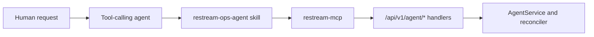
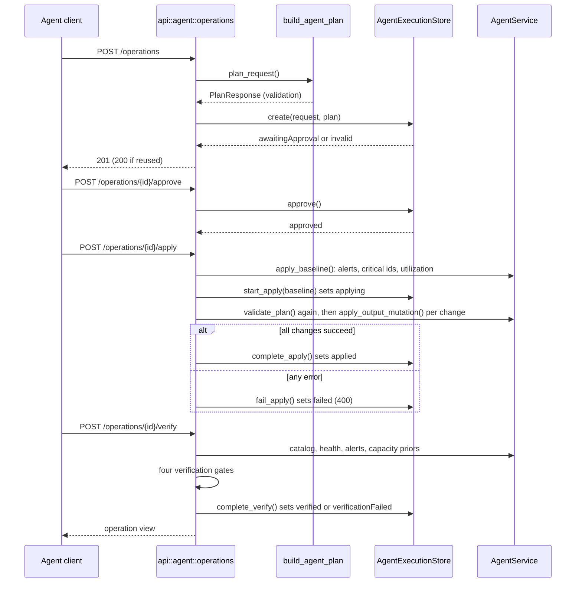
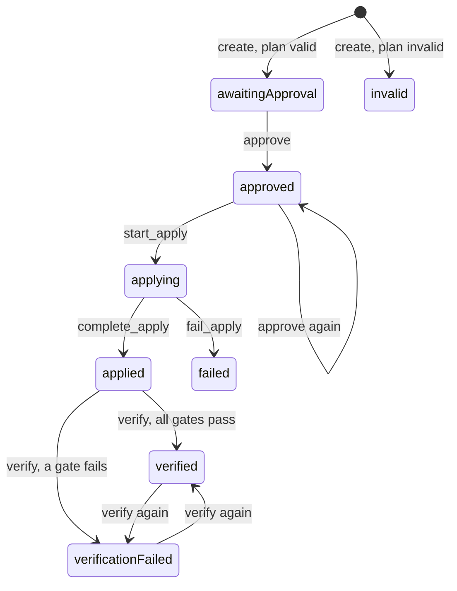
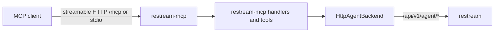

# Agent plane, MCP, and skill integration

The agent plane is Restream's task-oriented, redacted, approval-gated surface
for external agents. This page owns the integration contract: layering, the
operation flow and states, safety rules, and the MCP sidecar. The
[API reference](api-reference.md#agent-plane) owns route request and response
detail.

## Contents

- [Recommended layering](#recommended-layering)
- [Browser boundary](#browser-boundary)
- [Ownership split](#ownership-split)
- [Why agents use the agent plane](#why-agents-use-the-agent-plane)
- [Contract owners](#contract-owners)
- [Safe workflow](#safe-workflow)
- [Operation lifecycle](#operation-lifecycle)
- [Shared Rust implementation](#shared-rust-implementation)
- [MCP server architecture](#mcp-server-architecture)

## Recommended layering

This diagram shows how a human request reaches the media runtime.



The wrapper stays thin. Safety and product behavior are enforced once, inside
Restream.

## Browser boundary

The dashboard is not an agent client. Operator workflows use the
authenticated control-plane API.

Do not couple dashboard reads or mutations to the agent routes.

## Ownership split

| Layer | Owns | Must not own |
|---|---|---|
| Agent plane | redaction, validation, planning, approval state, apply, verification | transport-specific MCP behavior |
| MCP transport | authentication handoff, tool exposure, request/response transport | business validation or alternate approval semantics |
| Repository skill | investigation and mutation sequence, stop conditions, human interaction | raw control-plane mutation shortcuts |
| Dashboard | direct human operator workflows | hidden agent execution |

Product policy lives in one place. An MCP wrapper or prompt cannot redefine
success.

## Why agents use the agent plane

The control plane exposes object-oriented pipeline, output, setting, alert,
and diagnostic operations. The agent plane exposes task-oriented, redacted,
approval-aware workflows.

External agents use the agent plane for investigation and mutation planning.
They must not bypass it with raw output or pipeline mutation routes when an
approval-gated agent operation is required.

## Contract owners

- [API reference](api-reference.md#agent-plane) owns the HTTP routes and
  response shapes.
- [MCP tool contract](agent-guidance/skills/restream-ops-agent/references/tool-contract.md)
  owns the tool-to-route map, JSON request examples, supported change kinds,
  and interpretation rules.
- [Restream ops agent skill](agent-guidance/skills/restream-ops-agent/SKILL.md)
  owns the agent sequence and approval stop conditions.
- This page owns the operation flow, states, invariants, and the MCP sidecar.

## Safe workflow

All `/api/v1/agent/*` routes require an authenticated dashboard session
(`require_authenticated` in each handler). A mutation workflow has five steps:

1. Discover capabilities (`GET capabilities`) and read redacted context
   (`GET context`).
2. Investigate (`POST investigations`), plan (`POST plans`), validate
   (`POST plans/validate`), or preview graph impact
   (`POST graph-diff-preview`). None of these mutate or store anything.
   With a `pipelineId`, the plan's `graphPreview.topology` shows the
   [topology preview](#topology-preview).
3. Create an operation (`POST operations`).
4. Stop for explicit human approval (`POST operations/{id}/approve`).
5. Apply (`POST .../apply`), then verify (`POST .../verify` or
   `POST verify` with `operationId`).

Stop on validation failure, missing approval, apply failure, or failed
verification.

## Operation lifecycle

`AgentExecutionStore` in `crates/restream-agent/src/execution.rs` holds operation state. The
handlers in `src/api/agent/operations.rs` drive it and perform the runtime
mutation through `AgentService::apply_output_mutation`.

### Flow

This diagram shows one operation from create to verify.



### States

`OperationStatus` has eight values (serialized in camelCase). This diagram
shows the transitions the store allows.



`complete_verify` checks status while holding the operation store's lock.
Only `applied`, `verified` and `verificationFailed` can become `verified`
or `verificationFailed`. Other states are refused without changing the
record.

### Invariants

- Every operation requires approval (`approvalRequired` is always `true`).
- Apply only starts from `approved`. Approve only succeeds from
  `awaitingApproval` or `approved`.
- Apply revalidates the plan against the current catalog. A plan that is no
  longer valid fails the operation.
- Changes apply in order. There is no rollback: on an error, earlier changes
  stay applied and the operation is `failed`.
- Supported change kinds at apply: `addOutput`, `updateOutput`,
  `removeOutput`, `startOutput`, `stopOutput`.
- Each change has a minimum approver role (`actions[i].requiredRole`):
  `removeOutput` needs `admin`, because a removed destination's URL and
  stream key are gone; every other kind needs `operator`. `POST
  /api/v1/agent/operations/{id}/actions/{index}/approve` (`{"reason"?}`)
  approves one change as the session's member at its effective role (a
  session viewing as a lower role approves as that role). The operation
  becomes `approved` with its last change. `POST …/approve` approves every
  change at once and needs the most demanding change's role.
- A role below a change's minimum answers `403` with `requiredRole` and
  `effectiveRole`, changes nothing, and is recorded in the team audit log
  like any refused change. Each change keeps its own approval
  (`actions[i].approval`: `approvedBy`, `role`, `reason`, `approvedAt`).
- `approval.approvedBy` is the member that completed the approval; the
  request's `approvedBy` is stored as `claimedBy`, an unverified audit
  label.
- `actor` and `agentId` are `dashboard-admin`; `toolIdentity` is
  `agent-execution-api`.
- Every operation view, execution result, and verification result passes
  through `redact_secrets`.
- Each step appends an `auditLog` event: `created`, `invalid`,
  `actionApproved`, `approved`, `applyStarted`, `applyCompleted`,
  `applyFailed`, `verified`.

### Idempotency

- `idempotencyKey` is optional. With a key, create hashes the request plus
  the plan hash (SHA-256).
- Same key, same hash: the stored operation returns with `200`.
- Same key, different hash: `409 idempotencyConflict`.
- Records and the key index share one mutex, so concurrent creates with one
  key cannot both insert.
- Operation ids are `op_` plus 16 hex characters from a SHA-256 of time,
  request, and random bytes.

### Store limits

- The store is in memory. Operations do not survive a restart.
- It keeps at most 1024 operations (`MAX_AGENT_EXECUTION_RECORDS`). Past the
  limit it evicts finished ones first (`invalid`, `verified`,
  `verificationFailed`, `failed`), then pending ones (`awaitingApproval`,
  `approved`, `applied`), then `applying`; oldest first within each group.
  Eviction also drops the idempotency key.
- `POST /api/v1/agent/operations` takes at most 256 KiB of body
  (`AGENT_OPERATION_BODY_LIMIT_BYTES` in `src/api/router.rs`), because the
  store keeps the whole request.

### Errors

`operation_store_error` maps store errors to `{ "error", "code" }`:

| Code | HTTP | When |
|---|---|---|
| `operationNotFound` | 404 | unknown or evicted id |
| `idempotencyConflict` | 409 | key reused with a different request |
| `operationInvalid` | 409 | approve or apply on `invalid` |
| `approvalRequired` | 409 | apply on `awaitingApproval` |
| `alreadyApplying` | 409 | approve or apply on `applying` |
| `alreadyTerminal` | 409 | approve or apply on `applied`, `verified`, `verificationFailed`, `failed` |

Apply failure returns `400` with the `failed` operation view. Without the
`agent-plane` or `agent-execution` feature the routes return `404` with
`compiledIn: false`.

### Verification gates

Verify first runs one check per change against persisted output state and
runtime health. Check reasons include `running`, `stopped`, `persisted`,
`removed`, `pendingInput`, `notRunning`, `stillRunning`, `stillPresent`,
`outputMissing`, `desiredStateMismatch`, `retriesExhausted`, and
`unsupportedChangeKind`.

Then four gates (`crates/restream-agent/src/plane/verify_gates.rs`) decide `success`. Each
gate is `{ gate, passed, detail }` in the result's `gates` array. All four
must pass for `verified`.

| Gate | Passes when |
|---|---|
| `desiredState` | every per-change check passed |
| `outputsRunning` | every output the apply set running is running |
| `newCriticalAlerts` | no critical alert on a changed pipeline is open now that was not open at apply start (compared by alert id) |
| `capacityState` | the hottest service center's projected utilization is below the safe limit, or was already at or above it before apply |

The baseline is taken when apply starts (`ApplyBaseline` in
`crates/restream-agent/src/execution.rs`). The operation view shows it as
`preApplyAlertCount`, `preApplyCriticalAlertIds`, and
`preApplyProjectedUtilization` (`null` before apply). Capacity uses the
host-wide calibration priors, so a change on another pipeline between apply
and verify can fail `capacityState`.

The result also reports `postChangeHealth`, `freshnessRecovery`,
`graphConvergence`, and `incidentDelta` (all-alert count before and after).
These are reported, not judged.

### Topology preview

`topology_diff` (`crates/restream-agent/src/plane/topology.rs`) fills
`graphPreview.topology` in plan responses. It covers only the request's
`pipelineId`; without one it is `null`, and changes on other pipelines are
left out. Fields:

- `pipelineId`, and `ingestCodec`: the live ingest's video codec, or `null`
  without a live ingest.
- `before` and `after`: rows of `{ stage, protocol, outputs }`, counting
  wanted-running outputs by the stage they read (for example `source` or
  `video:720p:codec:h264`) and egress protocol.
- `addedStages`: stages beyond the source that the change would start.
- `retiredStages`: stages no wanted output would read after the change.

## Shared Rust implementation

The `restream-mcp` sidecar uses the shared `AgentBackend` trait
(`crates/restream-agent-contract/src/backend.rs`) and calls the product HTTP
surface. MCP is a transport adapter, not a second implementation of planning
or execution policy. `HttpAgentBackend` is the only backend; there is no
in-process MCP backend. `crates/restream-agent-contract/src/tools.rs` holds
the one tool list that both capability discovery and the MCP catalog follow.
The `restream-mcp` crate depends on the contract crate, not on `restream`.

## MCP server architecture

### Current shape

This diagram shows how an MCP client reaches the agent plane.



The sidecar supports streamable HTTP and stdio. The default HTTP bind is
`127.0.0.1:4040`.

### Tool contract

The catalog in `crates/restream-mcp/src/tools.rs` has eleven tools:
`get_agent_capabilities`, `get_agent_context`,
`investigate_pipeline_issue`, `plan_pipeline_change`, `validate_change`,
`preview_graph_diff`, `create_agent_operation`, `get_agent_operation`,
`approve_agent_operation`, `apply_agent_operation`, and
`verify_agent_operation`. `POST /api/v1/agent/verify` has no separate tool.
Print the compiled catalog with schemas:

```sh
./restream-mcp --print-tools
```

### Build and run

```sh
cargo build \
  --bin restream-mcp \
  --features mcp-server,mcp-http-backend
```

With `restream` on its default HTTP address, start streamable HTTP (endpoint
`/mcp`):

```sh
RESTREAM_AGENT_SESSION_COOKIE='session=<value>' \
  target/debug/restream-mcp --bind 127.0.0.1:4040
```

For a client that launches its server over stdio:

```sh
RESTREAM_AGENT_SESSION_COOKIE='session=<value>' \
  target/debug/restream-mcp --stdio
```

### Authentication and compatibility

| Variable | Effect |
|---|---|
| `RESTREAM_AGENT_BASE_URL` | Target server; default `http://127.0.0.1:3030` |
| `RESTREAM_AGENT_SESSION_COOKIE` | Session cookie to forward; wins if set |
| `RESTREAM_AGENT_BEARER_TOKEN` | Bearer token, for a compatible auth boundary |
| `RESTREAM_MCP_VERSION_CHECK` | `strict` (default), `warn`, or `off` |
| `RESTREAM_MCP_ALLOWED_ORIGINS` | Comma-separated origin allowlist for HTTP |

If the cookie variable is set but empty, no credential is sent (the bearer
token is not tried). Protect these values and use TLS for a remote server.

Before serving, the sidecar checks the target's build identity and
capabilities. `strict` exits on mismatch; `warn` logs and continues; `off`
skips the check. Use `off` only for deliberate compatibility testing. An
empty origin list does not grant a wildcard browser origin.

### Feature boundaries

`agent-execution` (which enables `agent-plane`) is in the default build. The
MCP features are opt-in; on `restream` they enable the `restream-mcp` crate
and its features of the same name.

| Feature | Adds |
|---|---|
| `agent-plane` | Agent read and planning API (default) |
| `agent-execution` | Approval-gated operation execution (default) |
| `mcp-core` | The `restream-mcp` crate: tool catalog, handlers, transports |
| `mcp-server` | The `restream-mcp` binary target |
| `mcp-http-backend` | HTTP adapter to `/api/v1/agent/*` |
| `mcp-embedded` | Compile combo of `mcp-core` + `agent-plane` |

`restream-mcp` requires `mcp-server` and `mcp-http-backend`
(`crates/restream-mcp/Cargo.toml`).

### Embedded mode

There is no in-process MCP backend. `mcp-embedded` only compiles `mcp-core`
with `agent-plane`; it does not mount an MCP transport in the main `restream`
binary. Use the `restream-mcp` sidecar.

### Source ownership

| Path | Responsibility |
|---|---|
| `crates/restream-agent-contract/` | Backend trait, request types, errors, tool list |
| `crates/restream-mcp/src/http.rs` | `HttpAgentBackend` |
| `crates/restream-mcp/src/` | Tool catalog, handlers, auth context, transports |
| `crates/restream-mcp/src/main.rs` | CLI, environment, compatibility check |
| `crates/restream-agent/src/plane.rs`, `crates/restream-agent/src/plane/` | Redaction, investigation, planning, validation, graph and topology preview, verification gates |
| `crates/restream-agent/src/execution.rs` | Operation store, states, idempotency, audit log |
| `src/api/agent.rs`, `src/api/agent/` | Authenticated HTTP handlers, apply and verify |
| `Cargo.toml` | Feature graph and binary requirements |
