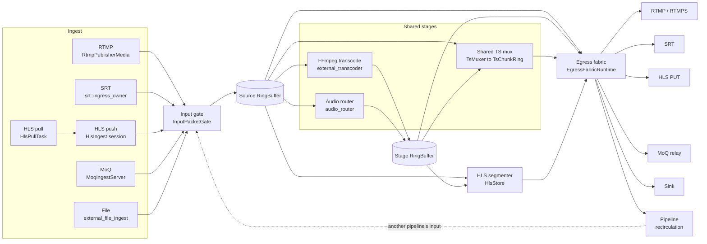
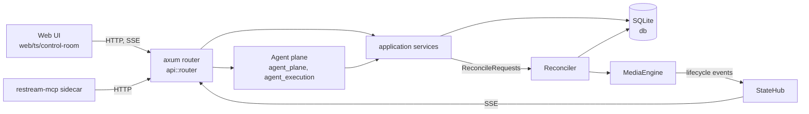
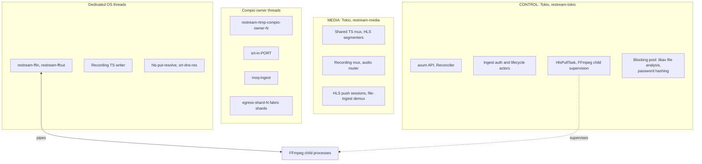
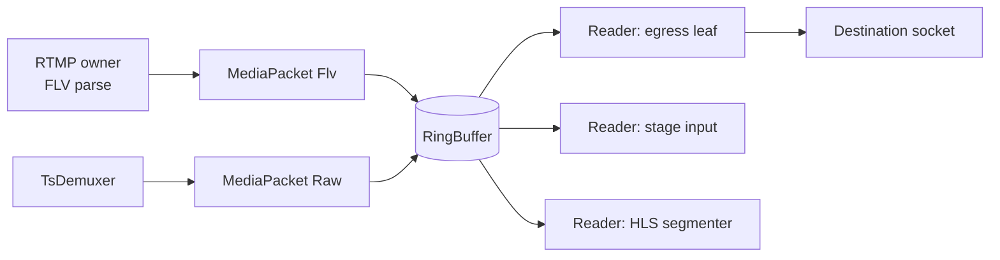
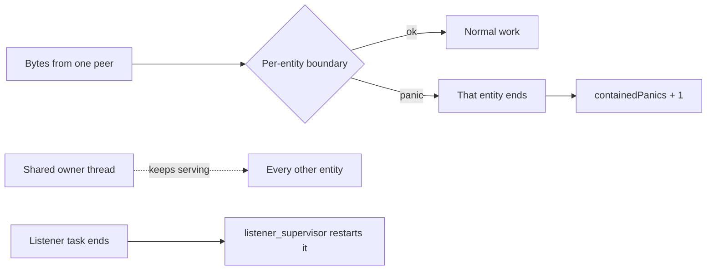
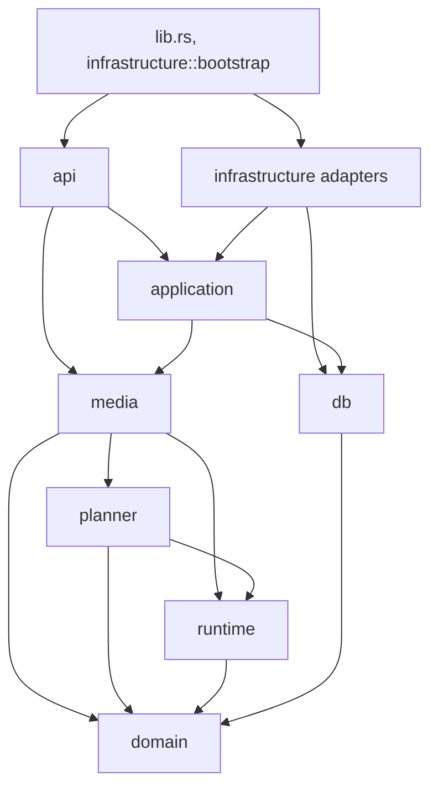

# Architecture

Restream is one Rust process. It owns the control plane (API, dashboard,
SQLite state, reconciler) and the production media path (ingest, packet rings,
shared stages, egress). FFmpeg runs as child processes for codec work.
MediaMTX is a peer in the live test harness only; Restream does not need it.

## Contents

- [Restream at a glance](#restream-at-a-glance)
- [Runtime ownership](#runtime-ownership)
- [Input selection](#input-selection)
- [Packets, rings and containers](#packets-rings-and-containers)
- [Shared processing stages](#shared-processing-stages)
- [Lifecycle and recovery](#lifecycle-and-recovery)
- [State and authentication](#state-and-authentication)
- [Dataplane invariants](#dataplane-invariants)
- [Layer ownership](#layer-ownership)
- [Key source areas](#key-source-areas)

## Restream at a glance

The data plane moves media from ingest listeners to outputs. Each pipeline
has one source `RingBuffer`. Shared stages read it and write their own rings.
The egress fabric reads rings and sends to destinations.

This diagram shows the media path from each ingest protocol to each output
kind.

| Ingest | Entry | Container in |
|---|---|---|
| RTMP | TCP listener, default port 1935 | FLV tags |
| SRT | UDP listener, default port 10080 | MPEG-TS |
| HLS push | `PUT`/`POST` under `/ingest/hls/{stream_key}/` on the HTTP port | MPEG-TS or fMP4 segments |
| HLS pull | Restream fetches a remote live playlist | MPEG-TS or fMP4 segments |
| MoQ | QUIC or WebTransport listener; off unless `RESTREAM_MOQ_INGEST_LISTEN` is set | moq-lite + hang catalog |
| File | FFmpeg child reads a media-library file | MPEG-TS on a pipe |

Outputs are `ProtocolSpec` values (`src/media/egress/command.rs`): `Rtmp`
(with `tls` for RTMPS), `Srt`, `HlsPut`, `Moq`, `Sink` (discard, for load
tests) and `Pipeline` (publish into another pipeline's input). Recording and
HLS preview also read the rings; they are not fabric outputs. The MoQ origin
serves pipelines to direct subscribers from the MoQ ingest thread
(`media::moq::origin`). MoQ on this branch is phase 1: moq-lite with the hang
catalog.

The control plane decides what runs. It never carries media packets.

This diagram shows how a change travels from a user to the media engine.

The API persists desired state in SQLite and asks for a reconcile pass. The
reconciler compares the rows with the engine's runtime state and starts,
stops or retries media work. See
[Lifecycle and recovery](#lifecycle-and-recovery).

## Runtime ownership

Each kind of work has one execution class. Ingest media never takes a
per-packet hop through Tokio. Codec work never runs on an I/O reactor.

This diagram shows which thread family runs which component.

| Class | Threads | Default size | Override | Owns |
|---|---|---|---|---|
| CONTROL | `restream-tokio` | all CPUs up to 2, else `ceil(C/3)` in `[2, 8]` | `RESTREAM_TOKIO_WORKER_THREADS` | API, reconciler, database, auth, ingest lifecycle, HLS pull fetches, child supervision |
| MEDIA | `restream-media` | `clamp(C, 1, 4)` | `RESTREAM_MEDIA_WORKERS` | continuous container work (`MediaServiceClass`): shared TS mux, HLS TS and fMP4 segmenters, recording, audio router, file-ingest demux, HLS push sessions |
| RTMP ingress | `restream-rtmp-compio-owner-<i>` | 1 | `RESTREAM_RTMP_INGRESS_OWNERS` (1–64, one `SO_REUSEPORT` listener each) | sockets, handshake, chunk parsing, AMF, and inline ingest media |
| SRT ingress | `srt-in-<port>[-<i>]` | 1 | `RESTREAM_SRT_INGRESS_OWNERS` | one srt-rs Compio `Owner` each; demux and ring publish inline |
| MoQ ingest | `moq-ingest` | 1 when enabled | `RESTREAM_MOQ_INGEST_LISTEN` | QUIC endpoint, sessions, frame conversion, ring push, MoQ origin |
| Egress fabric | `egress-shard-<n>` | grows with load, at most `clamp(C, 2, 8)` per fabric | `RESTREAM_EGRESS_SHARDS` (ceiling) | one fabric per feed and protocol (per HLS store for HLS PUT); RTMP/RTMPS, SRT, HLS PUT and MoQ shards each run a Compio runtime |
| OS threads | `restream-ffin`, `restream-ffout`, recording writer, resolvers | per stage or per fabric | — | blocking FFmpeg pipes, disk writes, DNS |

`C` is the host's CPU count from `HostCapacity` (`src/capacity.rs`): the
affinity mask and root cgroup `cpu.max` quota, read once at boot.
`/metrics/system` reports it as `hostCapacity`. The full list of runtime
variables is in [Configuration](configuration.md).

Ownership rules:

- **Transport stays on its owner.** Each SRT, RTMP, RTMPS and MoQ connection
  keeps its socket, protocol state, timers, buffers, I/O completions and
  teardown on one Compio thread. RTMPS keeps that owner through the rustls
  handshake and kernel TLS.
- **Only typed messages cross to Tokio.** Bounded control and lifecycle
  messages, snapshots and shared media buffers may cross. Raw sockets, borrowed
  file descriptors, Tokio network wrappers and Tokio duplex streams must not.
- **Ingest media runs inline.** RTMP, SRT and MoQ owners run classification,
  timestamp mapping, standby GOP, input gate and ring publication themselves.
  Tokio handles authentication, registration, the one-time media probe and
  disconnect bookkeeping.
- **io_uring is required.** The RTMP ingress, SRT ingress and egress-fabric
  runtimes force the io_uring driver and fail at startup without it. There
  is no fallback to Tokio or epoll.
- **HLS PUT** runs on egress-fabric shards by default.
  `RESTREAM_HLS_PUT_FABRIC=0` uploads from Tokio with Reqwest instead. Both
  use one upload policy (`media/hls/upload_policy.rs`).
- **No pinning.** Restream does not pin thread families to CPUs. CPU and
  NUMA placement is a deployment choice.

Thread and child-process entry points catch panics or child failure, report
status and cancel their stage. They do not stop the server.

[Runtime crossings](runtime-crossings.md) lists every Compio, Tokio and FFmpeg
crossing with its bound. [Media pipeline](media-pipeline.md) shows the
per-protocol thread and memory path.

## Input selection

A pipeline has up to four inputs (`MAX_PIPELINE_INPUTS`). An input is either
`Keyed` or `HlsPull` (`PipelineInputSourceKind`). A keyed input waits for a
publisher that presents its stream key over RTMP, SRT, HLS push or MoQ. An
HLS pull input fetches a remote origin.

Only the selected input reaches the source ring. Standby inputs still
receive, parse, probe and collect metadata, and can feed an input-scoped HLS
preview. Outputs and stages see one source.

Promotion is serialized per pipeline:

1. The current gate rejects new packets and drains its packet lease.
2. The target gate is armed.
3. RTMP, SRT, MoQ and recirculation inputs replay their retained GOP from the
   cached keyframe (`StandbyGopCache`, default 16 MiB and 2,048 packets).
   Without a complete cached GOP, the input starts at its next video keyframe.
4. One timestamp offset (`InputTimestampMapper`) makes the first DTS follow
   the previous writer's last DTS. Composition offsets are kept.

The ring stays single-writer, and timestamps never go backwards across
handoffs.

## Packets, rings and containers

`MediaPacket` (`src/media/packet.rs`) carries media type, track, PTS, DTS,
keyframe flag, payload format and reference-counted bytes. Producers set
`PayloadFormat` explicitly:

| Producer | Format | Payload |
|---|---|---|
| RTMP ingest | `Flv` | FLV audio or video tag body |
| MPEG-TS demux (SRT, file ingest, FFmpeg stage output, HLS TS segments) | `Raw` | Elementary audio, Annex B video |
| fMP4 demux (HLS fMP4 segments) | `Raw` | Elementary payload |
| MoQ ingest | `Raw` | Elementary payload from hang frames |

Consumers branch on the format. They never guess from the bytes. MPEG-TS
packaging strips FLV framing. RTMP egress passes `Flv` payloads through and
wraps `Raw` payloads into FLV tags (`rtmp::egress_payload_cache`).

This diagram shows how packets flow through a ring to independent readers.

Ring rules:

- Each `RingBuffer` is single-producer, multi-consumer.
- Each reader has its own cursor. One destination never consumes another
  destination's packets.
- A lagging reader that overflows resumes at a keyframe.
- Capacity and overflow are owned by `src/media/ring_buffer.rs` and
  `src/config.rs`.

SRT outputs share one MPEG-TS packaging per feed: the shared TS mux writes
`TsChunkRing`, and each SRT leaf keeps only its cursor and socket state.
Async-to-blocking boundaries, such as the recording writer, use a bounded
`MemoryQueue` (`src/media/avio.rs`).

Timestamp rules:

- Media PTS and DTS stay separate from wall-clock time.
- RTMP video timestamps are DTS; the signed FLV composition offset gives PTS.
- MPEG-TS muxing keeps DTS monotonic in container time bases.
- A transcoder starts a new packet timeline. Source packet identity does not
  continue through it.

Protocol details are in [Media pipeline](media-pipeline.md).

## Shared processing stages

Outputs with the same typed stage identity share one stage. A stage owns its
output ring and lifecycle token. Each destination owns its own connection and
sender state.

Stage kinds are `StageKind` values (`src/domain/stage.rs`).
`planner::select_backend` picks how each one runs:

| Stage | Runs as |
|---|---|
| `VideoPreset` | FFmpeg child (`external_transcoder`) |
| `CodecEdge` (HEVC to H.264) | FFmpeg child |
| `AudioRoute`, track selection or passthrough | Native packet routing on MEDIA (`audio_router`) |
| `AudioRoute`, remap or downmix | FFmpeg child |
| `HlsSegmenter`, `Hls` | MEDIA (`hls::segmenter` writes `HlsStore`; `hls::fmp4` writes `Fmp4HlsStore`) |
| `Recording` | MEDIA mux, then a dedicated writer thread |
| Shared TS mux (keyed per feed, not a `StageKind`) | MEDIA (`srt::shared_muxer`), writes `TsChunkRing` |

HLS preview reads the source ring. For HEVC input it reads the shared
HEVC-to-H.264 `CodecEdge` instead of starting its own transcoder.

For an FFmpeg stage, the `restream-ffin` thread reads the input ring, muxes
MPEG-TS (`TsMuxer`) and writes FFmpeg's stdin. The `restream-ffout` thread
demuxes stdout (`TsDemuxer`) into the stage ring.

Each consumer (egress, HLS preview, SRT player) holds a `StageLease` on every
stage it reads. The last lease to drop stops the stage
(`src/media/stage_lease.rs`). Stage identity is owned by
`src/domain/stage.rs`; do not rebuild its keys in another layer.

## Lifecycle and recovery

Every mutation takes one path:

1. An API or agent handler persists the change.
2. It requests a pass (`application::topology::ReconcileRequests`).
3. The reconciler (`src/infrastructure/bootstrap/reconcile.rs`) converges.

Handlers never tear down or switch runtime state themselves. A crash between
steps is fixed by the next pass, because the rows stay authoritative.

Each output pass (`converge_topology` plus egress start, stop and retry):

- applies a requested input promotion first, from its persisted row;
- stops egresses whose output row is gone;
- tears down the ingest sessions, file-ingest children, ring, stages and HLS
  state of a deleted pipeline.

The output pass runs only when something asks for it:

- a successful mutating HTTP request (one middleware covers every handler);
- an engine lifecycle event (ingest connect or disconnect, egress stop);
- a deadline the pass set itself (retry backoff end, ingest-disconnect grace
  end);
- a backstop every 10 reconcile intervals.

Passes are at least one interval apart (`RESTREAM_RECONCILE_INTERVAL_MS`).
A request after a quiet interval runs at once. A deadline only wakes the
pass, which re-reads current state, so a stale deadline cannot act on old
state. An egress error is not a trigger; the egress's stop is.

Housekeeping that reads no outputs runs every interval: sessions, fabric
sizing, recordings, idle HLS and file-ingest reaping. The pass does not manage
shared stages; leases do.

Failure isolation rules:

- Malformed media or a destination failure must not crash the engine.
- A child process, blocking sender or codec thread reports failure to its
  owning stage.
- Teardown cancels dependents before it removes shared state.
- File-ingest children are tracked and reaped.
- HLS state is in memory. The MPEG-TS `HlsStore` keeps `max_segments`
  (default 20) and drops matching variant-cache entries. fMP4 preview keeps
  `max_segments + 6` and advertises `max_segments`. Segment count is bounded;
  segment size is not: the MPEG-TS accumulator grows until the next keyframe
  splits the segment.

### Fault domains

One publisher or destination must never affect another. One thread serves
many entities, so each entity has a panic boundary where its bytes enter:

| Entity | Boundary | On panic |
|---|---|---|
| Egress output | `egress::visit::visit_leaf` | That output fails (`engine_panic`, retryable). The shard keeps serving the rest |
| RTMP ingest connection | Connection future in `rtmp::listener::run_compio_owner` | That connection closes. Its parser charge and gate lease drop with it |
| SRT ingest peer | `srt::ingress_owner::OwnerLoop::contain_peer_media` | That peer's media state is discarded without flush and the peer is disconnected. Its Owner byte budget share returns |
| RTMP and SRT listener | `bootstrap::listener_supervisor` | A listener that ends without shutdown restarts after 1 s, doubling to 30 s; the delay resets after 60 s of healthy running |

This diagram shows what a contained panic ends and what keeps running.

Rules for code behind a boundary:

- Shared state must stay valid after an unwind: atomics, poison-tolerant
  locks, RAII guards, per-entity state dropped with the entity. Insert
  per-entity state into its owning map before work that can unwind.
- Never drop a pending Compio I/O future in a losing `select!` branch. Its
  completion (an accepted socket, received bytes) is lost with it. Keep the
  operation in flight until it completes.
- Keep counters outside `tracing` macros. Their fields are not evaluated when
  the level is disabled.

`/api/v1/engine/health` reports `containedPanics`, `rtmpListener.restarts`,
`srtListener.restarts`, `rtmpListener.ingressOwners` and
`srtListener.ingressOwner.owners` (0 while a listener is stopped). Shared
resources and their per-entity bounds are in the
[isolation audit](isolation-audit.md). Proof expectations are in
[Concurrency proofing](concurrency-proofing.md) and the
[stage boundary proof map](testing.md#stage-boundary-proof-map).

## State and authentication

SQLite (`src/db/`, sqlx) stores pipelines, inputs, outputs, file ingests,
settings, recordings, sessions, jobs and logs. It never carries media. The
dashboard and API use cookie sessions. The initial admin password comes from
`RESTREAM_INITIAL_ADMIN_PASSWORD`, or is generated into
`restream-initial-admin-password.txt` (mode 0600) beside the database. SQLite
stores only its scrypt hash.

The HTTP listener binds `127.0.0.1` by default. A deployment that exposes it
must supply TLS and the network boundary. See [Configuration](configuration.md).

## Dataplane invariants

These are constraints, not suggestions.

| Area | Invariant |
|---|---|
| Ownership | Fixed shard ownership. No OS thread, task, UDP socket or runtime per connection, SRT caller or output. One Compio runtime per SRT shard, with at most one SRT `Owner` per address family |
| Media | Bounded shared feeds read by cursor. No per-output media queue. A slow output cannot pin shared retention forever. Media buffers are immutable and shared where possible |
| Scheduling | Bounded work budgets. Explicit ready and deadline scheduling. No population scans or run-to-quiescence loops on hot scheduler paths. Each `Owner` is serviced once per ready batch, not once per leaf. Completions and events carry exact identity and are generation-safe |
| Protocol | Preserve SRT wire behavior, protocol deadlines (separate from scheduling deadlines), stream-id admission, encryption, bonding and exact peer and group identity |
| Runtime | The io_uring production path fails closed. No hidden fallback to Tokio or poll. `RawReadiness` is a receive mode inside a working Compio io_uring runtime, not an alternative to it. `ManagedPreferred` stays the production policy |
| Replacement | When a replacement path lands, delete the old one in the same change. Keep behavioral contracts, not old structure. No dual runtimes |

[High-performance data path](high-performance-data-path.md) explains how to
measure them, and [Egress architecture](egress-architecture.md) applies them
to the fabric.

## Layer ownership

Move behavior to its owner before adding an abstraction.

This diagram shows which layers each layer imports. Imports point down;
none point back up.

| Layer | Owns | Does not own |
|---|---|---|
| `domain` | IDs, validation, typed configuration, shared vocabulary | SQL, HTTP shapes, sockets, runtime registries |
| `application` | Workflows across persistence and runtime; ports (`application::ports`) | HTTP transport, packet processing |
| `db` | Schema-aware queries and row mapping | Runtime policy, orchestration |
| `media` | Protocols, packet transforms, hot-path storage, media lifecycle | API JSON, persistence |
| `api` | Authentication, request validation, HTTP and SSE responses | Persistence policy, media internals |
| `infrastructure` | SQLite adapters, service wiring, bootstrap tasks | Domain policy |
| `agent_core` | Agent contracts shared by the agent plane and MCP | Transport, persistence, runtime |

`application::ports` with SQLite adapters in `infrastructure::sqlite_ports`
is the target shape. Some application modules (for example
`application::outputs` and `application::topology`), bootstrap reconcile and
egress tasks, and `src/logging.rs` still call `crate::db` with a pool.

### Layering rules

- `domain` depends only on itself, std, serde and URL parsing.
- `planner` does not import `application`, `media`, `api`, `db`, `config`,
  axum, sqlx, Tokio or the environment.
- `runtime/graph.rs`, `runtime/output.rs` and `runtime/stage.rs` do not import
  `media`, `application`, `api`, sqlx, axum or `serde_json`.
- `media` does not import `api`. `db` does not import `application`.
  `application` does not use axum.
- `agent_core` does not import `agent_plane`, `application`, `media`,
  Reqwest, axum or sqlx.
- API handlers stay thin. Agent orchestration lives in
  `application::services::agent_service`. API modules do not start FFmpeg or
  transcoder stages.
- Only approved owners read environment variables (mainly `src/config.rs`).
- Split files by ownership, not by size. A file near the 999-line limit is a
  sign to find the owner, not to cut it in half.
- Measure rebuild, reuse or isolation value before proposing a new crate.

`cargo xtask source-audit` (`crates/xtask/src/source_audit.rs`) enforces the
file-size limit, environment readers, API stage starts and media-to-API
imports. The architecture tests enforce the import rules:
`tests/domain_layering.rs`, `tests/architecture_compliance.rs`,
`tests/runtime_contract_architecture.rs`,
`tests/service_wiring_architecture.rs` and `tests/transport_architecture.rs`.
To change a boundary, update the check, its test and this page in one change.
The [layering audit skill](agent-guidance/skills/layering-audit/SKILL.md)
owns the audit procedure.

## Key source areas

| Source area | Responsibility |
|---|---|
| `src/main.rs`, `src/lib.rs`, `src/infrastructure/` | Process bootstrap, runtime construction, service wiring, reconciler |
| `src/api/` | Router, authentication, REST and SSE handlers, HLS push upload, embedded assets |
| `src/application/` | Control-plane workflows, ports, topology requests |
| `src/domain/` | IDs, output specs, stage identity, validation |
| `src/db/` | SQLite schema and repositories |
| `src/planner/` | Pure stage-graph planning |
| `src/runtime/`, `src/api_runtime_views/` | Runtime contracts and operator snapshots |
| `src/media/engine*.rs` | `MediaEngine`: media lifecycle, registries, fabric retention, snapshots |
| `src/media/ring_buffer.rs`, `src/media/ts_chunk_ring.rs`, `src/media/avio.rs` | Bounded packet and byte transport |
| `src/media/rtmp/`, `src/media/srt/`, `src/media/mpegts/` | RTMP and SRT protocols, MPEG-TS mux and demux |
| `src/media/hls_ingest/`, `src/media/hls_pull/`, `src/media/ingest_publisher/` | HLS push and pull ingest, byte-stream ingest publishing |
| `src/media/moq/` | MoQ ingest, egress, origin and QUIC transport |
| `src/media/egress/` | Egress fabric: shards, scheduler, leaf lifecycle, protocol backends. See [Egress architecture](egress-architecture.md) |
| `src/media/hls/`, `src/media/recording/` | HLS segmenting, preview, HLS PUT upload policy, recording |
| `src/media/external_transcoder/`, `src/media/ffmpeg/`, `src/media/audio_router.rs` | FFmpeg child stages, native audio track selection |
| `src/media/executor.rs` | MEDIA executor |
| `src/agent_plane/`, `src/agent_execution.rs`, `src/agent_core/`, `src/agent_backends/`, `src/agent_mcp/` | Agent planning and approval-gated execution, contracts, MCP server |
| `web/ts/` | Dashboard and control room source; `public/` is generated |
