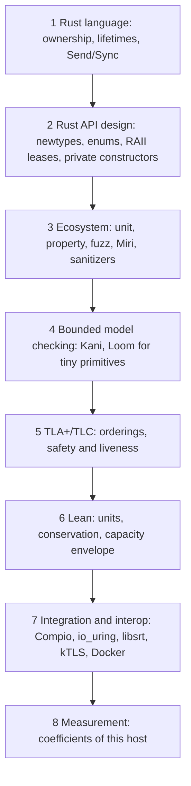

# Assurance roadmap

How Restream and srt-rs prove what they claim, ordered by cost, and where
each invariant belongs. [Concurrency proofing](concurrency-proofing.md) says
which gate to run; [testing](testing.md) lists the jobs. This page decides
what to build next.

## Contents

- [The rule](#the-rule)
- [The ladder](#the-ladder)
- [Where we are](#where-we-are)
- [Placement patterns](#placement-patterns)
- [Open work](#open-work)
- [Future rungs](#future-rungs)

## The rule

> **Every invariant lives at the lowest rung that can enforce it cleanly.**

In order of preference:

1. Delete duplicated state.
2. Make the invalid state unrepresentable.
3. Make mutation go through a capability (a lease, permit or handle).
4. Check the one primitive that owns the invariant.
5. Test only composition and external behavior.

Optimize for proof compression, not test deletion. Delete a test only when
the production API can no longer express the behavior it defends. If
hardening an invariant adds more machinery than the tests it replaces, do
not do it.

Rust is affine, not linear. A lease gives at-most-once ownership, but
`mem::forget` or an abort skips its `Drop`. Exact resource accounting must
tolerate a leaked token: a bounded leak, never a double release.

## The ladder

The diagram shows the rungs from cheapest to widest scope.

A higher rung is not a better one; each answers a different question.

| Rungs | Own | Question |
|---|---|---|
| 1–2 | structure | who owns what, and for how long |
| 3–4 | implementation | does this code keep its invariant over these inputs |
| 5 | time | which orderings are legal; does work finish |
| 6 | mathematics | what follows from the equations |
| 7–8 | physics | what this host and these peers really do |

Safe Rust is strong at spatial questions and weak at temporal ones (should
this event still be accepted, will this caller be served, does shutdown
end). That boundary is where to climb. A shared-nothing design (one owner
per connection, no connection mutex) removes whole bug families before any
checker runs.

## Where we are

| Rung | Restream | srt-rs |
|---|---|---|
| 1 Language | Compio Owners are `!Send` and thread-homed. `[lints]` in `Cargo.toml` deny `unsafe_op_in_unsafe_fn`, `unused_must_use` and `clippy::undocumented_unsafe_blocks`. FFI-free modules carry `#[forbid(unsafe_code)]` on their `mod` declaration. `src/lib.rs` refuses `panic = "abort"` builds. | Sans-I/O single-owner protocol core; `srt-lifecycle` forbids `unsafe`. |
| 2 API design | Per-entity panic boundaries and admission bounds ([isolation audit](isolation-audit.md)); locks only through poison-tolerant `crate::sync`. `ReadyQueue` owns membership; `LeafArena` resolves generational `LeafKey`s; `WorkBudget` debits itself; HLS persistent consumers hold a `PersistentLease`; the egress manager asks `CommandSink` for free slots. | Logical peer and caller ids, bounded caller pool, `DenseSlotArena`. |
| 3 Ecosystem | Property tests, live fault modes, eleven cargo-fuzz targets, narrow `miri` and `asan` jobs ([testing](testing.md#miri-and-addresssanitizer)). | proptests, cargo-fuzz, ASan in `cargo xtask ci`. |
| 4 Model checking | Nine Loom models in the concurrency gate; seven Kani proofs over `LeafArena`, `ReadyQueue` and `WorkBudget` ([testing](testing.md#kani-proofs)). | One Loom model (reuseport group); three Kani proofs over `DenseSlotArena`. |
| 5–6 TLA+, Lean | None. | None. |

## Placement patterns

Use the strong form wherever the weak form exists.

| Invariant | Weak form | Strong form |
|---|---|---|
| never zero | `usize` + tests | `NonZeroUsize` / `NonZeroU32` |
| exactly one lifecycle state | several booleans | one `enum` + one transition function |
| one owner of a resource | id + discipline | owned non-`Clone` capability |
| acquire and release paired | `add()` … `remove()` | RAII lease (`Drop` releases) |
| stale object never mutated | generation checks at each site | opaque generational handle resolved by the arena |
| queue never over capacity | `VecDeque` + caller `len` checks | bounded container with no unchecked insert |
| queued at most once | queue + external flag | queue owns membership |
| invalid config never runs | public fields + validation | private fields + validated constructor |
| units never mix | several `u64`s | newtypes (`Bytes`, `Packets`, `Generation`, `ShardId`) |
| untrusted bytes never panic | indexing + tests | slice patterns, `get`, checked arithmetic, module `deny` lints ([isolation audit](isolation-audit.md#findings) F6) |

Where Restream applies these today:

- **Generations.** `LeafArena` (`src/media/egress/leaf_arena.rs`) owns every
  shard's leaves; a `LeafKey` carries the slot epoch, bumped on removal.
  Events and completions for a removed leaf stop resolving even when the
  slot and fd are reused. One proptest and one Kani proof check the arena;
  `a_removed_leafs_late_event_does_not_reach_the_slots_next_output` checks
  the wiring. Output-keyed pending connects (DNS, Owner admission) keep a
  spec-generation check, because the output id is their identity.
- **Queue membership.** `ReadyQueue` (`src/media/egress/scheduler.rs`)
  records the key each slot queued; a duplicate push is a no-op and a stale
  epoch's entry is skipped.
- **Budgets.** `WorkBudget` (`src/media/egress/policy.rs`) keeps limits and
  spent counts private; engines call `debit_bytes`/`debit_unit` and ask
  `is_exhausted()`/`remaining_bytes()`. Per-engine budget tests stay: they
  check where each engine consults the budget.
- **Leases.** `PersistentLease` (`src/media/engine_hls.rs`) decrements on
  `Drop`.
- **Channel depth.** `CommandSink::free_slots`
  (`src/media/egress/manager.rs`) reads the bounded channel instead of a
  shadow counter.

Keep as they are: `LeafLifecycle` (one enum, one transition table), and
every test of external behavior (RTMP serialization, libsrt interop,
slow-peer isolation, Compio wakeups, kTLS handoff, capacity).

Practice:

- A counterexample from any checker becomes a deterministic Rust regression
  test with the same steps.
- A commit that changes an invariant names the rung that enforces it and the
  test that proves it.
- Fuzz belongs where external bytes enter. Theorem provers do not prove
  parser robustness.
- Hot-path changes need before/after benchmark or codegen evidence.

## Open work

### Rung 4: more Kani primitives

Small bounded state, one production function per proof, no framework.

| Repository | Primitive | Property for every bounded sequence | Status |
|---|---|---|---|
| Restream | `ReadyQueue` | membership ⇔ queued; each key at most once | proved |
| Restream | `LeafArena` | stale key never resolves, fills or removes (`get_mut` shares the filter but is not in the proof) | proved |
| Restream | `WorkBudget` | granted work never exceeds the budget | proved |
| srt-rs | `DenseSlotArena` | a stale handle never resolves; live ≤ capacity | proved |
| srt-rs | `DueIndex` / `DenseDueIndex` | entries and due results stay consistent through replace/remove | open |
| srt-rs | admission accounting, `CallerPool` | totals within limits; queued + in flight + free = capacity | open |
| srt-rs | sequence/window arithmetic | wrap and frontier operations stay valid | open |
| srt-rs | TX / permit pool | free + held + in flight = capacity | open |
| srt-rs | output-drain budget arithmetic | no underflow or overrun | open |
| srt-rs | packet-size and rate conversions | payload ↔ wire bytes, MAXBW | open |

CBMC also models the std containers. Keep keys concrete and make choices
symbolic: symbolic keys that reach `VecDeque` copies or `retain`, or a
removal at a symbolic index, exhaust memory or time. Keep fixed
allocations small under `cfg(kani)`.

Loom stays narrow: only cross-thread primitives left after the fixed-owner
design (wakes, snapshot swaps, shutdown signals, the reuseport barrier).

## Future rungs

Not scheduled. Each is worth doing at the point named.

### TLA+ (TLC first)

Small specs with 2–3 actors in `spec/tla/`, checked by TLC in CI:

- **`GenerationOwnership`**: no event for generation *g* mutates state of
  *g′ ≠ g*, across create, remove, reuse and every completion.
- **`OwnerScheduler`**: per-visit work ≤ budget; TX-slot conservation;
  under fairness a ready caller is eventually served.
- **`Reconciler`**: an older revision's result never installs; once desired
  state stops changing, runtime converges to it.
- **kTLS handoff** (if its lifecycle grows): data goes out in plaintext mode
  or after kTLS is installed, never both.
- **`Rescale`** (once live state can move): one owner per leaf; stale
  migration completions ignored.
- **Media ring and cursors** (deferred while ring semantics are stable).

Use a refinement mapping to keep models small. No TLAPS unless an unbounded
proof becomes necessary.

### Lean (when a capacity model gates admission)

A small `spec/lean/Capacity/` package: units and conversions, conservation,
monotone demand, the envelope lemma (max utilization < U_safe ⇒ every
resource < U_safe) and admission. Lean proves the equations; measurement
supplies the coefficients. Candidate theorems (10–20, not more): receiver
occupancy ≤ capacity; a stale completion never mutates a newer generation;
one visit never exceeds its budget; backpressure never reorders output; ring
memory stays bounded however slowly a destination reads; transactional
admission rolls back completely.

### Provenance of reported claims

Label each claim by how it is known: `PROVED`, `MODEL-CHECKED`,
`IMPLEMENTATION-CHECKED`, `OBSERVED`, `MEASURED`, `INFERRED`, `ASSUMED`. A
theorem has no confidence score; a capacity estimate does. A capacity model
that only computes (cores, shards, headroom, bottleneck) comes first; it
moves live state only after `Rescale` is model-checked.

Not planned: Verus, Prusti, Creusot, Coq or Isabelle; formal models of
Linux, Compio, TLS or the whole SRT protocol.
