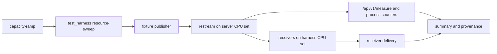

# Egress capacity ramp

Measure delivered fan-out, not just connected outputs. The ramp runs one
protocol and output count at a time, repeats each rung, and records the
highest rung where every repeat delivers to every destination.

## Contents

- [What it measures](#what-it-measures)
- [Run it](#run-it)
- [CPU and receiver placement](#cpu-and-receiver-placement)
- [Reading the results](#reading-the-results)
- [HLS PUT transports](#hls-put-transports)
- [Compare builds or hosts](#compare-builds-or-hosts)

## What it measures

The runner is [crates/xtask/src/capacity.rs](../crates/xtask/src/capacity.rs).
It invokes the resource-sweep harness for each rung. Default protocols are
RTMP, RTMPS, SRT and HLS PUT; `transcode` is an additional workload.

The workload separates the server from its measurement apparatus:



| Measurement | Meaning |
|---|---|
| Receiver delivery | Per-destination received bytes divided by offered bytes over the rated window; a destination passes at 0.95 or above |
| HLS PUT delivery | Every due segment arrives within the 3 s lag budget relative to the first receiver; not a byte-ratio grade |
| Worst interval ratio | Lowest sample-window delivery ratio, to expose short stalls |
| Jain fairness | Spread of delivery across destinations |
| Reported delivery | Restream's own delivery view, kept separate from receiver evidence |
| CPU | Average and peak usage; 100% means one CPU |
| Memory and threads | Restream RSS and thread count; see the resource sweep for child-process accounting |

A successful capped ladder establishes a lower bound, not maximum capacity.
Default ladders end at 1000 outputs except the transcode ladder. Use the
runner's help for exact ladders and all options.

## Run it

Use an otherwise idle Linux host and a worktree at the revision under test
(build and process rules: [AGENTS.md](../AGENTS.md#build-and-worktree-safety)).
The runner refuses live media and, by default, a dirty tree. It needs
`io_uring` and a file-descriptor limit of at least 65536; for RTMPS kTLS,
load the kernel `tls` module where required. Run it under the host
measurement lock:

```sh
flock -x /tmp/restream-host.lock cargo xtask capacity-ramp --help
flock -x /tmp/restream-host.lock cargo xtask capacity-ramp
```

The default builds real release binaries with `cargo xtask build-release`
in `target/qual-release/`. `CAPACITY_BUILD_PROFILE=bench` selects the
inner-loop binaries; do not substitute those for committed release
performance evidence. `CAPACITY_SKIP_BUILD=1` reuses existing binaries;
verify their provenance before using it.

Artifacts go to `.local/artifacts/capacity-ramp/<utc stamp>/`, or
`CAPACITY_ARTIFACT_ROOT`. Keep `summary.md`, `summary.csv`,
`provenance.json`, and the failed rung's harness logs. Each rung and repeat
also has its own resource-sweep artifacts.

A narrow run keeps the method but reduces the ladder:

```sh
CAPACITY_PROTOCOLS=rtmp CAPACITY_RTMP_OUTPUTS=100 CAPACITY_REPEATS=3 \
  flock -x /tmp/restream-host.lock cargo xtask capacity-ramp
```

Recommended socket limits, if the host permits changing them:

```sh
sudo sysctl -w net.core.somaxconn=4096 \
  net.core.rmem_max=26214400 net.core.wmem_max=26214400
```

## CPU and receiver placement

By default, Restream gets the first half of online CPUs; publishers,
harness and receivers get the rest. `CAPACITY_RESTREAM_CPUS` and
`CAPACITY_HARNESS_CPUS` override the split. On a NUMA host, choose and
record CPU sets that make the intended locality explicit.

- `CAPACITY_EGRESS_SHARDS` overrides the product's shard ceiling. Compare
  the default first; changing the ceiling is a separate experiment.
- `CAPACITY_PEER_COUNT` sets SRT sink instances and ports (default: the
  harness CPU count). Each SRT port runs `HARNESS_SRT_SINK_OWNERS_PER_PORT`
  Owners (default 2, clamped to 1–4) in one `SO_REUSEPORT` group. Keep these
  settings fixed across A/B runs. The sink refuses a port that already has a
  UDP socket in `/proc/net/udp{,6}`: a leftover sink from an earlier run would
  otherwise join the group and take part of the flows.
- Sink-port count changes SRT send batching as well as receiver parallelism.
  Outputs to one destination address can share batched sends. A single-port
  sink is not equivalent to independent remote destinations.
- `CAPACITY_MALLOC_ARENA_MAX` changes Restream's allocator arena policy for
  the run. Qualify it separately; do not change it between comparison arms.

Monitor receiver CPU and kernel drops at high rungs. If the receiver hits
its CPU budget or loses datagrams, the run does not isolate Restream's
capacity. Remote receivers and their same-window counters are described in
[Resource sweep](resource-sweep.md).

## Reading the results

A rung passes only when every destination passes in every repeat. By
default the ladder stops after a rung where no repeat passes;
`CAPACITY_STOP_AFTER_FAIL=0` continues it.

1. Check the harness exit status and workload validity before comparing CPU.
2. Check receiver delivery, then Restream's delivery view. A completed send
   or a connected socket alone does not prove delivery.
3. Compare CPU at equal delivered workload and equal output counts. Divide
   CPU percentage by the server CPU count to get utilization.
4. Inspect interval minima and fairness. A good mean can hide a stalled
   destination or a short outage.
5. Separate sender saturation from receiver drops, network limits and host
   scheduling gaps. Do not call a receiver bottleneck a server regression.

The runner probes host jitter before the ramp unless
`CAPACITY_JITTER_SECS=0`. The results are in `provenance.json`. Virtual
CPUs can lose execution time even when reported steal time is zero.

## HLS PUT transports

HLS PUT shares a segmenter across outputs but uploads separately per
destination. The Compio egress-fabric path is the default.
`RESTREAM_HLS_PUT_FABRIC=0` selects the Reqwest fallback. HTTPS without
usable kTLS also falls back to Reqwest.

Compare the transports with the same binary, segment policy, output count,
receiver, CPU split and TLS setting. Use interleaved rounds. Record segment
lag p50/p99/max as well as delivery and CPU. An HTTPS loopback receiver
performs decryption on the same host, so its CPU can cap the test before
the sender does. Do not extrapolate a loopback limit to a remote network.

Upload ordering, retry and acknowledged-playlist rules are in
[Media pipeline](media-pipeline.md) and
[`upload_policy.rs`](../src/media/hls/upload_policy.rs).

## Compare builds or hosts

For a build comparison, run interleaved A/B rounds on the same host and
keep the fixture, bitrate, CPU sets, peer topology, window, settle time,
repeat count, allocator policy and kernel settings fixed. An A/A control
helps distinguish measurement noise from a code effect.

For a host comparison, use the same revision and release-build procedure.
Record CPU model/count, NUMA placement, OS/kernel, virtualization, memory,
limits, receiver topology and jitter. Compare CPU per delivered output at
equal rungs, not only the final passing rung. Two hosts that pass a capped
ladder have not proved equal maximum capacity.
