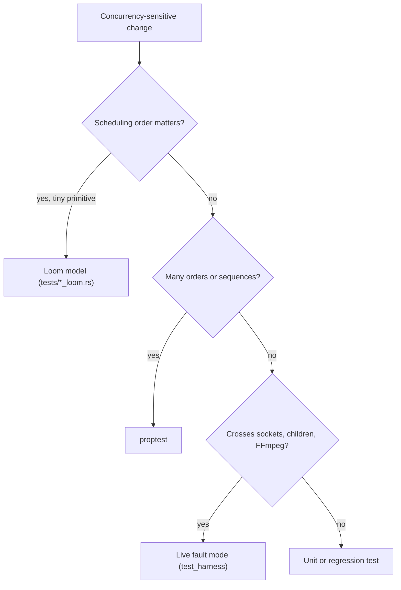

# Concurrency proofing

Each concurrency-sensitive boundary needs the kind of proof that catches its
failure mode. This page says which proof catches which bug, how to run the
gates, and which tests are mandatory. The boundary inventory is the
[stage boundary proof map](testing.md#stage-boundary-proof-map); the wider
strategy is the [assurance roadmap](assurance-roadmap.md).

## Contents

- [Which proof catches which bug](#which-proof-catches-which-bug)
- [Loom models](#loom-models)
- [Live fault modes](#live-fault-modes)
- [Gate commands](#gate-commands)
- [Update discipline](#update-discipline)
- [Mandatory surfaces](#mandatory-surfaces)
- [Open gaps](#open-gaps)

## Which proof catches which bug

Use the narrowest proof that can catch the bug.



The diagram shows how to pick the proof for a change.

| Bug | Example | Proof |
|---|---|---|
| Lost wake: a task blocks forever after cancel or close | The recording queue reader waits after the writer closed | Loom |
| Lost publication on a full channel | a feed's last publication stranded behind a full command queue | Loom plus controlled-race unit test |
| Cancelled-stage reuse: registry returns a dead shared stage | transcoder stage replaced while a reader registers | Loom (`*_stage_loom`) |
| Stale completion clobbers a replacement | old ingest disconnect poisons the new attempt | unit test (`stale_*_cannot_*`) |
| Ordering lost across a permutation | ring migration drops or duplicates a packet | proptest |
| Teardown erases diagnosis | cleanup drops the last structured error | API/unit test on retained status |
| Child, socket or thread leak on teardown | FFmpeg left running after a pipeline stops | live mode plus the contract gate's survivor check |
| Sink failure misreported | dead sink never reaches `failed` | live `fault.egress-retry` |
| Parallel test path: a `#[cfg(test)]` copy of production code drifts | tests pass while production bookkeeping is unexercised | delete the copy; test the production function |

If deleting a line of production code breaks no test, that line has no
proof. Benchmarks are not correctness proofs; keep measurement out of these
gates.

## Loom models

`cargo xtask concurrency fast` runs every model in `LOOM_TARGETS`
(`crates/xtask/src/concurrency.rs`). Each is `tests/<target>.rs`, built with
`--cfg loom` on the test crate only.

| Model | Proves |
|---|---|
| `byte_queue_loom` | close, wake and backpressure on the recording byte queue |
| `egress_feed_wake_loom` | queued wakes coalesce, heads are independent, the full-channel retry bit is never lost (`AcqRel` swaps; the consumer clears it before reading the head) |
| `input_selection_loom` | multi-input gate selection |
| `moq_origin_loom` | the MoQ origin viewer cap never admits past its maximum and every release frees a slot; the ring-to-pump wake over a one-slot channel loses no publication |
| `ring_frame_unit_loom` | a frame-unit read never returns the unit of a sequence that lapped it |
| `ring_migration_loom` | seal and migrate of a ring with live readers |
| `ts_chunk_ring_loom` | TS chunk ring wait and cancel |
| `ts_muxer_stage_loom` | TS muxer stage create, reuse and replacement races |
| `transcoder_stage_loom` | transcoder stage replacement, concurrent creators, cleanup and reader registration |

Build and run one model the way the gate does:

```sh
cargo xtask loom byte_queue_loom
```

Add a loom model only for a new cross-thread primitive (a wake, a snapshot
swap, a shutdown signal, a get-or-create registry). Loom across the dataplane
means the ownership model was broken.

## Live fault modes

| Mode | Proves | Gate |
|---|---|---|
| `fault.resilience` | RTMP and SRT standby promotion with a 10 s GOP and progress within 5 s (cached replay); RTMP → RTMPS delivery; sink loss reaches `retrying`; SIGTERM shutdown with the completion event | `contract`, `master-transport-shards` |
| `fault.egress-retry` | RTMP and SRT dead sinks show `retrying`, then `failed` when the retry budget runs out | `contract` |
| `fault.output-stall` | a connected RTMP sink that stops draining shows `stalled` in output status and health | `contract` |
| `recovery` | hung HLS PUT destinations time out and recover; rapid SRT publisher replacement; repeated RTMP/SRT sink flaps show as recovered but unstable; a killed transcoder FFmpeg is retried from a new stage process | `contract` |
| `fault.srt-output-stall` | bounded RSS while retrying a frozen SRT receiver; against `crates/test_harness/src/test_harness/srt_raw_sink.rs`, a real handshake and data while siblings progress; the retired output stops and two sibling receivers keep advancing | `contract`, nightly and release shards |

srt-rs exposes no hook for an application-unread receive buffer, so
`fault.srt-output-stall` does not claim that backpressure shape.

## Gate commands

```sh
cargo xtask concurrency fast       # CI: concurrency-fast, every run
cargo xtask concurrency contract   # CI: concurrency-contract, master only
```

| Step | `fast` | `contract` |
|---|---|---|
| All loom models | yes | — |
| Process-lifecycle guard over `crates/test_harness/src/main.rs` (every spawn armed for kill-and-wait) | — | yes |
| Build `restream` and `test_harness`, run the five `CONTRACT_MODES` | — | yes |
| No new `restream`, `mediamtx`, `ffmpeg`, `ffprobe` or `test_harness` process survives a mode | — | yes |

Unit, integration and property tests, including the mandatory surfaces
below, run in the CI `test` job (`cargo test --workspace`) on every run; the
gates do not repeat them.

`contract` logs each step to `.local/artifacts/concurrency-contract-logs/`
and prints a log only on failure. `CONCURRENCY_HARNESS_ARGS` passes extra
harness flags (CI sets `--no-netns`).

## Update discipline

When you touch concurrency-sensitive code:

1. Add or update the narrowest proof that catches the bug.
2. Add a new loom model to `LOOM_TARGETS` in
   `crates/xtask/src/concurrency.rs`; a new live mode to `CONTRACT_MODES`.
3. Update the live harness if visible teardown or recovery changed.
4. Update the API docs if status semantics changed.

If no new proof is needed, name the existing coverage in the commit
message. Run the targeted new or changed proof locally; CI runs the
mandatory gates.

## Mandatory surfaces

These tests guard the boundaries above. Weaken or remove one only with an
equal or stronger replacement in the same change. They run in the CI `test`
job; loom models also run in `cargo xtask concurrency fast`.

| Area | Tests |
|---|---|
| API status retention (`tests/api.rs`) | `health_endpoint_exposes_probe_and_egress_fault_fields`, `health_endpoint_surfaces_repeated_transient_disconnects_as_flapping`, `recovered_output_surfaces_flapping_after_repeated_sink_failures`, `output_status_and_health_preserve_recent_egress_failure_after_unregister` |
| Output status contract (`tests/output_status_contract.rs`) | `active_output_status_matches_health_runtime_fields`, `stalled_output_status_matches_health_runtime_fields` |
| Ring migration (`tests/ring_migration.rs`) | `prop_no_loss_no_gap_no_duplication`, `prop_multi_reader_migration_preserves_each_reader_order` |
| Engine attempts (`src/media/engine_tests/`) | `stale_ingest_unregister_cannot_clobber_replacement_attempt`, `stale_ingest_disconnect_cannot_poison_replacement_attempt`, `stale_egress_unregister_cannot_clobber_replacement_attempt`, `stale_egress_error_cannot_poison_replacement_attempt` |
| Engine health | `build_recent_ingest_outcome_resets_flap_streak_outside_window`, `prop_ingest_lifecycle_preserves_health_invariants`, `build_recent_egress_outcome_resets_flap_streak_outside_window`, `health_snapshot_surfaces_flapping_after_repeated_reconnects`, `health_snapshot_surfaces_flapping_after_repeated_egress_recoveries`, `output_status_surfaces_retry_backoff_after_failure`, `prop_egress_lifecycle_preserves_runtime_and_health_invariants` |
| Egress cursor priming (`src/media/egress/visit_tests.rs`) | `first_visit_primes_the_cursor_to_the_latest_sync_point`, `first_visit_primes_to_the_live_edge_without_a_sync_point`, `first_visit_primes_the_cursor_epoch_from_the_feed` |
| SRT egress Owners (`src/media/egress/backends/srt/owner_set.rs`) | `runtime_and_owners_live_and_die_on_the_shard_thread`, `many_ipv4_outputs_share_one_owner_and_one_caller_socket`, `ipv4_and_ipv6_outputs_coexist_on_two_family_owners`, `mixed_family_bond_is_rejected_without_partial_admission` |
| SRT egress scheduling (`src/media/egress/backends/srt/tests/`) | `stale_queued_admission_never_attaches_to_a_replacement_generation`, `late_dns_for_an_old_generation_is_ignored`, `one_ready_batch_is_one_owner_service_pass`, `a_wake_examines_a_bounded_slice_of_parked_leaves`, `command_wakes_a_parked_compio_wait_promptly`, `owner_protocol_deadline_bounds_the_park`, `shutdown_under_active_tx_reaches_owner_quiescence` |
| Recording byte queue (`crates/restream-sync/src/byte_queue.rs`) | `byte_queue_loom`; `cargo test -p restream-sync --lib byte_queue::tests` (includes `write_batch_round_trips_random_chunks`) |
| Transcoder | `replacement_video_stage_preserves_codec_hint_and_audio_tracks` (`tests/transcoder.rs`); `external_output_stream_idx_routes_known_tracks_without_aliasing`, `proptest_external_output_dts_routing_preserves_per_stream_monotonicity`, `external_720p_stage_emits_live_packets_for_h264_marker_fixture`, `external_1080p_stage_remuxes_marker_fixture_with_monotone_dts` |
| HLS | `hls_segment_boundaries_preserve_non_decreasing_dts_per_stream` |
| SRT ingress Owner (`src/media/srt/ingress_*`: `media::srt::ingress_live_tests`, `ingress_bridge_tests`, `ingress_admission`) | `read_play_sends_through_the_owner_and_target_deletion_disconnects`, `asynchronous_rejection_disconnects_the_owner_peer`, `fragmented_publisher_panic_retires_tail_without_stalling_an_existing_sibling`, `owner_stamps_receive_quality_and_stops_sampling_retired_peers`, `publisher_receive_quality_reaches_the_ingest_snapshot`, `one_ingress_owner_thread_serves_many_peers`, `owner_and_runtime_are_not_send`, `two_owners_share_the_port_and_each_session_command_reaches_its_owner` |
| RTMP listener (`src/media/rtmp/listener.rs`) | `media::rtmp::listener::tests` |
| Egress feed wakes | `feed_wake_delivers_media_after_idle_when_factory_start_is_delayed` (`rtmp_shard_tests.rs`), `fabric_feed_wakes_follow_ring_growth_rescale_and_stop_on_drop` (`egress/runtime.rs`), and in `egress/shard/tests/feed_wake.rs`: `publication_after_a_wake_head_check_rearms_the_shared_shard_gate`, `a_full_command_queue_cannot_strand_a_feeds_final_publication`, `full_fallback_preserves_an_already_queued_publication_wake` |
| Egress shard recovery | `a_panicked_shard_is_replaced_and_its_retried_outputs_are_delivered`, `placement_skips_a_dead_shard_until_its_replacement_starts`, `every_fabric_recovers_panics_without_adaptive_observation`, `reconciler_recovery_replaces_a_panicked_sink_shard`, `a_retried_output_delivers_again_after_its_shard_panics` |
| SRT stream id | `media::srt_stream_id::tests` |
| TS chunk ring | `live_reader_starts_after_existing_chunks` |
| Harness (`crates/test_harness/src/main.rs`) | `kill_and_wait_child_terminates_spawned_process`, and the live modes above |

## Open gaps

- More model-checked coverage for lifecycle registries beyond the stage
  families.
- Property tests for lifecycle permutations where loom does not fit.
- More live slow-sink isolation and repeated downstream flap cases.
