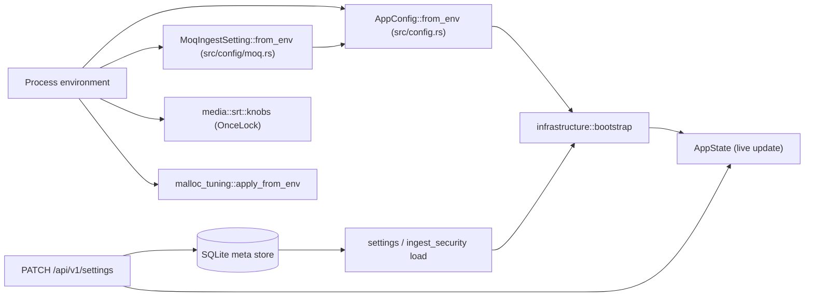

# Configuration reference

Restream reads deployment settings from environment variables once at
startup. User-facing settings live in SQLite and change at runtime through
the API. This page lists both, plus CLI helpers and host settings.

## Contents

- [How configuration is resolved](#how-configuration-is-resolved)
- [Fixed runtime values and environment variables](#fixed-runtime-values-and-environment-variables)
- [SQLite-backed settings](#sqlite-backed-settings)
- [Linux service placement](#linux-service-placement)
- [Host kernel settings](#host-kernel-settings)
- [SQLite performance settings](#sqlite-performance-settings)
- [Ingest URLs](#ingest-urls)
- [Output configuration](#output-configuration)
- [File ingest configuration](#file-ingest-configuration)
- [SRT transport configuration](#srt-transport-configuration)
- [HLS pull and authorization](#hls-pull-and-authorization)
- [Test, build and tooling variables](#test-build-and-tooling-variables)

## How configuration is resolved

The diagram shows where each kind of setting comes from and when it is read.



- Environment variables are read once. Changing one needs a restart.
- Every variable goes through `env_var` in `src/config.rs`. A value that does
  not parse falls back to the default. Most numeric values are then clamped to
  the range shown below.
- Boolean variables (`env_bool`) are true for `1`, `true`, `yes` or `on`
  (any case). Any other value set is false.
- SQLite settings persist across restarts. The API updates them live.

## Fixed runtime values and environment variables

Tables are grouped by area. "Clamp" is the range a parsed value is forced
into. Source is `src/config.rs` unless noted.

### Server, ports and paths

| Variable | Default | Range / values | Effect |
|---|---|---|---|
| `RESTREAM_HTTP_BIND_ADDR` | `127.0.0.1` | Interface address | Dashboard/API listener address. Change only when a reverse proxy or tunnel must reach another interface |
| `RESTREAM_HTTP_PORT` | `3030` | `1..=65535`; `0` is rejected (warning, default used) | Dashboard/API port; also the HLS push ingest port |
| `RESTREAM_RTMP_PORT` | `1935` | as above | RTMP ingest listener on `0.0.0.0` |
| `RESTREAM_SRT_PORT` | `10080` | as above | SRT ingest listener on `0.0.0.0` |
| `RESTREAM_DB_PATH` | `.restream/data/restream.db` | File path | SQLite database (plus WAL/SHM sidecars) |
| `RESTREAM_MEDIA_DIR` | `.restream/media` | Directory | Uploads and recordings (`DEFAULT_MEDIA_DIR`) |
| `RESTREAM_LOG_DIR` | `.restream/logs` | Directory | Rotated text log files |
| `FFMPEG_BIN_PATH` | unset | Executable path | FFmpeg used by the external transcoder, file ingest and recording remux; see [FFmpeg](#ffmpeg) |
| `RESTREAM_NOFILE_LIMIT` | `65536` | `>= 1` | Requested `RLIMIT_NOFILE` soft limit at startup |

The default layout lives under `.restream/`: `data/` holds only SQLite state,
`media/` holds uploads and recordings, `logs/` holds rotated logs, and
`runtime/` is a disposable cache (for example the `ffmpeg-fetch` binary).

### Auth and security

| Variable | Default | Range / values | Effect |
|---|---|---|---|
| `RESTREAM_INITIAL_ADMIN_PASSWORD` | unset | String | Dashboard password on first startup. Unset: a random password is written to `restream-initial-admin-password.txt` next to the database, owner-only |
| `RESTREAM_SECURE_SESSION_COOKIES` | off | bool | Adds the `Secure` attribute to session cookies (HTTPS deployments) |
| `RESTREAM_RTMPS_EXTRA_TRUST_ROOTS_PEM` | unset | PEM file path | Extra CA certificates added to public WebPKI roots for RTMPS and HTTPS HLS PUT outputs |
| `RESTREAM_SRT_PASSPHRASE` | unset (plaintext) | String | SRT encryption passphrase |
| `RESTREAM_SRT_PBKEYLEN` | `16` | Key length in bytes | SRT key length used with the passphrase |

Each SRT source (an IPv4 address, or an IPv6 /64) derives at most 8 keys per
second. Many encrypted encoders behind one NAT address therefore reconnect a
few seconds apart; a held handshake is counted in
`ingressOwner.keyDerivationDrops`.

### RTMP ingest and egress

| Variable | Default | Clamp | Effect |
|---|---|---|---|
| `RESTREAM_RTMP_LISTENER_BACKLOG` | `1024` | none | Accept backlog |
| `RESTREAM_RTMP_MAX_CONNECTIONS` | `512` | `1..=16384` | Concurrent connection cap |
| `RESTREAM_RTMP_MAX_CONNECTIONS_PER_IP` | `64` | `1..=RESTREAM_RTMP_MAX_CONNECTIONS` | Connections per client (IPv4 address or IPv6 /64), across all owners |
| `RESTREAM_RTMP_HANDSHAKE_TIMEOUT_MS` | `10000` | `100..=300000` | Handshake deadline |
| `RESTREAM_RTMP_PREAUTH_TIMEOUT_MS` | `10000` | `100..=300000` | Time after the handshake to start publishing or playing; otherwise the client is closed |
| `RESTREAM_RTMP_MAX_MESSAGE_BYTES` | `8388608` | 64 KiB..=`0xFFFFFF` | Largest declared inbound message; larger is rejected before buffering |
| `RESTREAM_RTMP_INGEST_PARSER_BUDGET_BYTES` | `268435456` | max message size ..= 16 GiB | Bytes all ingest parsers may hold before messages complete; the connection that would exceed it is rejected |
| `RESTREAM_RTMP_INGRESS_OWNERS` | `1` | `1..=64` | Compio owner threads, each with its own `SO_REUSEPORT` listener on the RTMP port |
| `RESTREAM_RTMP_PREAUTH_BUFFER_BYTES` | `131072` | 16 KiB..=1 MiB | Socket buffers before publish starts |
| `RESTREAM_RTMP_STREAM_BUFFER_BYTES` | `8388608` | 128 KiB..=64 MiB | Socket buffers while streaming |
| `RESTREAM_RTMP_EGRESS_CHUNK_SIZE` | `16384` | `128..=1048576` | Chunk size sent with `SetChunkSize` on RTMP outputs |

With more than one ingress owner, the kernel spreads connections by 4-tuple
hash. The connection cap and parser budget are split across owners, so hash
skew can reject on one owner while another has room. Raise owners only when
one owner thread saturates.

RTMPS outputs use the RTMP Compio TCP path and need Linux kTLS after the
Rustls handshake. If the host cannot install kTLS for the negotiated suite,
the output fails. There is no userspace-TLS fallback.

### SRT ingest and egress

| Variable | Default | Clamp | Effect |
|---|---|---|---|
| `RESTREAM_SRT_INGRESS_OWNERS` | `1` | `1..=` effective CPUs | Ingress Owner threads (`srt-in-<port>-<i>`) sharing the port as one `SO_REUSEPORT` group. Bonded legs move to the Owner that holds their group. One Owner fault stops the listener |
| `RESTREAM_SRT_MAX_PEERS_PER_IP` | `64` | `1..=4096` | srt-rs `admission.max_peers_per_ip`. IPv6 counts by /64; IPv4-mapped IPv6 counts as IPv4 |
| `RESTREAM_SRT_INGRESS_WINDOW_MEMORY_BYTES` | ¼ of memory limit (cgroup or host RAM) ÷ ingress owners | `0` disables | srt-rs `admission.max_window_memory_bytes` per Owner. Each publisher reserves `(flow + receive window) × 1,484` bytes. A publisher that does not fit is refused with `OVERLOAD` (1402) and counted in `ingressOwner.windowMemoryRejections`. Not a total RSS bound |
| `RESTREAM_SRT_CONNECT_TIMEOUT_MS` | `10000` | none | Per-output egress handshake deadline. The clock starts when the caller pool admits the request |
| `RESTREAM_SRT_EGRESS_CONNECT_CONCURRENCY` | `64` | `1..=4096` | Each egress Owner's caller-pool `max_in_flight`, per (shard, address family), with an equal bounded queue. A request beyond both fails and retries |
| `RESTREAM_SRT_EGRESS_TX_CAPACITY` | `16` (`SRT_OWNER_TX_CAPACITY`, `src/media/egress/backends/srt/owner_set.rs`) | `1..=4096` | Datagrams in flight per egress family Owner |
| `RESTREAM_SRT_EGRESS_GSO` | on | bool | Coalesce equal-length datagrams to one peer into one UDP GSO `sendmsg`. A path that rejects GSO turns it off by itself |
| `RESTREAM_SRT_EGRESS_MUXER_MAX_OUTPUTS_PER_SHARD` | `0` (off) | `0..=10000` | When set, a new shared TS muxer shard is created as each pipeline+encoding cohort crosses this many outputs |
| `RESTREAM_SRT_EGRESS_MUXER_MAX_SHARDS` | `64` | `1..=64` | Muxer shard limit; beyond it new outputs join the least-loaded shard (warning logged) |
| `RESTREAM_TS_RING_CAPACITY` | `256` chunks | `32..=16384` | Shared SRT TS ring between muxer and socket write |
| `RESTREAM_SRT_UDP_BUF_BYTES` | unset | positive bytes | UDP socket buffer for ingress and egress Owners (`src/media/srt/knobs.rs`). Unset: 8 MiB (`DESIRED_UDP_BUF`) for ingress and egress Owner sockets |
| `RESTREAM_SRT_RECV_BUDGET_DATAGRAMS` | unset | positive | Test-harness SRT sinks only (`src/media/srt/knobs.rs`); production Owner work is bounded by `OwnerServiceBudget` |

### HLS

| Variable | Default | Clamp | Effect |
|---|---|---|---|
| `RESTREAM_HLS_MIN_SEGMENT_MS` | `1000` | none | Minimum segment length |
| `RESTREAM_HLS_MAX_SEGMENTS` | `20` | `>= 1` | Live window length in segments |
| `RESTREAM_HLS_SEGMENT_CAPACITY_BYTES` | `8388608` | `>= 188` | Segment accumulator capacity |
| `RESTREAM_HLS_IDLE_TIMEOUT_MS` | `60000` | `>= 1` | Idle HLS segmenter timeout |
| `RESTREAM_HLS_PUT_FABRIC` | on | bool | HTTP/HTTPS HLS outputs upload from egress-fabric shards (Compio TCP, kTLS for HTTPS). `0` uses the Reqwest uploader on Tokio |

Both HLS PUT transports follow the same upload policy and report the same
status. HTTPS on the shards needs kernel TLS. If the host's kTLS probe does
not pass every TLS 1.2/1.3 AES-GCM pair the client offers, HTTPS outputs stay
on Reqwest (logged once). Transport comparison:
[capacity ramp](capacity-ramp.md#hls-put-transports).

### MoQ

MoQ ingest is off unless `RESTREAM_MOQ_INGEST_LISTEN` is set. Source:
`src/config/moq.rs`.

| Variable | Default | Range / values | Effect |
|---|---|---|---|
| `RESTREAM_MOQ_INGEST_LISTEN` | unset (off) | `IP:port`, non-zero port, e.g. `0.0.0.0:4443` | UDP address of the QUIC endpoint. Blank counts as unset |
| `RESTREAM_MOQ_TLS_CERT` | unset | PEM file path | Certificate chain; required when listening |
| `RESTREAM_MOQ_TLS_KEY` | unset | PEM file path | Private key; required when listening |
| `RESTREAM_MOQ_MAX_CONNECTIONS` | `64` | `1..=4096` | Concurrent handshakes plus publishers. An admitted viewer leaves this count |
| `RESTREAM_MOQ_ORIGIN_MAX_VIEWERS` | `64` | `1..=4096` | Concurrent direct viewers across all pipelines |

An unparseable address, port `0`, or a missing certificate or key gives
`MoqIngestSetting::Invalid`. Startup logs it and the listener stays off; the
engine still runs. See [MoQ ingest](media-pipeline.md#moq-ingest).

### Outputs and reconciler

| Variable | Default | Clamp | Effect |
|---|---|---|---|
| `RESTREAM_RECONCILE_INTERVAL_MS` | `1000` | `>= 100` | Housekeeping tick. Sessions are pruned every `ceil(3600000 / interval)` ticks |
| `RESTREAM_OUTPUT_MAX_RETRIES` | `10` | none | Restarts of a failed output |
| `RESTREAM_OUTPUT_RETRY_BASE_MS` | `5000` | `>= 1` | Restart base backoff |
| `RESTREAM_OUTPUT_RETRY_MAX_MS` | `300000` | `>= 1` | Restart backoff ceiling |
| `RESTREAM_INGEST_DISCONNECT_GRACE_MS` | `5000` | none | Grace period after an ingest disconnect |

### Egress fabric

| Variable | Default | Clamp | Effect |
|---|---|---|---|
| `RESTREAM_EGRESS_SHARDS` | `clamp(effective CPUs, 2, 8)` | `1..=1024` | Per-feed shard ceiling. Feeds start with one shard and grow from measured demand |
| `RESTREAM_EGRESS_COMMAND_CAPACITY` | `1024` | `1..=65536` | Commands queued per shard |
| `RESTREAM_EGRESS_COMMAND_BATCH` | `32` | `1..=4096` | Commands per loop |
| `RESTREAM_EGRESS_READY_BATCH` | `64` | `1..=4096` | Ready leaves per loop |
| `RESTREAM_EGRESS_TIMER_BATCH` | `64` | `1..=4096` | Timers per loop |
| `RESTREAM_EGRESS_MAX_LEAVES_PER_SHARD` | `4096` | `1..=1000000` | Leaf slots per shard; output creation fails when full |
| `RESTREAM_EGRESS_IDLE_WAIT_MS` | `25` | `1..=1000` | Shard idle wait |
| `RESTREAM_EGRESS_TCP_POLLER_MAX_EVENTS` | `1024` | `1..=65536` | RTMP/RTMPS completion events per poll |
| `RESTREAM_EGRESS_VISIT_MAX_UNITS` | `32` | `1..=4096` | Units per leaf visit |
| `RESTREAM_EGRESS_VISIT_MAX_BYTES` | `262144` | `188..=16 MiB` | Bytes per leaf visit |
| `RESTREAM_EGRESS_VISIT_MAX_US` | `2000` | `1..=1000000` | Microseconds per leaf visit |
| `RESTREAM_EGRESS_MAX_PENDING_BYTES` | `262144` | `1..=16 MiB` | Protocol bytes queued per output (not the TCP socket buffer) |
| `RESTREAM_EGRESS_DRAIN_TIMEOUT_MS` | `3000` | `1..=60000` | On shutdown, how long a shard lets leaves flush queued bytes |

Shard growth: before each new RTMP or SRT output is placed, the pool is sized
from CPU per delivered bit times the feed's bitrate, targeting 50% shard busy.
Cold priors are 128 (RTMP) and 64 (SRT) outputs per shard. Live outputs never
move. A shard retires only after 60 healthy windows with one shard fewer
projected under 40% busy, a 5-minute dwell, and its last output leaving.

`EgressFabricConfig::validate` runs at startup and logs a
`restream.config.warning` (non-fatal) when:

- `RESTREAM_EGRESS_MAX_PENDING_BYTES` < `RESTREAM_EGRESS_VISIT_MAX_BYTES`;
- `RESTREAM_EGRESS_SHARDS` > 4 × effective CPUs;
- `RESTREAM_EGRESS_DRAIN_TIMEOUT_MS` < 50;
- `RESTREAM_EGRESS_COMMAND_BATCH` > `RESTREAM_EGRESS_COMMAND_CAPACITY`.

### Media buffers and FFmpeg

| Variable | Default | Clamp | Effect |
|---|---|---|---|
| `RESTREAM_RING_CAPACITY` | `1024` packets | `64..=16384` | Source/ingest packet ring |
| `RESTREAM_RING_HEADROOM_SECS` | `6.0` | `0.1..=60.0` | Seconds of packets a pipeline ring grows to hold once the stream's frame rate and audio tracks are known (`adapt_pipeline_ring`); never below `RESTREAM_RING_CAPACITY` or above 16384 |
| `RESTREAM_TRANSCODER_RING_CAPACITY` | `512` packets | `64..=16384` | Transcoder output ring |
| `RESTREAM_AVIO_QUEUE_CAPACITY` | `524288` | 64 KiB..=16 MiB | AVIO bridge queue (recording) |
| `RESTREAM_EXTERNAL_FFMPEG_THREADS` | FFmpeg chooses | `u32` | Codec threads per external FFmpeg |
| `RESTREAM_RECORDING_FFMPEG_THREADS` | FFmpeg chooses | `u32` | Threads for recording remux |
| `RESTREAM_EXTERNAL_FFMPEG_PERMITS` | derived | `>= 1` | Concurrent external FFmpeg stages. Overrides the derivation below |
| `RESTREAM_EXTERNAL_FFMPEG_CPU_RESERVE` | `2` (at most CPUs − 1) | — | CPUs kept back in the derivation |
| `RESTREAM_EXTERNAL_FFMPEG_CPU_PER_CHILD` | `2` | `>= 1` | CPUs per child in the derivation |
| `RESTREAM_EXTERNAL_FFMPEG_MAX_CHILDREN` | unlimited | — | Hard cap in the derivation |

Derived permits are `ceil(max(CPUs − reserve, 1) / per_child)`, raised to at
least 5, then capped by the max children value.

#### FFmpeg

FFmpeg is not bundled. The executable resolves in this order
(`src/ffmpeg_binary.rs`): `FFMPEG_BIN_PATH`; the copy installed by
`restream ffmpeg-fetch` in `.restream/runtime/ffmpeg/`; `ffmpeg` on `PATH`.
If none is found, the server still starts and logs one warning; only
FFmpeg-backed features fail. Recording remux needs the `mov/mp4` muxer;
video presets need `libx264` and `libx265`.

`restream ffmpeg-fetch` downloads the
[BtbN](https://github.com/BtbN/FFmpeg-Builds) FFmpeg 8.1 static GPL build
for the host architecture from the `latest` release, checks it against
`checksums.sha256`, and installs `bin/ffmpeg`. It needs GNU `tar` with xz.
The container images run the same download and set
`FFMPEG_BIN_PATH=/usr/local/bin/ffmpeg`.

### Threads and memory

| Variable | Default | Clamp | Effect |
|---|---|---|---|
| `RESTREAM_TOKIO_WORKER_THREADS` | all CPUs up to 2, else `ceil(CPUs/3)` in `2..=8` | `>= 1` | Tokio scheduler workers (`restream-tokio`) |
| `RESTREAM_TOKIO_MAX_BLOCKING_THREADS` | `512` | `>= 1` | Tokio `spawn_blocking` capacity |
| `RESTREAM_MEDIA_WORKERS` | `clamp(CPUs, 1, 4)` | `1..=64` | `restream-media` executor workers (`src/media/executor.rs`) |
| `RESTREAM_MALLOC_ARENA_MAX` | `2` (provisional) | `default` or positive integer | glibc malloc arenas via `mallopt` (`src/malloc_tuning.rs`). `default` keeps glibc's policy |
| `MALLOC_ARENA_MAX` | unset | glibc | Applied by glibc itself; wins over `RESTREAM_MALLOC_ARENA_MAX` |

"CPUs" means the effective count from the CPU mask and cgroup quota
(`HostCapacity`, `src/capacity.rs`). The effective arena setting is logged as
`restream.malloc.arenas`. Qualify the arena value per host
([capacity ramp](capacity-ramp.md)) before you treat `2` as final.

### Logging and telemetry

| Variable | Default | Range / values | Effect |
|---|---|---|---|
| `RUST_LOG` | `info` | `tracing` `EnvFilter` syntax | Log filter (`src/logging.rs`) |
| `NO_COLOR` | unset | presence | Any value turns off ANSI colour in console logs |
| `RESTREAM_LOG_RETENTION_DAYS` | `7` | days | SQLite log-history retention |
| `RESTREAM_MEDIA_POLL_USAGE` | off | bool | Diagnostic: per-poll `getrusage` in media executor metrics (two extra syscalls per poll) |

### Capacity model

These six values feed the observe-only capacity model. They never admit or
reject work. Unset, unparseable or non-positive values use priors derived
from CPU count.

| Variable | Effect |
|---|---|
| `RESTREAM_CAPACITY_INGRESS_PPS` | Ingress packets/s service center |
| `RESTREAM_CAPACITY_EGRESS_PPS` | Egress packets/s service center |
| `RESTREAM_CAPACITY_NIC_BPS` | NIC bits/s |
| `RESTREAM_CAPACITY_MEMORY_BYTES` | Memory bytes |
| `RESTREAM_CAPACITY_FFMPEG_STAGES` | FFmpeg stages |
| `RESTREAM_CAPACITY_DISK_BPS` | Disk bits/s |

## SQLite-backed settings

`GET /api/v1/settings` returns current values and `PATCH /api/v1/settings`
updates any supplied field. Field-level detail:
[API reference](api-reference.md#configuration-and-discovery).

| Setting | Behavior |
|---|---|
| `serverName` | Dashboard display name; must be non-empty |
| `ingestHost` | Host used in generated RTMP/SRT publisher URLs; blank means `localhost` |
| `ingestSecurity` | Failed-publish limit, window, ban time and tracked-IP limit; enforced in memory, persisted under meta key `ingest_security_config` |
| `srtIngest.latencyMs` | Global SRT listener latency; see [SRT transport configuration](#srt-transport-configuration) |
| `recordingSettings.retainSourceTs` | Default `false`: the source `.ts` is deleted after a successful `.mp4` remux. A failed remux always keeps it |
| Dashboard password | Scrypt hash. First value from `RESTREAM_INITIAL_ADMIN_PASSWORD` or a generated file (see [Auth and security](#auth-and-security)) |
| Custom output video mode | Stored through `/api/v1/encodings/custom`; rejected by output create/update |
| Recording enabled | Stored per pipeline |

Sessions persist in SQLite and reload at startup. Expired sessions are pruned
at startup and then about once per hour.

## Linux service placement

On systemd hosts, use systemd for CPU and NUMA placement.
`scripts/deploy/install-systemd-service.sh` installs the unit:

```sh
sudo RESTREAM_CPU_AFFINITY=0-5 \
  RESTREAM_NUMA_POLICY=local \
  scripts/deploy/install-systemd-service.sh
```

| Installer variable | Default | Effect |
|---|---|---|
| `RESTREAM_SERVICE_NAME` | `restream` | Unit name |
| `RESTREAM_BIN` | `/usr/local/bin/restream` | Binary path |
| `RESTREAM_USER` / `RESTREAM_GROUP` | `restream` | Service account |
| `RESTREAM_WORKDIR` | `/var/lib/restream` | Working directory |
| `RESTREAM_ENV_FILE` | `/etc/restream/restream.env` | Optional `EnvironmentFile` for the variables on this page |
| `RESTREAM_CPU_AFFINITY` | unset | `CPUAffinity=` |
| `RESTREAM_NUMA_POLICY` / `RESTREAM_NUMA_MASK` | unset | `NUMAPolicy=` / `NUMAMask=` |

Validate the CPU/NUMA set on the host first. Process-level placement
(systemd `CPUAffinity`, Docker `--cpuset-cpus`, a Kubernetes CPU manager
policy) is the supported way to partition CPUs. The runtime does not pin its
own threads.

Resolved Tokio sizing appears in `/api/v1/engine/health`. The Tokio knobs do
not cap native threads made by FFmpeg or SQLite. Tokio threads are named
`restream-tokio`, separate from `srt-in-<port>`, `sqlx-sqlite-*` and other
native threads.

## Host kernel settings

The server never needs root. Use the one-shot helpers in the same binary
(`src/host_tuning.rs`):

```sh
restream host-check        # report; exit status 1 if anything is unmet
sudo restream host-tune    # apply once and persist, then report
```

At startup the server logs one `restream.host.setting_unmet` warning per
unmet setting.

| Setting | Requirement | `host-tune` action | Why |
|---|---|---|---|
| `net.core.rmem_max` | `>= 26214400` | raise; persist in `/etc/sysctl.d/99-restream.conf` | SRT UDP receive buffers |
| `net.core.wmem_max` | `>= 8388608` | raise; persist | SRT UDP send buffers |
| `net.core.somaxconn` | `>= 4096` | raise; persist | RTMP accept bursts |
| `tls` kernel module | loaded | `modprobe tls`; persist in `/etc/modules-load.d/restream.conf` | kTLS for RTMPS and HTTPS HLS PUT |
| `kernel.io_uring_disabled` | `0` | report only | Compio owner threads need io_uring |
| `net.ipv4.ip_local_port_range` | `>= 4096` ports | report only | Ephemeral ports for many outputs |
| `RLIMIT_NOFILE` hard limit | `>= 65536` | report only | Set `LimitNOFILE` in the unit (the installer sets 65536) |

`host-tune` never lowers a value. Restream does not use socket busy-polling.

## SQLite performance settings

`db::create_pool` (`src/db/mod.rs`) sets these on every pooled connection.
Schema setup (`src/db/schema.rs`) also asserts WAL and sets the journal size
limit.

| PRAGMA | Value | Effect |
|---|---|---|
| `journal_mode` | `WAL` | Readers run during a write |
| `synchronous` | `NORMAL` | fsync only at WAL checkpoints |
| `foreign_keys` | on | Enforce foreign keys |
| `busy_timeout` | 30000 ms | Wait on a locked database before `SQLITE_BUSY` |
| `journal_size_limit` | 64 MiB | Caps WAL growth |
| `cache_size` | -16384 (16 MiB) | In-process page cache |
| `temp_store` | `MEMORY` | Temp tables in memory |
| `mmap_size` | 128 MiB | Memory-mapped reads |

Write transactions that still hit `SQLITE_BUSY` are retried at the
repository boundary.

## Ingest URLs

Generated publisher URLs use `ingestHost` and the configured ports:

```text
rtmp://<ingestHost>:<rtmpPort>/live/<streamKey>
srt://<ingestHost>:<srtPort>?streamid=publish:<streamKey>
```

HLS push ingest (MPEG-TS) uses the HTTP port. It is not in a pipeline's
generated `ingestUrls`; a keyed input's `ingestUrls.hls` carries it. See
[HLS push ingest](media-pipeline.md#hls-push-ingest).

```text
http://<ingestHost>:<httpPort>/ingest/hls/<streamKey>/<playlist>.m3u8
```

MoQ ingest uses the MoQ UDP port and exists only while
`RESTREAM_MOQ_INGEST_LISTEN` is set. A keyed input's `ingestUrls.moq` names
it (`null` while MoQ is off). The last path segment is the stream key. A
publisher that connects to `https://<ingestHost>:<moqPort>/` may instead name
its broadcast `<streamKey>` (or `<scope>/<streamKey>.hang`). The listener
accepts WebTransport and native QUIC. See
[MoQ ingest](media-pipeline.md#moq-ingest).

```text
https://<ingestHost>:<moqPort>/<streamKey>
```

A pipeline may supply a stream key or let the API generate one.
`GET /api/v1/stream-keys` returns only keys assigned to pipelines.

## Output configuration

Each output stores a name, a URL and a config:

```json
{
  "name": "Primary CDN",
  "url": "rtmp://destination.example/live/key",
  "config": {
    "video": { "mode": "source" },
    "audio": { "mode": "all" },
    "protocol": { "type": "rtmp", "mode": "legacy" }
  }
}
```

| URL | Runtime behavior |
|---|---|
| `rtmp://...` | Compio TCP RTMP egress; bracketed IPv6 (`[::1]`) works |
| `rtmps://...` | Compio TCP RTMPS egress with Linux kTLS |
| `srt://...` | SRT egress through the `srt-rs` Compio Owner |
| `hls://...` | Pipeline's local in-memory HLS segmenter |
| `sink://...` | Discards media through the egress fabric (diagnostics, soak, capacity) |
| `pipeline://...` | In-process recirculation; cycles and target-input ownership are checked first |
| `http://...`, `https://...` | Local MPEG-TS segmenter plus HTTP PUT of segments and playlist |

Any other prefix fails validation. For HTTP/HTTPS upload, a `file=` query
parameter in the playlist URL is replaced with the segment name; otherwise the
playlist filename is. Segment names are `r<token>-<N>.ts`: `<N>` counts from
0 per output attempt and `<token>` is unique per attempt, so names never
repeat across restarts.

Video and audio are configured separately:

```json
{
  "video": { "mode": "preset", "preset": "720p" },
  "audio": { "mode": "selectTracks", "tracks": [0] }
}
```

- Video profiles: `source` (passthrough), `720p`, `1080p`, and the internal
  `h264` conversion. Every non-source profile, the HEVC-to-H.264 bridge and
  complex audio run in an external FFmpeg process. `custom` is rejected.
- Audio modes: `all`, `selectTracks` (packet-only), `remap` and `downmix`
  (external FFmpeg, stereo AAC).
- RTMP/RTMPS `protocol.mode`: `legacy` (default) or `enhanced`. Enhanced
  advertises `avc1`, `hvc1` and `mp4a` in the connect command's `fourCcList`,
  independently of the chosen video codec. H.264 keeps normal AVC payloads;
  HEVC uses Enhanced FLV `hvc1`. With HEVC ingest, legacy adds the shared
  `hevc_to_h264` conversion first.

## File ingest configuration

File ingest is set per pipeline or through the standalone ingest routes. Each
definition stores `filename`, `loop`, `startTime`, `liveOptimized` and
`targetGopSeconds`. It always runs FFmpeg. `liveOptimized=false` passes
streams through. `liveOptimized=true` re-encodes to H.264 and AAC, turns off
scene-cut GOP drift, and forces keyframes every `targetGopSeconds`.

## SRT transport configuration

SRT uses `srt-rs` (`srt-proto`, `srt-transport`) on Compio `Owner` threads.
The transport owns protocol state and UDP sockets.

### Ingest latency and encryption

- Global `srtIngest.latencyMs`: default `250` ms, range `20..=8000`
  (`src/domain/srt_ingest.rs`). A pipeline's `srtIngestPolicy.latencyMs`
  overrides it.
- Restream offers this as the listener's peer latency. A caller can propose
  more, so the negotiated delay can be larger.
- Ingest encryption comes from the global or per-pipeline API policy, never
  from StreamID text. Plaintext is the default; key lengths are 16, 24 or 32.
- Socket buffers: `RESTREAM_SRT_UDP_BUF_BYTES` (see
  [SRT ingest and egress](#srt-ingest-and-egress)). Linux may clamp it to
  `net.core.rmem_max` / `wmem_max`.

### Recognized SRT egress URL parameters

Restream reads only these query parameters from an `srt://` output URL.
Unrecognized parameters are ignored; in particular, `sndbuf`, `rcvbuf`,
`fc`, and `maxbw` are not egress URL settings:

| Parameter | Purpose |
|---|---|
| `streamid` | Stream ID presented to the destination; percent-decoded |
| `passphrase` | AES passphrase for an encrypted link; percent-decoded |
| `pbkeylen` | AES key length in bytes (`16`, `24`, or `32`) |
| `latency` | TSBPD delay proposed in the handshake, in milliseconds (`20`–`8000`, as libsrt's URI option; FFmpeg's microsecond value is rejected). The API refuses an output whose `latency` is outside the range or not an integer; an unusable value stored earlier is ignored with a warning when the leaf starts. Default: the transport's 120 ms; the peer can negotiate a larger delay |
| `bond` | Comma-separated additional peer addresses |
| `type` | Bond mode: `backup` (default) or `broadcast` |

The URL authority is the primary peer. `backup` prefers it and keeps the
other legs as standbys; `broadcast` sends on every healthy leg. All legs must
use one address family, and the peers must join the same receiving group.

```text
srt://primary.example:10080?streamid=publish:key&bond=backup1.example:10080,backup2.example:10080&type=backup
```

On ingest, a publisher-created Broadcast or Backup group is authenticated as
one logical input. It keeps its identity when a leg fails and reports per-leg
and aggregate telemetry.

### Linux host and harness capacity

Production kernel settings come from `restream host-tune`
([Host kernel settings](#host-kernel-settings)). The live harness also needs
private user and network namespaces:

```sh
scripts/dev/harness-host-prereqs.sh                   # check
scripts/dev/bootstrap.sh --configure-harness-host     # persist
scripts/dev/bootstrap-runtime.sh --configure-harness-host
```

The bootstrappers write `kernel.unprivileged_userns_clone=1`,
`user.max_user_namespaces=28633`, `net.core.rmem_max=26214400` and
`net.core.wmem_max=8388608` to `/etc/sysctl.d/99-restream-harness.conf`. They
do not change AppArmor. Use `--no-netns` only as a temporary fallback.

| Setting | Harness baseline | Why |
|---|---:|---|
| `RLIMIT_NOFILE` hard limit | `>= 65536` | The harness raises its soft limit but cannot pass the hard limit |
| `net.core.rmem_max` | `26214400` | SRT UDP receive buffers |
| `net.core.wmem_max` | `8388608` | Default 8 MiB SRT egress buffer request |
| `net.core.somaxconn` | `>= 4096` | RTMP accept burst at 1,200 outputs |
| `net.ipv4.ip_local_port_range` | `>= 4096` ports | Outbound connections |
| `fs.file-max` | above total demand | Restream, peers, MediaMTX and publishers together |
| `kernel.unprivileged_userns_clone`, `user.max_user_namespaces` | `1`, `28633` | Private namespaces for integration tests |

Record other host limits (`rmem_default`, `netdev_max_backlog`, `udp_mem`,
CPU quota, cgroup limits, RAM) with scale artifacts; runtime health shows
process limits, affinity, quota and memory.

## HLS pull and authorization

The in-memory HLS store is served under `/hls/<pipelineId>/` (master, video
and per-audio-track playlists, `init.mp4` and segments) and
`/hls/inputs/<inputId>/` (`src/api/router.rs`). Preview uses one fMP4
segmenter per pipeline; HTTP/HTTPS upload uses the MPEG-TS segmenter.

All these routes need the dashboard session cookie. They send HLS CORS
headers, but unauthenticated requests get `401`. Before exposing HLS outside
dashboard sessions, add signed URLs or short-lived tokens for playlists and
segments, with expiry, revocation, rate limits and token-safe logs. Route
detail: [API reference](api-reference.md#hls-pull).

## Test, build and tooling variables

None of these change a production server.

| Variable | Read by | Effect |
|---|---|---|
| `RESTREAM_AGENT_BASE_URL`, `RESTREAM_AGENT_SESSION_COOKIE`, `RESTREAM_AGENT_BEARER_TOKEN`, `RESTREAM_MCP_ALLOWED_ORIGINS`, `RESTREAM_MCP_VERSION_CHECK` | `src/bin/restream-mcp.rs` | MCP bridge; see [agent plane integration](agent-plane-integration.md) |
| `RESTREAM_WI37_SRT_SHARDS` | `src/config.rs`, only with the `wi37-shard-bench` feature | Pins SRT shard count `1..=4` for benchmarks |
| `RESTREAM_SRT_RECV_BUDGET_DATAGRAMS` | `src/media/srt/knobs.rs` | Harness SRT sink receive budget |
| `RESTREAM_BUILD_GIT_COMMIT` (else `GITHUB_SHA`), `RESTREAM_BUILD_TIMESTAMP` (else `SOURCE_DATE_EPOCH`) | `build.rs` | Commit and timestamp stamped into the binary |
| `RESTREAM_HARNESS_*`, `RESTREAM_BENCH_*`, `SUBSTRATE_*`, `MOQ_BROWSER_*`, `TEST_HARNESS_USE_HOST_NET`, `WORK_DIR` | `src/bin/test_harness/` | Harness runs; see [testing](testing.md) |
| Release and container variables (`RESTREAM_BUILD_*`, `RESTREAM_RELEASE_*`, `RESTREAM_CONTAINER_*`, `RESTREAM_SBOM_PATH`, ...) | `scripts/` | Build and release scripts; documented in each script's usage text |
