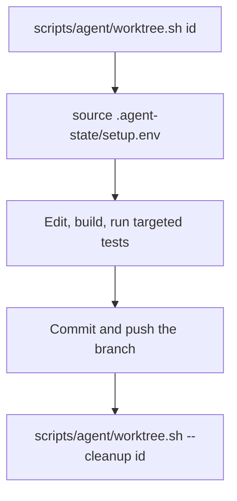

# Developer guide

This page takes you from a fresh host to a working change. Scripts own the
exact steps; this page says which script to run and when. Run any script
with `--help` for its options.

## Contents

- [Prerequisites](#prerequisites)
- [First build](#first-build)
- [Daily loop](#daily-loop)
- [Frontend work](#frontend-work)
- [Worktrees for parallel work](#worktrees-for-parallel-work)
- [Sharing one host](#sharing-one-host)
- [Containers](#containers)
- [Release builds](#release-builds)

## Prerequisites

Restream builds on Linux x86_64. The scripts support Debian and Ubuntu.

| Host | Run once |
|---|---|
| Development | `scripts/dev/bootstrap.sh` |
| Live harness only (no compiler) | `scripts/dev/bootstrap-runtime.sh` |

`bootstrap.sh` installs the apt packages, the pinned Rust toolchain
(`rust-toolchain.toml`), Node and the frontend dependencies, a pinned
MediaMTX and the Git pre-commit hook. It also checks the host for the live
harness.

- The package list lives in
  [`scripts/lib/debian-packages.sh`](../scripts/lib/debian-packages.sh). Do
  not copy it into docs.
- `--configure-harness-host` makes the user-namespace and SRT UDP-buffer
  settings persistent. Use it only on a machine you want changed.

## First build

```sh
scripts/dev/prepare.sh
scripts/build/app-native.sh
RESTREAM_INITIAL_ADMIN_PASSWORD=change-me target/debug/restream
```

1. `prepare.sh` builds the embedded frontend assets. It stops with an instruction if `node_modules/` is missing.
2. `app-native.sh` builds `target/debug/restream`, checks that it links no
   SRT or FFmpeg libraries, and emits its SBOM. `RESTREAM_BUILD_PROFILE=release` builds a release binary instead.
3. The binary keeps its state under `.restream/` in the working directory.
   [Configuration](configuration.md) lists the path, listener and auth
   settings.

## Daily loop

```sh
scripts/build/app-native.sh
cargo test <name>
cargo clippy
cargo fmt --all
```

- Run the test you are writing, not the full suite. GitHub PR CI runs the
  correctness gates. [AGENTS.md](../AGENTS.md#inner-loop) maps each kind of
  change to its CI job.
- The pre-commit hook runs `cargo xtask gates --staged`. It routes changed
  files to their cheap checks; Markdown changes run
  `node scripts/check/docs.mjs`.
- Use `--profile bench` instead of `--release` for local builds. Harness
  modes need `cargo xtask build-bench`, which fills `target/bench/`.
- Cargo uses all CPUs but one (`jobs = -1` in `.cargo/config.toml`). Override
  with `CARGO_BUILD_JOBS`.
- Benchmarks are declared in `Cargo.toml` and live in `benches/`. A measured
  change puts its numbers in its commit message.
  [High-performance data path](high-performance-data-path.md) says when a
  benchmark is required.

[Testing](testing.md) owns gate choice, harness modes, fixtures and
artifacts.

## Frontend work

Edit `web/ts/` and `web/styles/input.css`. Never edit the generated
`public/js/` or `public/output.css`.

```sh
npm run build:frontend
npm run test:frontend
npm run test:e2e
```

- `test:frontend` runs the Node unit tests and a built-module smoke test.
  `test:frontend:coverage` adds coverage.
- `test:e2e` (`scripts/harness/frontend-e2e.sh`) builds the app, starts it in
  `.local/e2e` and runs Playwright. Use `npx playwright test` only against an
  app you already run on port 3030.
- [package.json](../package.json) owns the command definitions.
  [Frontend](frontend.md) owns the design system and control room structure.

## Worktrees for parallel work

Use one worktree per task or agent. The helper creates it with warm caches:

```sh
scripts/agent/worktree.sh <id>
source .local/worktrees/<id>/.agent-state/setup.env
```

This diagram shows the life of a worktree.



- Defaults: path `.local/worktrees/<id>`, branch `codex/<id>`, based on
  `HEAD`.
- The helper copies a pruned debug `target/`, `.cargo/` and `node_modules/`
  from the source tree. Each worktree owns its copies; never point two
  worktrees at one `target/`.
- `setup.env` records `AGENT_WORK_ROOT` (default
  `.local/artifacts/agents/<id>` inside the worktree). Export it as
  `WORK_ROOT` and keep the task's artifacts under it.
- `--cleanup` removes the checkout but keeps the branch. It refuses a dirty
  or locked worktree unless you pass `--force-cleanup`.

## Sharing one host

A worktree isolates source and build caches. It does not isolate processes,
ports or CPU.

| Work | Rule |
|---|---|
| Heavy builds | Check `pgrep -a -x cargo` first. Nothing serializes builds across worktrees |
| Builds and live media | Never build while a Restream, MediaMTX or FFmpeg pipeline runs. Builds are memory heavy and can run a small host out of memory |
| Live correctness runs | Run modes through `scripts/harness/run.sh`; it rebuilds stale bench binaries. Overlap runs only when each has its own network, ports and artifacts, as `scripts/harness/parallel-fast-breadth.sh` provides |
| Measurements | Benchmarks, sweeps and capacity ramps run serially on an idle host. A competing build or pipeline makes the result invalid |
| Long-lived sessions | Give each dashboard or debug session an owner, its own runtime directory and a cleanup step. Prefer the harness or demo tooling that already owns ports |

Do not kill processes another task owns. [AGENTS.md](../AGENTS.md) owns the
full agent safety rules.

## Containers

The [README](../README.md#run-the-container) shows the production image. The
Dockerfile builds the frontend and binary from the same scripts, then copies
the binary and the BtbN `ffmpeg` and `ffprobe` executables into a distroless
image.

The `harness` target holds the bench-profile `restream` and `test_harness`,
pinned MediaMTX, FFmpeg and the committed fixtures. Its entry point is
`test_harness`, so harness modes and flags go straight after the image name:

```sh
docker build \
  --build-arg RESTREAM_BUILD_GIT_COMMIT="$(git rev-parse HEAD)" \
  --build-arg RESTREAM_BUILD_TIMESTAMP="$(git show -s --format=%cI HEAD)" \
  --target harness -t restream:harness .
docker run --rm --network host \
  --security-opt seccomp=distribution/docker/restream-seccomp.json \
  restream:harness mixed.live.srt.h264.a1.bf0 --no-netns
```

- `--network host` lets harness modes open loopback publishers and sinks.
- The harness image needs the same seccomp profile as production.
- The `runtime-ubuntu` target is an escape hatch for unusual NSS or DNS
  setups. The default target is the distroless `runtime`.

## Release builds

The engine links no FFmpeg; codec work runs in an external `ffmpeg`.
[FFmpeg versions](ffmpeg-versions.md) owns which build runs.

Committed performance evidence uses `cargo xtask build-release`
(`target/qual-release/`). Release candidates follow the
[release runbook](release-runbook.md), which certifies the packaged bytes.
