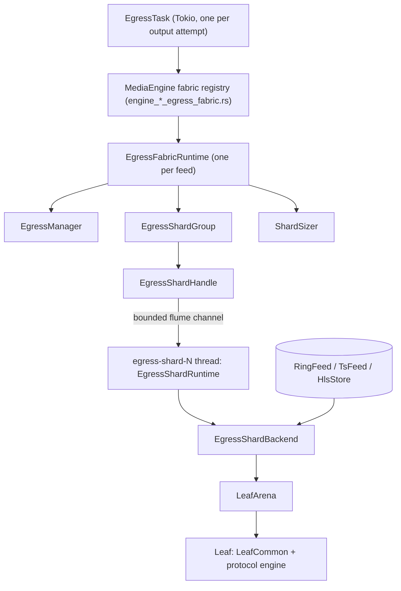
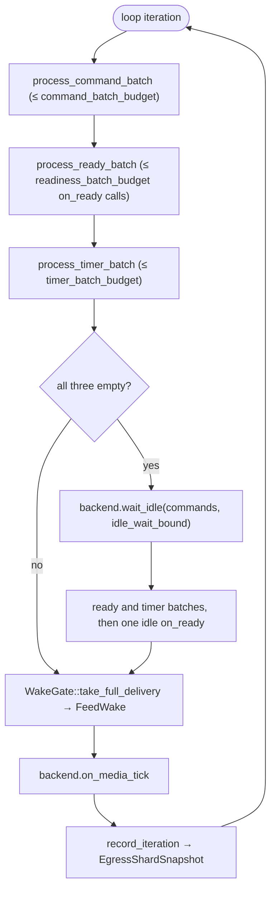
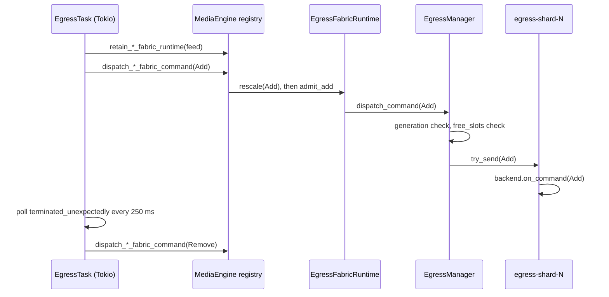
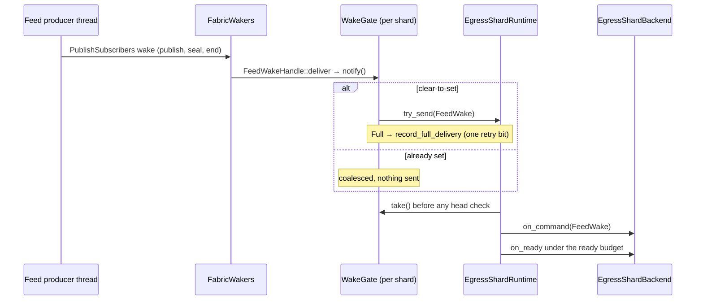
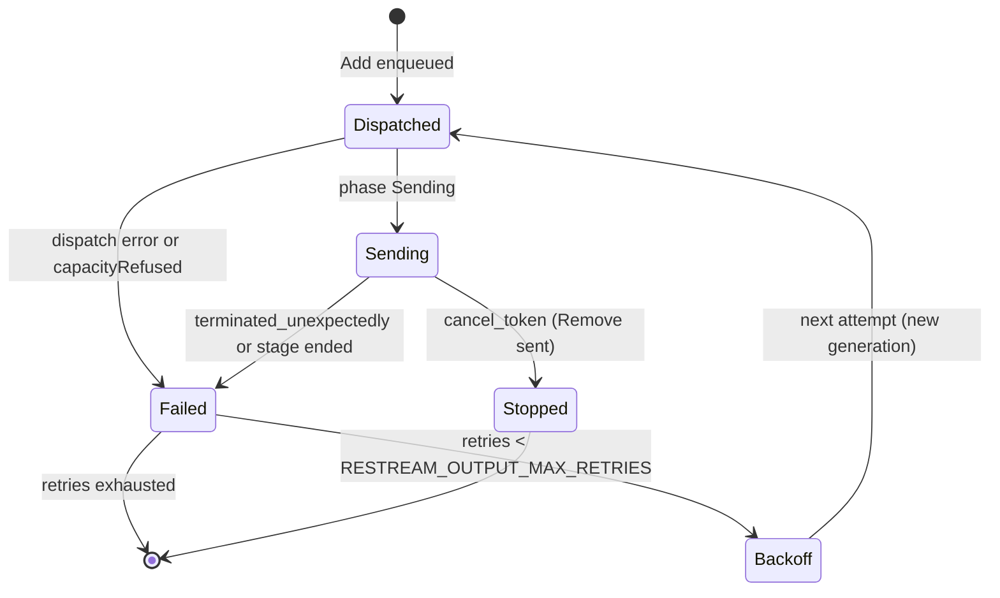

# Egress architecture

Every live output runs as a leaf on the egress fabric (`src/media/egress/`).
A leaf is one output's protocol state. A shard is an OS thread that owns many
leaves and visits them under a finite budget. Each prepared feed gets its own
small pool of shards. No output owns a thread, a Tokio media task or a private
media queue.

This page is the ownership and concurrency contract for that fabric. Protocol
wire details live in [Media pipeline](media-pipeline.md); every runtime
handoff is listed in [Runtime crossings](runtime-crossings.md).

## Contents

- [Outputs on the fabric](#outputs-on-the-fabric)
- [Ownership](#ownership)
- [Feeds and cursors](#feeds-and-cursors)
- [Shard loop](#shard-loop)
- [Commands and wakes](#commands-and-wakes)
- [Leaf lifecycle](#leaf-lifecycle)
- [Protocol engine contract](#protocol-engine-contract)
- [Backpressure, stalls and retries](#backpressure-stalls-and-retries)
- [Shard sizing and placement](#shard-sizing-and-placement)
- [Failure containment](#failure-containment)
- [Transport backends](#transport-backends)
- [Configuration](#configuration)
- [Observability](#observability)
- [Invariants and proofs](#invariants-and-proofs)

## Outputs on the fabric

`EgressTask::run` (`src/infrastructure/bootstrap/egress_task.rs`) picks the
path by URL scheme. Each fabric output becomes an `OutputSpec` with one
`ProtocolSpec` variant (`src/media/egress/command.rs`).

| Scheme | `ProtocolSpec` | Shard backend | Feed | Transport |
|---|---|---|---|---|
| `rtmp://`, `rtmps://` | `Rtmp` | `RtmpShardBackend` | `RingFeed` | Compio TCP; RTMPS via Rustls then kTLS |
| `srt://` | `Srt` | `SrtShardBackend` | `TsFeed` | `srt-rs` Compio `Owner` per address family |
| `http://`, `https://` HLS PUT | `HlsPut` | `HlsPutShardBackend` | `HlsStore` | Compio TCP; HTTPS needs kTLS |
| `moqt://` | `Moq` | `MoqShardBackend` | `RingFeed` | Compio QUIC (`src/media/moq/egress/`) |
| `sink://` | `Sink` | `SinkShardBackend` | `RingFeed` | none: discards after accounting |
| `pipeline://` | `Pipeline` | `PipelineShardBackend` | `RingFeed` | in-process publish to another pipeline |

HLS PUT has one exception. It uses the fabric only when
`RESTREAM_HLS_PUT_FABRIC` is on (default) and, for HTTPS, when kernel TLS is
available. Otherwise the output uses the Tokio Reqwest uploader
(`src/media/hls/upload.rs`).

## Ownership

The diagram shows who owns what, from the Tokio output task down to one leaf.



| Owner | Owns | Must not |
|---|---|---|
| `EgressTask` (Tokio) | One output attempt: `Add`, wait, `Remove`, retry bookkeeping | Touch media or sockets |
| `EgressFabricRuntime` | One feed's manager, shard group, sizer and wake handles | Run on a shard thread |
| `EgressManager` | Desired outputs, output-to-shard placement, generation checks | Move a live output |
| `EgressShardRuntime` | Command batch, ready backlog, `TimerWheel`, drain deadline, snapshot | Know protocol state |
| `EgressShardBackend` | Leaves, `ReadyQueue`, transport runtime, stall sweep | Leave its shard thread |
| `LeafCommon` | Cursor, generation, limits, progress, `EgressProgressSink` | Hold a media backlog |

The backend is built, used and dropped on its shard thread.
`EgressShardBackend` is not `Send`. Only the factory passed to
`EgressShardHandle::spawn_with` or `try_spawn_with` crosses threads. This lets
a backend own a per-thread Compio runtime and `Rc` state without locks.
`EgressShardHandle::spawn` (for already-built `Send` backends) is for tests.

Leaves live in a fixed-capacity `LeafArena` (`leaf_arena.rs`). A `LeafKey`
names a slot and its epoch. Removing a leaf bumps the epoch, so a stale queue
entry, readiness event or I/O completion no longer resolves.

## Feeds and cursors

The fabric reads a bounded, sequence-addressed, immutable feed through the
`EgressFeed` trait (`feed.rs`). Adaptors wrap existing rings
(`journal.rs`):

- `RingFeed` wraps a `RingBuffer`; units are `Arc<MediaPacket>`.
- `TsFeed` wraps the ring inside a `TsChunkRing`; units are `Bytes`.

| Method | Contract |
|---|---|
| `head_sequence`, `oldest_sequence` | Retained window; a cursor below `oldest_sequence` is overrun |
| `read_from` / `read_from_into` | Non-blocking; bounded by `ReadBudget` (default 64 units, 512 KiB) |
| `latest_sync_point`, `sync_point_at_or_after` | Positions a protocol can start from, such as a keyframe |
| `epoch` | Bumped by `FeedEpoch::advance` on a discontinuity |

A `FeedCursor` holds only `epoch` and `next_sequence`. It does not pin
entries. A slow leaf cannot make the feed grow.

A leaf starts with a placeholder cursor. On its first visit, `visit_leaf`
(`visit.rs`) primes it with `live_start_cursor`: the latest retained sync
point, or the head when none is retained. `HandshakeComplete` re-anchors the
cursor the same way, because handshake states never read the feed. The
start is never `oldest_sequence`; that would put the leaf a full retention
window behind live.

On `FeedOverrun` the leaf resynchronizes in place. The cursor moves to
`live_start_cursor`, the overrun is counted, and the connection stays up.
`FeedRead::EpochMismatch` reports a cursor from an old epoch.

## Shard loop

`EgressShardRuntime::run` (`shard.rs`) drives one backend. The diagram shows
one loop iteration.



- `idle_wait_bound` is the earliest of `RESTREAM_EGRESS_IDLE_WAIT_MS`, the
  next `TimerWheel` deadline and, while draining, the drain deadline.
- `wait_idle` returns `Command`, `BackendActivity`, `Timeout` or
  `Disconnected` (`EgressShardIdleWake`). The default waits on the command
  channel. RTMP, SRT, HLS PUT and MoQ backends override it to wait inside
  their Compio runtime for commands and I/O together.
- `BackendActivity` schedules one ordinary `on_ready` under the shared
  budget. It is not a command.
- The idle `on_ready` gives a quiet shard one real I/O poll per idle cycle,
  so a leaf waiting on a handshake byte is not stranded.
- `on_media_tick` runs every iteration. Backends use it for DNS completions,
  connect sweeps and the once-per-second stall sweep.
- `record_iteration` copies `ShardMetrics` into the shared snapshot. Thread
  CPU time is sampled about once per second.

The ready backlog is a fixed-capacity `VecDeque` sized
`command_channel_capacity + readiness_batch_budget`. Excess `ScheduleReady`
requests are counted in `ready_overflows`, not queued. A full `TimerWheel`
counts `queue_overflows`.

Inside a backend, `ReadyQueue` (`scheduler.rs`) holds each `LeafKey` at most
once and pops in FIFO order. A leaf that wants more work goes to the tail, so
one fast destination cannot hold the head.

## Commands and wakes

Control commands and media wakes share the bounded command channel but have
different rules.

| Command | Sender | Meaning |
|---|---|---|
| `Add(OutputSpec)` / `Update(OutputSpec)` | manager | Start or replace a leaf for this generation |
| `Remove(OutputId)` | manager | Close gracefully: flush, then close |
| `Abandon(OutputId)` | manager | Close without the end marker (no HLS `EXT-X-ENDLIST`) |
| `FeedWake` | feed producer | The feed may have new data |
| `DrainShard(ShardId)` | manager | Close every leaf on that shard |
| `Shutdown` | manager / group | Start the drain window, then stop |

The command path runs on Tokio and never waits for a shard.



`EgressManager` rules (`manager.rs`):

- A spec with a lower generation is `IgnoredStale`. The same generation is
  `AlreadyCurrent`. Each output attempt uses its registration `attempt_id` as
  the generation.
- The manager checks the shard's free command slots before it clones the
  spec. A full channel returns `CommandChannelFull`; the output records the
  error and its retry runs.
- A draining shard refuses new specs with `ShardDraining`.
- `Shutdown` is sent to every shard only if every channel has room.

Feed wakes skip the manager. The sequence shows one publication.



- `subscribe_fabric_wakes` (`runtime.rs`) registers one `FabricWakers` per
  feed on the ring's `PublishSubscribers`. No watcher task sits between the
  producer and the shards. One wake is sent at subscribe time.
- Per shard, at most one `FeedWake` is queued, plus one fallback bit when the
  channel was full. The loop services the fallback bit without a later
  publication. Neither path allocates per publish.
- The shard clears the gate before the backend reads any head. A publication
  after that read arms a new wake instead of being lost.
- `rescale` stores a new handle list in the shared `ArcSwap`, so shards that
  grow later get wakes from feeds subscribed earlier.
- A closed shard is not woken. Dropping the `FeedWakeSubscription`
  unsubscribes.

## Leaf lifecycle

Each backend tracks its real connection phase; the fabric does not impose
a second lifecycle state machine or retry timer:

| Backend | Phase type |
|---|---|
| RTMP/RTMPS | `pending_connects` → `connecting` → `RtmpFabricState::{Handshaking, Negotiating, Publishing}`; `draining_since` while closing |
| SRT | `PendingStage::{Resolving, …}` until the Owner admits the caller, then an `SrtFabricLeaf` |
| HLS PUT | `Conn::{Idle, Resolving, …}` per request connection |
| MoQ | `LeafLink` state shared with the leaf's Compio connection task |
| Sink, pipeline | Always ready; no connect phase |

The output-level lifecycle that operators see is driven by `EgressTask`, not
by a shard state:



## Protocol engine contract

A protocol engine implements `ProtocolEngine` (`backend.rs`). It owns
connection-local state and advances once per visit.

```rust
fn advance(
    &mut self,
    transport: &mut Self::Transport,
    readiness: Readiness,
    feed: &Self::Feed,
    cursor: &mut FeedCursor,
    budget: WorkBudget,
) -> EngineProgress;
```

An engine must not block, spawn threads or tasks, sleep, implement its own
retry delay, or hold a shared feed or registry lock during I/O. It must stop
when the transport would block and keep any partial wire state it needs to
resume. `WorkBudget` (`policy.rs`) ends a visit when units, bytes or the time
deadline run out; a visit always gets at least one unit.

`visit_leaf` maps the result to a scheduler decision:

| `EngineProgress` | Effect on the leaf | `VisitDecision` |
|---|---|---|
| `Progress { bytes, units, wait }` | Records progress; publishes to `EgressProgressSink` | `Continue` |
| `Needs(wait)` | Parks until `wait` is satisfied | `Suspend` |
| `HandshakeComplete` | Re-anchors the cursor at the live start | `Continue` |
| `FeedOverrun` | Resynchronizes the cursor in place; counts it | `Continue` |
| `Yield` | Budget spent; requeue at the tail | `Continue` |
| `PeerClosed`, `Failed(_)` | Logged; the backend closes the leaf | `Close` |

`WaitCondition` says what a parked leaf waits for: `Feed`, `Io(Interest)` or
`FeedOrIo(Interest)`. Only `Feed` and `FeedOrIo` leaves are re-queued by a
`FeedWake`. `RecoveryCapability` lets an engine advertise
`InPlaceResync`; the default is `ReconnectOnly`.

`visit_leaf` also rejects a stale generation (`StaleGeneration`) and catches a
panic inside `advance`. A panic becomes `Failed` with reason `engine_panic`,
so only that output fails.

## Backpressure, stalls and retries

The rule is: a slow leaf stops being runnable; it does not add work or
backlog.

- A leaf retains at most its pending wire state. `LeafLimits`, built from
  `LeafPolicy::default()`, bounds pending application bytes (256 KiB), feed
  lag (300 units) and time without progress (15 s).
- RTMP and SRT backends run a stall sweep at most once per second.
  `classify_stall` returns `Idle`, `Backpressured` or `Stalled` from pending
  bytes, progress age and lag. The lag ceiling applies to SRT only; RTMP
  passes 0 because a lagging TCP leaf catches up by reading.
- The sweep also writes feed lag, `backpressureReason` and protocol quality
  (`TCP_INFO` for RTMP, `srt-rs` statistics for SRT) into the output status.
- A `Stalled` leaf, a peer close or a failure closes the leaf. The backend
  sets `terminated_unexpectedly` and removes it. An explicit `Remove` never
  sets that flag.
- `Remove`, `DrainShard` and `Shutdown` drain first. RTMP and SRT leaves with
  queued bytes stay visited until the bytes flush or
  `RESTREAM_EGRESS_DRAIN_TIMEOUT_MS` (default 3 s) passes.

Retries are not a shard concern. `EgressTask` sees the flag within 250 ms,
records the error, sends `Remove` and returns. `EgressTask::run` then applies
the shared output backoff (`RESTREAM_OUTPUT_RETRY_BASE_MS` 5 s,
`RESTREAM_OUTPUT_RETRY_MAX_MS` 300 s, `RESTREAM_OUTPUT_MAX_RETRIES` 10) and
the reconciler starts a new attempt with a new generation. HLS PUT may
retry an individual failed request on a `ScheduleTimer` and reports it
through `UploadStatus`; this does not add another output-reconnect policy.

## Shard sizing and placement

Each feed has its own `EgressFabricRuntime` and shard group. A feed's pool
starts with one shard.

- **Placement.** RTMP, SRT, HLS PUT and MoQ use
  `PlacementPolicy::LeastLoaded`: the placement shard with the fewest live
  outputs, ties broken by rendezvous score. Sink and pipeline use
  `Rendezvous` (`assign_output_to_shard`). A live output never moves.
- **Growth.** Before an `Add`, `rescale` asks `ShardSizer` (`sizing.rs`) for
  the shard count that keeps projected busy time at 50%. Demand is measured
  CPU time per delivered bit times the feed's bitrate. Before the first
  healthy measurement it uses a cold prior: 128 outputs per shard
  (`EgressShardProfile::OutputCount`) or 64 for SRT
  (`SrtOutputCount`) at 4.8 Mbit/s. New shards serve only new outputs.
- **Admission.** `admit_add` refuses an `Add` if the chosen shard would run
  above 60% busy (`ADMIT_CEILING`). The output reports
  `capacityRefused` and retries on its backoff. Admitted outputs are never
  shed.
- **Shrink.** On each reconciler tick, `resize_*_fabrics` (`Observe`) runs
  for RTMP, SRT and MoQ; a runtime observes at most every 5 s. After 60
  healthy low-load windows, a 5-minute dwell, and projected load under 40%
  on one shard fewer, new outputs stop going to the tail shard. Its thread
  stops once its last output leaves.
- **Ceiling.** The pool never exceeds `clamp(effective CPUs, 2, 8)` or
  `RESTREAM_EGRESS_SHARDS`, whichever is lower.
- Sink and pipeline pools are not adaptive: one shard per 128 outputs, same
  ceiling.

The SRT prior and the 60% ceiling come from a delivery-checked single-shard
test (see [Runtime crossings](runtime-crossings.md#measurement-references),
M6).

## Failure containment

| Failure | Blast radius | Mechanism |
|---|---|---|
| Engine panic | One output | `catch_unwind` in `visit_leaf`; output closes and retries |
| Slow or dead destination | One output | Budgets, parking, `LeafLimits`, stall sweep |
| Stale event after removal | None | `LeafKey` epoch; generation check in `visit_leaf` |
| Shard panic outside a visit | Outputs on that shard | `EgressShardSnapshot::panicked`; health `Panicked`; critical alert |
| Native call that blocks | Outputs on that shard | Not contained; other shards and feeds keep running |

Shards share no mutable leaf state and take no process-wide lock on the hot
path. Cross-shard contact is feed reads, wake gates, the command channel and
the snapshot mutex written once per loop iteration.

The shard thread catches panics and publishes a panicked snapshot;
commands to that dead instance fail. The next fabric resize check:

1. Releases that shard's desired outputs and marks only their shared
   progress sinks unexpectedly terminated.
2. Excludes the dead shard from placement until a replacement starts.
3. Constructs the backend on its new shard thread and refreshes feed wake
   handles.
4. Lets affected `EgressTask`s retry through the ordinary backoff path.

Reconciliation invokes recovery for every fabric kind, including fixed
pools and quiet sink, pipeline and HLS PUT feeds. Failed replacement
construction is reported and retried on the next check. Healthy siblings
are unchanged. There is no desired-output replay or socket migration.
A stalled but live shard is reported, not replaced: it still owns resources
that cannot safely be taken by another thread.

## Transport backends

### RTMP and RTMPS

- Each shard owns one Compio io_uring runtime in `CompioTcpPoller`. Shard
  construction fails if io_uring is unavailable.
- DNS runs on the backend's resolver worker (`ResolvingRtmpShardBackend`),
  never on the shard thread.
- Each peer starts with one non-blocking `connect(2)`. Only `EINPROGRESS`
  sockets are registered with `PollFd`. A rotating scan visits at most half
  of `RESTREAM_EGRESS_TCP_POLLER_MAX_EVENTS` pending connects per poll.
- Established sockets never enter the `PollFd` set. One receive worker and one
  transmit worker per connection use one-shot Compio operations and send
  generation-tagged completions. Read and write flags are ORed before the
  next visit.
- RTMPS uses Rustls for the handshake, then requires kTLS. An unsupported
  suite or missing kTLS fails the output; there is no userspace fallback. TLS
  1.3 session tickets are discarded, so session resumption is not used. A TLS
  1.3 KeyUpdate fails the output.
- Raw-to-FLV payload conversion is memoized per shard
  (`SharedRtmpPayloadCache`), so outputs on one shard share converted
  `Bytes`.

Per-leaf transport buffers (`compio_tcp/stream.rs`):

| Buffer | Bound |
|---|---:|
| Queued RX (`TRANSPORT_BUFFER_CAPACITY`) | 4 KiB |
| Receive buffer (`IO_CHUNK`) | 4 KiB |
| TX staged plus in flight (`TRANSMIT_BUFFER_CAPACITY`) | 64 KiB |
| Copied-run buffer (`COPIED_RUN_CAPACITY`) | 4 KiB |

Media payload in TX staging is mostly shared `Bytes` from the feed; the
private copy is usually headers and control messages. Capacity planning must
still assume the full bound per leaf. It excludes engine, TLS and kernel
socket buffers.

### SRT

- Each shard runs one Compio runtime on its thread and at most one
  `srt_transport::compio::Owner` per address family. Each Owner owns one
  caller UDP socket, a caller pool and a fixed TX pool. No output has its own
  runtime, task, socket or Owner.
- DNS runs on the shard's `srt-dns-res` worker.
- `Owner::connect` and `connect_bonded` return `Admitted`, `Queued` or `Full`.
  The caller pool (`RESTREAM_SRT_EGRESS_CONNECT_CONCURRENCY`, default 64,
  with an equal queue) bounds in-flight handshakes. Each output's
  `connect_timeout` (`RESTREAM_SRT_CONNECT_TIMEOUT_MS`, default 10 s) starts
  at pool admission. A late admission for an old generation is retired.
- A bonded output is one leaf and one logical caller. All legs must resolve
  to one address family. A `PeerGroupCollision` fails only that output.
- A ready batch services each Owner once under `OwnerServiceBudget`, drains
  bounded Owner event queues, then visits leaves. Each batch starts with one
  non-blocking driver poll, so a shard that never idles still reaps TX
  completions (`a_shard_that_never_parks_still_reaps_tx_completions`).
- SRT protocol timers stay inside the Owner. `wait_idle` parks in the Compio
  runtime until a command, Owner activity or the earliest Owner deadline.
- A peer or transient TX failure affects one caller. A structural Owner fault
  retires that family's leaves and keeps admission closed for the shard's
  life; the other family keeps running.

The SRT shard needs a working io_uring runtime. Receive mode is chosen per
Owner under `RxModePolicy::ManagedPreferred`:

| Runtime state | Result |
|---|---|
| io_uring denied or unavailable | Shard fails: `SrtFabricShardGroupError::Backend`; no fallback runtime |
| io_uring works, no provided-buffer ring or multishot | `OwnerRxMode::RawReadiness` |
| io_uring, provided-buffer ring and `recvmsg` multishot | `OwnerRxMode::ManagedMultishot` |

Startup logs `srt egress shard runtime ready` per shard and
`srt egress owner attached` per family, with `substrate_diagnosis`
(`buffer-ring-denied-by-policy` for `EPERM`/`EACCES`,
`buffer-ring-unsupported-by-kernel` for `EINVAL`). Shutdown logs
`srt egress owner final counters`. Docker needs the shipped seccomp profile
([distribution/docker/README.md](../distribution/docker/README.md)).

### HLS PUT, MoQ, sink and pipeline

- **HLS PUT** reads segments and playlists from the pipeline's `HlsStore`.
  It uses the same `CompioTcpPoller` as RTMP and issues HTTP/1.1 requests
  (`http1.rs`). Failed requests retry on a shard timer; a rejection such as
  401 ends the output without retry.
- **MoQ** opens one Compio QUIC connection task per output on the shard's
  runtime. The engine reads the `RingFeed` and writes the hang catalog and
  media tracks. See [Runtime crossings](runtime-crossings.md#moq-crossings).
- **Sink** discards units after recording progress. It exercises the same
  manager, scheduler, cursor and status paths without a network.
- **Pipeline** publishes units into another pipeline's input in the same
  process through `RecirculationInputPublisher`. It shares
  `Arc<MediaPacket>`; nothing is serialized.

## Configuration

`EgressFabricConfig::from_env` (`src/config.rs`) parses and clamps the
`RESTREAM_EGRESS_*` variables; `validate` logs warnings for risky
combinations but never stops startup. Variables, defaults, ranges and the
warnings are listed in [Configuration](configuration.md#egress-fabric).

## Observability

Each shard publishes an `EgressShardSnapshot` once per loop iteration.
`EgressFabricRuntime::heartbeat` turns it into `EgressShardHeartbeat`, and
`MediaEngine::egress_fabric_shard_statuses`
(`engine_egress_fabric_diagnostics.rs`) merges every protocol's shards.

| Consumer | Source |
|---|---|
| `GET /metrics/system` | `src/api/telemetry/system.rs` |
| Status and resource map | `src/api_runtime_views/status.rs`, `resource_map.rs` |
| Runtime state, capacity | `src/application/runtime_state/`, `src/capacity.rs` |

Heartbeat health is `Healthy`, `Stalled` (no loop progress for
`SHARD_STALL_AFTER`, 10 s), `Stopped` or `Panicked`. Fields include loop
iterations, command depth and capacity, ready depth and high-water mark,
ready visits, budget exhaustions, feed resyncs, TX/RX counters, completion
counters and, for SRT, per-family Owner metrics.

Alerts (`src/alerts.rs`), keyed
`engine:egress_fabric:{protocol}:{feed}:{shard}:…`:

| Alert | Severity | Condition |
|---|---|---|
| `panicked` | Critical | Shard thread panicked |
| `stalled` | Warning | Shard state `stalled` |
| `stopped` | Warning | Shard stopped with outputs assigned |
| `command_overload` | Warning | Command depth ≥ 80% of capacity |
| `repeated_resync` | Warning | `resyncCount` ≥ 5 |

Per output, the shard writes through `EgressProgressSink` with relaxed
atomics: bytes and units sent, last progress time, resync count, feed lag,
backpressure reason, quality and the termination flag.

## Invariants and proofs

1. Each leaf is in its backend's `ReadyQueue` at most once
   (`scheduler.rs` Kani proofs).
2. A removed leaf's key never resolves again (`leaf_arena.rs` Kani proofs).
3. A visit never takes more than its unit or byte limit (`policy.rs` Kani
   proofs).
4. A stale generation cannot mutate a leaf (`visit_leaf`); the manager
   ignores stale and duplicate specs.
5. A publication after the shard reads heads is never lost
   (`tests/egress_feed_wake_loom.rs`, `shard/tests/feed_wake.rs`).
6. An engine panic fails only its output
   (`panicking_leaf_fails_alone_and_its_shard_keeps_serving_the_others`).
7. A blocked leaf does not starve a ready one on the same shard
   (`shard/tests/leaf_isolation.rs`).
8. Publication never waits for a shard; a full channel leaves one fallback
   bit, not a blocked producer.
9. A cursor never pins feed entries; overrun moves the leaf to the live
   start.
10. A live output never changes shard; resizing affects new outputs only.
11. Backends are built, used and dropped on their shard thread (`!Send`).

The visit cost has a micro-benchmark, `benches/egress_visit.rs`. Proof
selection is described in [Concurrency proofing](concurrency-proofing.md).
