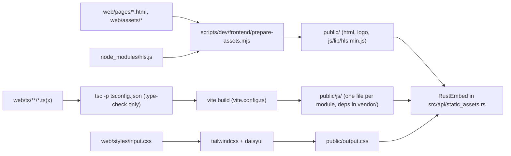
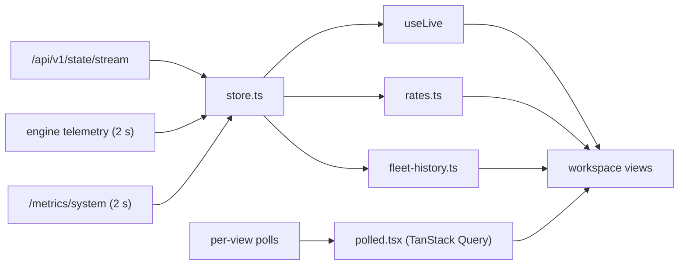
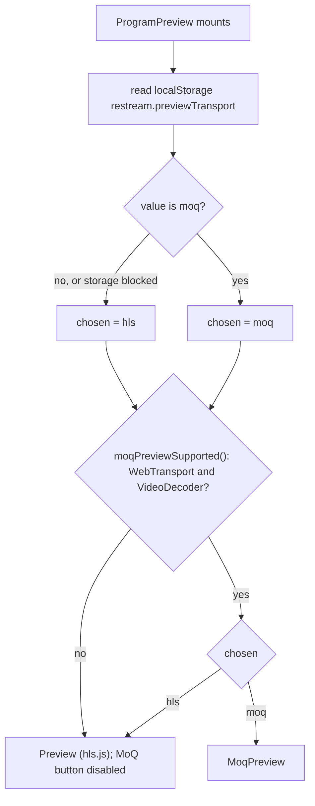
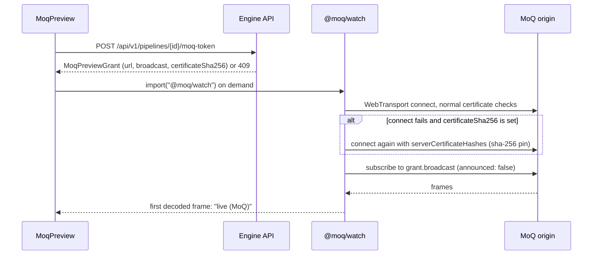

# Frontend

The dashboard is one React page: the control room. This page covers its
design system, how it is built, how it reads data, what each workspace
shows, and how previews play. Source lives in `web/ts/` and
`web/styles/input.css`; `public/` is generated and not committed. The target
operator experience is the
[control-room mockup](design/control-room-mockup.html) (illustrative data).

## Contents

- [Build](#build)
- [Design system](#design-system)
- [Components](#components)
- [Shell and routing](#shell-and-routing)
- [Data flow](#data-flow)
- [Workspaces](#workspaces)
- [Managing pipelines](#managing-pipelines)
- [Logs and diagnostics](#logs-and-diagnostics)
- [Previews](#previews)
- [Proof](#proof)

## Build

`npm run build:frontend` builds everything into `public/`. The engine embeds
`public/` at compile time (`RustEmbed` in `src/api/static_assets.rs`) and,
in development, serves files from disk first.

The diagram shows the steps of `build:frontend` in `package.json`.



- `prepare-assets.mjs` clears the old output, copies `index.html`,
  `login.html`, `base-path.js`, `login.js` and `logo.png`, and copies
  `hls.min.js` without its source-map comment.
- `vite.config.ts` makes every module under `web/ts` an entry and uses
  `preserveModules`, so `public/js` mirrors `web/ts`. The dashboard loads
  its views lazily, and tests import single shipped modules. Dependencies go
  to `public/js/vendor/`, because Node treats files under `node_modules` as
  CommonJS.
- `scripts/release/prepare-build-tree.sh` checks that the key outputs exist
  before a release build (`public/index.html`, `public/output.css`,
  `public/js/control-room/main.js`, `public/js/lib/hls.min.js`, and others).

```sh
npm ci
npm run build:frontend
```

## Design system

Restream is a compact broadcast operations console. It must feel quiet,
precise and easy to scan under time pressure. Status drives the look:
restrained surfaces, clear state color, and media only when an operator asks.

### Color

The console uses DaisyUI's `dim` theme (`web/styles/input.css`). Components
use semantic Tailwind and DaisyUI tokens, not fixed palette values.

| Role | Token | Usage |
|---|---|---|
| Page surface | `base-300` | Application background |
| Section surface | `base-200` | Primary panels |
| Item surface | `base-100` | Rows, cards, menus |
| Primary text | `base-content` | Labels and values |
| Secondary text | `base-content/70` | Supporting information |
| Border | `base-content/10` | Panel and row separation |
| Primary action | `primary` | Create and submit actions |
| Operational action | `accent` | Start, select, preview and promote |
| Healthy | `success` | Connected and forwarding |
| Attention | `warning` | Recovering and awaiting media |
| Failure | `error` | Failed and destructive actions |
| Information | `info` | Neutral runtime notices |

Status color always carries meaning. Do not use decorative color or
gradients.

### Typography

- Sans stack: Aptos, Segoe UI Variable, Segoe UI, IBM Plex Sans, Helvetica
  Neue, Arial, sans-serif.
- Mono stack: Cascadia Mono, Cascadia Code, JetBrains Mono, SFMono-Regular,
  Consolas, Liberation Mono, monospace.

| Level | Size | Weight | Usage |
|---|---|---|---|
| Page title | 18px | 600 | Workspace title |
| Section title | 16px | 600 | Panel heading |
| Item title | 14px | 600 | Input, output or monitor name |
| Body | 15px | 400 | Default console text |
| Supporting | 14px | 400 | Descriptions |
| Metadata | 12px | 400–600 | Runtime and protocol details |
| Compact label | 11px | 600 | Uppercase field labels |

Letter spacing is zero, except compact uppercase labels, which use
`tracking-wide`.

### Spacing and layout

- Spacing uses Tailwind's 4px unit. Panel padding is 16px, compact rows
  8–12px, section gaps 12–16px. Content width is `max-w-7xl`.
- The document owns scroll. Monitor cards use a responsive grid and fixed
  16:9 media frames.
- At 375px, controls and rows reflow to one column with no horizontal page
  scroll. Stream keys and URLs scroll or wrap inside their own field.

### Motion and depth

- Use DaisyUI's hover, active and focus behavior. State transitions are
  100–200ms transform or opacity changes. Loading media may use the spinner.
  Respect `prefers-reduced-motion`; add no decorative motion.
- Separate surfaces with borders and tone: sections `base-200`, rows
  `base-100`, borders `base-content/10`. Shadows only on popovers and menus.
  Card radius is at most 8px.

### Accessibility

The target is WCAG 2.2 AA: 4.5:1 body text, 3:1 large text, visible focus,
full keyboard reach, semantic buttons and labels, and no color-only status.
Touch targets are at least 36px on compact surfaces. There is no open
accessibility debt.

## Components

| Component | Structure | Variants | States | Accessibility |
|---|---|---|---|---|
| Dashboard section | Section, optional header, full-width content | Standard, table, compact | Loading, empty, populated, error | Labelled by its heading |
| Operational row | Title and state, metadata, command cluster | Selected, standby, disabled, disconnected | Default, hover, focus, busy, error | Command labels name the affected input or output |
| Status badge | Short state label, optional detail | Healthy, attention, failure, neutral | Static | Text at AA contrast; color is never the only signal |
| Monitor card | Title, state, actions, 16:9 frame | Input, program, output monitor, empty | Idle, loading, playing, offline, error | Media controls keyboard-reachable; buttons name their monitor |
| Input manager | Compact input rows plus an add command | Selected primary, selected backup, standby, disabled | Loading, empty, busy, error, maximum reached | Labels, keys, URLs and actions reachable by keyboard and screen reader |

Command clusters wrap and become a vertical stack on narrow widths. Monitor
cards sit in a grid; do not nest cards.

## Shell and routing

`/` is the dashboard: one React root (`web/ts/control-room/main.tsx`) in
`web/pages/index.html`, mounting a TanStack Router (`router.tsx`).

- The place is in the query: `?w=<workspace>` and, for a pipeline view,
  `&p=<pipeline id>`. `route.ts` holds the pure rules; `router.tsx` wires
  them to TanStack Router, which owns history and link clicks.
- An absent or unknown workspace opens Fleet. The pipeline is kept across
  workspaces. Other query parameters are kept after `w` and `p`; a repeated
  parameter keeps its first value.
- Links (`PlaceLink`) are real `href`s; a plain click navigates in place.
- The engine serves the same page for unknown top-level paths, so the place
  is read from the query on any path (`/index.html?w=operate` included). A
  link from there canonicalises to `/`.
- A nested unknown path (`/a/b?w=inspect`) redirects to the shell's
  directory with a relative `../` per level, keeping the query. Asset URLs
  are relative so the page can sit under a proxy prefix.
- Errors: the page renders `#error-alert`, `#error-msg` and `#saving-badge`,
  which `core/api.ts` reports into, so a failed mutation is shown.

## Data flow

The diagram shows where views get their data.



- `store.ts` holds what is pushed or sampled for the whole page. It follows
  the revisioned runtime state stream and samples engine telemetry and host
  metrics every 2 s while a view is subscribed. Views read it through
  `useLive` and hold no copy.
- Per-view polls use TanStack Query (`polled.tsx`).
- Rates come from two successive telemetry samples of one ingest session or
  output (`rates.ts`). A counter that went down, or a failover to another
  input, has no rate.
- The header shows the stream state (`live · rev N` or `reconnecting`) and
  the age of the oldest sampled source. A steady system sends no deltas, so
  time since the last change means nothing.
- Panels show the age of their sample and turn amber once it is older than
  2.5 samples. A stale or missing source is a gap, never a zero or a frozen
  value.

## Workspaces

Every workspace shows live data only.

### Fleet

- Delivery counts. Degraded outputs grouped by cause: an upstream cause
  (with stage or shard) covers every output it stalls; destination causes
  stay per output. Ranked by outputs affected, upstream first on a tie.
  Wanted outputs that neither deliver nor carry a diagnosis count as
  starting, never healthy.
- Headroom from `/metrics/system`: measured host use; egress flow only when
  shards measured it (`flowMeasured`); and, labelled as such, the capacity
  model's projection from calibration priors (observe-only).
- Shared work (`uniqueStages` serving `activeLeaves`, from the capacity
  snapshot) and the open-alert count with its age (the `aggregate-alerts`
  query that Incidents uses).
- History of headroom (100 less projected utilization, raised to the
  deepest egress shard's measured queue when shards run), delivery, and
  degraded outputs by layer. Source: `LiveSnapshot.history`, one
  `fleet-history.ts` sample per store sample, kept 15 min for this page
  session.
- A worst-first table of at most 10 pipelines, sharing rows with Pipelines
  (`pipeline-table.tsx`) and linking there for the rest.

### Pipelines

- The inventory, attention first, then size. Search by name or id; filter
  by the same health rule as Fleet; outputs by protocol.
- Above it, from runtime state (`pipelines-model.ts`): fleet protocol mix,
  shared stages (running outputs grouped by `stage`, largest first), and
  cards (needs attention, warm standby, bonded SRT, recording) that narrow
  the table.

### Operate (one pipeline)

- Source deck from the state's `inputs` (RTT from the telemetry `inputs`),
  with Promote and each input's preview.
- Media path (`operate-graph.tsx`) in four views:
  - Graph: the state's `graphs` entry with telemetry counters attached
    (`state-views.ts`), laid out by longest path. Each shared stage is drawn
    once with its consumer count; destinations fold per upstream stage and
    protocol; egress nodes join outputs on `outputId`.
  - Destinations: the same groups as a table.
  - Timeline: the pipeline's kept lifecycle events, newest first.
  - Preview: the program (see [Previews](#previews)).
- Selecting a group opens its inspector (`operate-group-model.ts`):
  delivering count, worst delivery ratio, worst feed lag and resyncs; the
  fabric shards its outputs run on (`fabricFeed`, `shardId`) with state,
  command queue and progress age from `/metrics/system` (`egressShards`);
  and each diagnosed output's layer, cause and ruled-out layers.
- Destination matrix from the state stream (feed lag from the running
  egress, rate from telemetry) with Start/Stop. Degraded first, capped at
  200 rows, with the hidden count, how many of them need attention, and
  "show all".

### Inspect (one pipeline)

- Resource map polled every 2 s
  (`/engine/resource-map?pipeline_id=…&view=detail&top_n=200`). Nodes under
  pressure first, then by memory. Each node has a confidence (measured,
  derived, estimated, unmeasured). The count of nodes the server left out is
  shown.
- Detail panel: metric cards (graph consumers, measured CPU with the FFmpeg
  child PID, input packet rate, work per packet) and the engine's bottleneck
  judgement. A missing number is left out, not shown as zero. A selected
  stage adds its pipe counters (`/stages/{key}/telemetry`) and says when the
  engine no longer has the stage.
- "Global resource map" drops `pipeline_id`; there is no consumer card then.
- Source ring fill and retained payload (`sourceRings`), the egress shards
  this pipeline uses, and the attribution legend.
- Diagnostics: see [Logs and diagnostics](#logs-and-diagnostics).

### Monitor (one pipeline)

- Ingest and egress rate, share of wanted outputs delivering, worst feed
  lag, ring fill, and the slowest shard progress age. Sampled every 2 s on
  one clock and kept in the page for 15 min (the engine keeps no history).
- A non-live stream, stale source or truncated map is a gap in the line.
- Each rise of the degraded count from 0 is an incident onset, marked on
  every line and listed by time. A pipeline degraded at page load has no
  onset in view.
- Pause freezes the window while sampling goes on. Compare, while paused,
  overlays the live window dashed on the same scale.
- Below (`monitor-path.ts`): the selected input's transport metrics (only
  what its protocol reports), the shared media path (ring fill, worst
  reader lag, each stage's packet rate and readers, reader overflows), and
  the destination outlier: the wanted output with the lowest delivery ratio
  under the engine's 0.95 floor, against the median of its peers on the
  same stage and protocol.

Operate, Inspect and Monitor share one header and picker
(`pipeline-scope.tsx`).

### Incidents

- Every open alert (`/alerts`): critical first, then widest scope, then
  oldest. The selected alert's events (`/events`) from a minute before it
  opened, and its evidence packet: diagnosis layer and cause, layers ruled
  out, evidence lines marked `measured` or `derived`, and the action.
- Resolved list from `/alerts?since=` (15m/1h/6h/24h), with a note when the
  window passes the engine's kept history.
- Correlation chart from `/fleet/history?since=&until=` (engine samples
  every 5 s, keeps 24 h): from a minute before open to a minute after
  close, then only new samples. Lines: delivering, headroom, degraded, with
  cursors at open and close. Notes say when kept history or the event log
  starts after that minute.
- "Export evidence" downloads alert, packet, timeline and samples as one
  JSON file built in the browser.

### Capacity

- The `/metrics/system` capacity snapshot (load per service center,
  labelled calibration priors, observe-only).
- Flow Doctor: measured from the busiest shard, or projected when none runs.
- Scenario form: baseline and projection both come from
  `/capacity/scenario`; the page computes no capacity number. Pick the
  pipeline (highest-bitrate live one by default), protocol and encoding
  (new renditions are shared stages). The calibration table shows each
  limit and whether it is configured or a prior. "Draft it in Changes" opens
  a planned change.

### Media

- Media directory (`/media`) split into recordings and source files, newest
  first, with search.
- Selected file: stored forms, probe (`/media/{file}/analysis`, once on
  select), and whether it can feed a live pipeline as is. The engine judges
  sparse GOPs against its live GOP target; with fewer than two keyframes it
  measures no spacing, so a long file needs Live Optimized.
- Upload, rename, and confirmed delete (refused while a pipeline ingests
  the file). Media disk from `/metrics/system`.
- A recording shows its timeline from the persisted session (`recordings`
  table) and the remux state: start; `converting` at stop; `endedAt` when
  the browser MP4 was written; a failed remux keeps the `.ts`. Rows are
  selected by session id, so selection survives `.ts` → `.mp4`. A rename
  breaks the join (by stored path) and loses the timeline.
- "Use as source" opens the new-pipeline form with a looping file source
  (Live Optimized when needed) and goes to its Operate view.

### System

`/engine/health` every 10 s: host checks (warnings first), io_uring and TLS
capability, execution classes (media workers, RTMP and SRT ingress owners,
egress shards, FFmpeg children, configured Tokio workers), SRT ingress
counters with every non-zero loss or lateness count, and build, native
libraries and SBOM from `/engine`.

### Settings

Reads `/settings` once (it lists every pipeline and output, so it is never
polled). Each card saves only its part: general names, SRT ingest (10–79
byte passphrase), transcode profiles (built-ins kept), failed-attempt
limits, dashboard password. The failed-attempts list is polled; forgetting
one client sends its scope key, forgetting all sends no scope (other scopes
get 400). Log out is on the password card.

### Changes

Uses the [agent plane](api-reference.md#agent-plane): one pipeline, one or
more destination changes (add, change, start, stop, remove) and a reason.

1. Preview asks `/agent/plans` to judge (nothing mutates). It shows only
   while the form matches what was judged.
2. A valid preview shows impact: the topology diff (outputs by stage and
   protocol, before and after) and, for additions, `/capacity/scenario`
   before and after (removals are counted, not credited).
3. A valid preview creates an operation. The operator approves it (as this
   session, with an audited reason), applies and verifies.
4. "Verified" is the engine's four gates: desired state; started outputs
   running; no new critical alert on the changed pipelines since apply; host
   still under safe utilization. Per-change checks, alert delta and active
   graph nodes are listed under them.
5. Verification checks one moment, so it can run again.

A refused apply returns 400 with the failed record; the page shows the
reason and warns that earlier changes may be applied. The convergence
timeline merges audit events and output changes in time order. The tab
keeps the operation id in `sessionStorage`; operations live in engine
memory, so after a restart (404 `operationNotFound`) the page starts over.

## Managing pipelines

Files: `operate-manage.tsx`, `pipeline-form.tsx`, `output-form.tsx`, rules
in `manage-model.ts`.

- Pipelines has New pipeline; its Operate view opens once stored.
- Operate reads `/settings` once and after each edit, and adds: Record
  (armed until a source arrives; `enabled` and `active`), play/stop of a
  file source (polled from `/pipelines/{id}/file-ingest`), confirmed delete,
  and the settings form (name, stream key, "Issue a new stream key" locked
  while any destination runs, live or file source, per-pipeline SRT ingest
  override).
- An edit re-sends the source only when it changed, because re-sending a
  file source restarts its ingest.
- The source deck adds backup inputs with publish URLs, and enables,
  disables or deletes them. The primary and the selected input offer
  neither; the engine refuses both.
- An input is a stream key (RTMP, SRT or HLS push) or a remote HLS URL the
  engine pulls, with a rendition rule (highest or lowest bandwidth) and one
  credential: none, bearer token, cookie string, username and password, or
  custom headers. Signed URLs need none. A stored secret is shown only as
  state, and a save that does not touch it keeps it.
- The destination matrix adds, edits and deletes destinations: preset
  server plus key or a full URL, SRT fields, RTMP flavour, passthrough or a
  profile, and audio routing. Notes from the destination's caps say what is
  dropped or downmixed. Caps are advice; they never block a save. Tracks
  come from `/pipelines/{id}/probe`; pickers always include a stored track.

## Logs and diagnostics

Logs (`logs.tsx`, rules in `diagnose-model.ts`):

- Reads the newest 200 rows (`/logs`), then streams matches from
  `/logs/stream`, resuming after the newest row, so no row is lost or
  doubled. One filter set: scope (all, engine-wide, pipeline, destination),
  lowest level, lifecycle-only.
- Keeps 500 rows, newest first. Pause closes the stream; Resume reopens it
  after the newest row shown. A failed read offers Read again.

Inspect's Diagnostics runs `POST /pipelines/{id}/diagnostics/run` on
request and downloads the result as a `restream.diagnostics.v1` report.

## Previews

Previews play only when asked, because a preview makes the engine produce
media for it.

### HLS

`preview.tsx` plays the program (`/hls/{pipeline}/master.m3u8`) and each
connected input (its `previewUrl`) muted through hls.js.

- The engine answers 404 until the first segment exists, so the player
  retries 404s for up to 15 s. Safari's native player does not retry, so the
  page polls the playlist first.
- Buffered media that has not grown for 20 s is a stall (a stopped source
  raises no player error). The preview stops and offers Retry. Waiting reads
  "buffering", never "live". A 401 goes to the login page.
- More than one audio track adds a track picker.
- Input previews are always HLS: the MoQ origin serves pipeline broadcasts.

### Program transport switch

`ProgramPreview` in `operate-graph.tsx` shows an HLS | MoQ radio group. The
diagram shows how it picks the player.



- HLS is the default. A click stores the choice in `localStorage`; if
  storage is blocked, the choice lasts this visit.
- MoQ needs WebTransport and WebCodecs (`VideoDecoder`). Otherwise the MoQ
  button is disabled with a tooltip.

### MoQ

`MoqPreview` (`moq-preview.tsx`) plays the program straight from the
engine's [MoQ origin](media-pipeline.md#moq-origin) on a canvas, muted. The
diagram shows one attempt.



- `mintMoqPreview` (`core/api.ts`) returns no grant on 409 (MoQ listener
  off) or 404 (pipeline gone). The preview then fails with "MoQ is off on
  this engine".
- `@moq/watch` loads only when the operator starts the preview.
- Pinning is the fallback, not the first try: browsers accept a pinned
  certificate only if it is valid for at most 14 days, which fits the
  engine's short-lived self-signed certificate. WebSocket fallback is off.
- States: starting, playing ("live (MoQ)"), buffering (decoder stalled),
  failed. It fails with a reason when the session closes or no frame
  decodes within 15 s (`FIRST_FRAME_MS`). Retry starts a new attempt.

## Proof

Node tests in `test/frontend/`: `control-room-fleet`,
`control-room-fleet-history`, `control-room-pipelines`,
`control-room-operate`, `control-room-operate-group`,
`control-room-state-views`, `control-room-input`, `control-room-inspect`,
`control-room-monitor`, `control-room-incidents`, `control-room-media`,
`control-room-system`, `control-room-settings`, `control-room-changes`,
`control-room-manage`, `control-room-diagnose` (each `.test.mjs`), and
`frontend-runtime-state-stream.test.mjs` (stream liveness).
`test/frontend/control-room.spec.ts` runs Playwright against a running
engine.

```sh
npm run test:frontend
npm run test:e2e
```
