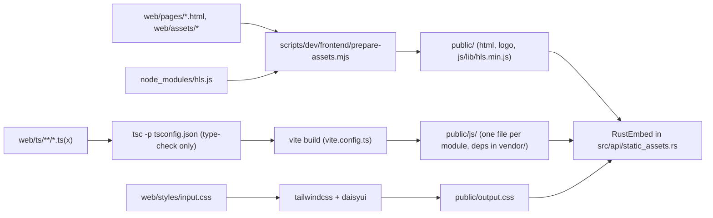
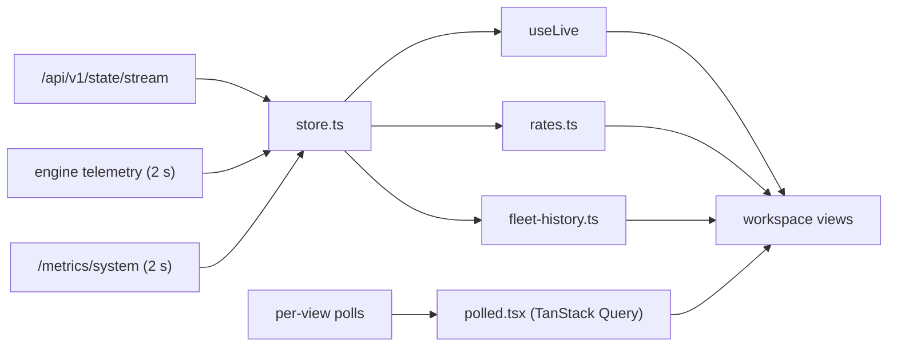
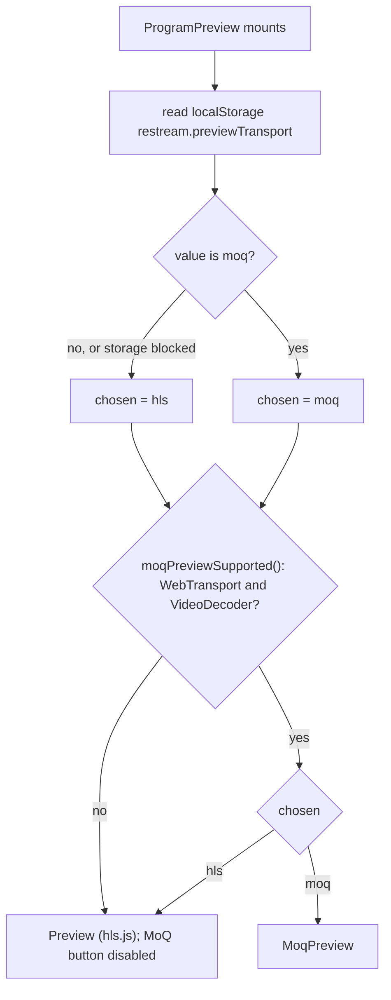
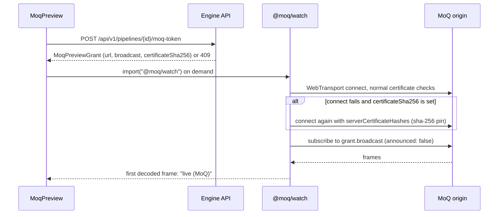

# Frontend

The dashboard is one React page: the control room. This page covers its
design system, how it is built, how it reads data, what each workspace
shows, and how previews play. Source lives in `web/ts/` and
`web/styles/input.css`; `public/` is generated and not committed.

## Contents

- [Build](#build)
- [Design system](#design-system)
- [Components](#components)
- [Shell and routing](#shell-and-routing)
- [Data flow](#data-flow)
- [Workspaces](#workspaces)
- [Managing pipelines](#managing-pipelines)
- [Logs and diagnostics](#logs-and-diagnostics)
- [Previews](#previews)
- [Proof](#proof)

## Build

`npm run build:frontend` builds everything into `public/`. The engine embeds
`public/` at compile time (`RustEmbed` in `src/api/static_assets.rs`) and,
in development, serves files from disk first.

The diagram shows the steps of `build:frontend` in `package.json`.



- `prepare-assets.mjs` clears the old output, copies `index.html`,
  `login.html`, `base-path.js`, `login.js` and `logo.png`, and copies
  `hls.min.js` without its source-map comment.
- `vite.config.ts` makes every module under `web/ts` an entry and uses
  `preserveModules`, so `public/js` mirrors `web/ts`. The dashboard loads
  its views lazily, and tests import single shipped modules. Dependencies go
  to `public/js/vendor/`, because Node treats files under `node_modules` as
  CommonJS.
- `scripts/release/prepare-build-tree.sh` checks that the key outputs exist
  before a release build (`public/index.html`, `public/output.css`,
  `public/js/control-room/main.js`, `public/js/lib/hls.min.js`, and others).

```sh
npm ci
npm run build:frontend
```

## Design system

Restream is a broadcast operations console. Every section leads with a
verdict and the action it calls for; the counters behind it are one switch
away in the section itself, never a console-wide mode. Status drives the look: restrained surfaces, clear
state colour, and media only when someone asks. The whole system is
token-based, so both themes and both densities come from one set of
components.

### Themes, density and section detail

Viewer preferences live in `localStorage` (`restream.theme`,
`restream.density`, and `restream.detail.<section>` per section;
`ui/prefs.tsx`). Blocked storage leaves the defaults. Theme and density are
applied as attributes on `<html>`.

| Preference | Values | Effect |
|---|---|---|
| Theme | system (default), dark, light | DaisyUI theme `restream-dark` or `restream-light` (`web/styles/input.css`); system follows `prefers-color-scheme` live |
| Density | comfortable (default), compact | Root font size 15px or 13.5px; every rem-based size scales with it |
| Section detail | off (default), on, per section | A section's Detail switch (`useSectionDetail`, `DetailToggle`) adds its ids and counters: the destination matrix gains delivery ratio, feed lag and shard; channel cards gain id, attempt phase, shard, stage and the raw error. Every page also ends with its raw payload, collapsed (`RawJson`, serialised only when opened) |

### Color

Components use semantic tokens, never fixed palette values.

| Role | Token | Usage |
|---|---|---|
| Page surface | `base-300` | Application background |
| Panel surface | `base-200` | Panels, sidebar, KPI tiles |
| Item surface | `base-100` | Rows, cards inside panels, inputs |
| Primary text | `base-content` | Labels and values |
| Secondary text | `base-content/70` | Supporting information (floored at AA in `input.css`) |
| Border | `base-content/10` | Panel and row separation |
| Primary action | `primary` | Create, submit, selection |
| Operational action | `accent` | Start, promote, preview |
| Healthy | `success` | Delivering, on air |
| Attention | `warning` | Degraded, retrying, saturated |
| Failure | `error` | Failed, gave up, overloaded, destructive |
| Information | `info` | Starting, standby, neutral notices |

Protocols are categories, not states: `control-room/protocol-style.ts` maps
each to a non-status hue. Status colour always carries meaning and is never
the only signal: every badge says its state in words.

### Typography

- Sans stack: Aptos, Segoe UI Variable, Segoe UI, IBM Plex Sans, Helvetica
  Neue, Arial, sans-serif. Mono stack: Cascadia Mono, Cascadia Code,
  JetBrains Mono, SFMono-Regular, Consolas, Liberation Mono, monospace.
- Numbers use tabular figures (`.tabular`). Compact uppercase labels use
  `.kicker`.

| Level | Size (comfortable) | Weight | Usage |
|---|---|---|---|
| Page title | 20px | 600 | Workspace verdict (`PageHeader`) |
| KPI value | 24px | 600 | `Kpi` |
| Panel title | 14px | 600 | `Panel` header |
| Body | 15px | 400 | Default text |
| Supporting | 13px | 400 | Subtitles, descriptions |
| Kicker | 11px | 650 | Uppercase labels, eyebrows |

### Spacing, layout and motion

- Spacing uses Tailwind's 4px unit; panels pad 16px; content is capped at
  1680px.
- The document owns scroll. Long lists scroll inside their own panel and
  are windowed (`DataTable`).
- At 375px nothing scrolls the page sideways; tables become cards and chip
  rows scroll sideways inside themselves. On coarse pointers every control
  is at least 36px (`@media (pointer: coarse)` in `input.css`).
- Transitions are 150-300ms colour or width changes; `prefers-reduced-motion`
  removes them. Shadows only on popovers and dialogs.

### Accessibility

The target is WCAG 2.2 AA: 4.5:1 body text, 3:1 large text, visible focus
(`:focus-visible` outline), full keyboard reach (the command palette,
tables, chips), semantic regions (every `Panel` with an id is a named
region), and no colour-only status.

## Components

The primitives live in `web/ts/ui/`, a layer below the app: `ui/` may import
`core/`, never `control-room/` (`frontend-architecture-layering.test.mjs`).

| Component | File | What it is |
|---|---|---|
| `Panel`, `Tile`, `EmptyState` | `panel.tsx` | Titled section (title, subtitle, actions, optional status stripe); an in-panel card; an empty state that says why and what to do |
| `PageHeader` | `page-header.tsx` | Eyebrow breadcrumb, verdict title (toned), subtitle, actions |
| `Kpi`, `KpiRow`, `Meter`, `MeterRow`, `KeyValue` | `kpi.tsx` | KPI tile (a named group), threshold-toned meters (amber at 80%, red at 100%), labelled values; `KpiRow` columns follow its own width (a container query), not the window's |
| `StatusBadge`, `StatusDot`, `Tone` | `tone.tsx` | One tone vocabulary (ok, warn, bad, info, neutral, accent) for every state; the dot is DaisyUI's `status` |
| `MiniTrend` | `mini-trend.tsx` | A row-sized line of the last minute of one rate (Fleet and Pipelines tables: ingest) |
| `DataTable` | `data-table.tsx` | Sortable table whose columns carry a priority; cards on phones; windowed past 80 rows (`useWindowedRows`) |
| `TimeSeries` | `time-series.tsx` | Multi-series chart: area, dashed, gaps for missing samples, bands, labelled cursors, a ghost overlay, hover readout |
| `Field`, `UnitInput`, `SearchField`, `ChipGroup`, `CopyButton`, `ShareBar` | `controls.tsx` | A labelled control (caption over it, optional hint, and an `invalid` message shown in the error colour once the person leaves a control marked `validator` with a value its constraints refuse), a text box with its unit inside, filters, a copy button and a protocol-mix bar |
| `MenuButton` | `controls.tsx` | A button that opens a panel beside it: the browser's popover (top layer, light dismiss, Escape) placed by CSS anchor positioning, a fixed corner where that is unsupported, fading in with `@starting-style` |
| `RawJson` | `raw-json.tsx` | A section's raw payload, collapsed and copyable |
| `Icon` | `icons.tsx` | Inline stroke icons |

Pages are built from these, not from raw DaisyUI markup:
`scripts/check/frontend-style.mjs` (CI, Source architecture audit) fails on
legacy cards (`card bg-base-200`, `card-body`, `card-title`), DaisyUI 4
`*-bordered` classes, DaisyUI 4 `form-control`/`label-text` (a labelled
control is a `Field`), a status drawn as a bare toned `badge`, hand-rolled
header tabs, and dates formatted by hand instead of `<When>`. A line that must keep one says why in a
`// style-ok: <reason>` comment on the line before. Tabs under a header use
the `tab-strip` classes; a row of filters uses `filter-bar` (its fields
carry `filter-field`), which aligns captions, controls, checkboxes and
statuses on one baseline.

A move to another workspace crossfades through the View Transitions API
(`viewTransition` on `PlaceLink` and `useGo`); a filter or pipeline change
inside one workspace swaps at once, and reduced motion drops the animation.
Text areas grow with their content (`field-sizing: content`) between a
floor and a ceiling.

## Shell and routing

`/` is the dashboard: one React root (`web/ts/control-room/main.tsx`) in
`web/pages/index.html`, mounting a TanStack Router (`router.tsx`). The shell
is `app.tsx` plus `control-room/shell/`.

- Navigation groups the workspaces (`shell/nav.ts`): Operate (Fleet,
  Channels, Pipelines, Operate, Wall, Monitor, Schedule), Understand (Incidents,
  Stream health), Manage (Media, Notifications, Team, Settings), Learn
  (Guides), and More tools (Capacity, Stability Lab, Inspect, Logs, System,
  Changes, Audit log, How it works). More tools is folded until opened (the
  choice is kept per browser) and stays open while one of its tools is the
  current workspace; folded, it shows a dot when one of its badges needs a
  look. The groups are filtered to what the
  session's role may open (`navGroupsFor`). Live badges
  count degraded destinations, pipelines and open alerts (`shell/badges.ts`);
  an unknown count is absent, never zero.
- Wide screens (1280px and up) show the sidebar with a host card (CPU,
  memory, egress, ingest). Tablets show an icon rail. Phones show a bottom
  bar (Fleet, Incidents, Channels, Operate, More); More opens a sheet with
  every workspace, the account, the host card and the preferences.
- Fleet opens with "Start here" (`start-here.tsx`, steps in
  `start-here-model.ts`) until something is live: create a pipeline,
  connect an encoder, add a destination, go live. Each step is ticked off
  from the runtime state on the pipeline furthest along; the next one says
  what to do and offers the button for it. Operators and admins see it;
  Hide keeps it away in this browser.
- The top bar holds search, the help button, the live status, the UTC
  clock (2xl) and the preferences menu.
- Help (`shell/help.tsx`, words in `help-model.ts`): the help button or `?`
  opens a drawer saying what the current page answers, when to use it and
  the terms it uses. From there a spotlight tour lights the page's parts one
  at a time (a step targets a CSS selector, usually a Panel's
  `section[aria-labelledby]`; a step with no visible target shows a centred
  card), and the onboarding tour walks the console across workspaces. Steps
  are filtered to what the session's role may do and open (`stepsFor`).
  Guides (`guides-model.ts`) are task walkthroughs whose steps link to their
  pages; How it works (`architecture.tsx`) explains the system block by
  block, each linked to the page that shows it live.
- The command palette (`⌘K`, `Ctrl+K` or `/`) finds workspaces,
  pipelines, destinations and open incidents from what the page holds, and
  changes preferences (`shell/palette-model.ts`, ranked by prefix, word and
  substring; every term must match).
- Operate, Monitor, Inspect and Logs share a pipeline header with tabs
  (`pipeline-scope.tsx`); with no pipeline chosen it shows a searchable,
  windowed picker.
- The place is in the query: `?w=<workspace>` and, for a pipeline view,
  `&p=<pipeline id>`; Logs also takes `&o=<output id>`, which any other move
  drops (`LogsLink` opens a problem's log this way).
- Words for people: times show relative and clock time with the viewer's
  zone, full instant and UTC on hover (`when.ts`, `<When>`); troubles read
  as a summary and a fix, the engine's text in the tooltip
  (`trouble-model.ts`); alert titles name the pipeline and destination
  (`alerts::name_subjects`). `route.ts` holds the pure rules; `router.tsx` wires
  them to TanStack Router, which owns history and link clicks.
- An absent or unknown workspace opens Fleet. The pipeline is kept across
  workspaces. Other query parameters are kept after `w` and `p`; a repeated
  parameter keeps its first value.
- Links (`PlaceLink`) are real `href`s; a plain click navigates in place.
- The engine serves the same page for unknown top-level paths, so the place
  is read from the query on any path (`/index.html?w=operate` included). A
  link from there canonicalises to `/`.
- A nested unknown path (`/a/b?w=inspect`) redirects to the shell's
  directory with a relative `../` per level, keeping the query. Asset URLs
  are relative so the page can sit under a proxy prefix.
- Errors: the page renders `#error-alert`, `#error-msg` and `#saving-badge`,
  which `core/api.ts` reports into, so a failed mutation is shown.

## Data flow

The diagram shows where views get their data.



- `store.ts` holds what is pushed or sampled for the whole page. It follows
  the revisioned runtime state stream and samples engine telemetry and host
  metrics every 2 s while a view is subscribed. Views read it through
  `useLive` and hold no copy.
- Per-view polls use TanStack Query (`polled.tsx`).
- Rates come from two successive telemetry samples of one ingest session or
  output (`rates.ts`). A counter that went down, or a failover to another
  input, has no rate.
- The header shows the stream state (`live · rev N` or `reconnecting`) and
  the age of the oldest sampled source. A steady system sends no deltas, so
  time since the last change means nothing.
- Panels show the age of their sample and turn amber once it is older than
  2.5 samples. A stale or missing source is a gap, never a zero or a frozen
  value.

## Workspaces

Every workspace shows live data only.

### Fleet

- A verdict headline and six KPIs: delivering share, pipelines live,
  egress, open incidents, headroom and shared work.
- Needs attention: degraded outputs grouped by cause (an upstream cause,
  with stage or shard, covers every output it stalls; destination causes
  stay per output), then rolled up by layer and kind of cause across
  pipelines (`attentionGroups`), so thousands of degraded destinations read
  as a handful of rows. Ranked by outputs affected, upstream first on a tie.
  Wanted outputs that neither deliver nor carry a diagnosis count as
  starting, never healthy.
- Headroom from `/metrics/system`: measured host use; egress flow only when
  shards measured it (`flowMeasured`); and, labelled as such, the capacity
  model's projection from calibration priors (observe-only).
- Shared work (`uniqueStages` serving `activeLeaves`, from the capacity
  snapshot) and the open-alert count with its age (the `aggregate-alerts`
  query that Incidents uses).
- History of headroom (100 less projected utilization, raised to the
  deepest egress shard's measured queue when shards run), delivery, and
  degraded outputs by layer. Source: `LiveSnapshot.history`, one
  `fleet-history.ts` sample per store sample, kept 15 min for this page
  session.
- A worst-first table of at most 12 pipelines, sharing rows with Pipelines
  (`pipeline-table.tsx`) and linking there for the rest.

### Channels

- Every destination as a channel on a platform (`channels-model.ts`):
  YouTube, Twitch, Kick, Facebook, X, LinkedIn, Instagram and Vimeo by the
  stored URL's host; anything else is a custom destination of its protocol.
  URLs come from `/settings`, read once and after each bulk run.
- Platform tiles (live / total, how many need attention) filter the grid;
  chips filter by state (needs attention, live, off) and platform; a picker
  narrows to one pipeline; search matches channel or pipeline names.
- Each card has a go-live/stop switch, its state in words, the retry
  attempt and countdown, its rate, and the cause when it is not live.
- Bulk Go live, Retry failed (a stop then a start, which resets the
  engine's retry budget) and Stop act on the filtered set after a
  confirmation that names the count. They run 6 at a time (`runBulk`), and
  a refused channel is counted, never fatal.

### Pipelines

- The inventory, attention first, then size. Search by name or id; filter
  by the same health rule as Fleet; outputs by protocol.
- Above it, from runtime state (`pipelines-model.ts`): fleet protocol mix,
  shared stages (running outputs grouped by `stage`, largest first), and
  cards (needs attention, warm standby, bonded SRT, recording) that narrow
  the table.

### Operate (one pipeline)

- Source deck from the state's `inputs` (RTT from the telemetry `inputs`),
  with Promote and each input's preview.
- Media path (`operate-graph.tsx`) in four views:
  - Graph: the state's `graphs` entry with telemetry counters attached
    (`state-views.ts`), laid out by longest path. Each shared stage is drawn
    once with its consumer count; destinations fold per upstream stage and
    protocol; egress nodes join outputs on `outputId`.
  - Destinations: the same groups as a table.
  - Timeline: the pipeline's kept lifecycle events, newest first.
  - Preview: the program (see [Previews](#previews)).
- Selecting a group opens its inspector (`operate-group-model.ts`):
  delivering count, worst delivery ratio, worst feed lag and resyncs; the
  fabric shards its outputs run on (`fabricFeed`, `shardId`) with state,
  command queue and progress age from `/metrics/system` (`egressShards`);
  and each diagnosed output's layer, cause and ruled-out layers.
- Destination matrix (`destination-matrix.tsx`) from the state stream
  (rate from telemetry) with Start/Stop, Edit and Delete. Degraded first;
  filtered by state (needs attention, retrying, starting, delivering,
  stopped), protocol and name (`filterDestinationRows`); windowed, so every
  destination is one scroll away. A retrying output shows its attempt and a
  countdown to the next one. The Detail switch adds delivery ratio, feed lag
  and shard.
- The graph draws at most 8 egress groups per column, worst first, and folds
  the rest into a link to the Destinations view.

A file source can be a playlist. The pipeline settings list the files that
play after the first; each can be moved or removed, and more are added from
the media library. Loop then repeats the whole list. While it runs, the file
switch shows what is playing ("Now playing 2 of 3 · name"). The rules are
`moveQueued` and `nowPlayingLabel` in `manage-model.ts`.

Admins also get a **Share** panel at the foot of Operate. It makes public
watch links (a label and a lifetime) and lists them with their expiry and
view count, with copy-link, copy-embed (a responsive iframe), open and
revoke (`share-panel.tsx`, `share-model.ts`).

### Inspect (one pipeline)

- Resource map polled every 2 s
  (`/engine/resource-map?pipeline_id=…&view=detail&top_n=200`). Nodes under
  pressure first, then by memory. Each node has a confidence (measured,
  derived, estimated, unmeasured). The count of nodes the server left out is
  shown.
- Detail panel: metric cards (graph consumers, measured CPU with the FFmpeg
  child PID, input packet rate, work per packet) and the engine's bottleneck
  judgement. A missing number is left out, not shown as zero. A selected
  stage adds its pipe counters (`/stages/{key}/telemetry`) and says when the
  engine no longer has the stage.
- "Global resource map" drops `pipeline_id`; there is no consumer card then.
- Source ring fill and retained payload (`sourceRings`), the egress shards
  this pipeline uses, and the attribution legend.
- Diagnostics: see [Logs and diagnostics](#logs-and-diagnostics).

### Stream health (one pipeline)

- Reads the pipeline's flight recorder (`useFlightRecorder`, polled every
  2 s with `since`, so only new samples travel).
- Verdicts in plain language over the last minute (`stream-health-model.ts`),
  worst first:
  - keyframe interval: platforms want 2 s, and most refuse past 4 s;
  - bitrate collapse (below half its typical rate) or swing (±35%);
  - frame-rate drop (20% below typical) or under 24 fps;
  - sustained packet loss;
  - a long round trip;
  - a full SRT receive buffer;
  - no source at all.
- KPIs for the current video, bitrate, frame rate, keyframe interval, round
  trip and loss. Charts of bitrate, keyframe interval (with the 2 s target
  and 4 s limit drawn), frame rate, and round trip with loss. A metric the
  protocol does not report is left out, never shown as zero.
- Timestamps and sync (`stream-timeline.tsx`), from the engine's stream
  inspector (`ingest.timeline` in the trace): per track, timestamps that
  went back or leapt against real time, frames out of order (PTS before
  DTS), closed captions per video track (CEA-608/708, or "stopped N s
  ago"), each audio track's offset from the video as sent, and each AAC
  track's clock drift against its own samples; below it, each FFmpeg stage on this host with how far it is
  behind the source and how often its input pipe was full. Verdicts
  (`timelineVerdicts`, `decoderVerdicts`): any broken timestamp is amber
  (red from three in a minute); captions that stop are amber from 10 s, red
  from a minute; clock drift from 200 ms a minute is amber
  (red from 1 s); an offset over 1 s is amber; a stage blocked 20% of the
  time is amber, 50% red.
- Picture and sound (`picture-sound.tsx`):
  - the publisher's audio tracks in words ("AAC · 48 kHz · stereo"), from
    `/pipelines/{id}/probe`; Operate's source card shows the first;
  - the switch for the engine's picture and sound checks (operators; off by
    default, since they decode on the server);
  - while they run, a loudness meter on each track (the -14 LUFS platform
    level marked; a check over 10 s old shows no level), a loudness chart
    with one line per track, and verdicts beside the others: picture moving, black (amber,
    red from 10 s), unchanged (amber from 30 s, a slate may be meant), and
    sound level or silence (red from 10 s). A check over 10 s old reads as
    "not checked", never as fine.

### Monitor (one pipeline)

- Ingest and egress rate, share of wanted outputs delivering, worst feed
  lag, ring fill, and the slowest shard progress age. Sampled every 2 s on
  one clock and kept in the page for 15 min (the engine keeps no history).
- A non-live stream, stale source or truncated map is a gap in the line.
- Each rise of the degraded count from 0 is an incident onset, marked on
  every line and listed by time. A pipeline degraded at page load has no
  onset in view.
- Pause freezes the window while sampling goes on. Compare, while paused,
  overlays the live window dashed on the same scale.
- Below (`monitor-path.ts`): the selected input's transport metrics (only
  what its protocol reports), the shared media path (ring fill, worst
  reader lag, each stage's packet rate and readers, reader overflows), and
  the destination outlier: the wanted output with the lowest delivery ratio
  under the engine's 0.95 floor, against the median of its peers on the
  same stage and protocol.

Operate, Stream health, Monitor, Inspect and Logs share one header, picker
and tab row (`pipeline-scope.tsx`). The picker searches every pipeline by
name or id, worst health first; Enter opens the top match in the same view.

### Wall

The multiview wall (`wall.tsx`, model in `wall-model.ts`): one tile per
pipeline, for a screen in the control room.

- A tile shows the source (protocol and codec), ingest rate, delivering out
  of wanted, recording, and up to two open alerts, critical first. Its ring
  is the tally: red for a critical alert, amber for any other alert or a
  degraded pipeline, green when receiving, grey when idle. The name opens
  Operate.
- Tiles keep their place by name; "Worst first" orders by tally instead.
  The filter shows all, receiving, or those needing attention.
- Layout is "Fit all" (the smallest square, at most 6 across) or 2 to 5
  across, from desktop widths and in full screen. Phones show one tile
  across and tablets two. Layout, order and filter are kept per browser.
- Tiles show state at no cost. Video is opt-in per tile ("Watch", or
  "Watch N" for every receiving tile) and capped at 9 playing tiles,
  because each one makes the engine produce a preview (see Previews). The
  whole picture area of a tile is its Watch button. A tile that goes idle
  or is deleted stops playing; one the filter hides plays again when shown.
- Full screen fits every tile on the screen with the largest tiles that
  fit (`wallScreenFit`), under a slim bar with the headline and an exit.
- A browser that cannot decode the stream (a Chromium build without H.264
  and AAC) says so on the tile instead of retrying.

### Incidents

- Every open alert (`/alerts`): critical first, then widest scope, then
  oldest. The selected alert's events (`/events`) from a minute before it
  opened, and its evidence packet: diagnosis layer and cause, layers ruled
  out, evidence lines marked `measured` or `derived`, and the action.
- Resolved list from `/alerts?since=` (15m/1h/6h/24h), with a note when the
  window passes the engine's kept history.
- Correlation chart from `/fleet/history?since=&until=` (engine samples
  every 5 s, keeps 24 h): from a minute before open to a minute after
  close, then only new samples. Lines: delivering, headroom, degraded, with
  cursors at open and close. Notes say when kept history or the event log
  starts after that minute.
- "Export evidence" downloads alert, packet, timeline and samples as one
  JSON file built in the browser.

### Capacity

- The `/metrics/system` capacity snapshot (load per service center,
  labelled calibration priors, observe-only).
- Flow Doctor: measured from the busiest shard, or projected when none runs.
- Scenario form: baseline and projection both come from
  `/capacity/scenario`; the page computes no capacity number. Pick the
  pipeline (highest-bitrate live one by default), protocol and encoding
  (new renditions are shared stages). The calibration table shows each
  limit and whether it is configured or a prior. "Draft it in Changes" opens
  a planned change.

### Stability Lab

A short trigger can leave a system stuck long after it ends (a metastable
failure). The Lab shows whether restream's egress rides one out, as a
narrated story in the anatomy of the reference overload videos.

- KPIs for wanted, not delivering and delivering.
- Each egress shard's queue as a strip of cells coloured by what it holds:
  new media, re-sent copies or handshakes. A callout appears once the
  backlog passes the stall line.
- Each shard's destinations by state.
- Reconnects per second, the share of work that is overhead, and the
  hottest shard's CPU.
- A chart of wanted, delivering and reconnects, with the trigger and the
  stuck span shaded and a "STALLED" badge.
- A chapter chip and caption (healthy, outage/spike/CPU cut, overflow,
  stuck, recovering, recovered), and a footer that says whether the story
  is modelled or measured.

Two sources feed the same player:

- **Simulate** (`stability/sim-engine.ts`): a pure, seeded fluid model,
  stepped every 100 ms. Each shard is a service center serving fresh media,
  copies and handshakes.
  - A destination whose shard queue is older than the stall line stalls
    and resyncs, which re-sends what it missed.
  - Past the give-up timeout it is torn down and retried under the
    reconnect policy.
  - The policy is the engine's own (`retryPolicy` from
    `/capacity/scenario`: exponential from 5 s to 300 s with equal
    jitter), "retry every 1 s" or "retry at once".
  - Scenarios: a platform blip, 200 destinations started at once (with a
    pacing toggle, as Channels' bulk go-live paces), and a shard losing
    CPU.
  - "Restart worst shard here" adds an operator action at the playhead and
    re-runs.
  - The tests pin the outcome: after a 20 s blip the engine's backoff is
    back above 95% within 30 s, and both naive policies are still at 0% at
    the end.
- **Replay a pipeline** (`stability/replay.tsx`, `storyFromTrace`): the
  pipeline's flight record over a span the operator chooses, with the
  source ring as the queue and its outputs as the destinations.
  - An overview of the whole kept history (delivering share, 24 h by
    default) sits on top; drag across it, or use the arrow keys, to pick a
    span. Presets show the last 10 min, 1 h, 6 h or 24 h; the zoom buttons
    halve or double the span around its middle (a following span keeps its
    right edge on now). The rules are pure (`stability/replay-window.ts`).
  - The span is the URL's (`?w=stability&p=…&from=…[&to=…]`, epoch ms; no
    `to` follows now), so an incident's **Replay** opens the span from two
    minutes before it opened to two minutes after it closed.
  - A measured span is drawn whole with a playhead and plays at a steady
    rate (a day in about a minute at 4×); the clock reads the time of day.
    Older samples come from the persisted history every 10 s, the last 10
    minutes every 2 s; the footer says which.

### Media

- Media directory (`/media`) split into recordings and source files, newest
  first, with search.
- Selected file: stored forms, probe (`/media/{file}/analysis`, once on
  select), and whether it can feed a live pipeline as is. The engine judges
  sparse GOPs against its live GOP target; with fewer than two keyframes it
  measures no spacing, so a long file needs Live Optimized.
- Upload, rename, and confirmed delete (refused while a pipeline ingests
  the file). Media disk from `/metrics/system`.
- A recording shows its timeline from the persisted session (`recordings`
  table) and the remux state: start; `converting` at stop; `endedAt` when
  the browser MP4 was written; a failed remux keeps the `.ts`. Rows are
  selected by session id, so selection survives `.ts` → `.mp4`. A rename
  breaks the join (by stored path) and loses the timeline.
- "Use as source" opens the new-pipeline form with a looping file source
  (Live Optimized when needed) and goes to its Operate view.

### System

`/engine/health` every 10 s: host checks (warnings first), io_uring and TLS
capability, execution classes (media workers, RTMP and SRT ingress owners,
egress shards, FFmpeg children, configured Tokio workers), SRT ingress
counters with every non-zero loss or lateness count, and build, native
libraries and SBOM from `/engine`.

### Settings

Reads `/settings` once (it lists every pipeline and output, so it is never
polled). Each card saves only its part: general names, SRT ingest (10–79
byte passphrase), transcode profiles (built-ins kept), failed-attempt
limits, dashboard password. The failed-attempts list is polled; forgetting
one client sends its scope key, forgetting all sends no scope (other scopes
get 400). Log out is on the password card.

### Schedule

The week ahead by local day (a list on phones), the events with their next
time, repeat and how the last run went, and a form to schedule one: a name,
a pipeline, an action (go live, stop destinations, play or stop the file
source), the destinations (all, or chosen), a local time and a repeat.
Operators can run an event now, pause it or delete it. Times are entered and
shown in the browser's local time; the engine keeps UTC (`schedule-model.ts`
mirrors its occurrence rule).

### Notifications

Every member sets up **this browser**. Push uses the engine's VAPID key and a
service worker (`web/assets/sw.js`, served as `/sw.js`), so alerts arrive
with no tab open. It needs HTTPS or localhost and a reachable push service.
In-tab notifications show a system notification for each newly opened alert
while the tab is hidden; the choice is per browser
(`restream.notify.inTab`). Admins also manage the shared channels: Slack and
Discord (a pasted URL picks the kind) and signed webhooks, whose secret is
shown once. They can send a test and read the delivery log, and each
channel's row shows its latest delivery. The rules behind it are in
`notify-model.ts` and `browser-notify.ts`.

### Team and Audit log

Admin only; other roles do not see them in the navigation, and the engine
refuses their routes. Team lists the members (the built-in `admin` first)
with their role, status and age, adds one (username, initial password,
role), and changes a role, disables, resets a password or removes inline.
Audit log reads `/audit` 200 at a time with "Load older", filters by
outcome (done, refused, failed) and by member or words, and says each change
in plain words (`team-model.ts`, `describeChange`), with the raw request in
the last column.

The account menu in the top bar (in More on a phone) shows the member and
their role and offers **View as** a lower role. The choice is stored on the
session and enforced by the engine, and a banner says so until the member
goes back. Views also stop offering what the role would be refused: a
viewer gets no bulk actions or toggles on Channels, no actions column on
the destination matrix, and never reads `/settings` (it holds stream keys).
The session comes from `useSession()` (`session.tsx`); navigation filters
by `navGroupsFor(role)`.

### Changes

Uses the [agent plane](api-reference.md#agent-plane): one pipeline, one or
more destination changes (add, change, start, stop, remove) and a reason.

1. Preview asks `/agent/plans` to judge (nothing mutates). It shows only
   while the form matches what was judged.
2. A valid preview shows impact: the topology diff (outputs by stage and
   protocol, before and after) and, for additions, `/capacity/scenario`
   before and after (removals are counted, not credited).
3. A valid preview creates an operation. The operator approves it (as this
   session, with an audited reason), applies and verifies.
4. "Verified" is the engine's four gates: desired state; started outputs
   running; no new critical alert on the changed pipelines since apply; host
   still under safe utilization. Per-change checks, alert delta and active
   graph nodes are listed under them.
5. Verification checks one moment, so it can run again.

A refused apply returns 400 with the failed record; the page shows the
reason and warns that earlier changes may be applied. The convergence
timeline merges audit events and output changes in time order. The tab
keeps the operation id in `sessionStorage`; operations live in engine
memory, so after a restart (404 `operationNotFound`) the page starts over.

## Managing pipelines

Files: `operate-manage.tsx`, `pipeline-form.tsx`, `output-form.tsx`, rules
in `manage-model.ts`.

- Pipelines has New pipeline; its Operate view opens once stored.
- Operate reads `/settings` once and after each edit, and adds: Record
  (armed until a source arrives; `enabled` and `active`), play/stop of a
  file source (polled from `/pipelines/{id}/file-ingest`), confirmed delete,
  and the settings form (name, stream key, "Issue a new stream key" locked
  while any destination runs, live or file source, per-pipeline SRT ingest
  override).
- An edit re-sends the source only when it changed, because re-sending a
  file source restarts its ingest.
- The source deck adds backup inputs with publish URLs, and enables,
  disables or deletes them. The primary and the selected input offer
  neither; the engine refuses both.
- An input is a stream key (RTMP, SRT or HLS push) or a remote HLS URL the
  engine pulls, with a rendition rule (highest or lowest bandwidth) and one
  credential: none, bearer token, cookie string, username and password, or
  custom headers. Signed URLs need none. A stored secret is shown only as
  state, and a save that does not touch it keeps it.
- Keyed inputs offer **HLS push authentication**: None or Basic. Stored
  credentials show only the username and Replace/Clear actions, never a
  password or hash. Untouched saves omit `pushAuth`; Clear sends explicit
  `none`; Replace requires a new username (no colon, at most 256 UTF-8 bytes)
  and nonempty password (at most 4096 UTF-8 bytes). Publish URLs stay
  credential-free: configure HTTP Basic auth separately in the publisher.
  This protects HLS publishing only, not other ingest protocols or playback.
  Switching to HLS pull explicitly clears stored push auth; switching back
  to keyed explicitly clears stored pull-origin credentials.
- The destination matrix adds, edits and deletes destinations: preset
  server plus key or a full URL, SRT fields, RTMP flavour, passthrough or a
  profile, and audio routing. Notes from the destination's caps say what is
  dropped or downmixed. Caps are advice; they never block a save. Tracks
  come from `/pipelines/{id}/probe`; pickers always include a stored track.

## Logs and diagnostics

Logs (`logs.tsx`, rules in `diagnose-model.ts`):

- Reads the newest 200 rows (`/logs`), then streams matches from
  `/logs/stream`, resuming after the newest row, so no row is lost or
  doubled. One filter set: scope (all, engine-wide, pipeline, destination),
  lowest level, lifecycle-only.
- Keeps 500 rows, newest first. Pause closes the stream; Resume reopens it
  after the newest row shown. A failed read offers Read again.

Inspect's Diagnostics runs `POST /pipelines/{id}/diagnostics/run` on
request and downloads the result as a `restream.diagnostics.v1` report.

## Previews

Previews play only when asked, because a preview makes the engine produce
media for it.

### HLS

`preview.tsx` plays the program (`/hls/{pipeline}/master.m3u8`) and each
connected input (its `previewUrl`) muted through hls.js.

- The engine answers 404 until the first segment exists, so the player
  retries 404s for up to 15 s. Safari's native player does not retry, so the
  page polls the playlist first.
- Buffered media that has not grown for 20 s is a stall (a stopped source
  raises no player error). The preview stops and offers Retry. Waiting reads
  "buffering", never "live". A 401 goes to the login page.
- More than one audio track adds a track picker.
- The audio meter (`audio-meter.tsx`) has one bar per channel of the track
  playing, named in Web Audio order (L, R, C, LFE, Ls, Rs for 5.1) from the
  rendition's `CHANNELS`, so a dead side shows. Listen unmutes it.
- Player stats overlays this browser's playback of the preview on the
  picture (`playback-stats.ts`), like a video site's "stats for nerds". It
  says how the preview plays here, not how the input arrives (that is
  Stream health): size, decoded frame rate, share of frames dropped,
  buffer ahead, seconds behind live, bandwidth estimate and stalls. Values
  the player has not measured yet read "--". Export player stats downloads every
  reading (one a second, the last 10 min) and state change as
  `restream.playback.v1` JSON, to attach to a ticket.
- Input previews are always HLS: the MoQ origin serves pipeline broadcasts.
- An H.265 program or input (`preview-codec.ts`): where `MediaSource`,
  `ManagedMediaSource` or the native player reports `hvc1` support, the
  preview asks for `/hls/{pipeline}.hevc/master.m3u8` (an input's
  `previewUrl` with `.hevc` after its id), the source as sent,
  with no server transcode, and shows "H.265 as sent". If that fails before
  its first frame (a browser that claimed H.265 it cannot decode), it falls
  back once to the H.264 copy and says so.

### Program transport switch

`ProgramPreview` in `operate-graph.tsx` shows an HLS | MoQ radio group. The
diagram shows how it picks the player.



- HLS is the default. A click stores the choice in `localStorage`; if
  storage is blocked, the choice lasts this visit.
- MoQ needs WebTransport and WebCodecs (`VideoDecoder`). Otherwise the MoQ
  button is disabled with a tooltip.
- MoQ sends the source as it is. For an H.265 source, `MoqPreview` first
  asks `VideoDecoder.isConfigSupported`; a browser without an H.265 decoder
  (Chrome without one in hardware, Firefox off Windows) is told at once to
  use HLS, instead of waiting out the first-frame timer.

### MoQ

`MoqPreview` (`moq-preview.tsx`) plays the program straight from the
engine's [MoQ origin](media-pipeline.md#moq-origin) on a canvas, muted. The
diagram shows one attempt.



- `mintMoqPreview` (`core/api.ts`) returns no grant on 409 (MoQ listener
  off) or 404 (pipeline gone). The preview then fails with "MoQ is off on
  this engine".
- `@moq/watch` loads only when the operator starts the preview.
- Pinning is the fallback, not the first try: browsers accept a pinned
  certificate only if it is valid for at most 14 days, which fits the
  engine's short-lived self-signed certificate. WebSocket fallback is off.
- States: starting, playing ("live (MoQ)"), buffering (decoder stalled),
  failed. It fails with a reason when the session closes or no frame
  decodes within 15 s (`FIRST_FRAME_MS`). Retry starts a new attempt.

## Proof

Node tests in `test/frontend/`: `control-room-fleet`,
`control-room-fleet-history`, `control-room-pipelines`,
`control-room-operate`, `control-room-operate-group`,
`control-room-state-views`, `control-room-input`, `control-room-inspect`,
`control-room-monitor`, `control-room-incidents`, `control-room-media`,
`control-room-system`, `control-room-settings`, `control-room-changes`,
`control-room-manage`, `control-room-diagnose` (each `.test.mjs`), and
`frontend-runtime-state-stream.test.mjs` (stream liveness).
`control-room-shell` covers the command palette's ranking, the navigation
badges and theme resolution. `test/frontend/control-room.spec.ts` runs
Playwright against a running engine.

```sh
npm run test:frontend
npm run test:e2e
```

### Working on the UI at scale

`scripts/dev/frontend/fixture-server.mjs` serves `public/` against a seeded
synthetic deployment (`fixtures/density.mjs`) with no engine: `small` (5
pipelines, 24 destinations), `plant` (150 pipelines, about 350 inputs, 3,000
destinations) or `extreme` (400 pipelines, about 1,000 inputs, 10,000
destinations, 32 shards per protocol). It streams state deltas every 2 s:
outputs fail and retry, inputs fail over, and one shard stalls on a script.
It is development-only (no auth) and every payload is synthetic. Its routes
live in `fixtures/api.mjs`, so `scripts/dev/frontend/static-demo.mjs` can
run the same synthetic engine inside the page (`fixtures/browser-backend.mjs`
answers `fetch` and `EventSource`) and write a static demo folder to
`.local/demo/` that any web server can host: no engine, no login.
`scripts/dev/frontend/shots.mjs` screenshots every workspace across widths,
themes and section detail into `.local/shots/<label>/`. It runs
`layout-audit.mjs` on each page (horizontal page scroll, clipped text,
select text under its arrow, stray hairline scrollbars, controls on one row
at different heights or centres, phone touch targets under 36px, text below
WCAG AA contrast against what is actually behind it) and
records console errors. `test/frontend/control-room-layout.spec.ts` runs the
same audit in CI on every workspace at 1440 and 375 px in both themes (and
on a page whose host restyles `body`), and checks every
pipeline view shows the pipeline tabs.

```sh
npm run build:frontend
node scripts/dev/frontend/fixture-server.mjs --preset plant --port 3031 &
node scripts/dev/frontend/shots.mjs --base http://127.0.0.1:3031 --label mine \
  --widths 375,768,1440 --themes dark,light --details summary,detail
```
