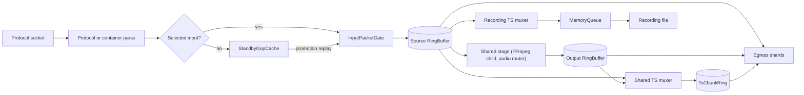

# High-performance data path

This page is the performance contract for moving packets and bytes. It says
what a hot path must not do, how each buffer is bounded, what is shared, and
how to measure a change. Benchmark code and production source own the
executable detail; measured numbers belong in the commit that changes them.

For package boundaries and local crate dependencies, see the central
[workspace/dependency map](architecture.md#workspace-layout). Execution
contexts below describe runtime ownership, not a consequence of crate edges.

## Contents

- [Data-path shape](#data-path-shape)
- [Hot-path contracts](#hot-path-contracts)
- [Bounded transport](#bounded-transport)
- [Sharing and isolation](#sharing-and-isolation)
- [Native and child-process boundaries](#native-and-child-process-boundaries)
- [Measurement workflow](#measurement-workflow)
- [Change review](#change-review)

## Data-path shape

The diagram shows one packet from socket to destination.



- Encoded payloads move as reference-counted `Bytes`. A `RingBuffer` is
  single-producer, multi-consumer; each reader has its own cursor.
- `TsChunkRing` shares packaged MPEG-TS chunks across SRT destinations.
- Egress shards read rings directly by cursor
  ([Egress architecture](egress-architecture.md)).
- Recording uses `MemoryQueue` (`crates/restream-sync/src/byte_queue.rs`)
  between its media-runtime TS producer and dedicated blocking file writer
  (`crates/restream-engine/src/recording/mod.rs`). It is not an egress transport queue.

`restream-core` owns `MediaPacket`, metadata, frame-unit vocabulary and shared
codec helpers. `MediaPacket` is pinned at 56 bytes by a size assertion in
`crates/restream-core/src/lib.rs`. Ring, reader, frame-unit tracking, standby
GOP and byte-queue implementations live in `restream-sync`. Application
callers use those owning crates directly; changing an import does not add a
runtime hop or alter packet ownership.

Per-frame configuration metadata stays out of `MediaPacket`. Each
preallocated ring slot carries an atomic word with the packet's track
configuration generation, written by the producer and read by sequence
without a lock ([frame units](media-pipeline.md#frame-units)). Recording
this side-band word adds a relaxed generation load for tracked packets and
a release store, with no per-packet allocation or payload parsing.
Configuration bytes are compared and stored only when a producer records
them. This is not the full publication cost: `RingBuffer::push` and
`push_batch` allocate a new `Arc<MediaPacket>` for each packet. The packet's
`Bytes` payload remains shared without a payload copy; ring publication is
not allocation-free.

## Hot-path contracts

A packet loop must not do work whose cost grows unseen with packet rate:

- no per-packet logging, serialization or metrics-label construction;
- no payload copy or fresh allocation when ownership can move;
- no shared global lock or async channel send in the normal ring path;
- no blocking syscall on a Tokio worker;
- no diagnostic reader that changes production fan-out behavior;
- no loss of PTS/DTS or payload-format distinctions for convenience.

Allocate reusable buffers outside the loop and clear them for reuse. Prefer
`Bytes`/`BytesMut` ownership transfer and burst APIs where the consumer
already takes batches. An optimization must keep protocol correctness and
bounded shutdown.

The egress hot path adds its own rules: a leaf visit is bounded by
`WorkBudget`, a parked leaf costs nothing until a wake or readiness event,
and a feed publication sends at most one wake per shard
([Commands and wakes](egress-architecture.md#commands-and-wakes)).

## Bounded transport

Every queue between contexts has an explicit bound. Configurable defaults
and environment parsing live in `src/config/mod.rs` and `crates/restream-engine/src/config/`; fixed
structural limits live with the module that owns the structure. Each
structure owns its overflow or backpressure policy, and they differ on
purpose:

| Structure | Under pressure |
|---|---|
| `RingBuffer` reader | Falls behind, then recovers at the latest retained keyframe; with none retained it resumes at the live edge and skips video interframes until the next keyframe (audio passes). A slot the producer already lapped is an overflow, never a newer packet |
| `StandbyGopCache` | Keeps one GOP; clears it entirely past 16 MiB or 2048 packets (defaults) |
| `TsChunkRing` reader | Detects overwrite (the slot's sequence tag, not just the write index) and advances to the latest video-keyframe chunk |
| Egress leaf cursor | Overrun resynchronizes at the latest sync point; with none retained, at the live edge with the cursor awaiting a keyframe (the feed skips video interframes until one). The feed never grows |
| Recording `MemoryQueue` | Async producer waits for space; blocking file reader waits for data; closure wakes both sides. Capacity is a soft limit and one write/batch can overshoot it |
| Connection and child-process admission | Rejects or defers new work |

Do not copy capacities or derived seconds-of-buffer estimates into planning
documents. They change with configuration and packetization. Runtime
telemetry is the evidence for a given deployment.

## Sharing and isolation

Expensive work is shared by typed stage identity. State that belongs to one
destination stays outside the shared stage.

| Shared | Per destination |
|---|---|
| Source packet ring | Reader cursor and lag counters |
| Transform output ring (FFmpeg child, audio router) | Protocol connection and retry state |
| SRT MPEG-TS muxer and `TsChunkRing` | Owner caller and send state |
| Raw→FLV conversion cache per egress shard | RTMP chunking, acknowledgement and TLS state |
| HLS pipeline store | Request authorization and response transfer |

Egress for RTMP, RTMPS, SRT, HLS PUT, MoQ, sink and pipeline outputs runs on
the egress fabric. Each feed has a small pool of shard OS threads that
starts at one and grows with measured load, up to `clamp(CPUs, 2, 8)`. One
shard serves many destinations. Active socket I/O is completion-driven on
one Compio io_uring runtime per shard; SRT uses the shard-local Compio
`Owner`.

Sharing must not couple failure domains. A stalled or failed destination can
lose its own buffered data or restart. It must not stop the publisher or
another destination.

Multi-input standby caching is deliberately outside shared transforms. A
standby input adds socket and demux work plus reference-counted compressed
payload retention. It adds no decode, encode, transform ring, packaging or
HLS. With N configured inputs, the worst case is N − 1 standby cache bounds
in addition to the selected pipeline.

## Native and child-process boundaries

| Work | Context |
|---|---|
| API, database, control and lifecycle | Tokio CONTROL |
| RTMP and SRT ingest: parse or demux, sequence headers, timestamps, standby GOP, gate, publish | Compio ingress owners |
| MoQ ingest and local origin | `moq-ingest` Compio thread |
| Shared SRT TS muxing, audio routers, HLS segmenting (TS and fMP4), recording feed, file-ingest demux, HLS push and pull assembly | Separate Tokio MEDIA runtime (`restream-media`) |
| RTMP, RTMPS, SRT, HLS PUT and MoQ egress sockets and connection state | Egress shards (Compio io_uring) |
| Codec work | FFmpeg child; `restream-ffin` and `restream-ffout` move its pipes |
| Blocking calls (DNS, file writes) | Guarded OS threads or blocking pools |

Diagnostic direct RTMP play still reads the ring on CONTROL. The HLS PUT
fallback uploader (Reqwest) also runs on CONTROL. Every crossing between
these contexts is listed with its bound in
[Runtime crossings](runtime-crossings.md).

MEDIA is the multi-thread Tokio runtime built by `crates/restream-engine/src/executor.rs`;
it is distinct from CONTROL and from dedicated blocking I/O threads.
Moving helpers into workspace crates does not move their callers between
these contexts. In particular, `restream-moq` contains media/catalog,
budget, token, URL and TLS configuration helpers, while live endpoints and
session drivers remain under `crates/restream-engine/src/moq/{transport,ingest,origin,egress}/`.
The root listener and egress-fabric code still own their Compio runtimes.

The process boundary costs a process start and pipe traffic. In return it
isolates codec failure and keeps blocking work off the async schedulers.

One FFmpeg child runs per live unique FFmpeg-backed stage, and every
destination shares it. The child count follows a pipeline's FFmpeg-backed
stages (renditions per codec variant, codec edges, heavy audio routes, the
HEVC preview bridge), not its destination count. Child-cost measurement:
[resource-sweep.md](resource-sweep.md#per-rendition-ffmpeg-child-cost).
Merging several renditions into one child would put every merged destination
in one codec failure domain, which "Sharing and isolation" forbids. It needs
an explicit failure-isolation gate and an owner decision.

## Measurement workflow

The `[[bench]]` targets in `crates/restream-engine/Cargo.toml` (engine hot
paths, code under `crates/restream-engine/benches/`) and in the root
`Cargo.toml` (`api_health`, `alert_tracker`, code under `benches/`) are the
benchmark inventory. Hot-path examples: `ring_buffer`, `ingest_handoff`,
`input_gate`, `egress_visit`, `rtmp_serializer`, `codec_conversions`,
`byte_queue_throughput`, `stage_feeder`. `egress_visit` needs the engine's
`egress-test-driver` feature. Live protocol modes belong to the harness
(`cargo xtask harness`).

For a hot-path change:

1. Pick the benchmark or live mode that exercises the changed owner.
2. Record a clean baseline with the same build profile, fixture and host
   constraints as the comparison.
3. Make one bounded change.
4. Run the focused correctness gate before trusting a speed result.
5. Repeat the measurement. Record variance, throughput, latency and the
   resource effects that bear on the hypothesis.
6. Put the before and after numbers, host and command in the commit message.

```sh
cargo bench -p restream-engine --bench egress_visit --features egress-test-driver
cargo xtask build-bench
```

Use `cargo xtask build-bench` when a measurement mode needs the canonical
`target/bench/` binaries. Do not infer production capacity from loopback
throughput alone.

## Change review

A performance change is ready only when it answers all of these:

- Which production owner and workload does the measurement represent?
- Is protocol and lifecycle proof at least as strong as before?
- Is every added allocation, lock, copy, task hop, thread, process or
  syscall visible in the design?
- Are memory and queue effects bounded when a consumer is slow?
- Does the result separate a directional signal from a proven deployment
  recommendation?

Architecture ownership is in [Architecture](architecture.md). Test and gate
selection is in [Testing](testing.md).
