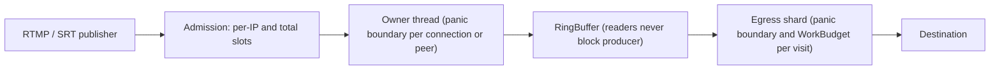

# Isolation audit

The rule: **one publisher or one destination never affects another.** This
page lists each resource entities share, the bound that stops one entity
from taking it all, and the test that proves the bound. A row without a
bound or a test is an open finding. Panic containment is described in
[architecture: fault domains](architecture.md#fault-domains).

## Contents

- [Threat model](#threat-model)
- [Shared resources](#shared-resources)
- [Findings](#findings)
- [Compile-time guards](#compile-time-guards)

## Threat model

An entity is one RTMP or SRT ingest connection or peer, or one egress output
(its destination server). It may be malicious or broken. It may:

- send any bytes, in any split, at any rate, including none;
- open as many connections as the kernel allows, from one address;
- stop reading (a destination) or stop sending (a publisher);
- hold valid credentials (a publisher with a real stream key).

It must not end or stall a thread other entities use, use up a shared
budget so others are refused, or corrupt state others read.

The diagram shows where a bound sits on the path from a publisher to a
destination.

## Shared resources

| Resource | Shared by | Bound per entity | Bound in total | Proof |
|---|---|---|---|---|
| RTMP owner thread | all RTMP connections | panic boundary per connection; any other owner-thread panic is caught at the thread entry, counted and reported (`rtmp.listener.owner_panicked`), and stops only the RTMP listener, which the supervisor restarts | — | `a_panicking_connection_does_not_stop_the_listener`, `an_owner_thread_panic_is_contained_and_stops_the_listener_cleanly` |
| RTMP accept loop | all RTMP clients | one accept in flight, never dropped | — | `clients_connecting_while_connections_end_are_all_accepted` |
| RTMP connection slots | all RTMP clients | `RESTREAM_RTMP_MAX_CONNECTIONS_PER_IP` (default 64) per IPv4 address or IPv6 /64, across owners | `RESTREAM_RTMP_MAX_CONNECTIONS` (default 512) | `one_client_cannot_take_every_connection_slot`, `client_slots` tests |
| RTMP time before publish | all RTMP clients (holds a slot) | handshake, then `RESTREAM_RTMP_PREAUTH_TIMEOUT_MS` (default 10 000) to publish | — | `a_client_that_never_publishes_is_closed_at_the_admission_deadline` |
| RTMP parser memory | RTMP connections on an owner | `RESTREAM_RTMP_MAX_MESSAGE_BYTES` (default 8 MiB) per message | aggregate parser budget | `oversized_declared_message_rejects_the_publisher`, `aggregate_parser_budget_rejects_the_connection_that_exceeds_it` |
| RTMP control channel | one connection | 16 commands (`CONTROL_SESSION_CAPACITY`) | sessions ≤ connection cap | by construction |
| SRT Owner thread | all SRT peers | panic boundary per peer (media work); any other Owner-thread panic is caught at the thread entry and faults only that listener, which the supervisor restarts | — | `a_panicking_publisher_is_disconnected_and_the_owner_keeps_serving`, `an_owner_thread_panic_faults_the_listener_and_its_restart_serves` |
| SRT protocol state (srt-rs) | all SRT peers | per-peer state | — | srt-rs CI |
| SRT peer slots | all SRT peers | `RESTREAM_SRT_MAX_PEERS_PER_IP` (default 64) per IPv4 address or IPv6 /64 | srt-rs `max_peers` 4096, `max_half_open_peers` 1024, half-open timeout 10 s | srt-rs admission tests |
| SRT window memory | all SRT publishers | (flow window + receive buffer packets) × (MTU − SRT header) per established peer | `RESTREAM_SRT_INGRESS_WINDOW_MEMORY_BYTES` per Owner (default a quarter of host or cgroup memory, split across Owners; `0` disables); over it a publisher, or a bonded leg moving to a full Owner, is rejected | srt-rs `window_memory_budget_reserves_worst_case_windows_until_retirement`, `a_member_without_window_memory_refuses_a_relocated_leg`; `srt_ingress_window_memory_is_split_across_owners_and_zero_disables` |
| SRT key derivation (PBKDF2) | encrypted publishers | 8 per second per source | 128 per second per Owner; over it a CONCLUSION is dropped and retransmitted (`keyDerivationDrops`) | srt-rs `encrypted_conclusions_are_held_to_the_key_derivation_budget` |
| SRT pre-admission media | unattached peers | 2 500 000 bytes per peer | 32 MiB per Owner | `a_new_peer_keeps_its_first_payloads_when_the_admission_cap_is_full`, `a_peer_over_its_own_quota_drops_its_own_oldest_payloads` |
| SRT probe hold | publishers awaiting their probe | `probe_hold_peer_bytes` 4 MiB, 2 s timeout | `probe_hold_total_bytes` 64 MiB | `concurrent_stalled_probes_stay_inside_their_byte_budgets`, `discarding_a_panicked_peer_returns_only_its_held_bytes`, `a_replay_that_unwinds_leaves_no_bytes_charged` |
| SRT Owner → Tokio events | all SRT peers | — | 256-slot bridge plus 1024 pending events; media never waits | [runtime crossings](runtime-crossings.md) |
| SRT Tokio lifecycle loop (`SrtServer::run`) | all SRT peers | the loop awaits no engine lock. Each peer attempt's lookup (5 s deadline) and registration, and each `srt_call` caller's registration, run off the loop in its own task (never aborted; a peer gone meanwhile registers nothing after its lookup, and a registration racing that is finished); in flight at most `RESTREAM_SRT_MAX_PEERS_PER_IP` per client IP and 4 publish attempts per stream key (readers are not counted against the key), counting tasks whose peer left; over a cap the peer is disconnected at once without a lookup. An attached publisher's probe applications and its finish run in that publisher's own task, in event order (its disconnect closes the task's queue, so queued probes apply and are answered first; a panicking application is contained and answered with no ring); answers reach the Owner through the loop's one pending command slot. Telemetry writes the publisher's own ingest state; the deleted-pipeline check uses `try_read` and skips a tick; a failed-key flood evicts tracked IPs in amortized passes | the Owner's peer table size (srt-rs `max_peers`, 4096) per listener; at most one queued probe answer per publisher (one probe in flight per publisher); listener exit waits for in-flight admissions and every publisher task's finish | `a_stalled_pipeline_lookup_does_not_stall_another_tenants_publisher`, `a_reconnect_after_a_stalled_lookup_is_not_refused_as_a_duplicate`, `a_lookup_past_the_deadline_rejects_the_peer_and_the_loop_keeps_serving`, `admissions_per_ip_are_bounded_without_affecting_others`, `admissions_per_stream_key_are_bounded_across_ips`, `listener_exit_finishes_a_late_admission_and_a_restart_reuses_the_key`, `a_stalled_probe_on_one_peer_leaves_another_peers_probe_and_disconnect_on_time`, `a_probe_then_a_disconnect_answer_then_finish_in_order`, `tracked_ip_eviction_is_amortized` |
| Egress shard thread | outputs on the shard | panic boundary per visit; `WorkBudget` per visit | — | `panicking_leaf_fails_alone_and_its_shard_keeps_serving_the_others`, `blocked_leaf_does_not_starve_ready_leaf_on_same_shard_thread` |
| Egress send memory | outputs on the shard | RTMP encodes the next unit only after the previous one is written; SRT's bounded send buffer; lag and backpressure-time stall limits | shard leaf capacity | `crates/restream-engine/src/egress/shard/tests/leaf_isolation.rs` |
| Name resolution (`crates/restream-engine/src/resolver.rs`) | every egress output (RTMP, SRT, HLS PUT, MoQ), HLS pull and SRT caller input | each request has a deadline (egress `LeafPolicy::resolve_timeout`, 5 s otherwise) and is answered at it even while `getaddrinfo` still runs; a failure, timeout or overflow fails only that output, pull or call, which retries on its own backoff; per-name dedupe: concurrent lookups of one `(host, port)` share one call, so a retrying output never stacks lookups of its hung name; elastic replacement: a thread still inside a lookup past the slow threshold (500 ms, or half the time its earliest caller had left when it started, if shorter) is marked hung and replaced, so 16 threads stay available to other names however many distinct names a tenant's name server hangs, and a name queued behind hung ones waits at most that threshold; the hung thread exits when its lookup returns; a bond's hosts resolve concurrently under one deadline, and its first failing leg fails it at once; HLS pull's source private-address check also ends on cancel, so the reconciler that cancels and joins a pull never waits on its DNS; no egress shard owns or joins a resolver thread, and a replaced panicked shard is detached, not joined, under the `fabric.<proto>` lock; fabric release joins shard threads on the blocking pool, not a Tokio worker | bound = the cap: 128 lookup threads in total (`RESOLVER_MAX_THREADS`); at the cap other names wait in the queue until their deadline, counted (`nameResolver.capReached`, `hungThreads`); 1024 queued names, over that the request is answered `Overflow` at once and counted (`nameResolver.overflows`) | `a_hung_name_never_delays_another_name`, `hung_lookups_are_replaced_so_another_name_still_resolves`, `a_name_queued_behind_hung_lookups_resolves_before_their_deadline`, `a_request_is_answered_at_its_deadline_while_the_lookup_hangs`, `every_request_is_answered_when_the_queue_overflows`, `concurrent_lookups_of_one_name_share_one_call`, `a_black_holed_destination_never_delays_a_sibling_on_the_shard` (RTMP and SRT), `a_bond_fails_on_its_first_failing_leg`, `every_output_past_the_resolver_queue_gets_a_terminal_state`, `shard_teardown_never_waits_on_a_hung_lookup`, `a_pull_cancelled_during_its_source_lookup_ends_at_once` |
| Std locks shared by entities | entities and the status API | poison-tolerant `restream_sync::lock::{lock, read, write}`; raw calls disallowed by `clippy.toml` | — | `a_poisoned_lock_still_serves_later_callers`; clippy `-D warnings` |
| Engine registries (tokio locks in `IngestRegistry`, `EgressRegistry`, `StageRegistry`, `FileIngestRegistry`, `HlsRegistry`) | every input, output and stage lifecycle, and the status, telemetry and measure views | no guard is held across an await, except sections that take more than one guard in the one order per registry documented in `engine_registries.rs` (ingest `selection` (one pipeline's) → `cancel_tokens` → `sessions` → `selected_inputs` → `active`, a MoQ origin's per-pipeline attach lock before that pipeline's `selection`; egress `retry` → `cancel_tokens` → `active`; stage `runtimes` → `metrics` → `lifecycles`; file ingest `ingests.sessions` → `children` → `active` → `positions`); views copy one map at a time into owned data, never re-acquiring a held lock behind a queued writer. Ingest selection is a per-pipeline `KeyedLock` (an entry is removed by its last user, under the map mutex) and no section holds two pipelines' selections; a registration waits for the replaced input's gate holding only its pipeline's selection, and the input-keyed maps change under one write guard set, so a stuck holder on one pipeline delays no other pipeline's registration, probe, disconnect or MoQ attach. The engine's release task ends each dropped lease's attempt in a task of its own (a claimed attempt is not handed out twice), so one pipeline's stuck selection delays no other pipeline's abandoned release | in-memory critical sections only | `engine_telemetry_never_deadlocks_stage_and_ingest_writers`, `pipeline_telemetry_never_deadlocks_stage_and_ingest_writers`, `file_ingest_running_check_and_snapshot_never_deadlock`, `health_snapshot_does_not_pin_ingest_guard_while_waiting_for_egress`, `a_stuck_selection_on_one_pipeline_leaves_another_pipelines_publisher_on_time`, `a_stuck_selection_does_not_delay_another_pipelines_abandoned_release`, `a_release_with_a_queued_waiter_never_hands_the_key_to_two_holders`, loom `keyed_lock_loom`; clippy `await_holding_invalid_type` `-D warnings` (`KeyedGuard` included), each multi-guard section an `#[expect]` naming its order |
| Feed rings | one pipeline's outputs | readers never block the producer; an overrun resyncs the reader | ring capacity | `fault_injection_rapid_overflow_recovery`, `first_visit_primes_the_cursor_to_the_latest_sync_point` |
| Ingest registrations (stream-key slot) | every publisher on an input or stream key | one `IngestLease` per input attempt, held by that attempt's session state; `finish` ends it in order, and a lease dropped without it (panic, cancelled task, early return) cancels its attempt's own token at once (the input admits the next publisher) and is queued on the engine-owned release queue, ended as `abandoned` by the release task (no second outcome after a cancelled `finish`), attempt-checked so a stale lease never ends a newer attempt; an unregister takes every registry write guard before its first removal, so a cancelled one leaves the attempt whole; the queue outlives any release task, entries leave it by attempt id once released, and bootstrap runs the task on the main runtime and drains the backlog at shutdown after the listeners end | one queue entry per dropped lease | `a_dropped_lease_releases_its_attempt_as_abandoned`, `a_dropped_lease_frees_its_input_before_its_release_runs`, `a_stale_lease_never_releases_a_newer_attempt_on_its_input`, `a_lease_dropped_while_no_release_task_runs_is_released_by_the_next_one`, `a_finish_cancelled_between_record_and_release_records_one_outcome`, `a_release_cancelled_at_a_lock_leaves_its_attempt_whole`, `two_passes_over_one_queue_release_every_entry`, `a_panicking_control_session_frees_its_stream_key`, `an_admission_panic_after_registration_frees_the_stream_key`, `a_cancelled_supervisor_releases_its_input`, `an_unfinished_owner_session_frees_its_stream_key`, `an_aborted_recirculation_releases_its_target_input` |
| SQLite catalog on the connect path | every publisher and reader on every protocol (RTMP, SRT, HLS push, MoQ) | admission, including the HLS push per-object credential check, reads the in-memory `CatalogAuthSnapshot`; no connect awaits the SQLite pool (10 connections, 30 s acquire) or its 30 s busy timeout, and no connect writes to it (its lifecycle events reach the log sinks without waiting: see the process log sinks row); an input row that does not decode stays a known key refused without counting a failure, so it cannot get its client banned from that client's other keys | each catalog write and the whole-index reload after it run as one task the request cannot cancel, finished before the write returns; reloads run one at a time; a failed reload keeps the previous index and one retry task backs off from 100 ms to 5 s until a reload succeeds; a 30 s periodic reload bounds staleness from any change no write reported to 30 s plus one reload while SQLite answers; a reload reads through the lifecycle pool under the 3 s shared-loop deadline, so API load neither delays nor exhausts it. Outbound HLS pull and SRT caller inputs start from output passes whose reads have the same deadline | `every_access_mode_authenticates_while_the_database_pool_is_exhausted`, `every_catalog_write_is_enforced_on_the_next_connect`, `a_rotation_whose_caller_is_cancelled_after_commit_is_still_enforced`, `the_periodic_reload_enforces_a_change_no_write_reported`, `an_undecodable_input_row_is_refused_without_banning_the_client`, `a_failed_reload_keeps_the_previous_index_until_a_retry_succeeds`, `refreshes_during_a_reload_coalesce_into_one_later_reload` |
| Process log sinks (stdout, stderr, daily file, `app_logs` history; `src/logging/`) | every thread that logs: Owner and shard threads, the SRT loop, the reconciler, the event consumer, Tokio workers | no logging thread waits on a collector: console and file lines go into a bounded queue per sink, drained by that sink's own writer thread (`catch_unwind` at entry), history rows through `try_send`; a full queue drops the line and counts it (`logging.consoleDropped`, `fileDropped`, `historyDropped` in engine health; a failed history batch counts its rows too); the panic hook queues its report on stderr and waits at most 100 ms, on the panicking thread only; shutdown flushes all sinks under one 2 s deadline; the history drain restarts after a panic | 16 384 lines per console stream and for the file; 4096 history rows | `a_thread_that_logs_never_waits_for_a_blocked_sink_and_drops_are_counted`, `a_writer_recovers_once_its_sink_unblocks`, `a_shutdown_flush_returns_by_its_deadline_while_the_sink_is_blocked`, `a_panicking_sink_loses_one_line_and_the_writer_continues`, `a_panic_report_is_written_before_the_hook_returns`, `a_panic_report_waits_at_most_its_bound_while_stderr_is_stalled`, `a_failed_history_batch_counts_its_rows_dropped`, `a_panicking_loop_is_restarted_and_a_returning_loop_ends` |
| Listener tasks | the whole protocol | — | restart with a 1–30 s backoff from a supervision task of their own (`runtime.rs`), which also ends the process when the dashboard listener exits; no reconciler or housekeeping step runs on it | `listener_supervisor` tests, `a_faulted_listener_restarts_within_its_backoff_while_the_output_pass_is_stalled` |
| Reconciler output pass | every pipeline's outputs, inputs and topology | each output's start (rings, stages, the MoQ `ca` read under a 5 s deadline, the egress task) and retries-exhausted mark (awaited to its outcome) run in that output's own task, one at a time per output; the output's failures are cleared only by a pass that reads the marked row, so a stale row cannot restart it; the pass skips an output while its task runs, and the task's end wakes a pass; each output is planned behind a panic boundary of its own: a panic in the pass's decision for it or in its start or mark task skips it (what its task registered is unregistered) for the output retry backoff, which grows per panic until the output runs or is no longer wanted, and the pass goes on to the next output; the job row is written off the start path, one statement at a time per job; each step's rows are read under the shared-loop deadline, and a step that cannot read is retried after the gap while the other steps still run | one pass at a time, passes at least one interval apart | `an_output_starts_while_api_reads_hold_every_api_connection`, `a_faulted_listener_restarts_within_its_backoff_while_the_output_pass_is_stalled`, `another_pipelines_output_starts_while_one_output_start_is_stalled`, `a_stalled_pool_ends_the_pass_at_its_deadline_and_the_output_converges_after`, `an_output_starts_while_another_writer_holds_the_write_lock`, `a_late_retries_exhausted_mark_does_not_swallow_the_next_start`, `a_pass_reading_rows_from_before_the_mark_does_not_restart_the_output`, `an_output_whose_planning_panics_leaves_the_others_planned_in_the_same_pass` |
| Housekeeping (pruning, fabric sizing, recordings, stream checks, idle HLS, file-ingest reaping) | every pipeline | runs in a supervised task of its own, never on the output pass; each tick reads the pipelines and every pipeline's switches in two statements; a failed read changes no recording or stream check that tick (an unreadable switch is never read as off); a tick panic is contained and the next tick runs | log retention deletes in statements of at most 1000 rows, each its own write | `a_panicking_housekeeping_step_is_contained_and_the_next_tick_runs`, `a_housekeeping_ticks_reads_return_at_their_deadlines_while_every_connection_is_held`, `an_unreadable_switch_read_stops_no_recording_or_stream_check`, `log_retention_deletes_in_batches_of_at_most_the_batch_size` |
| Recording switch in views (health, alerts, telemetry, agent) | every pipeline's recording state | a switch that cannot be read shows the pipeline's current state (on while its recording runs), never off | — | `an_unreadable_recording_switch_keeps_the_current_state` |
| Scheduler (`src/api/schedules.rs`) | every schedule, every pipeline | each schedule's due occurrence, or its skip record, runs in a task of its own; a schedule whose task still runs is left alone, and the rows are read only after finished tasks are collected, so an occurrence runs once; an action past its 30 s deadline is recorded `running: not finished after 30 s` and never cut short; a panicking action is recorded as failed; a slow action, record or panic delays only its own schedule | one occurrence in flight per schedule | `another_pipelines_occurrence_runs_while_one_occurrence_is_stalled`, `an_occurrence_whose_running_record_waits_on_the_write_lock_runs_once` |
| Recording catalog writer (`src/infrastructure/recording_metadata.rs`) | every recording | recorders never wait: an update merges into the queue's one entry per recording (its start and its latest end; a later end supersedes an earlier one), so nothing is dropped; one supervised writer awaits each write through the lifecycle `DeadlineDb`, and after a panic restores the update it held before taking the next | entries ≤ recordings with an unwritten update | `updates_behind_a_held_write_lock_stay_one_entry_and_the_latest_lands`, `a_panicking_writer_is_restarted_and_its_update_still_lands`, `drained_rows_match_writing_every_report_in_order` |
| SQLite pool | the API, and the shared loops (output pass, housekeeping, egress job rows, scheduler, recording catalog writer, catalog reload) | the shared loops use a lifecycle pool of their own (6 connections) through `DeadlineDb` (`src/db/deadline.rs`), which bounds a read's acquire, statements and busy retries by one deadline (3 s) and drops it there; a write runs as its own task, awaited to its outcome by a task that may stall on it (an output's task, housekeeping, a scheduled occurrence, the recording catalog writer; never the pass), and at most 2 writes hold a connection, so writes behind another writer's lock never take the loops' read connections; the startup catalog load retries until it succeeds; API handlers keep the main pool (10 connections, 30 s acquire, 30 s busy) | — | `a_read_returns_at_its_deadline_while_every_connection_is_held`, `a_write_behind_a_held_write_lock_answers_with_its_outcome_after_release`, `concurrent_starts_behind_a_write_lock_hold_at_most_the_write_permits_while_reads_answer`, `an_occurrence_whose_running_record_waits_on_the_write_lock_runs_once`, `a_failing_startup_load_retries_until_a_load_succeeds` |
| Allocator, FDs, CPU | everything | the per-entity bounds above | `nofile`, cgroup | capacity ramps |

## Findings

Closed findings are rows in the table above (per-client RTMP and SRT caps,
the RTMP admission deadline, lock poisoning, the `ts_demux` fuzz target).

- **F6 (open). Untrusted-byte parsers must not index, overflow or unwrap.**
  Fix: convert module by module to checked forms and deny the lints there
  (see [compile-time guards](#compile-time-guards)). Converted modules carry
  the `deny` attribute. Extracted implementation owners are
  `crates/restream-rtmp/src/{flv,timestamps,parser_budget,egress_packets,egress_payload_cache,egress_engine}.rs`,
  `crates/restream-mpegts/src/{demux,probe}.rs`,
  `crates/restream-core/src/codec/` and `crates/restream-moq/src/media.rs`.
  Remaining application implementations include
  `crates/restream-engine/src/rtmp/{ingest,ingest_media}.rs`,
  `crates/restream-engine/src/hls/fmp4/codec.rs`, `crates/restream-engine/src/egress/http1.rs`,
  `crates/restream-engine/src/ingest_publisher/fmp4/`, `crates/restream-engine/src/hls_ingest/playlist.rs` and
  `crates/restream-engine/src/moq/ingest/{media,cmaf}.rs`. The HLS playlist and MoQ ingest paths
  are also fuzzed by `hls_playlist` and `moq_ingest`.
- **F7 (decided: off). Release builds wrap on integer overflow.** Global
  `overflow-checks` cost measurable CPU on the SRT ingest hot path and gained
  no isolation. Parsers of untrusted bytes deny
  `clippy::arithmetic_side_effects` instead (F6), and new parsers take the F6
  deny list.
- **Scope (open).** This audit covers RTMP, SRT and egress. HLS push ingest
  and MoQ ingest/origin entities have no rows yet, except that a MoQ listener
  thread panic outside a connection task is caught at the thread entry and
  reported (`restream.moq.ingest.faulted`, test
  `an_accept_loop_panic_is_contained_at_the_thread_entry`); MoQ ingest then
  stays stopped until restart, since nothing supervises it.

## Compile-time guards

| Guard | Mechanism | Status |
|---|---|---|
| Containment needs unwinding | `#[cfg(all(panic = "abort", not(kani)))] compile_error!` in `crates/restream-engine/src/lib.rs` | done |
| No panicking or skipped lock access | `clippy.toml` `disallowed-methods` on `Mutex::lock` and `RwLock::{read,write}` outside `restream_sync::lock` (tests, benches and the harness may use them) | done |
| No tokio guard held across an await | `clippy.toml` `await-holding-invalid-types` (tokio `RwLock`/`Mutex` guards, owned and mapped) for `clippy::await_holding_invalid_type`; a section that must hold more than one guard carries `#[expect]` naming its lock order (`engine_registries.rs`); unit tests may hold guards. The lint sees a guard bound to a local, not one inside an `Option`, tuple or struct field (two such sites today, listed in `engine_registries.rs`) | done |
| No name lookup without a deadline | `clippy.toml` `disallowed-methods` on `std::net::ToSocketAddrs::to_socket_addrs` and `tokio::net::lookup_host`; the one `#[expect]` is the resolver's pool lookup (`crates/restream-engine/src/resolver.rs`). An address string handed to a std or Tokio `connect`/`bind` still resolves inside the library, out of the lint's sight; entity connects pass a resolved `SocketAddr`, and listener binds resolve their configured address once at startup | done |
| No unbounded child-process await | `clippy.toml` `disallowed-methods` on tokio `Child::{wait, wait_with_output}` and `Command::output`; the two `#[expect]`s are `restream_engine::child_process::reap` (waits a grace, then kills and waits a bounded time) and `ffmpeg_binary::run_tool` (a deadline and `kill_on_drop`); crates and test files that already allow `disallowed_methods` wholesale (the harness, many root tests) are outside it | done |
| Parsers cannot index, overflow or unwrap | `#![deny(clippy::indexing_slicing, clippy::arithmetic_side_effects, clippy::unwrap_used, clippy::expect_used, clippy::panic)]` per parser module | per module (F6) |
| Overflow is never silent | `overflow-checks = true` in release | rejected (F7) |
| Fault-injection points never ship | `#[cfg(test)]` only (`INJECTED_PANIC_PAYLOAD`, `injected_panics`, `EngineScript::Panic`) | done |
