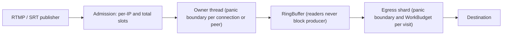

# Isolation audit

The rule: **one publisher or one destination never affects another.** This
page lists each resource entities share, the bound that stops one entity
from taking it all, and the test that proves the bound. A row without a
bound or a test is an open finding. Panic containment is described in
[architecture: fault domains](architecture.md#fault-domains).

## Contents

- [Threat model](#threat-model)
- [Shared resources](#shared-resources)
- [Findings](#findings)
- [Compile-time guards](#compile-time-guards)

## Threat model

An entity is one RTMP or SRT ingest connection or peer, or one egress output
(its destination server). It may be malicious or broken. It may:

- send any bytes, in any split, at any rate, including none;
- open as many connections as the kernel allows, from one address;
- stop reading (a destination) or stop sending (a publisher);
- hold valid credentials (a publisher with a real stream key).

It must not end or stall a thread other entities use, use up a shared
budget so others are refused, or corrupt state others read.

The diagram shows where a bound sits on the path from a publisher to a
destination.

## Shared resources

| Resource | Shared by | Bound per entity | Bound in total | Proof |
|---|---|---|---|---|
| RTMP owner thread | all RTMP connections | panic boundary per connection | — | `a_panicking_connection_does_not_stop_the_listener` |
| RTMP accept loop | all RTMP clients | one accept in flight, never dropped | — | `clients_connecting_while_connections_end_are_all_accepted` |
| RTMP connection slots | all RTMP clients | `RESTREAM_RTMP_MAX_CONNECTIONS_PER_IP` (default 64) per IPv4 address or IPv6 /64, across owners | `RESTREAM_RTMP_MAX_CONNECTIONS` (default 512) | `one_client_cannot_take_every_connection_slot`, `client_slots` tests |
| RTMP time before publish | all RTMP clients (holds a slot) | handshake, then `RESTREAM_RTMP_PREAUTH_TIMEOUT_MS` (default 10 000) to publish | — | `a_client_that_never_publishes_is_closed_at_the_admission_deadline` |
| RTMP parser memory | RTMP connections on an owner | `RESTREAM_RTMP_MAX_MESSAGE_BYTES` (default 8 MiB) per message | aggregate parser budget | `oversized_declared_message_rejects_the_publisher`, `aggregate_parser_budget_rejects_the_connection_that_exceeds_it` |
| RTMP control channel | one connection | 16 commands (`CONTROL_SESSION_CAPACITY`) | sessions ≤ connection cap | by construction |
| SRT Owner thread | all SRT peers | panic boundary per peer (media work) | — | `a_panicking_publisher_is_disconnected_and_the_owner_keeps_serving` |
| SRT protocol state (srt-rs) | all SRT peers | per-peer state | — | srt-rs CI |
| SRT peer slots | all SRT peers | `RESTREAM_SRT_MAX_PEERS_PER_IP` (default 64) per IPv4 address or IPv6 /64 | srt-rs `max_peers` 4096, `max_half_open_peers` 1024, half-open timeout 10 s | srt-rs admission tests |
| SRT window memory | all SRT publishers | (flow window + receive buffer packets) × (MTU − SRT header) per established peer | `RESTREAM_SRT_INGRESS_WINDOW_MEMORY_BYTES` per Owner (default a quarter of host or cgroup memory, split across Owners; `0` disables); over it a publisher, or a bonded leg moving to a full Owner, is rejected | srt-rs `window_memory_budget_reserves_worst_case_windows_until_retirement`, `a_member_without_window_memory_refuses_a_relocated_leg`; `srt_ingress_window_memory_is_split_across_owners_and_zero_disables` |
| SRT key derivation (PBKDF2) | encrypted publishers | 8 per second per source | 128 per second per Owner; over it a CONCLUSION is dropped and retransmitted (`keyDerivationDrops`) | srt-rs `encrypted_conclusions_are_held_to_the_key_derivation_budget` |
| SRT pre-admission media | unattached peers | 2 500 000 bytes per peer | 32 MiB per Owner | `a_new_peer_keeps_its_first_payloads_when_the_admission_cap_is_full`, `a_peer_over_its_own_quota_drops_its_own_oldest_payloads` |
| SRT probe hold | publishers awaiting their probe | `probe_hold_peer_bytes` 4 MiB, 2 s timeout | `probe_hold_total_bytes` 64 MiB | `concurrent_stalled_probes_stay_inside_their_byte_budgets`, `discarding_a_panicked_peer_returns_only_its_held_bytes`, `a_replay_that_unwinds_leaves_no_bytes_charged` |
| SRT Owner → Tokio events | all SRT peers | — | 256-slot bridge plus 1024 pending events; media never waits | [runtime crossings](runtime-crossings.md) |
| Egress shard thread | outputs on the shard | panic boundary per visit; `WorkBudget` per visit | — | `panicking_leaf_fails_alone_and_its_shard_keeps_serving_the_others`, `blocked_leaf_does_not_starve_ready_leaf_on_same_shard_thread` |
| Egress send memory | outputs on the shard | `LeafLimits::max_pending_bytes`, lag, backpressure time | shard leaf capacity | `src/media/egress/shard/tests/leaf_isolation.rs` |
| Std locks shared by entities | entities and the status API | poison-tolerant `crate::sync::{lock, read, write}`; raw calls disallowed by `clippy.toml` | — | `a_poisoned_lock_still_serves_later_callers`; clippy `-D warnings` |
| Feed rings | one pipeline's outputs | readers never block the producer; an overrun resyncs the reader | ring capacity | `fault_injection_rapid_overflow_recovery`, `first_visit_primes_the_cursor_to_the_latest_sync_point` |
| Listener tasks | the whole protocol | — | restart with backoff | `listener_supervisor` tests |
| Allocator, FDs, CPU | everything | the per-entity bounds above | `nofile`, cgroup | capacity ramps |

## Findings

Closed findings are rows in the table above (per-client RTMP and SRT caps,
the RTMP admission deadline, lock poisoning, the `ts_demux` fuzz target).

- **F6 (open). Untrusted-byte parsers must not index, overflow or unwrap.**
  Fix: convert module by module to checked forms and deny the lints there
  (see [compile-time guards](#compile-time-guards)). Converted modules carry
  the `deny` attribute: `rtmp/flv.rs`, `rtmp/ingest.rs`,
  `rtmp/ingest_media.rs`, `rtmp/timestamps.rs`,
  `rtmp/ingest/parser_budget.rs`, `rtmp/egress_packets.rs`,
  `rtmp/egress_payload_cache.rs`, `rtmp/egress_engine.rs`,
  `mpegts/demux.rs`, `mpegts_probe.rs`,
  `codec/{bits, h264_sps, video, aac, enhanced_rtmp_hevc}`,
  `hls/fmp4/codec.rs`, `egress/http1.rs`, `ingest_publisher/fmp4`,
  `hls_ingest/playlist.rs`, `moq/media.rs` and
  `moq/ingest/{media,cmaf}.rs`. The latter HLS and MoQ paths are also fuzzed
  by `hls_playlist` and `moq_ingest`.
- **F7 (decided: off). Release builds wrap on integer overflow.** Global
  `overflow-checks` cost measurable CPU on the SRT ingest hot path and gained
  no isolation. Parsers of untrusted bytes deny
  `clippy::arithmetic_side_effects` instead (F6), and new parsers take the F6
  deny list.
- **Scope (open).** This audit covers RTMP, SRT and egress. HLS push ingest
  and MoQ ingest/origin entities have no rows yet.

## Compile-time guards

| Guard | Mechanism | Status |
|---|---|---|
| Containment needs unwinding | `#[cfg(all(panic = "abort", not(kani)))] compile_error!` in `src/lib.rs` | done |
| No panicking or skipped lock access | `clippy.toml` `disallowed-methods` on `Mutex::lock` and `RwLock::{read,write}` outside `crate::sync` (tests, benches and the harness may use them) | done |
| Parsers cannot index, overflow or unwrap | `#![deny(clippy::indexing_slicing, clippy::arithmetic_side_effects, clippy::unwrap_used, clippy::expect_used, clippy::panic)]` per parser module | per module (F6) |
| Overflow is never silent | `overflow-checks = true` in release | rejected (F7) |
| Fault-injection points never ship | `#[cfg(test)]` only (`INJECTED_PANIC_PAYLOAD`, `injected_panics`, `EngineScript::Panic`) | done |
