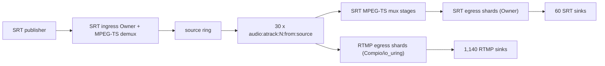

# Mahashivratri hero scenario

The Mahashivratri (MSR) scenario is Restream's canonical capacity and
correctness workload: one SRT contribution with one video stream and 30
language audio tracks, fanned out to 1,200 outputs (95% RTMP, 5% SRT). Each
RTMP output carries one audio track. This page defines the workload, the
runtime graph it should produce, and how the `msr` harness mode runs it.

## Contents

- [Workload](#workload)
- [Expected runtime graph](#expected-runtime-graph)
- [Run the harness](#run-the-harness)
- [Controls](#controls)
- [Peer modes](#peer-modes)
- [Acceptance](#acceptance)
- [Related documentation](#related-documentation)

## Workload

### Ingest

| Dimension | Value |
|---|---|
| Protocol | SRT / MPEG-TS |
| Video streams | 1 |
| Resolution | 1080p and 4K, run separately |
| Frame rate | 30 fps; 60 fps as an extension |
| Video codec | H.264; HEVC as a compatibility variant |
| Audio tracks | 30 AAC at 48 kHz: 29 stereo, one 5.1 |
| Track identity | Stable track index plus language metadata |
| Output video | `source` unless a test selects a preset |

Language ranks, most popular first:

```text
English, தமிழ், हिन्दी, తెలుగు, ಕನ್ನಡ, मराठी, नेपाली, Bengali,
മലയാളം, Gujarati, Odia, Italian, Spanish, French, German, Russian,
Portuguese, Arabic, Simplified Chinese, Traditional Chinese, Indonesian,
Japanese, Korean, Urdu, Turkish, Vietnamese, Thai, Punjabi, Dutch, Polish
```

Both Chinese variants use ISO 639 code `zho`; their stream titles keep them
apart.

Passthrough is the default so a run measures fan-out and routing, not a
transcode. The HEVC variant adds the shared HEVC-to-H.264 stage for RTMP.

### Output population

Outputs per language follow Zipf with `s = 1`: `N(rank) = round(300 /
rank)`. The counts sum to exactly 1,200:

```text
300, 150, 100, 75, 60, 50, 43, 38, 33, 30,
27, 25, 23, 21, 20, 19, 18, 17, 16, 15,
14, 14, 13, 13, 12, 12, 11, 11, 10, 10
```

| Protocol | Share | Outputs |
|---|---:|---:|
| RTMP | 95% | 1,140 |
| SRT | 5% | 60 |
| **Total** | **100%** | **1,200** |

- Protocol assignment is deterministic and keeps the rank distribution, so
  runs are comparable.
- Every RTMP output uses `source+atrack:N`. The primary SRT run also selects
  one track per output.
- SRT correctness variants: track subsets (at least 2, 3 and 6 tracks) and
  `source` with all 30 tracks. They need not carry all 60 outputs.

## Expected runtime graph

The diagram shows the H.264 graph with all 30 languages in use.



- One SRT ingest and inline MPEG-TS demuxer feed one adaptive source ring.
- 30 shared `audio:atrack:N:from:source` router stages, one per language.
  A hot language adds senders, not routers: the 300 rank-one outputs share
  one selected-audio ring.
- RTMP outputs run on shared per-feed egress shard pools (one Compio/io_uring
  runtime per shard), not one task per output.
- SRT outputs share MPEG-TS mux stages keyed by final encoding and run on
  egress shards whose Owner holds the SRT socket.

HEVC variant: one shared `hevc_to_h264:from:source` stage feeds the RTMP
audio routers; SRT keeps separate native-HEVC routers. With all languages on
both protocols, expect up to 60 audio router stages.

### Packet rate

At about 50 AAC packets per second per track:

```text
30 tracks * 50 packets/s + 30 to 60 video packets/s
= about 1,530 to 1,560 source packets/s
```

Six seconds of headroom needs about 9,180 to 9,360 ring slots, under the
16,384-slot maximum (`MAX_RING_CAPACITY` in `crates/restream-engine/src/engine_pipeline.rs`).
The 30 routers together inspect about 46,000 packets per second. Payload
bytes are shared; packet objects, ring writes, metrics and notifications are
per route.

## Run the harness

`msr` is a bench-profile harness mode, not in the default suite. It runs the
production binary, configures it through the API, publishes real media over
SRT, and receives RTMP and SRT egress on localhost peers.

```sh
MSR_PLAN_ONLY=1 cargo xtask harness msr   # print the deterministic plan
cargo xtask harness msr                   # first 30 outputs
MSR_FULL=1 cargo xtask harness msr        # 30,120,300,600,900,1200 ramp
```

- Each checkpoint proves Restream output progress and peer health (see
  [Peer modes](#peer-modes)).
- `ffprobe` read-back runs on a sample of outputs, not all 1,200, so helper
  processes do not dominate the measurement.
- Results go to `msr-results.json` and `msr-report.md` under
  `.local/artifacts/msr/` by default. When signal calibration is on
  (`MSR_SIGNAL_CALIBRATION`, default on with `MSR_FULL=1`), a
  `signal-calibration` profile runs first in `signal-calibration/` and
  writes `msr-signal-*` files; the canonical run follows.
- Plan rules (Zipf totals, protocol split, track selection) have unit tests
  in `crates/test_harness/src/test_harness/resource_sweep/msr/tests.rs`.

Before a 1,200-output run, prepare the host per
[Linux host and harness capacity](configuration.md#linux-host-and-harness-capacity).
The harness raises its soft descriptor limit from the largest checkpoint,
but the hard limit must be at least 65,536, `net.core.somaxconn` must cover
the RTMP accept burst, and the UDP buffer maxima must fit the SRT socket
buffers.

## Controls

| Variable | Default | Purpose |
|---|---:|---|
| `MSR_OUTPUT_COUNTS` | `30` | Checkpoints (1..=1200); overrides `MSR_FULL` |
| `MSR_FULL` | unset | `1` uses `30,120,300,600,900,1200` |
| `MSR_PLAN_ONLY` | unset | Print the 1,200-output plan without media |
| `MSR_PROTOCOL_MIX` | `canonical` | `canonical`, `rtmp-only`, `srt-only` or `srt-every:N` |
| `RESTREAM_MSR_FIXTURE_OVERRIDE` | unset | Source media. The default is the checked-in ~2 Mb/s fixture. For 1080p60 at ~8 Mb/s, run `cargo xtask fixtures generate-msr-1080p` and set `.local/fixtures/bbb-1080p60-30a.mp4` |
| `MSR_SAMPLE_SECS` | `6` | Sampling window per checkpoint |
| `MSR_SAMPLE_INTERVAL_MS` | `1000` | Resource sample interval |
| `MSR_SETTLE_SECS` | `4` | Settle time before sampling |
| `MSR_PROGRESS_TIMEOUT_BASE_SECS` | `60` | Initial output-progress allowance |
| `MSR_PROGRESS_TIMEOUT_PER_OUTPUT_SECS` | `2` | Added allowance per output |
| `MSR_PROGRESS_TIMEOUT_CAP_SECS` | `900` | Maximum progress wait |
| `MSR_FFPROBE_SAMPLE_COUNT` | `4` (`60` with `MSR_FULL`) | Outputs probed per checkpoint |
| `MSR_SKIP_FFPROBE` | unset | Skip `ffprobe` read-back (always on with `MSR_PEER=sink`) |
| `MSR_SRT_READ_TIMEOUT_SECS` | unset | SRT read timeout for probes |
| `MSR_NO_CLEANUP` | unset | Leave the final stack running |
| `MSR_SIGNAL_CALIBRATION` | on with `MSR_FULL=1`, else off | Run the signal-calibration profile before the canonical run |
| `MSR_SIGNAL_SAMPLES_PER_CHECKPOINT` | `4` | Outputs signal-checked per checkpoint |
| `MSR_SIGNAL_SAMPLE_SECS` | `20` | Duration of each signal check |
| `MSR_PEER` | `mediamtx` | `mediamtx` or `sink` |
| `PEER_COUNT` | `1` | Peer instances; output `ordinal % PEER_COUNT` picks one. Each instance offsets its ports by `index * 4` |
| `PEER_SKIP_START` | unset | `mediamtx` only: peers are already running; the harness checks them |
| `HARNESS_SRT_SINK_UDP_BUFFER` | `67108864` | `sink` only: `SO_RCVBUF`/`SO_SNDBUF` per SRT socket, granted up to 2 × `net.core.rmem_max`; `0` keeps host defaults |
| `HARNESS_SRT_SINK_PORTS_PER_PEER` | `2` (clamped to 1–4) | `sink` only: SRT ports per peer instance, one production SRT Owner each; SRT outputs of an instance take its ports in turn by ordinal |
| `MSR_SINK_SAMPLE_SECS` | `3` | MediaMTX path-health window before the resource window |
| `MSR_SINK_POST_SAMPLE_SECS` | `2` | MediaMTX path-health window after it |
| `MSR_SINK_TIMEOUT_SECS` | `60` | Timeout for MediaMTX path-health checks |
| `MSR_SINK_ENGINE_SAMPLE_SECS` | `5` | `sink` only: engine `bytesOut` sample window |

## Peer modes

The harness owns every peer. Start peers by hand only with
`PEER_SKIP_START`.

| Mode | Receiver | Checkpoint proof |
|---|---|---|
| `mediamtx` | `PEER_COUNT` MediaMTX instances, own config and log each (`msr-mediamtx.yml`, suffixed `-N` for N>0) | Every expected path is `ready=true` in that instance's `/v3/paths/list` and total `bytesReceived` grows; merged into `mediamtxPathHealth` |
| `sink` | In-process listeners: `GeneralizedSinkServer` (`sinks.rs`) for RTMP, `HarnessSrtSinkPool` (`harness_srt_sink.rs`) for SRT | Every output appears in `/api/v1/engine/health` and its `bytesOut` grows; reported as `sinkVerification` |

Sink mode details:

- Use it when MediaMTX would be the bottleneck or raw connection count
  matters most; it uses far less memory per connection.
- The RTMP listener completes real `connect`/`createStream`/`publish`
  (`rml_rtmp::sessions::ServerSession`) before discarding media. It counts
  wire bytes per connection. With `RESOURCE_SWEEP_RTMPS_CERT`/`_KEY` set, an
  RTMPS listener also starts.
- The SRT pool runs one production `srt_transport::compio::Owner` thread per
  port, built like the SRT ingress Owners. Each peer instance listens on
  `HARNESS_SRT_SINK_PORTS_PER_PEER` consecutive ports (1–4, default 2) and
  its SRT outputs take them in turn: Restream sends every output of an
  egress shard from one UDP socket, so the sink's parallelism comes from
  these ports rather than kernel `SO_REUSEPORT` hashing. Payload bytes are
  counted per logical connection (`LogicalPeerId`), since callers share UDP
  sockets. `srtSinkDrops` records kernel drops per socket (local port and
  inode), the aggregate Owner-RX `dropped`, `bufferExhaustions` and
  `truncated` totals, and `ownerFaults`: a faulted Owner stops serving its
  port.
- Read `bytesOutDelta` against the target rate. `outputsPresent` alone does
  not prove sustained throughput.

## Acceptance

A passing canonical run needs:

- the exact output count and protocol mix;
- sustained forward progress on every connection;
- correct audio identity for every distinct route and sampled duplicate;
- no unexpected stage multiplication;
- zero source and audio-router overflows in a clean run;
- no unexplained retries or failed outputs;
- bounded RSS, CPU, descriptor and thread growth against the baseline;
- full shutdown and return near the pre-run baseline;
- a statement of whether network capacity was measured externally.

Run fault slices (stalled sinks, mass disconnect, peer restart, publisher
reconnect, recreate all outputs) separately; never mix them into
performance baselines.

## Related documentation

- [Media pipeline](media-pipeline.md)
- [Testing](testing.md) and [why two test tiers](testing.md#why-two-test-tiers)
- [Resource sweep](resource-sweep.md) and
  [matrix resource constraints](resource-sweep.md#matrix-resource-constraints)
