# Media pipeline

This page is the protocol and media path reference. It says how media enters
Restream, how shared stages change it, and how each protocol sends it out.
Each protocol section gives a diagram and a short contract: ports and
environment variables, codecs, limits, failure behavior and source paths.

Related pages: [Architecture](architecture.md) owns the layer and runtime
model, [Egress architecture](egress-architecture.md) owns the egress fabric,
and [Configuration](configuration.md) lists every environment variable.

## Contents

- [Overview](#overview)
- [Rings and input selection](#rings-and-input-selection)
- [Stages and codecs](#stages-and-codecs)
- [RTMP](#rtmp)
- [SRT](#srt)
- [HLS](#hls)
- [MoQ](#moq)
- [Recirculation and sink outputs](#recirculation-and-sink-outputs)
- [Thread and memory ownership, ingest to egress](#thread-and-memory-ownership-ingest-to-egress)
- [Output start and timestamps](#output-start-and-timestamps)

## Overview

Every ingest publishes `MediaPacket`s into one source ring per pipeline.
Shared stages read a ring and publish into their own output ring. Egress
readers take the ring that matches their output's resolved encoding.

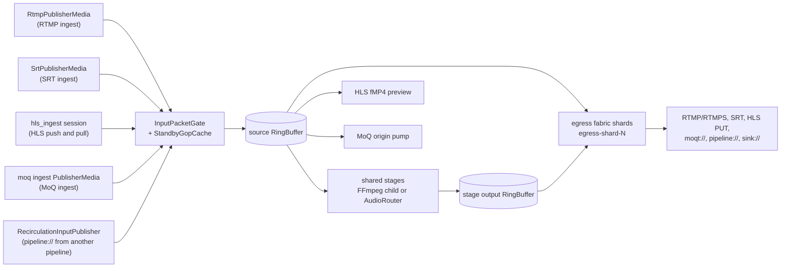

The diagram shows the shared path from each ingest to the egress readers.

| Protocol | Direction | Port or setting | Source |
|---|---|---|---|
| RTMP | ingest | TCP `0.0.0.0:1935` (`RESTREAM_RTMP_PORT`) | `src/media/rtmp/` |
| RTMP, RTMPS | egress | `rtmp://`, `rtmps://` output URLs | `src/media/rtmp/`, `src/media/egress/` |
| SRT | ingest | UDP `0.0.0.0:10080` (`RESTREAM_SRT_PORT`) | `src/media/srt/` |
| SRT | egress | `srt://` output URLs | `src/media/srt/`, `src/media/egress/backends/` |
| HLS push | ingest | HTTP port 3030 (`RESTREAM_HTTP_PORT`), `/ingest/hls/` | `src/media/hls_ingest/` |
| HLS pull | ingest | `hlsPull` pipeline input, no listener | `src/media/hls_pull.rs` |
| HLS PUT | egress | `http://`, `https://` output URLs | `src/media/hls/` |
| HLS preview | serving | HTTP port, `/hls/` | `src/media/hls/` |
| MoQ | ingest and origin | UDP, off unless `RESTREAM_MOQ_INGEST_LISTEN` is set | `src/media/moq/` |
| MoQ | egress | `moqt://` output URLs | `src/media/moq/egress/` |
| Recirculation | egress into ingest | `pipeline://` output URLs | `src/media/recirculation.rs` |
| Sink | egress | `sink://` output URLs | `src/media/egress/backends/sink.rs` |

File inputs use an FFmpeg child that writes MPEG-TS, which is demuxed into the
same source ring (`src/media/external_file_ingest.rs`).

All outputs share one retry policy. A failed output is retried with capped
exponential backoff and jitter: `RESTREAM_OUTPUT_MAX_RETRIES` (default 10),
`RESTREAM_OUTPUT_RETRY_BASE_MS` (default 5000) and
`RESTREAM_OUTPUT_RETRY_MAX_MS` (default 300000)
(`src/application/reconcile.rs`). Protocol code reports the failure; the
egress reconciler owns the restart.

## Rings and input selection

### Ring buffers

`RingBuffer` (`src/media/ring_buffer.rs`) is a fixed-capacity SPMC ring of
`MediaPacket`s. A packet has media type, track index, PTS, DTS, keyframe flag,
payload format (`Flv` or `Raw`) and reference-counted bytes
(`src/media/packet.rs`). Readers pull in bursts of up to 32 packets
(`MEDIA_PULL_BURST_PACKETS`). A reader that falls behind the producer resyncs.

| Ring | Default capacity | Setting |
|---|---|---|
| Source ring | 1024 packets, clamp 64–16384 | `RESTREAM_RING_CAPACITY` |
| Source ring after probe | `ceil((fps + audio tracks × 50) × headroom)`, at least the configured capacity, at most 16384 | `RESTREAM_RING_HEADROOM_SECS` (default 6.0, clamp 0.1–60) |
| Stage output ring | 512 packets, clamp 64–16384 | `RESTREAM_TRANSCODER_RING_CAPACITY` |
| SRT `TsChunkRing` | 256 chunks, clamp 32–16384; grows to 5 s of source packets, at most 16384 | `RESTREAM_TS_RING_CAPACITY` |

A resized ring keeps its readable tail, frame units and configurations.

### Frame units

Every ring slot also records the configuration generation of its packet's
track. A reader asks by ring sequence (`RingBuffer::frame_unit`,
`RingBuffer::track_config_at`) without a lock. A sequence that the producer
has overwritten reads as not retained.

- A track configuration is the codec configuration bytes for one
  `(media type, track index)`. For video it is the raw Annex B parameter
  sets.
- A new generation starts only when the bytes change. The last four
  generations of each track stay readable (`CONFIG_HISTORY`), so a lagging
  reader still gets the bytes its packet was published with.
- `push` and `push_batch` never parse payloads. Each producer records a
  configuration just before the packet that carries it, from what it already
  parses. `push_drained_batch_recording_config` records each Raw video
  packet's in-band sets at publication.
- The audio router and recirculation republish another ring's video. They
  copy its configuration where the generation changes (`VideoConfigFollower`).

RTMP egress uses this to announce a new sequence header before a Raw keyframe
whose generation differs from the last one it sent. A repeated in-band header
sends nothing; any parameter-set change sends a new header.

### Input selection

A pipeline has one primary input and up to three backups, each with its own
stream key (`src/db/pipeline_input_repo.rs`). Only the selected input
publishes into the source ring. Unselected inputs stay connected: they parse,
probe, report metrics and can serve an input-scoped HLS preview.

Each input has an `InputPacketGate` (`src/media/input_gate.rs`). It stores the
forwarding state and the in-flight publication count in one atomic word.

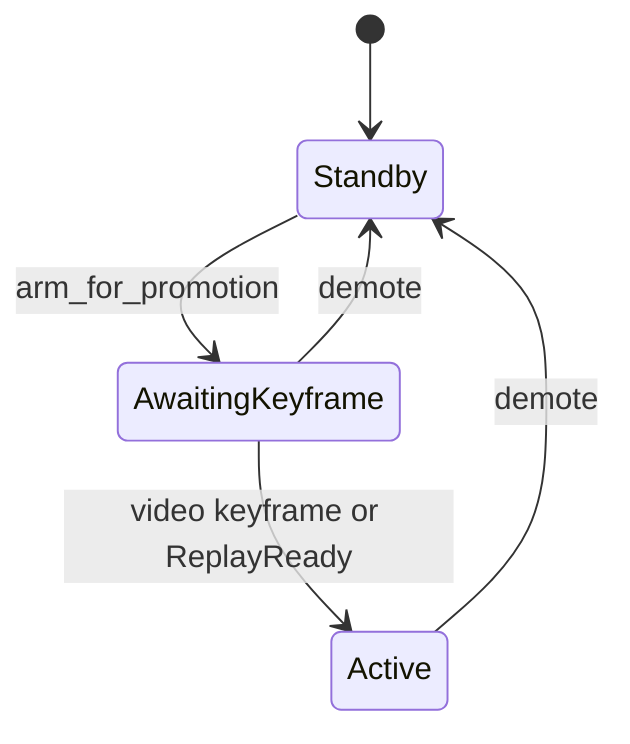

The diagram shows the gate states during a promotion.

1. Promotion demotes the old input's gate and waits until its in-flight
   publications drain (`src/media/engine_ingest.rs`).
2. It arms the target gate (`AwaitingKeyframe`).
3. RTMP, SRT, MoQ and recirculation standbys keep the newest compressed GOP in
   a `StandbyGopCache` (`src/media/standby_gop.rs`): 16 MiB of payload and
   2,048 packets per input by default. Crossing either limit drops the cache
   until the next keyframe.
4. On the target's next packet, a cache that starts with a video keyframe is
   replayed once and activates the gate. Without one, the target waits for
   its next live video keyframe.
5. `InputTimestampMapper` applies one offset so the first forwarded DTS
   follows the previous input's last DTS. PTS and DTS move by the same
   offset.

`tests/input_selection_loom.rs` models writer exclusion and one replay
activation.

## Stages and codecs

### Transcoder stages

A stage reads one ring and publishes into its own output ring. Outputs that
resolve to the same stage share it; each output keeps its own connection and
retry state.

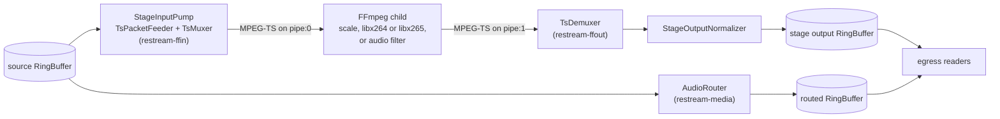

The diagram shows the two stage backends between rings: the external FFmpeg
child and the in-process audio router.

- **External FFmpeg** (`src/media/external_transcoder.rs`,
  `src/media/ffmpeg/`) is the only FFmpeg stage backend. Two OS threads move
  bytes: `restream-ffin` writes MPEG-TS to stdin, `restream-ffout` demuxes
  stdout. Tokio supervises the child only. `RESTREAM_EXTERNAL_FFMPEG_THREADS`
  sets FFmpeg threads (default 2). On stop the child gets 30 s after EOF or
  1 s after cancel, then it is killed.
- **AudioRouter** (`src/media/audio_router.rs`) runs on the MEDIA executor.
  It copies video and selects and reindexes audio tracks. It never decodes.

The planner (`src/planner/`) picks the stages for each output and
`application::egress::prepare_output_ring` (`src/application/egress.rs`)
wires the ring. A `source` output with no codec or audio change reads the
source ring directly.

### Stage keys

A stage identity is a typed `StageKey { pipeline, kind }`
(`src/domain/stage.rs`). Its display form is the key below.

| Stage | Key | Example |
|---|---|---|
| Video preset | `video:<preset>:codec:<codec>` | `video:720p:codec:h264` |
| Codec edge | `<operation>:from:<upstream>` | `hevc_to_h264:from:source` |
| Audio route | `audio:<operation>:from:<upstream>` | `audio:atrack:0:from:video:720p:codec:h264` |

The audio key embeds its upstream key, so outputs with different presets or
codecs never share audio stages. `same_encoding_outputs_share_one_transcoder_stage`
(`src/media/engine_stage_tests/transcoder.rs`) checks that equal requests
share one ring.

### Stage lifetime

A stage lives exactly as long as its consumers (`src/media/stage_lease.rs`).

- Each consumer holds a `StageLease` on every stage it reads: an egress
  attempt (`EgressTask`), an HLS preview, or an SRT play session.
- The registry keeps only a `Weak`. A consumer reuses a stage only while
  another consumer holds it.
- The last lease to drop cancels the stage at once. There is no grace period
  and no sweep.
- A stage that ends on its own (FFmpeg exits) is never reused. An egress
  attempt that reads it ends with error `stage_ended` and retries on a new
  stage. An HLS PUT output then abandons its session without `EXT-X-ENDLIST`
  (`EgressCommand::Abandon`), so the destination keeps the stream open.
- An output that waits out its retry backoff holds no lease.
- The pipeline HLS segmenter holds the leases of the output that started it
  until the segmenter ends (`src/infrastructure/bootstrap/hls_segmenter.rs`).

### Video presets

A preset output scales and re-encodes with the profile of that name
(`src/media/profiles.rs`). Saved profiles override built-ins of the same
name. An unknown name falls back to the `h264` profile.

| Built-in profile | Size | Use |
|---|---|---|
| `h264` | source size | HEVC to H.264 codec edge |
| `720p` | 1280×720 | preset |
| `1080p` | 1920×1080 | preset |

All built-ins use `ultrafast`, `zerolatency`, CRF 23, GOP 60 and no B-frames.
The encoder follows the resolved output codec: `libx264` for H.264,
`libx265` for H.265. An output with `custom` encoding is rejected on create
and update.

### Audio routes

| Route | Backend | Effect |
|---|---|---|
| `atrack:<n>` | AudioRouter | keep audio track `n` only, reindexed |
| `remap:<l>:<r>` | FFmpeg | `pan=stereo` from two source channels, AAC stereo |
| `downmix:<n>` | FFmpeg | `aresample` to stereo, AAC stereo |

FFmpeg audio routes copy video.

### Codecs by output

`codec:auto` keeps the input codec when the output protocol carries it.
Otherwise it takes the protocol default. An explicit codec the protocol
cannot carry is rejected before it is saved
(`src/domain/output_spec/config.rs`).

| Output | Video codecs | H.265 source with `codec:auto` |
|---|---|---|
| RTMP, legacy mode (default) | H.264 | `hevc_to_h264:from:source` stage (FFmpeg `libx264`, source size) |
| RTMP, enhanced mode | H.264, H.265 | passthrough as Enhanced RTMP `hvc1` |
| SRT | H.264, H.265 | passthrough in MPEG-TS |
| HLS (`http://`, `https://`, `hls://`) | H.264 | `hevc_to_h264` stage |
| HLS preview | H.264 | shared `hevc_to_h264:from:source` stage |
| `moqt://` | H.264, H.265 | passthrough |
| `pipeline://`, `sink://` | any | passthrough |

Restream's muxers and packagers write AAC audio only. Ingest codecs:

| Ingest | Video | Audio |
|---|---|---|
| RTMP | H.264 (FLV codec ID 7) | AAC |
| SRT, file | H.264 (TS type `0x1B`), H.265 (`0x24`) | AAC ADTS (`0x0F`), AAC LATM (`0x11`) |
| HLS push and pull | H.264, H.265 in MPEG-TS or fMP4 (`avc1`, `hev1`, `hvc1`) | AAC (`mp4a`) |
| MoQ | H.264, H.265 | AAC, up to eight tracks |

The MPEG-TS demuxer (`src/media/mpegts/demux.rs`) ignores other stream types.
It keeps audio track indices, PIDs and languages. It emits one AAC frame per
packet, even when a frame spans PES packets. The MPEG-TS muxer
(`src/media/mpegts/mux.rs`) assigns PIDs from `0x100`, keeps track index and
language, and writes H.264, H.265 and AAC ADTS.

## RTMP

### RTMP ingest

The RTMP listener accepts publishers on Compio owner threads. The socket,
handshake, chunk parsing and media publication stay on the owner. A Tokio
control session per connection authenticates the publish and handles
lifecycle.

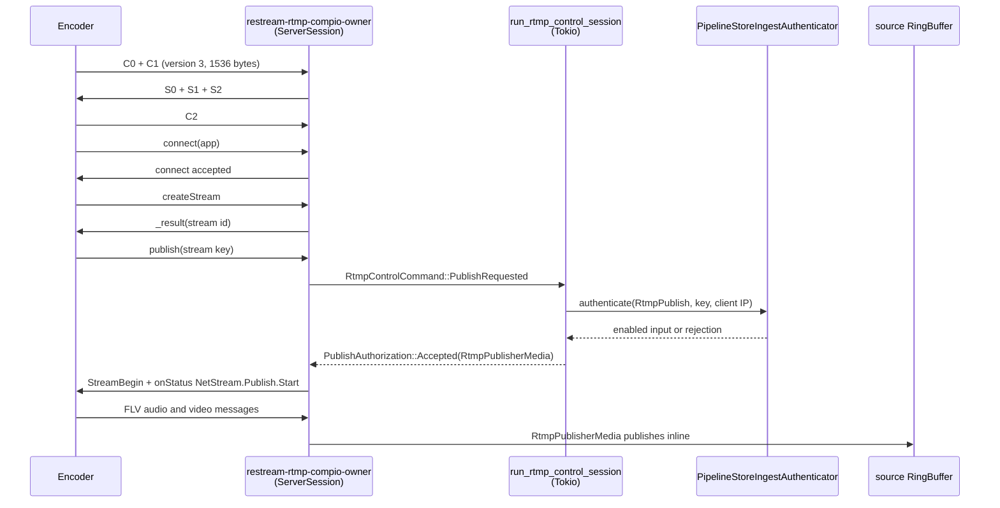

The diagram shows a successful publish, from the TCP handshake to the first
media in the ring.

- **Handshake.** `rml_rtmp` (vendored under `vendor/rml_rtmp/`) runs the
  server handshake (`src/media/rtmp/handshake.rs`). It does not verify the C2
  signature.
- **Stream key.** The key is the first argument of `publish`. The `connect`
  app name is not part of the key. `releaseStream` and `FCPublish` are
  ignored.
- **Authentication.** `authorize_publish` (`src/media/rtmp/ingest.rs`)
  requires an enabled input whose stream key matches exactly. A banned IP, a
  bad key or a second publisher on the same input is rejected with
  `NetStream.Publish.BadName`. Restream then closes the connection; the
  rejection message is not sent to the encoder.
- **Media.** `RtmpPublisherMedia` (`src/media/rtmp/ingest_media.rs`) classifies
  FLV tags, stores sequence headers, runs the standby GOP cache and the input
  gate, and publishes `Flv` packets to the ring. Video DTS is the RTMP
  timestamp; PTS adds the signed 24-bit composition offset. Probe metadata goes
  to the control session; ordinary packets do not.
- **Enhanced RTMP ingest** (`hvc1` FourCC) is not implemented.
- **Play.** A `play` request with a valid key reads the active ingest's ring
  (`src/media/rtmp/play.rs`). An invalid key or no active ingest gets
  `NetStream.Play.StreamNotFound`.

| Setting | Default | Range |
|---|---|---|
| `RESTREAM_RTMP_PORT` | 1935 | |
| `RESTREAM_RTMP_INGRESS_OWNERS` | 1 | 1–64; owners share the port with `SO_REUSEPORT` |
| `RESTREAM_RTMP_LISTENER_BACKLOG` | 1024 | |
| `RESTREAM_RTMP_MAX_CONNECTIONS` | 512 | 1–16384 |
| `RESTREAM_RTMP_MAX_CONNECTIONS_PER_IP` | 64 | 1–max connections |
| `RESTREAM_RTMP_HANDSHAKE_TIMEOUT_MS` | 10000 | 100–300000 |
| `RESTREAM_RTMP_PREAUTH_TIMEOUT_MS` | 10000 | 100–300000; time to reach an accepted publish |
| `RESTREAM_RTMP_MAX_MESSAGE_BYTES` | 8 MiB | 64 KiB–16 MiB − 1 |
| `RESTREAM_RTMP_INGEST_PARSER_BUDGET_BYTES` | 256 MiB | max message size–16 GiB; split across owners |
| `RESTREAM_RTMP_PREAUTH_BUFFER_BYTES` | 128 KiB | 16 KiB–1 MiB; socket buffers before auth |
| `RESTREAM_RTMP_STREAM_BUFFER_BYTES` | 8 MiB | 128 KiB–64 MiB; socket buffers after auth |

Failure behavior:

- A connection over the total or per-IP cap is dropped at accept.
- A declared message over the size limit closes the connection before its
  payload is buffered.
- A connection that would push its owner over its share of the parser budget
  is closed. The budget counts buffered input and completed media.
- Socket buffer sizes are requests. A failed `setsockopt` logs a warning and
  keeps the publisher.

### RTMP and RTMPS egress

RTMP outputs are leaves on egress fabric shards. Each shard is one OS thread
with one Compio runtime; the protocol engine and the socket workers share it.

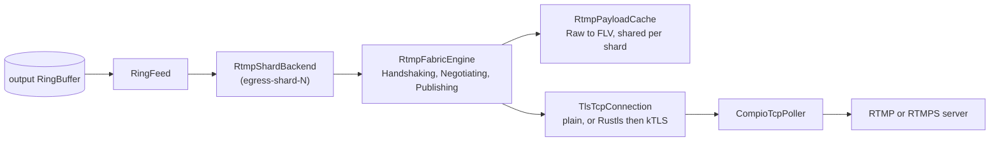

The diagram shows one RTMP output from its ring to the destination socket.

- **URL.** `rtmp://host[:port]/app/key` or `rtmps://…`. Both default to port
  1935, so an RTMPS destination on 443 must name the port. When the query
  contains `/`, the key is the text after the last `/` of `path?query`
  (`rtmp://host/live2?backup=1/<key>`). App and key are percent-decoded
  (`src/media/rtmp/egress_transport.rs`).
- **Mode.** Legacy mode (default) sends H.264. Enhanced mode also sends H.265
  as Enhanced RTMP `hvc1` packets (`src/media/codec/enhanced_rtmp_hevc.rs`).
  The `connect` command does not advertise a `fourCcList`.
- **Media.** The startup snapshot fixes the tracks once. More than one audio
  track is rejected. Raw audio without an AAC sequence header is dropped.
  Raw video becomes FLV in `RtmpPayloadCache`, shared by the shard's leaves
  (64 entries). Video uses DTS as the RTMP timestamp; audio uses PTS. Each
  type's timestamps are kept strictly increasing.
- **RTMPS.** Rustls completes TLS, then the session keys move to Linux kTLS
  (`src/media/egress/tls/`). Only AES-GCM suites are offered. An unsupported
  suite or a kTLS install error fails the output; there is no userspace-TLS
  fallback. After the handoff, TLS 1.3 session tickets are discarded and a
  `KeyUpdate` closes the output. `RESTREAM_RTMPS_EXTRA_TRUST_ROOTS_PEM` adds
  trust roots to the bundled web roots.
- **Socket.** One shared Compio `TcpStream` per leaf. RX reads are 4 KiB;
  staged and in-flight TX is bounded at 64 KiB by default
  (`src/media/egress/backends/compio_tcp/stream.rs`).
  `RESTREAM_RTMP_EGRESS_CHUNK_SIZE` sets the chunk size (default 16384,
  clamp 128–1048576).
- **Failure.** A peer close, protocol error or TLS error removes the leaf and
  marks the output as ended unexpectedly. `EgressTask` records
  `rtmp_fabric_leaf` and the retry policy restarts it.

## SRT

SRT uses [srt-rs](configuration.md#srt-transport-configuration)
(`srt-proto`, `srt-transport`) on Compio. An `Owner` owns each UDP socket and
all SRT protocol state.

### SRT ingress owner

The listener runs one owner thread per seat: `srt-in-<port>` by default, or
`srt-in-<port>-<index>` when `RESTREAM_SRT_INGRESS_OWNERS` is above 1 (members
of one `SO_REUSEPORT` group). Each thread has its own Compio runtime (io_uring
only) and one `srt_transport::compio::Owner`.

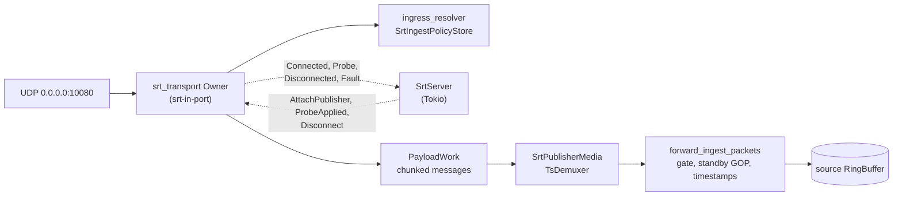

The diagram shows that media stays on the owner thread; Tokio sees only
lifecycle and probe events (dotted).

- **Admission.** The resolver runs on the owner
  (`src/media/srt/ingress_admission.rs`).
  An empty key is `BAD_MODE`, an unknown key `UNAUTHORIZED`, a bad crypto or
  group mode `BAD_REQUEST`. It applies the input's latency and encryption.
  Tokio then checks IP bans, pipeline authentication, duplicate publishers and
  read targets; a rejection disconnects that peer.
- **Bridges.** Commands to the owner: `AttachPublisher`, `AttachReader`,
  `ProbeApplied`, `Disconnect`, `Shutdown` (256 per owner). Events to Tokio:
  `Connected`, `Probe`, `Disconnected`, `Fault` (256, shared)
  (`src/media/srt/ingress_bridge.rs`).
- **Payload work.** Messages stay in packet chunks. A 64-slot owner-local work
  list holds them; a visit consumes at most 64 chunks, 16 per message, and
  retires at most 64 actions. Events keep queue order, so a disconnect never
  overtakes queued media (`src/media/srt/ingress_owner_payload.rs`).
- **Probe hold.** Before attach, an owner holds up to 2.5 MB per peer and
  32 MiB in total. After the probe it holds up to 4 MiB per publisher, 64 MiB
  per owner, for 2 s; overflow publishes to the current ring.
- **Retirement.** A locally closed peer retires after its terminal event or
  500 ms. Stale commands for a retired peer are counted (`staleCommands`).
- **Fault.** An owner fault ends its thread. The listener supervisor restarts
  the whole listener with backoff from 1 s to 30 s, reset after 60 s of
  health (`src/infrastructure/bootstrap/listener_supervisor.rs`).
- **Metrics.** `srtListener.ingressOwner` in engine status, with no peer or
  StreamID labels (see [Observability](observability.md)).

| Setting | Default | Notes |
|---|---|---|
| `RESTREAM_SRT_PORT` | 10080 | invalid values fall back to the default |
| `RESTREAM_SRT_INGRESS_OWNERS` | 1 | clamp 1–CPU count |
| `RESTREAM_SRT_UDP_BUF_BYTES` | 8 MiB | socket buffer request, ingress and egress |
| `RESTREAM_SRT_MAX_PEERS_PER_IP` | 64 | clamp 1–4096 |
| `RESTREAM_SRT_INGRESS_WINDOW_MEMORY_BYTES` | available memory / 4 / owners | 0 disables |
| `RESTREAM_SRT_PASSPHRASE`, `RESTREAM_SRT_PBKEYLEN` | unset, 16 | used only when no SRT ingest config is saved |

Ingest latency comes from the saved SRT ingest policy: default 250 ms, valid
20–8000 ms. A passphrase is 10–79 bytes; key length is 16, 24 or 32
(`src/domain/srt_ingest.rs`).

### SRT Stream ID

`src/media/srt_stream_id.rs` accepts these shapes (case-sensitive):

```text
publish:<key>   publisher:<key>
read:<key>      play:<key>      subscriber:<key>   request:<key>
<key>
#!::r=<key>,m=publish
#!::r=<key>,m=request    #!::streamid=<key>
```

A bare key publishes. Only `play`, `read`, `subscriber` and `request` select
read; any other prefix publishes. Trailing NULs and whitespace are trimmed and
the query is stripped. A slash stays part of the key.

### SRT bonding

A publisher-created Broadcast or Backup group becomes one logical input.
Restream answers every bonded leg with one receiving-group id, random per
listener lifetime and shared by all owners. A direct caller gets no group
response. Matching Stream IDs on independent sockets do not form a bond.

For egress, `bond=` adds legs to one logical caller:

```text
srt://primary:10080?streamid=publish:key&bond=backup1:10080,backup2:10080&type=broadcast
```

- `type=backup` (default) or `type=broadcast`.
- All legs must reach the same remote receiving group. A leg that answers from
  another group fails the whole output. An unreachable leg is only degradation.
- All legs must use one address family; a mixed bond fails the output.

### SRT egress

SRT outputs share one MPEG-TS muxer per pipeline and stage. Shard leaves send
its chunks through one owner per shard and address family.

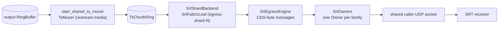

The diagram shows one SRT output from its ring to the remote receiver.

- **URL.** `srt://host:port?streamid=…&passphrase=…&pbkeylen=…&bond=…&type=…`.
  Other parameters, such as `latency`, are ignored
  (`src/media/srt/egress_connect.rs`). Restream is always the caller.
- **Muxer.** `start_shared_ts_muxer` (`src/media/srt/shared_muxer.rs`) runs on
  the MEDIA executor. It is keyed by pipeline and stage. With
  `RESTREAM_SRT_EGRESS_MUXER_MAX_OUTPUTS_PER_SHARD` above 0 (max 10000),
  outputs split across up to `RESTREAM_SRT_EGRESS_MUXER_MAX_SHARDS` muxers
  (default 64), keyed with `:srt-mux-shard:<index>`.
- **Owner.** Each `(shard, address family)` has at most one owner, created on
  demand: one caller UDP socket, one caller pool, one TX pool. A full window
  parks the leaf; there is no Restream transport queue
  (`src/media/egress/backends/srt/owner_set.rs`).
- **Failure.** A peer-group collision or a mixed-family bond fails the output.
  An owner fault fails that family's leaves only. Tokio notices an ended leaf
  within 250 ms, records `srt_fabric_leaf`, and the retry policy restarts it.

| Setting | Default | Range |
|---|---|---|
| `RESTREAM_SRT_CONNECT_TIMEOUT_MS` | 10000 | per leg |
| `RESTREAM_SRT_EGRESS_CONNECT_CONCURRENCY` | 64 | 1–4096 connects in flight per owner |
| `RESTREAM_SRT_EGRESS_TX_CAPACITY` | 16 | 1–4096 TX slots per owner |
| `RESTREAM_SRT_EGRESS_GSO` | true | UDP GSO |

## HLS

### HLS push ingest

Encoders push an MPEG-TS or fMP4 HLS stream over HTTP to the dashboard port,
under the input's stream key:

```text
http://<host>:<httpPort>/ingest/hls/<streamKey>/<playlist>.m3u8
```

```sh
ffmpeg -re -i input.mp4 -c:v libx264 -g 60 -c:a aac \
  -f hls -hls_segment_type fmp4 -method PUT -hls_time 2 \
  http://HOST:3030/ingest/hls/KEY/index.m3u8
```

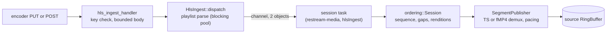

The diagram shows one uploaded object from the HTTP handler to the ring.

Sources: `src/api/hls_ingest.rs`, `src/media/hls_ingest/`,
`src/media/ingest_publisher.rs`.

- **Objects.** `.m3u8` playlists, `.ts` segments, and fMP4 `.mp4` or `.m4s`
  objects. PUT and POST store; DELETE answers `200` and deletes nothing.
  Segment URIs must be relative to their playlist. The first media object
  fixes the container; a later object of the other container gets `415`.
  To copy ADTS AAC into fMP4, add `-bsf:a aac_adtstoasc`; the harness does
  this (`src/bin/test_harness/hls_push_duty/options.rs`).
- **Authorization.** The stream key is checked like an RTMP or SRT key,
  under the `hls-publish` rate-limit scope. A keyed input may additionally
  require HTTP Basic via write-only `pushAuth` configuration. Every PUT,
  POST and DELETE checks both before reading any body byte; missing or wrong
  Basic credentials receive `401`. Salted password verification uses a
  bounded blocking lane, never a Tokio worker or media Owner; saturation
  returns `503`. Generated URLs never contain these credentials. The route
  is outside the dashboard session check. Use HTTPS through a TLS proxy.
- **Session.** The first accepted object registers an `hls` input attempt. It
  ends on `EXT-X-ENDLIST` after the last listed segment, after
  max(3 × target duration, 10 s) without an object, or when the input goes
  away. A panic ends only that session.
- **Ordering.** A segment no playlist lists yet is held (`202`). Segments
  publish in `EXT-X-MEDIA-SEQUENCE` order. A gap is skipped after one target
  duration once later segments are ready. A master playlist selects the
  highest-`BANDWIDTH` variant; other variants get `200` and are dropped.
- **Separate audio.** When the variant names an `EXT-X-MEDIA` audio rendition
  (`DEFAULT=YES`, else `AUTOSELECT=YES`, else the first with a `URI`), that
  playlist is followed too. Video and audio merge onto the ring in DTS order.
  A rendition that stalls delays the other by at most three target durations.
- **fMP4.** The `EXT-X-MAP` names the init segment. Identical init bytes under
  a new URI change nothing; new bytes rebuild the demuxer and start a
  discontinuity. The last applied init per rendition stays with the stream
  key, so a restarted session reuses it; `EXT-X-ENDLIST` or a refused init
  clears it, and deleting the input forgets it. Each fragment needs a `tfdt`.
  An HEVC sample is a keyframe only when it is a sync sample and an IRAP
  picture (NAL types 16–23).
- **Discontinuities.** An encoder restart (sequence or names go back) or
  `EXT-X-DISCONTINUITY` starts a new epoch. Timestamps continue after the last
  forwarded ones.
- **Pacing.** Released media reaches the ring at media pace. Media that is
  behind is published at once, up to one target duration. A session takes
  new objects only while less than two target durations of media, and at most
  128 MiB, wait to publish. A poll applies one object or publishes one
  64 KiB chunk (`PUBLISH_CHUNK_BYTES`).
- **Bad segment.** A segment that fails to demux is dropped and counted. The
  timeline re-anchors and publishing continues.
- **Known limit.** An init lost on the wire under the same URI is invisible;
  the next run may build ADTS headers from the old audio config.

| Status | Meaning |
|---|---|
| `200` | stored, or dropped as another variant; any DELETE |
| `202` | held until a playlist lists it |
| `400` | malformed object or invalid path |
| `403` | wrong key, disabled input or banned IP |
| `405` | method other than PUT, POST, DELETE |
| `408` | no upload slot within 10 s; body silent for 10 s; body longer than max(4 × target duration, 40 s) |
| `409` | another publisher holds the input |
| `413` | over a size bound |
| `415` | unsupported extension, container or codec; fMP4 media without `EXT-X-MAP` |
| `503` | key lookup unavailable, or shared budget exhausted (`Retry-After: 1`) |

| Bound | Value |
|---|---|
| Playlist | 1 MiB |
| Segment or fMP4 object | 64 MiB |
| fMP4 init | 4 MiB |
| Uploads in flight per key | 2 |
| Held segments per key | 8 or 128 MiB, oldest evicted |
| Segment bytes per key | 128 MiB; chunked bodies claim it in 4 MiB steps |
| All sessions | 512 MiB, never waited for |
| fMP4 per segment | 4096 box-walk steps, 64 fragments, 256 KiB per `moof`, 16384 samples |

Playlists use only the shared budget and never wait for a per-key share.

### HLS pull ingest

An `hlsPull` input has no listener. `HlsPullTask` (`src/media/hls_pull.rs`)
fetches a remote live HLS origin and feeds the push session path as protocol
`hls-pull`.

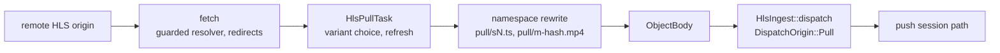

The diagram shows a pull feeding the same session code as a push.

- **Source.** An `http` or `https` playlist URL, a variant rule
  (`highestBandwidth`, the default, or `lowestBandwidth`) and optional
  credentials: bearer, cookies, basic or request headers. Credentials are
  write-only. A URL with userinfo is refused.
- **Variant.** The rule applies among variants whose `CODECS` are all
  supported (`avc1`, `avc3`, `hvc1`, `hev1`, `mp4a.40.2`), or among all
  variants when none qualifies. The master is resolved again after a 401,
  403 or 404 on the media playlist, and after a failed retry burst.
- **Audio.** A separate `EXT-X-MEDIA` audio rendition is followed too
  (`pull/a/`). Its failures do not stop video; after six failed cycles in a
  row the pull drops audio until it restarts.
- **Credentials.** They go only to the source's own origin (scheme, host and
  port). Each pull has its own cookie jar.
- **Redirects.** At most 10. `https` to `http` is refused. A cross-origin hop
  is refused when the pull has credentials or the target fails the address
  guard.
- **Address guard.** Loopback, link-local, private, unique-local, CGNAT and
  `localhost` targets are fatal, unless the source itself is private. The
  guard checks every resolved address and connects to those addresses only.
  Proxy environment variables are ignored.
- **Refresh.** Every target duration, or half of it after a reload with
  nothing new, never faster than 500 ms. A live playlist starts at the
  segment at least three target durations from its end; an ended playlist
  starts at its first segment.
- **Refused playlists.** `EXT-X-KEY` or `EXT-X-SESSION-KEY` with a method other
  than `NONE`, and `EXT-X-BYTERANGE`, end the task.
- **Retries.** 200 ms doubling to 5 s. After six failures in a row the pull
  waits 30 s. A segment that fails four times is skipped.
- **Timeouts.** Connect 5 s, request 20 s (`src/media/hls_pull/fetch.rs`).
- **Logs.** URLs are logged without userinfo, query, or path segments that
  contain `=`.
- **End.** `EXT-X-ENDLIST` ends the task after the last segment. A fatal error
  ends it; the registry may restart it after 30 s. Cancellation stops it at
  the next await and dispatches nothing more.

### HLS PUT egress

An `http://` or `https://` output uploads MPEG-TS segments and a playlist to
the target. The pipeline has one MPEG-TS segmenter. The first HLS output
starts it on its own ring, and later HLS outputs of the pipeline share it.

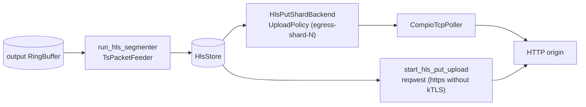

The diagram shows both upload transports reading the shared segment store.

- **Transport.** With `RESTREAM_HLS_PUT_FABRIC` (default true), `http://` and
  kTLS-capable `https://` outputs run on fabric shards. Other `https://`
  outputs use the Reqwest uploader. An `hls://` output keeps the segmenter
  running and uploads nothing.
- **Segments.** A segment is cut on a keyframe after
  `RESTREAM_HLS_MIN_SEGMENT_MS` (default 1000). The accumulator starts at
  `RESTREAM_HLS_SEGMENT_CAPACITY_BYTES` (default 8 MiB) and grows as needed.
- **Upload.** Each segment is PUT as `video/mp2t`, then the playlist as
  `application/vnd.apple.mpegurl`. The playlist lists the last three
  acknowledged segments. At most five segments wait; the oldest is dropped.
  Restream never sends DELETE (`src/media/hls/upload_policy.rs`).
- **URL.** A `file=` query value is replaced per segment; otherwise segments
  go next to the playlist path (`src/media/hls/upload.rs`).
- **Retries.** A `2xx` acknowledges. `408`, `425`, `429`, other non-4xx
  answers and transport errors retry with 200 ms doubling to 5 s. Other `4xx`
  answers end the output. A segment retries for max(segment duration, 1 s);
  the playlist retries with its newest state.
- **Stop.** A removed output sends one final playlist with `EXT-X-ENDLIST`. An
  output whose stage ended abandons without it.

### HLS preview

The dashboard preview is fMP4 HLS, served on the HTTP port. It starts on the
first request and stops after `RESTREAM_HLS_IDLE_TIMEOUT_MS` (default 60000)
without a playlist fetch.

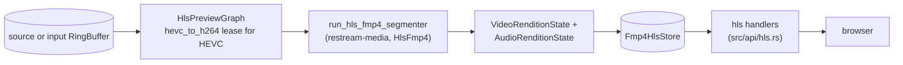

The diagram shows the preview path from the ring to the browser.

- **Routes.** `/hls/{pipeline_id}/` and `/hls/inputs/{input_id}/`, each with
  `master.m3u8`, `video/index.m3u8`, `video/init.mp4`, `video/segN.m4s`,
  `audio/{track}/index.m3u8`, `audio/{track}/init.mp4` and
  `audio/{track}/segN.m4s` (`src/api/router.rs`). `/hls/{pipeline_id}` and
  `/hls/{pipeline_id}/index.m3u8` return the primary playlist.
- **Codecs.** H.264 `avc1` and AAC `mp4a`, with RFC 6381 `CODECS` from the
  sample entries. HEVC sources go through the shared
  `hevc_to_h264:from:source` stage.
- **Window.** The playlist advertises `RESTREAM_HLS_MAX_SEGMENTS` (default
  20) segments and keeps 6 more fetchable. `EXT-X-TARGETDURATION` starts at
  the first segment's duration and never decreases.

## MoQ

MoQ negotiates moq-lite (`moq-lite-03` to `moq-lite-06`) or IETF MOQT
drafts 14–22 using `moq-net` on Compio QUIC. One listener serves publishers
(ingest) and viewers (origin). `moq-mux` publishes both hang `catalog.json`
(plus its compressed form) and MSF `catalog`; media tracks use LOC.
The vendored `moq-net` `unsend` feature preserves the `!Send` transport owner.

| Setting | Default | Notes |
|---|---|---|
| `RESTREAM_MOQ_INGEST_LISTEN` | off | UDP socket address, for example `0.0.0.0:4443` |
| `RESTREAM_MOQ_TLS_CERT` | none | PEM certificate chain; required when listening |
| `RESTREAM_MOQ_TLS_KEY` | none | PEM private key; required when listening |
| `RESTREAM_MOQ_MAX_CONNECTIONS` | 64 | clamp 1–4096; handshakes and publishers |
| `RESTREAM_MOQ_ORIGIN_MAX_VIEWERS` | 64 | clamp 1–4096; viewers across all pipelines |

An invalid setting logs `restream.moq.ingest.config_invalid` and the listener
stays off. An unreadable PEM or a bind error logs
`restream.moq.ingest.start_failed`. `moqt://` egress does not need the
listener.

### MoQ ingest

One OS thread, `moq-ingest`, runs a Compio runtime that owns the endpoint,
every connection, frame conversion and ring publication. Tokio only admits the
publisher, applies the probe and records the disconnect.

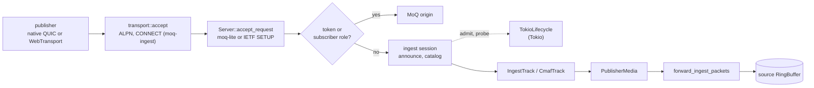

The diagram shows a publisher connection from QUIC accept to the ring.

- **Transport.** The ALPN picks the native QUIC wire: moq-lite or
  `moqt-14` through `moqt-22`. `h3` is WebTransport, whose CONNECT must offer
  a supported MoQ subprotocol (else HTTP `400` and close `0x10b`). A CONNECT
  that fails to decode closes with `0x10e`. HTTP/3 frames and capsules are
  bounded to 64 KiB. The transport handshake and SETUP each have 10 s
  (`src/media/moq/transport/`). Library drivers run on the owner, not Tokio.
- **Routing.** A connection with a non-empty `token` (CONNECT query or SETUP
  path query) or the subscriber role goes to the origin. Any other is a
  publisher.
- **Stream key.** The last segment of the connection path, without the query.
  When the path is empty, the first announced broadcast names it (a trailing
  `.hang` or `.msf` is removed). The key is checked under the `moq-publish` scope and
  registers an input attempt as protocol `moq`. An unknown key or ban closes
  the session as unauthorized; a held input as duplicate.
- **Catalogs.** A `.msf` broadcast prefers MSF, and `.hang` prefers hang;
  other names race both subscriptions on the owner, without spawned tasks.
  A missing profile falls back; malformed catalogs fail promptly. The
  upstream MSF consumer maps to the shared hang model before selection.
  Local `moq-msf` deserializer bounds apply before shared initialization data
  expands: 32 MiB serialized input, 64 tracks/init entries and 32 MiB aggregate
  resolved init strings. No second hand-written catalog parser is used.
- **Tracks.** The first ranked H.264 or H.265 rendition becomes video; up to
  eight AAC renditions become audio tracks in catalog order. Others are logged
  as `restream.moq.ingest.track_rejected`. A catalog with no usable track ends
  the session. Only the first catalog is read; a publisher that changes
  renditions must reconnect.
- **Frames.** LOC carries a property block and codec payload; upstream
  `moq_loc::decode` slices without copying and honors per-frame Timescale.
  Legacy hang timestamps and CMAF remain accepted. Empty duration or
  discontinuity markers are skipped, not counted as malformed. Video becomes
  Raw Annex B with missing keyframe parameter sets restored; AAC gets ADTS.
  LOC/legacy carry presentation time, so DTS uses the catalog `jitter`;
  CMAF uses the HLS fMP4 demuxer and retains real decode times.
- **Publication.** The same path as SRT after demux: input gate, standby GOP,
  timestamp mapping, ring. Packets are held (4 MiB, 2 s) while the probe
  resizes the ring.
- **Limits.** Each ends the session: no announcement, broadcast or catalog
  within 10 s each; no frame for 20 s; a frame over 16 MiB; 64 malformed
  frames in a row (a single bad frame is dropped). A catalog that hang/MSF
  refuses, or whose parser panics, ends the session as a protocol violation.
  Parser panics are counted as contained; the input is released with that
  reason (`src/media/moq/ingest/session.rs`).
- **Shutdown.** The endpoint closes with code 0, sessions get 1 s, then the
  rest are dropped and their inputs released.

### MoQ origin

The same listener serves a pipeline straight to viewers: the dashboard player
over WebTransport, or a moq-lite/IETF client over native QUIC.

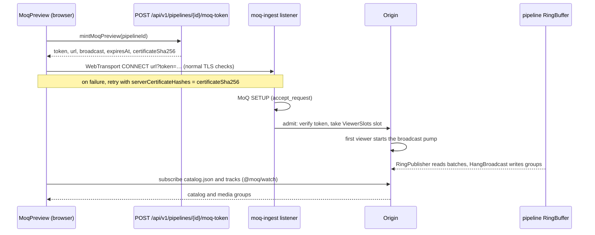

The diagram shows a dashboard preview subscribing to a pipeline.

- **Token.** `POST /api/v1/pipelines/{id}/moq-token`
  ([API](api-reference.md)) returns `{token, url, broadcast, expiresAt,
  certificateSha256}`, or `409` when the listener is off. The token is
  `v1.<pipeline>.<expiry>.<HMAC-SHA256>` under a random key created on first
  use in this process (`src/media/moq/origin/token.rs`). It admits only its
  own pipeline and must be used within 60 s. An open session does not expire
  with its token.
- **Admission.** A missing, forged or expired token is refused as
  unauthorized. When `RESTREAM_MOQ_ORIGIN_MAX_VIEWERS` viewers are playing,
  the next gets application error 1. An admitted viewer leaves the connection
  count.
- **Serving.** The first viewer of a pipeline starts one broadcast, named by
  the pipeline id. A pump task on the listener thread reads the ring in
  batches (64 units or 1 MiB) and sleeps until the ring publishes. Viewers of
  one pipeline share it; the last to leave stops it. A pipeline with no
  usable media is refused as not found.
- **Media.** The same conversion as MoQ egress: video plus the first AAC
  track.
- **Browser.** `MoqPreview` (`web/ts/control-room/moq-preview.tsx`) needs
  `WebTransport` and `VideoDecoder`. It loads `@moq/watch` on demand, connects
  with normal certificate checks, and pins `certificateSha256` only if that
  fails. It reports failure when no frame decodes within 15 s.
- **Loom.** `tests/moq_origin_loom.rs` models the viewer cap and the
  ring-to-pump wake.

### MoQ TLS and certificates

| Side | Trust |
|---|---|
| Listener | TLS 1.3 with `RESTREAM_MOQ_TLS_CERT` and `RESTREAM_MOQ_TLS_KEY`; no client certificates; at most 64 incoming unidirectional streams per connection |
| Browser viewer | normal WebPKI validation; on failure, `serverCertificateHashes` with the SHA-256 of the leaf certificate DER (`certificateSha256`, `null` if unreadable). Browsers accept a pinned certificate only when it is valid for at most 14 days |
| `moqt://` egress | TLS 1.3 with bundled web roots plus `ca=` PEM files confined to operator-set `RESTREAM_MOQ_CA_DIR`; `insecure=1` skips chain and name checks but still verifies handshake signatures |

Restream does not generate a certificate (`src/media/moq/tls.rs`).

### MoQ egress

A `moqt://` output publishes the pipeline to a moq-lite or IETF relay over
native QUIC. The pinned IETF interop peer is moq-relay 0.17.7 on `moqt-19`;
MediaMTX's incompatible dialect is tracked separately in
[Q-091](backlog.md#q-091-protocol-opus-align-mediamtx-moq-dialect-with-ietf-interop).

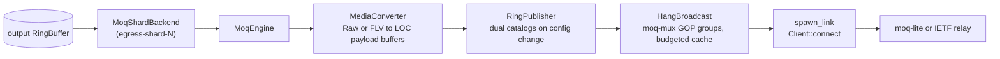

The diagram shows one MoQ output from its ring to the relay.

- **URL.** `moqt://HOST[:PORT][/PATH][?broadcast=NAME&ca=FILE&insecure=1&version=moqt-19]`,
  default port 443, no userinfo (`src/media/moq/egress/url.rs`). `broadcast`,
  `ca`, `insecure` and `version` are Restream-only keys; other query pairs
  remain in the relay session path. `broadcast` defaults to the pipeline id.
  Without `version`, offer all supported MoQ ALPNs; a known ALPN pins one,
  while an unknown value is rejected.
- **Thread.** Each output is a leaf on a MoQ fabric shard (`egress-shard-N`); its
  Compio runtime owns the connection and the session
  (`src/media/engine_moq_egress_fabric.rs`). Startup metadata is prepared on
  Tokio; CA canonicalization, confinement checks and reads use its blocking
  pool. Custom CA reads require `RESTREAM_MOQ_CA_DIR`; absolute paths, `..`
  components and symlink escapes are refused (see [configuration](configuration.md#moq)).
- **Media.** Video (H.264 or H.265) and the first AAC track. The startup
  snapshot gives the catalog its `avcC` or `hvcC` record and AAC config. Raw
  video drops in-band parameter sets and gets 4-byte NAL lengths; FLV video is
  copied once into converter headroom. Raw ADTS audio is split per AAC frame.
  A configuration change publishes both catalogs before the next frame.
  Video waits for its first configuration and keyframe.
- **Framing.** Finalize the LOC header in place, including an explicit
  1,000,000 Timescale for application media time (LOC-04 §2.3.1.1–2);
  omitting it would mean Unix wall time. One `Bytes` allocation is shared
  across subscribers. Empty markers follow the same media-time contract.
- **Groups and retention.** `moq-mux::container::Producer` manages GOP video
  groups and roughly 1 s audio groups, with buffer duration zero. A rewind
  behind the closed-group live edge emits a discontinuity on both tracks
  and advances one shared offset; B-frame reordering within a GOP is kept.
  A ring overrun resyncs the leaf. `max_age(0)` makes slow subscribers skip
  old groups; it does not free them. Every broadcast's byte budget follows
  twice its tracks' last complete groups (about two GOPs); moq-net always
  retains each live track's newest group.
- **Failure.** A refused or failed connection or a relay close ends the output
  and the retry policy restarts it. A removed output finishes the broadcast,
  closes the session for a bounded time, then closes QUIC with code 0.

### MoQ protocol verification

Two independent gates read the same delivery path. `moq-dev-interop` runs the
pinned `moq` CLI read-back and the Chromium/Firefox `@moq/watch` E2E against a
live relay and the origin. `moq_subscriber` is the headless protocol peer: it
dials a relay or origin over native QUIC with the production
`transport::connect` and `moq_net::Client`, resolves the broadcast, reads the
hang catalog and both media tracks through `moq-mux`'s LOC consumer, and
prints startup delay (catalog-ready to first media), video frames/keyframes,
audio frames/bytes and A/V arrival skew. Skew is the wall-clock gap between
the two tracks delivering the same media instant (frames matched within
25 ms), taken after a 2 s join warmup. It exits non-zero only for a
connection or protocol failure; low counts stay in the report for the caller
to judge.

The `moq-impairment` harness mode drives that subscriber through the relay
path under a loopback `netem` qdisc (2 % loss, 200 ms delay, relay QUIC port
only) and asserts frames, keyframes, audio and a 500 ms p95 arrival-skew
bound (the maximum is reported, not gated). The browser E2E remains the
product proof; this mode is the protocol evidence under loss. See [testing](testing.md#moq-impairment-moq-impairment).

## Recirculation and sink outputs

### Recirculation

A `pipeline://<target-pipeline-id>/<target-input-id>` output feeds this
pipeline's media into an input of another pipeline. The target input is a
standby: it forwards nothing until an operator promotes it.

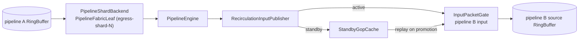

The diagram shows recirculation holding media until the target input is
promoted.

- **Validation** (`src/application/recirculation.rs`). The target input must
  exist, belong to the target pipeline, be enabled and be unselected. A
  target on the same pipeline, or a chain that leads back to the source
  pipeline, is refused as a cycle. The output must use source video and
  passthrough audio.
- **Claim.** The leaf claims the target input as protocol `pipeline` with
  stream key `pipeline:<output_id>`. If another publisher holds the input,
  the output fails with `recirculation_input_claim`.
- **Standby.** While the target gate is not active, `RecirculationInputPublisher`
  (`src/media/recirculation.rs`) keeps the newest GOP in a `StandbyGopCache`
  and publishes nothing.
- **Promotion.** The target's promotion replays the cached GOP once, maps
  timestamps after the previous input, and copies video configuration
  (`VideoConfigFollower`). From then on packets forward directly.
- **Failure.** Fabric errors are recorded as `pipeline_fabric_ensure`,
  `pipeline_fabric_dispatch` or `pipeline_fabric_leaf`. A feed overrun
  resyncs in place.

### Sink

A `sink://` output (for example `sink://local/test`) reads its prepared output
ring, including any stages its encoding needs, and discards the media.
`SinkEngine` (`src/media/egress/backends/sink.rs`) counts payload bytes and
units. It has no socket. Use it to load stages and the fabric without a
destination. Errors are `sink_fabric_ensure`, `sink_fabric_dispatch` and
`sink_fabric_leaf`.

## Thread and memory ownership, ingest to egress

Each protocol keeps its socket and protocol state on one owner thread. Tokio
carries control, lifecycle and the probe, not per-packet media. See
[Architecture](architecture.md#runtime-ownership) for the runtime policy and
[Runtime crossings](runtime-crossings.md) for each crossing.

| Path | Thread | Memory owner |
|---|---|---|
| RTMP ingest | `restream-rtmp-compio-owner-<n>` | Compio socket, `ServerSession`, `RtmpPublisherMedia`, owner share of the parser budget |
| SRT ingest | `srt-in-<port>[-<n>]` | srt-rs `Owner` (socket, peers, timers), `SrtPublisherMedia` |
| HLS push ingest | axum handler on Tokio; session on `restream-media` | bounded bodies, per-key and shared budgets, session outbox |
| HLS pull ingest | `HlsPullTask` on Tokio (async HTTP); session on `restream-media` | same as push |
| MoQ ingest and origin | `moq-ingest` | Compio QUIC endpoint, sessions, origin pumps |
| FFmpeg stage | `restream-ffin`, `restream-ffout`, FFmpeg child | pipe buffers, stage output ring |
| Audio router, SRT TS muxer, HLS segmenters | `restream-media` | output ring, `TsChunkRing`, `HlsStore`, `Fmp4HlsStore` |
| Egress (RTMP, SRT, HLS PUT, MoQ, pipeline, sink) | `egress-<shard>` | leaf state; SRT owner per address family |
| HLS PUT over `https` without kTLS | Reqwest uploader on Tokio | upload policy state |

Rings are shared: one source ring per pipeline and one output ring per stage,
independent of the output count.

| Buffer | Default | Source |
|---|---|---|
| Standby GOP cache | 16 MiB or 2,048 packets per input | `src/media/standby_gop.rs` |
| Recording `MemoryQueue` | 512 KiB (`RESTREAM_AVIO_QUEUE_CAPACITY`, clamp 64 KiB–16 MiB); soft limit, a write can overshoot by one batch | `src/media/avio.rs` |
| HLS MPEG-TS window | `RESTREAM_HLS_MAX_SEGMENTS` (20); target duration starts at 6 s and never decreases | `src/media/hls/store.rs` |
| HLS fMP4 window | 20 advertised, 26 kept | `src/media/hls/fmp4/store.rs` |

## Output start and timestamps

### Output start waits for the probe

A direct egress plans its tracks once, at start. So the reconciler does not
start an output while the pipeline's active ingest has no probe
(`MediaEngine::ingest_tracks_ready`, `OutputStartAction::SkipProbePending`).

- The gate opens when video or audio metadata exists, or 10 s after the first
  media byte (not after registration).
- A completed probe emits `ingest.probed`, which wakes the reconciler. A
  skipped output is also rechecked every reconciler interval.
- Probe recorders write audio tracks and sequence headers before the metadata
  that opens the gate. SRT and MoQ resize the source ring first.
- Known window: the first metadata of either type opens the gate. An output
  that starts before the other type's metadata plans without it. The gate
  does not wait for both, because a source may publish only one.

### Timestamp semantics

RTMP video timestamps are decode timestamps:

```text
DTS = RTMP timestamp
PTS = DTS + signed 24-bit composition offset
```

Audio has `PTS = DTS`. RTMP egress and play send DTS for video and PTS for
audio (`src/media/rtmp/timestamps.rs`). MPEG-TS and fMP4 ingest keep their
own PTS and DTS. Every ingest passes through `InputTimestampMapper` before
the source ring.
