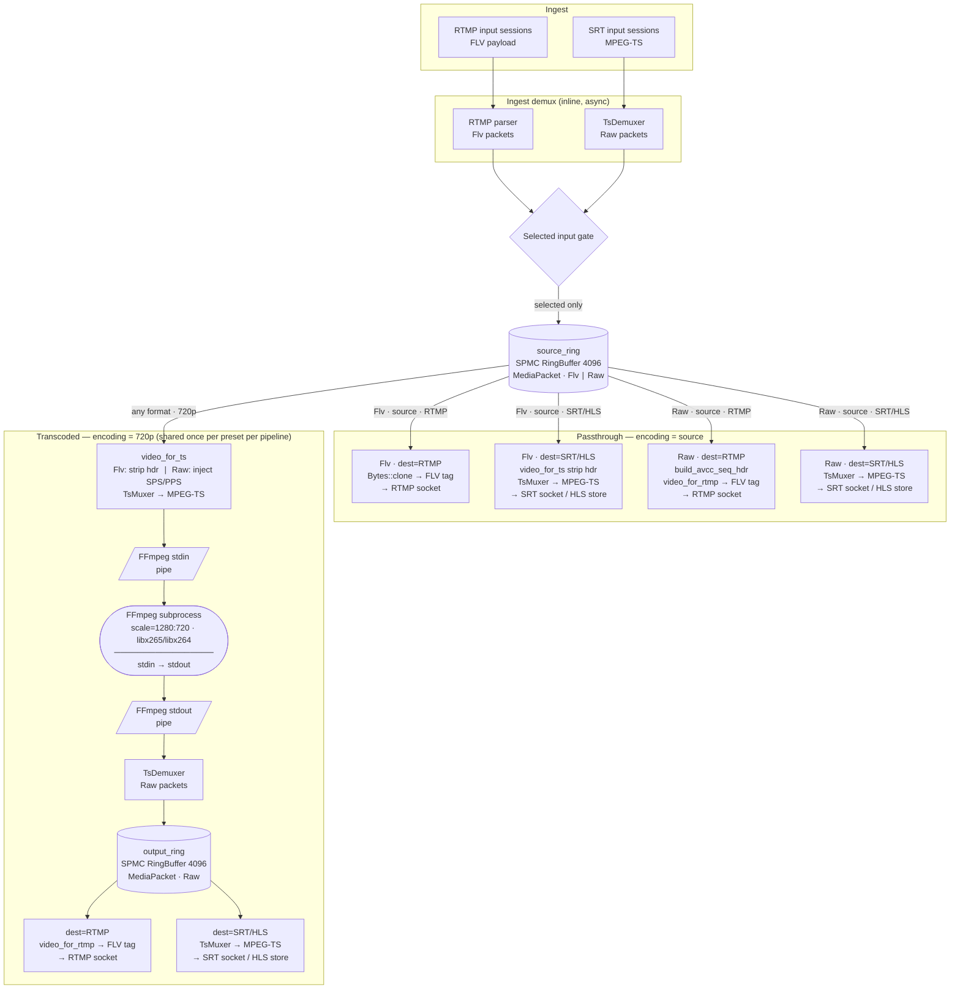
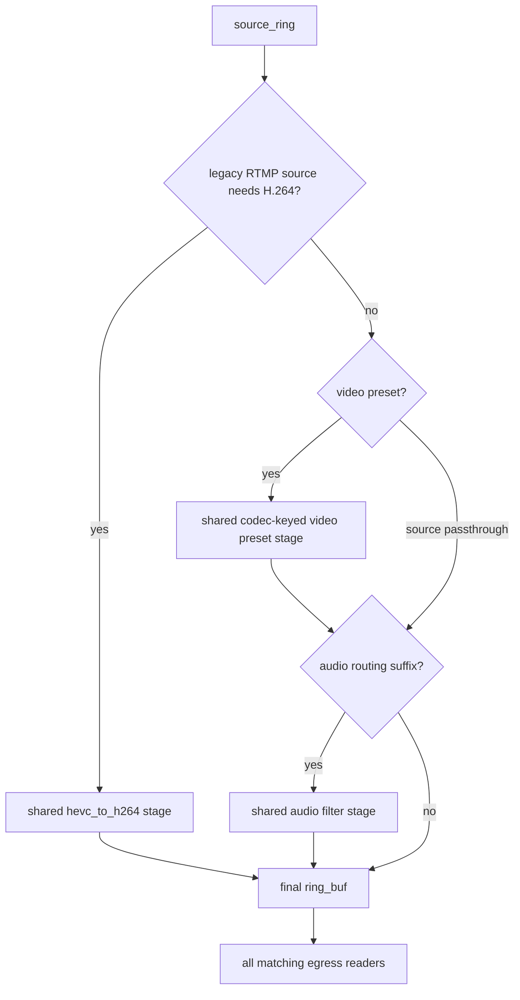
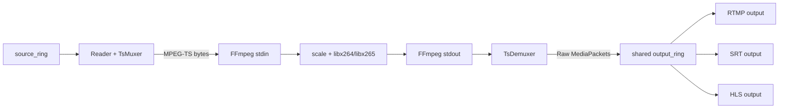
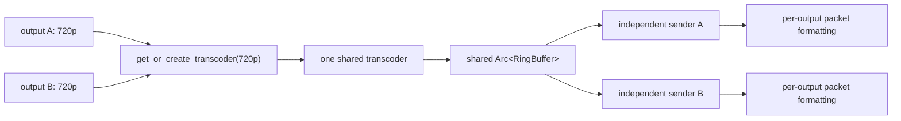
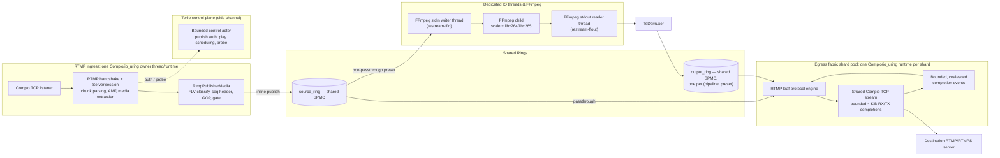

# Media Pipeline

This document covers the ingest-to-egress media pipeline: current shape,
protocol/codec boundaries, stage sharing, buffer sizing, and correctness
requirements.

For the performance optimization plan and benchmark results, see
[High-Performance Data Path](high-performance-data-path.md).

## Contents

- [Current shape](#current-shape)
- [Multi-input selection](#multi-input-selection)
- [Transcoder stages](#transcoder-stages)
- [Protocol and codec boundaries](#protocol-and-codec-boundaries)
- [Resolution presets](#resolution-presets)
- [H.265 egress policy](#h265-egress-policy)
- [Current protocol matrix](#current-protocol-matrix)
- [Minimum work per consumer](#minimum-work-per-consumer)
- [Harness coverage](#harness-coverage)
- [What is shared when outputs use the same video and audio config](#what-is-shared-when-outputs-use-the-same-video-and-audio-config)
- [Audio stage cache](#audio-stage-cache)
- [Buffer sizing for 4K 60fps](#buffer-sizing-for-4k-60fps)
- [Thread and memory ownership, ingest to egress](#thread-and-memory-ownership-ingest-to-egress)
- [SRT bonding](#srt-bonding)
- [SRT ingress owner](#srt-ingress-owner)
- [HLS push ingest](#hls-push-ingest)
- [Protocol correctness requirements](#protocol-correctness-requirements)

## Current shape



## Multi-input selection

A pipeline supports one primary and up to three backup input records. Each
record has a separate stream key and independent RTMP/SRT session. Unselected
connected sessions stay warm through socket receive, parsing, demux/probe,
metadata, transport metrics, and on-demand input-scoped HLS preview generation.
RTMP and SRT standbys keep the latest complete compressed GOP in a
protocol-task-local `StandbyGopCache`. The default per-input limits are 16 MiB
of payload and 2,048 packets. Crossing either limit invalidates the whole GOP;
non-keyframe packets are then discarded until the next keyframe starts a new
cache. The cache has no shared lock, async channel, decoder, or transform.

Explicit promotion demotes and drains the old gate, then arms the target gate.
On the target's next packet, a complete cached GOP activates the gate and is
drained exactly once from its retained video keyframe. Without a complete cache,
the target waits for its next live video keyframe. `InputTimestampMapper`
applies one offset to the replay so its first DTS follows the prior writer's
last DTS, with PTS/DTS composition offsets preserved across the whole GOP and
on later re-promotions. The gate stores forwarding state and in-flight lease
count in one atomic word; loom covers no overlapping writers and one activation
for a replay-ready boundary.

This is connected standby, not bonded ingest. Each publisher remains an
independent source and the operator chooses one. SRT bonding is one caller group
represented by a single logical publisher. File inputs retain the next-live-keyframe promotion path;
the compressed-GOP cache applies to continuously connected RTMP/SRT publishers.

## Transcoder stages

Every non-passthrough encoding creates a **shared stage**: one process per
`(pipeline_id, preset, output_codec)` tuple regardless of how many outputs use
that resolved video shape.

### Stage graph



The `hevc_to_h264` stage converts H.265 ingest to H.264 at source resolution
for consumers that cannot carry HEVC: legacy RTMP egress and HLS preview.
Both share `hevc_to_h264:from:source` so audio and video stay on one ring.
Preset outputs resolve the codec first: legacy RTMP `codec:auto` creates an
H.264 preset stage (for example `video:720p:codec:h264`), while Enhanced RTMP
and SRT can create or share an H.265 preset stage (for example
`video:720p:codec:hevc`).

### Stage lifetime

A shared stage (transcoder, codec edge, audio route, SRT TS muxer) lives
exactly as long as its consumers (`media::stage_lease`). Each consumer holds
a `StageLease` on every stage it reads: an egress for its whole attempt
(`EgressTask`), an HLS preview for its segmenter, an SRT player for its
session. A pipeline HLS segmenter, which every HLS output of the pipeline
shares and which outlives the output that started it, holds that output's
leases until the segmenter ends: once no HLS output holds the segmenter, the
idle sweep ends it within `RESTREAM_HLS_IDLE_TIMEOUT_MS` (60 s) of its start,
or when the ingest leaves. If a stage it reads ends on its own, the segmenter
ends with it, so the next HLS attempt starts one on its new stage. The
registry keeps only a `Weak`, so a consumer reuses a stage only while
another holds it. The last lease to drop cancels the stage at once and
removes its entry, unless a newer stage has taken the key. A stage that ends
on its own (its FFmpeg exits or finds no plan) is cancelled and never reused,
so the next consumer starts a new one; an egress attempt reading it ends with
error `stage_ended` and retries, and the retry starts the new stage. That is
no intentional stop: an HLS PUT fabric output abandons its session
(`EgressCommand::Abandon`) without the `EXT-X-ENDLIST` end playlist, so the
destination keeps the stream open for the retry. A pipeline delete stops its
outputs before it cancels their stages, so they stop, not fail. There is
no stage sweep and no grace period. An output waiting out its retry backoff
holds no lease, so a transcoder used only by that output restarts with its
next attempt (unless a pipeline HLS segmenter still holds it).

### Passthrough rule

`source` encodings **never** enter any transcoder stage. The egress reads
directly from `source_ring`. This is enforced in the reconciler (`src/lib.rs`)
before any `get_or_create_transcoder` call. `custom` output encodings are
rejected during output create/update because custom FFmpeg arguments are stored
for future implementation but not applied by the runtime.

### Stage-key naming

| Stage | Key format | Example |
|---|---|---|
| Video preset | `video:<preset>:codec:<codec>` | `video:720p:codec:h264`, `video:720p:codec:hevc` |
| H.265→H.264 | `hevc_to_h264:from:<upstream_key>` | `hevc_to_h264:from:source` |
| Audio filter | `audio:<op>:from:<video_key>` | `audio:atrack:0:from:video:720p:codec:h264` |

The `upstream_key` in the `hevc_to_h264` key encodes what ring feeds the
converter. Legacy RTMP source outputs and HEVC HLS preview both use `source`.

The video-preset key is shared across all compound encodings with the same
resolved video part (for example `720p+atrack:0` and `720p+remap:0:1` can both
use `video:720p:codec:h264`). The audio key embeds the upstream video key to
prevent cross-contamination between presets and output codecs.

### External transcoder (default)



One `ffmpeg` subprocess per `(pipeline, preset)`. FFmpeg reads MPEG-TS from
stdin and writes transcoded MPEG-TS to `pipe:1` (stdout). Dedicated stdin and
stdout threads pull/mux the source ring and demux the child output with
`TsDemuxer`, publishing `MediaPacket`s into `output_ring`. Tokio supervises
the child lifecycle, not continuous pipe/media work.

This is the only FFmpeg stage backend. FFmpeg errors are
isolated to the subprocess and logged to stderr; a crash restarts cleanly on
the next reconciler cycle.

### Muxing stages summary

| Stage | Role | Execution Context |
|---|---|---|
| SRT Ingest | `TsDemuxer` — demux MPEG-TS into `MediaPacket`s, gate, timestamps, ring publish | Compio SRT Ingress Owner (inline) |
| RTMP Ingest | `RtmpPublisherMedia` — chunk parse, FLV classification, sequence headers, gate, ring publish | Compio RTMP Ingress Owner (inline) |
| External transcoder | subprocess FFmpeg stdin→stdout; `StageInputPump` writes stdin, `TsDemuxer` reads stdout | Dedicated OS threads (`restream-ffin`, `restream-ffout`) |
| SRT Egress | Shared `TsMuxer` task per unique `(pipeline, preset)` feeding shared `TsChunkRing` | Media Executor (`restream-media`) |
| HLS | MPEG-TS mux/segmenting for remote outputs; separate fMP4 packaging for preview | Media Executor (`restream-media`) |
| Recording | MPEG-TS feeder task to `MemoryQueue`; raw `.ts` disk write | Feeder: Media Executor; Writer: OS thread |
| File Ingest | External FFmpeg stdout demux, timestamps, gate, and ring publish | Media Executor (`restream-media`) |


## Protocol and codec boundaries

| Area | Current state |
|---|---|
| RTMP H.264/AAC | Native ingest/play/egress; video uses DTS and carries FLV composition offset. B-frame round-trip still an E2E gate |
| SRT H.264/AAC | Native ingest/read/egress with MPEG-TS demux/remux |
| SRT H.265 | Codec mapping implemented; full E2E matrix remains a gate |
| RTMP H.265 | Enhanced RTMP ingest (H.265 arriving over RTMP) is not implemented. RTMP *egress* with H.265 source works: `hevc_to_h264` stage does full libavcodec decode→encode |
| Multi-track audio | SRT ingest preserves audio track indices plus MPEG-TS PID/language metadata where present |
| Audio remap/downmix | Channel-level DSP routes use an external FFmpeg audio stage (`pan` for remap, stereo resample for downmix); `atrack` remains packet-only |
| HLS pull routes/store | Implemented and tested; live segment generation uses native TsMuxer |
| HLS upload | Implemented; HTTP/HTTPS output URLs PUT new segments plus playlist to the target |
| RTMPS output | `rtmps://` uses the RTMP Compio shard path; Rustls completes TLS and hands record I/O to Linux kTLS. TLS 1.3 tickets are discarded after handoff (no session resumption); KeyUpdate closes the output. Unsupported suites or handoff errors fail without userspace-TLS fallback |
| Custom output encoding | Not applied; `custom` is rejected by output create/update instead of being exposed as a passthrough runtime option |

## Resolution presets

The external transcoder stage applies `scale=WxH` and re-encodes preserving the
input codec: `libx265 -preset veryfast` for H.265 input, `libx264 -preset
veryfast` for H.264 input.

| Preset | Resolution | Scale filter |
|---|---|---|
| `source` | passthrough | none — never enters transcoder |
| `480p` | 854×480 | `scale=854:480` |
| `720p` | 1280×720 | `scale=1280:720` |
| `1080p` | 1920×1080 | `scale=1920:1080` |


## H.265 egress policy

Standard RTMP (non-Enhanced) does not carry H.265. The reconciler enforces:

| Egress protocol | H.265 input | Behavior |
|---|---|---|
| Legacy RTMP | H.265 source | `hevc_to_h264:from:source` stage inserted; full libavcodec H.265→H.264 — **working** |
| Legacy RTMP | H.265 + video preset | typed `codec:auto` resolves to H.264, so the preset stage is keyed as `video:<preset>:codec:h264` and no HEVC bridge is needed |
| Enhanced RTMP | H.265 source/preset | HEVC is packetized as Enhanced FLV `hvc1`; encoded presets are keyed as `video:<preset>:codec:hevc` |
| SRT | H.265 source | Passthrough (MPEG-TS carries HEVC natively) — **working** |
| SRT | H.265 + video preset | `video:<preset>:codec:hevc` with libx265; same ring can be shared with Enhanced RTMP — **working** |
| HLS preview | H.265 source | Reuses shared `hevc_to_h264:from:source` (same ring as legacy RTMP) at source resolution, then serves H.264+AAC fMP4 — **current path** |

Output configuration is symmetric at the model boundary: video mode, video
codec, audio routing, and protocol mode are typed fields. Protocol capability
validation remains asymmetric: legacy RTMP and HLS resolve `codec:auto` to
H.264, Enhanced RTMP and SRT can preserve H.265, and explicit unsupported
codec/protocol combinations are rejected before persistence.

## Current protocol matrix

| Ingest | RTMP egress | SRT egress | HLS preview | Recording |
|---|---|---|---|---|
| RTMP H.264 | Basic interop; B-frame timestamp gate | Implemented; full matrix gate | fMP4 HLS preview with alternate-audio renditions | Input-scoped mixed gate validates final MP4 |
| RTMP H.265 | Enhanced RTMP egress supported; legacy RTMP uses H.265→H.264 bridge | Not assumed | Not assumed | Not assumed |
| SRT H.264 | Packetization implemented; live matrix gate | Locally validated | fMP4 HLS preview with alternate-audio renditions | Input-scoped mixed gate validates final MP4 |
| SRT H.265 | RTMP: `hevc_to_h264` conversion working; SRT: passthrough working | Passthrough implemented; E2E gate | HEVC preview reuses `hevc_to_h264` at source size, then serves H.264+AAC fMP4 | Input-scoped mixed gate validates final MP4 |
| File | RTMP-shaped via child FFmpeg | Implemented for compatible FLV codecs | Native fMP4 preview packager; HEVC reuses the shared `hevc_to_h264` bridge | Input-scoped mixed gate validates final MP4 |

HLS preview is served as fragmented MP4 with `EXT-X-MAP`, `init.mp4`, and
`.m4s` media segments. The preview packager builds H.264 `avc1` / AAC `mp4a`
sample entries with `shiguredo_mp4` bitstream helpers and advertises RFC 6381
`CODECS` from those sample entries when they exist. Packet conversion stays on
the existing Annex B↔AVCC hot path. The preview path uses one fMP4 muxer per
HLS rendition: one video-only rendition plus separate audio-only playlists for
alternate tracks. Remote HLS outputs intentionally remain MPEG-TS because HTTP
PUT ingest targets commonly require `.ts` media segments.

## Minimum work per consumer

All consumers that process packets from a ring buffer avoid per-packet heap
allocation by using the zero-allocation `_into` variants:

| Consumer | Video conversion | Audio conversion | Burst size |
|---|---|---|---|
| RTMP egress | `video_for_rtmp_into` | `audio_for_rtmp_into` | `pull_burst` 32 |
| SRT egress | None (Shared `TsMuxer`) | None (Shared `TsMuxer`) | `pull_burst` 32 (`TsChunkReader`) |
| SRT play subscriber | None (Shared `TsMuxer`) | None (Shared `TsMuxer`) | `pull_burst` 32 (`TsChunkReader`) |
| HLS segmenter | `video_for_ts_into` | `audio_for_ts_into` | `pull_burst` 32 |
| Recording | `video_for_ts_into` | `audio_for_ts_into` | `pull_burst` 32 |
| Transcoder feed | `video_for_ts` (Raw→Raw passthrough) | `audio_for_ts` | `pull_burst` 32 |

Scratch buffers (`video_conv_buf`, `audio_conv_buf`) are allocated once at
consumer startup and reused across packets. For `PayloadFormat::Raw` video, the
borrowed payload slice is returned directly (zero copy).

## Harness coverage

The live harness owns the changing scenario inventory. Use the catalog
inspection workflow in [Testing](testing.md#live-integration-tests) instead of
copying mode, scenario, or stage-count tables into this guide.

The canonical scenario definitions live in `test/harness/scenarios/` and the
generated mixed-matrix catalog under `src/bin/test_harness/`. Representative
rows cover RTMP, SRT, and file ingest; H.264 and H.265; single- and
multi-audio; passthrough and preset stages; B-frame timestamp behavior; and
cross-protocol egress.

Tests should assert the stable sharing contract rather than a copied process
count: identical `(pipeline_id, stage_key)` values reuse expensive work, while
each destination keeps its own sender. Current scenario composition and
resource measurements belong to the catalog and dated evidence.

## What is shared when outputs use the same video and audio config

Stage sharing is keyed by `(pipeline_id, stage_key)`:



The per-packet format conversion (AVCC wrap, ADTS strip) is NOT shared between
egress tasks. This is intentional: sharing would require synchronization and
outweigh the ~700 ns per frame conversion cost. What IS shared is the far more
expensive encode stage (CPU-bound, seconds of latency). This invariant is
covered by `same_encoding_outputs_share_one_transcoder_stage` in engine tests,
and holds regardless of egress routing.

"Independent sender" above describes protocol/retry state ownership, not a
literal OS thread per destination: under the [egress fabric](egress-architecture.md), each output is a leaf serviced by a
shared shard OS thread alongside other outputs, not a dedicated thread.

This guide owns the sharing invariant, not a performance snapshot.

## Audio stage cache

Output reconciliation splits compound encodings into a video stage and an audio
stage. Audio stages are keyed by the upstream stage identity as well as the
audio operation (e.g. `audio:atrack:0:from:video:720p:codec:h264`), preventing
outputs using different presets or codecs from cross-contaminating.

`atrack` stages run in the lightweight packet router and only select/reindex
audio tracks. `remap` and `downmix` stages run through the external FFmpeg
stage, copy video, filter one selected audio track to stereo AAC, and then feed
the normal MPEG-TS demux back into the shared output ring.

## Buffer sizing for 4K 60fps

| Component | Size | Constraint | Source |
|---|---|---|---|
| Standby GOP cache | 16 MiB payload / 2,048 packets per connected RTMP/SRT standby | Keeps only the latest complete compressed GOP; invalidates on either limit | `standby_gop.rs` |
| RingBuffer capacity | 1024 packets (default; `RESTREAM_RING_CAPACITY`, clamp 64–16384) | Overflow `fast_forward` to most recent keyframe | `ring_buffer.rs`, `config.rs` |
| AVIO buffer | 32 KB | FFmpeg internal read/write chunk | `avio.rs` |
| MemoryQueue | 512 KiB (default; `RESTREAM_AVIO_QUEUE_CAPACITY`, clamp 64 KiB–16 MiB) | Bounded `VecDeque<u8>`; writer yields on full, consumer blocks on empty `read()` | `avio.rs`, `config.rs` |
| HLS segment accumulator | 8 MB initial | 4K60 H.264 segment at 6s can reach 12 MB; grows if needed (no hard byte ceiling) | `hls/mod.rs` |
| HLS MPEG-TS `max_segments` | 20 (default; `RESTREAM_HLS_MAX_SEGMENTS`) | Exact sliding window: evict when `len > max_segments`, also drop `variant_segments` for that index | `hls/store.rs` |
| HLS fMP4 preview window | advertise `max_segments`; retain `max_segments + 6` | Grace keeps the oldest advertised segment fetchable across a playlist refresh; not the TS eviction algorithm | `hls/fmp4/store.rs` |
| HLS `EXT-X-TARGETDURATION` | TS starts at 6s; fMP4 starts from first media duration | Sticky high-water mark of `duration.ceil()` since create/clear (7.2s → 8); eviction never shrinks it (`target_duration_never_decreases`) | `hls/store.rs`, `hls/fmp4/store.rs` |
| RTMP TCP SO_RCVBUF/SO_SNDBUF | 128 KB before auth, 8 MB after publish auth | Limits unauthenticated connection footprint while preserving burst headroom for accepted publishers | `rtmp.rs` |
| SRT caller UDP buffers | 8 MiB requested by default (`RESTREAM_SRT_UDP_BUF_BYTES` overrides) | Applied to the shared egress Owner socket; the kernel may clamp the request | `media/srt/knobs.rs`, `media/srt/egress_connect.rs` |
| SRT egress TX pool | 16 fixed slots per shard/address family | Bounds in-flight datagrams; payloads are materialized into reserved slots | `media/egress/backends/srt/owner_set.rs` |

## Thread and memory ownership, ingest to egress

This section traces one publisher's media from its entry socket to its exit
socket for each protocol, naming which concurrency primitive owns each hop
and which structure owns the memory at that hop. It complements
[Architecture § Runtime ownership](architecture.md#runtime-ownership). Exact
thread counts depend on live CPU count, feed count, and output count; they are
not capacity recommendations.

### RTMP: ingest to egress



The accepted socket and RTMP protocol session stay together on the fixed
Compio owner. Tokio receives bounded typed control, lifecycle commands, and
the one-time media probe; ordinary publisher media goes directly to the ring
on the owner. There is no Tokio duplex stream, byte pump, or duplicated TCP
descriptor. Publisher TCP statistics are sampled on the socket-owning owner.
A connection's parser can hold one completed RTMP message and the next
incomplete assembly, each up to `RESTREAM_RTMP_MAX_MESSAGE_BYTES`, plus a 4 KiB
socket read and parser staging buffer. The aggregate parser budget
(`RESTREAM_RTMP_INGEST_PARSER_BUDGET_BYTES`) caps the sum across connections;
the connection that would exceed it is rejected.

| Hop | Thread/process model | Memory owner |
|---|---|---|
| RTMP listener and protocol session | One Compio/io_uring owner thread/runtime; accepted connection futures remain pinned there. Connection admission is clamped to 1–16,384 and the handshake has a configured timeout | Compio socket and RTMP parser/session state; no per-connection thread/runtime or Tokio duplex |
| RTMP control actor | One bounded Tokio actor per admitted connection; authorization/registration, lifecycle, one-time media probe, and diagnostic play-reader scheduling | Per-session command channel of 16 entries carrying lifecycle commands and the one-time probe metadata |
| RTMP publisher media | FLV classification, sequence-header handling, timestamp mapping, standby GOP, input gating, and ring publication run inline on the Compio ingress owner | Owner-local publisher state and shared ring; no ordinary per-packet media channel |
| `source_ring` / `output_ring` | Shared application structure | Fixed-capacity `RingBuffer` per pipeline / per `(pipeline, preset)`, independent of output count |
| External transcoder (non-passthrough preset) | One FFmpeg child plus dedicated stdin/stdout threads per `(pipeline, preset)`; Tokio supervises lifecycle only | FFmpeg process memory and bounded pipe buffers; input pump pulls the ring on its writer thread |
| RTMP/RTMPS egress shard | Fixed fabric shard thread and one Compio/io_uring runtime; protocol engine and completion workers share the owner thread | Per active transport leaf: nominal 16 KiB for plain RTMP and 16 KiB + 24 B for RTMPS adapter buffers. At the default upper topology of 8 shards × 4,096 leaves (32,768), this is about 512 MiB / 512.75 MiB; configured shard/leaf overrides scale total capacity. Excludes engine/TLS/task/event state, allocator overhead, and kernel socket buffers. The existing application pending-byte ceiling remains separate |

The egress runtime uses one shared `Rc<Compio TcpStream>` per active leaf.
One-shot RX and TX workers exchange bytes with the synchronous RTMP engine
through bounded connection-local queues; the event channel is bounded by the
configured per-shard TCP event capacity. Only pending connects use duplicated
`PollFd` registrations, which are removed at activation and scanned with a
rotating per-call budget. Established leaves do not participate in population
readiness scans.

### SRT: ingest to egress

```mermaid
flowchart LR
    subgraph L1["SRT ingress Owner thread(s): one Compio/io_uring runtime each\n(RESTREAM_SRT_INGRESS_OWNERS share the port as a SO_REUSEPORT group)"]
        SS["srt-rs Owner listener/recv\nPeerTable + protocol timers"]
        SD["TsDemuxer + gate + timestamps\nstandby GOP + ring publish"]
        SS --> SD
    end
    subgraph R2["Shared packet rings"]
        SR2[("source_ring — shared SPMC")]
        OR2[("output_ring")]
    end
    subgraph MX["Media Executor pool: restream-media"]
        Mux["Shared TsMuxer\n1 task per (pipeline, preset)"]
        TCR[("TsChunkRing — shared SPMC\npackage ring")]
        Mux --> TCR
    end
    subgraph S2["Egress fabric shard pool: OS threads per feed,\neach shard runs one Compio runtime with per-family Owners"]
        Leaf2["SRT leaf: connection,\ncongestion, encryption state"] --> Send2["send_shared into the logical caller"]
    end
    SD --> SR2
    SR2 -->|"passthrough"| Mux
    OR2 --> Mux
    TCR --> Leaf2
    subgraph L2["Shared SRT state: one Compio Owner per (shard, address family):\n1 caller UDP socket, caller pool, fixed TX pool"]
        Send2 --> Buf["srt-rs protocol buffers + TSBPD\ndeadline enforcement"]
    end
    Buf --> Dest2["Destination SRT receiver"]
```



| Hop | Thread/process model | Memory owner |
|---|---|---|
| SRT ingest socket, demux, and publish | One Compio runtime and Owner per ingress Owner thread (default one; `RESTREAM_SRT_INGRESS_OWNERS` members of one `SO_REUSEPORT` group otherwise) own their listener socket, peer table, timers, demux, input gate, standby GOP, and ring publication for the sessions they hold; members pass forwarded handshakes and relocated bonded legs to each other directly | The Owner installs the managed-RX substrate observed from its own runtime before attach. `ManagedPreferred` selects multishot when available and falls back to raw readiness otherwise. Ingest media runs inline to completion on the Owner (WI11 step 1) |
| Shared `TsMuxer` (SRT preparation) | Media Executor pool (`restream-media`), one task per `(pipeline, preset)` | `TsChunkRing` (256-chunk shared ring, `RESTREAM_TS_RING_CAPACITY`) |
| Egress shard (SRT) | Fixed OS-thread pool per feed; each shard owns one Compio runtime and at most one `Owner` per local address family, plus queued leaf visits | Per-leaf application state and bounded scratch; protocol state lives in the Owner |
| Shared SRT transport | One Compio `Owner` per `(shard, local family)`: one caller UDP socket, one bounded caller pool, fixed TX pool and one receive consumer; shared TS muxing remains per `(pipeline, preset)` | srt-rs caller/protocol state plus kernel `SO_SNDBUF`; DATA is materialized into reserved TX-pool slots |

The SRT path bounds work per shard three ways: a finite `OwnerServiceBudget`
for each per-family Owner's service pass, explicit ready/feed-wait/parked
queues for leaf visits, and the Owner's fixed TX pool (16 slots per family) as
the physical in-flight envelope. Restream keeps no transport queue of its own:
unsent protocol output waits in bounded protocol state, and payload is
materialized straight into a reserved TX-pool slot when the Owner drains it.

## SRT bonding

### Ingest

The srt-rs listener explicitly accepts publisher-created Broadcast and Backup
groups. Restream answers every bonded leg with ONE application-owned
receiving-group id (random per listener lifetime, never derived from an address,
port or socket id), in the caller's own mode; a caller's group id identifies the
CALLER group and is never echoed. A direct caller receives no GROUP response.
Because the id is stable across legs, libsrt callers pin it and see no
`SRT_REJ_GROUP`. Their authenticated matching legs feed one stable logical input,
deduplicate received MPEG-TS payloads, and retain per-leg health plus logical
aggregate telemetry. Matching StreamIDs on independent sockets do not create a
bond.

### Egress

Backup links use the established `bond=` URL parameter:

```text
srt://primary:10080?streamid=publish:key&bond=backup1:10080,backup2:10080
```

This creates an SRT Backup group with the URL authority as the primary leg and
the listed peers as standbys. Add `type=broadcast` to duplicate each media
message over every healthy leg.

`bond=` means true SRT bonding: ONE logical stream, ONE logical caller, N
physical paths, and every path must terminate in the SAME remote receiving
group. Distinct hosts, IPs or ports are fine (they can be different network
endpoints of one receiver process); the validity test is the remote group
identity the SRT handshake establishes, not the URL strings. If a leg answers
from a different receiving group, `srt-rs` reports a peer-group collision and
Restream fails the whole output (it never keeps the healthy leg running or
degrades to one leg); normal retry policy owns any restart. A backup leg that is
merely unreachable is ordinary degradation, not a collision. Independent
receivers are not a bond target. All legs of one bond must share one address
family (one bond, one family Owner, one shared caller socket); a mixed-family
bond fails the output explicitly.

## SRT ingress owner

The SRT listener is one owner thread per seat (`srt-in-<port>`): one thread by
default, or K members of one `SO_REUSEPORT` group
(`RESTREAM_SRT_INGRESS_OWNERS`), each with one production Compio runtime
(forced io_uring, no fallback) and one `srt_transport::compio::Owner` attached
with `Owner::listen_planned` for its own `owner_plans` entry and the ingress
resolver. Every such Owner installs the managed-RX substrate observed from its
own runtime (`Owner::set_rx_substrate`) and runs `ManagedPreferred`: multishot
provided-buffer receive where the host supports it, raw readiness otherwise.
Transient provided-buffer pressure (`ENOBUFS`/`ResourceBusy`) is counted
(`rxBufferExhaustions`), never promoted to an RX-stream fault. The pinned
upstream listener drains bounded `recvmmsg` batches, with `recvfrom` for the
residual byte-budget tail. This is not a per-datagram Tokio bridge or a
transport-runtime fallback.

The Owner owns its socket, `PeerTable`, handshake admission, timers, ACK/NAK,
listener TX and every peer's send/disconnect/retire. There is no second protocol
table on Tokio. Egress's separately qualified managed-RX policy is independent
of any one ingress Owner's.

- **Admission** is synchronous on the owner thread: the resolver reads the
  `SrtIngestPolicyStore` (mode validation, `UNAUTHORIZED`/`BAD_MODE`/
  `BAD_REQUEST`, latency, passphrase, key length) and adds the receiving-group
  response for bonded callers. The asynchronous checks (pipeline authentication,
  IP bans, duplicate publishers, missing read target) stay in Tokio and, on
  rejection, send `Disconnect` for the real `LogicalPeerId`.
- **Bridges are bounded.** Commands (Tokio to Owner): `AttachPublisher`,
  `AttachReader`, `ProbeApplied`, `Disconnect`, and `Shutdown`, capacity 256.
  Events (Owner to Tokio): `Connected`, `Probe`, `Disconnected`, and `Fault`,
  capacity 256. These carry lifecycle and the one-time stream probe only:
  publisher demux/publication and diagnostic reader playback stay on the Owner.
  Backpressure on the lifecycle bridge retains unaccepted events; it does not
  introduce a per-packet media handoff through Tokio.
- **Fragmented messages stay chunked.** `ReceivedPayload` keeps message metadata
  and original packet order without flattening. One fixed-capacity 64-slot
  Owner-local work list holds events, chunk cursors and their cancellation
  retirements. A pass consumes at most 64 chunks, with a 16-chunk slice per
  cursor, and separately reclaims at most 64 original packet slots. The same
  work slot follows a message into retirement; no second garbage queue is added.
  Lifecycle-bridge backpressure pauses media/event delivery but not reclamation.
  Events apply in queue order: the first event a visit cannot apply (full
  bridge, live cursor, spent media budget) holds every later event of that
  visit, so a terminal event can never overtake an accepted payload still
  queued ahead of it.
- **Retirement.** A terminal `Disconnected` is forwarded and the peer is unrouted
  from the Owner; a locally disconnected peer is retired after its terminal event
  or a 500 ms grace. Pending application cursors are cancelled in place.
  Protocol storage remains on that Owner for action-budgeted reclamation, and
  its admission/window-payload credits stay charged until reclamation completes.
  Stale commands for a retired `LogicalPeerId` remain harmless and counted
  (`staleCommands`). Reclamation counts do not impose a hard allocator/kernel
  CPU-time limit, and the payload-window budget is not a total RSS bound.
- **Owner fault** stops admission, reports `Fault` to Tokio and ends the thread;
  there is no rebuild on another runtime. Shutdown flushes SHUTDOWN datagrams and
  runs `Owner::shutdown_and_drain`; the verdict is logged, never assumed.
- **Metrics**: `srtListener.ingressOwner` in the engine status (service visits and
  actions, TX capacity/in-flight/high-water/exhaustions, RX packets/bytes/ring
  depth/drops/truncation, peers, admission telemetry, bridge depth high-water,
  stale commands, overload disconnects). No peer or StreamID labels.

## HLS push ingest

Encoders can push an MPEG-TS or fMP4 HLS stream over HTTP, as they do to
YouTube HLS ingest or Akamai MSL. They `PUT` or `POST` each playlist and
segment to the dashboard HTTP port, under the input's stream key:

```text
http://<host>:<httpPort>/ingest/hls/<streamKey>/<playlist>.m3u8
```

```sh
ffmpeg -re -i input.mp4 -c:v libx264 -g 60 -c:a aac \
  -f hls -method PUT -hls_time 2 \
  http://HOST:3030/ingest/hls/KEY/index.m3u8
```

```sh
ffmpeg -re -i input.mp4 -c:v libx264 -g 60 -c:a aac \
  -f hls -hls_segment_type fmp4 -method PUT -hls_time 2 \
  http://HOST:3030/ingest/hls/KEY/index.m3u8
```

These all work: `-method POST`; FFmpeg's default of one connection per
object, closed without reading the response; persistent connections
(`-http_persistent 1`), with one limit: FFmpeg then sends requests ahead of
the replies and, on exit, closes without reading them, so the connection is
reset and its final segment and `EXT-X-ENDLIST` playlist can be lost (the
session then ends on the idle timeout); keep the default for streams whose
end matters; chunked or `Content-Length` bodies; and
`delete_segments`, whose `DELETE` gets `200` and changes nothing. Segment URIs
must be relative to their playlist. To copy existing ADTS AAC into fMP4, add
`-bsf:a aac_adtstoasc`. An ingest accepts a `.m3u8` playlist, an MPEG-TS `.ts`
segment, and an fMP4 object with extension `.mp4` or `.m4s` (the init segment
is usually `init.mp4` and media segments `*.m4s`, though some encoders name
media segments `*.mp4`). One input publishes exactly one container: a stream
that mixes MPEG-TS and fMP4 objects gets `415` on the mismatching object and
keeps the container it started with.

- **Key check.** The stream key is the credential. It is resolved the same
  way as an RTMP or SRT publish key, against the client IP, under its own
  `hls-publish` rate-limit scope, before any body byte is read. A wrong key,
  a disabled input or a banned IP gets `403`. The route sits outside the
  dashboard session check.
- **Session.** The first accepted object for a key registers an `hls` input
  attempt. If another publisher (RTMP, SRT or file) already holds the input,
  the object gets `409`. A session ends in any of these cases:
  - `EXT-X-ENDLIST`, once the last listed segment has been published;
  - no object for max(3 × target duration, 10 s);
  - the pipeline or input is removed or disabled.
- **Ordering.**
  - Encoders upload a segment before the playlist that lists it, so a segment
    that no playlist lists yet is held and answered `202` at once.
  - Segments are published in `EXT-X-MEDIA-SEQUENCE` order, each sequence
    once.
  - A gap that has waited one target duration, while later segments are
    ready, is skipped and counted.
  - With a master playlist, the highest-`BANDWIDTH` variant is followed;
    otherwise the first media playlist is. Objects of the other variants get
    `200` and are dropped.
  - **fMP4 segments.** The init segment is named by the playlist's
    `EXT-X-MAP` URI, not by its extension, and encoders upload it *before*
    the playlist that names it. Such an object is held (`202`), like any
    object the playlist has not listed yet; when the playlist's `EXT-X-MAP`
    names it, the session applies it as an init object, never as a media
    segment and never published to the ring. Each listed segment records
    the `EXT-X-MAP` that was in force for it, so a listing that changes its
    map uses each segment's own init.
  - When the `EXT-X-MAP` URI changes, or the bytes of the same URI change,
    the demuxer is rebuilt and the next segment is a discontinuity: its
    demuxed timestamp continues right after the last forwarded one, like an
    `EXT-X-DISCONTINUITY`.
  - The init a stream key applied last is kept in the ingest itself, not in
    the session, because FFmpeg uploads its init once per run: a session
    that starts after an idle timeout, a retry or a failure applies the same
    init again from that slot when the playlist names the same
    `EXT-X-MAP` URI, so a resumed encoder keeps publishing. A playlist that
    names a different URI gets nothing from it. The slot lives in the stream
    key's own state, so it is bounded by the configured inputs, holds at
    most one init (the 4 MiB init bound), and goes when that state does. Its
    entry is cleared when `EXT-X-ENDLIST` ends the run, or when an init
    upload for that key is refused (which also voids the map's init, and the
    seed a later session would take from it).
  - **Known limit.** The two rules above cover an init the ingest *refused*.
    An init *lost* on the way (an unread `503` or `408`, a reset) under the
    same `EXT-X-MAP` URI is not visible to the ingest, and a run whose audio
    settings changed then gets ADTS headers built from the stale
    AudioSpecificConfig. Video is not affected in practice: FFmpeg carries
    SPS/PPS in band, and a stale `avcC` is only injected into a keyframe that
    lacks one.
- **Discontinuities.** A new epoch starts on an encoder restart inside the
  idle window (the media sequence or the segment names go back) and on
  `EXT-X-DISCONTINUITY`. The next segment is demuxed from scratch, and its
  timestamps continue right after the last ones forwarded.
- **Codecs.** fMP4 ingest is H.264 video and AAC audio only. An HEVC
  (`hev1`/`hvc1`) init segment is refused with `415` and the reason "HEVC
  fMP4 ingest is not implemented". An accepted init's `avcC` SPS/PPS become
  the ring's video parameter sets, so downstream stages see an fMP4 input
  exactly as they see a TS one.
- **fMP4 demuxing.** The session walks each media segment's top-level boxes
  itself (`styp`, `sidx`, `free`, `emsg` and `prft` are skipped, and an
  unknown box is logged once per session) and demuxes each `moof` + `mdat`
  pair, at most 64 fragments per segment. Every fragment must carry its own
  `tfdt`: without it the demuxer would place the fragment at decode time 0
  and glue a restarted timeline onto the previous one. A `moof` with no
  `mdat`, a `traf` with no `tfdt`, a box size below its header, a truncated
  object, or a `tfhd` that sets an explicit `base_data_offset` (whose offsets
  would measure from the whole segment, not from the fragment handed to the
  demuxer) is refused with `400`. An fMP4 media object under a playlist that
  names no `EXT-X-MAP` is refused with `415`: it can never be demuxed. An
  fMP4 init object that is answered on its own upload carries the refusal
  (`415`, `400` or `413`) directly, and voids that map's init plus the key's
  cached init: encoders never read a refusal, and a stale init would
  silently demux the new run's segments with it (an HEVC stream as H.264,
  another codec's frames as AAC). Its segments then wait for an init that
  cannot come and are skipped.
- **A segment that cannot be demuxed.** A rejection while publishing an
  already-answered segment — a truncated access unit, a sample that runs past
  its fragment, a decode failure — drops that segment: the session
  counts it, logs the reason once, discards what the segment had demuxed but
  not yet published, re-anchors the timeline for
  the next segment, and keeps publishing. Packets from an earlier fragment of
  that segment that were already released stay in the ring; only what was
  demuxed and still pending is dropped. Only a session that no longer has a
  demuxer at all (its publisher failed to open) ends failed; the engine
  survives either way, and the encoder's next object starts a fresh session
  if the session does end.
- **Bounds.**
  - Each object is bounded: 1 MiB per playlist, and 64 MiB per segment and
    per fMP4 object (an fMP4 object is bounded before its role is known). An
    fMP4 init object is additionally bounded at 4 MiB. Over any bound is
    `413`.
  - Each key is bounded: 2 uploads in flight, and 8 held segments or 128 MiB
    held, with the oldest evicted first. A third upload waits up to 10 s for
    a slot before its body is read (`408` after that).
  - Each key's segments may use 128 MiB, a quarter of the shared budget, for
    bytes being read, queued, held or published. A segment claims its share
    before it is read: all of its `Content-Length` at once, or, when chunked,
    in 4 MiB steps while it alone holds the key's claim lock, so two bodies
    of one key never each hold part of the share and wait for the rest. A
    segment that has to wait is read later, not refused: FFmpeg's blocked
    write is backpressure it respects. This throttle is tested on the body,
    not yet over a real socket (FFmpeg's write blocking on a full TCP window).
  - Playlists are small and are what releases held segments, so they take
    only the shared budget and never wait for a share.
  - All HLS sessions share a 512 MiB budget, never waited for. When it is
    exhausted, an upload gets `503` with `Retry-After: 1`, and its claim is
    released. FFmpeg never reads replies, so for it that segment is lost.
    The per-key share bounds this but does not prevent it: four keys at
    their 128 MiB share fill the budget, and then other keys' segments get
    `503`. Four 4K publishers with 10 s segments reach that legitimately
    (two target durations of outbox is about 2 × 61 MiB each).
  - A request body that sends nothing for 10 s, or takes longer in total than
    max(4 × target duration, 40 s) including any wait for its share, gets
    `408`, and its bytes are released. A segment fits when the uplink carries
    at least a quarter of the stream bitrate, which a real-time encoder's
    uplink always does, since it must carry the full bitrate; a trickle does
    not.
  - An encoder faster than real time is slowed, not refused: once two target
    durations (by `EXTINF`; 10 s before a playlist) of released media, or
    128 MiB, wait to be published, the session stops taking objects, so its
    uploads are answered only as publication catches up.
- **Pacing.** Released segments reach the ring at media pace, like every
  other TS source, not as one burst per segment. Media time is anchored at
  the first data after a session start or a discontinuity; later data waits
  until its offset from the anchor has passed on the wall clock. Media that
  fell behind is published at once, at most one target duration of it (10 s
  before the first playlist); further behind, or a timestamp jump, re-anchors.
- **Placement.**
  - The axum handler only checks the key and reads the bounded body.
  - It hands each object over a bounded channel to the key's session task on
    the MEDIA executor (`hlsIngest` class).
  - The session task parses playlists, orders segments and publishes them
    through the ingest publisher it shares with file ingest
    (`media::ingest_publisher`; MPEG-TS and fMP4 are its two demuxes).
  - A panic in a session ends only that session and releases its input.

## Protocol correctness requirements

### Probe with matching ingest protocol

Probing must use the same read protocol as the active ingest. Cross-protocol
probing can create false positives (e.g., probing SRT ingest through RTMP
requires additional packetization). The diagnostics endpoint rejects mismatched
probe protocols.

### SRT Stream ID normalization

The listener accepts these shapes:

```text
publish:<key>             publisher:<key>
read:<key>                play:<key>           subscriber:<key>
<key>
#!::r=<key>,m=publish
#!::r=<key>,m=request
```

Query parameters are stripped before database validation.
Slash-delimited application prefixes are RTMP-only; SRT treats the decoded
resource string as the stream key.

### Media streams only

Read endpoints must emit media payload only. The pipeline selects the first
video stream and preserves all audio tracks. Subtitles, private data, second
video PIDs, and unknown stream types are excluded. The MPEG-TS remuxer rejects
unknown codec metadata rather than guessing H.264/AAC.

The control plane surfaces MPEG-TS stream identity metadata separately from the
media payload: video and audio metadata may include PID, language, and title
fields when descriptors are present, and audio tracks can be assigned local
operator-friendly labels in the dashboard.

### Timestamp semantics

RTMP video timestamps are decode timestamps. AVC/HEVC packets carry a signed
24-bit composition-time offset:

```text
DTS = RTMP timestamp
PTS = DTS + signed composition-time offset
```

Ingest stores both values correctly. RTMP play and egress use `packet.dts` as
the RTMP message timestamp for video (audio uses PTS). B-frame round-trip tests
remain desirable.

### H.265

H.265 must be tested explicitly and cannot be inferred from H.264 results.
SRT/MPEG-TS should preserve HEVC codec identity. RTMP H.265 requires Enhanced
RTMP handling. Until RTMP H.265 is proven end-to-end, diagnostics should prefer
SRT read/probe for SRT H.265 publishers.
