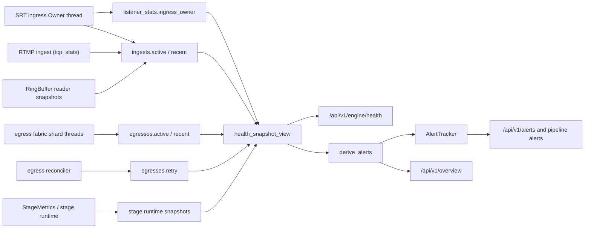
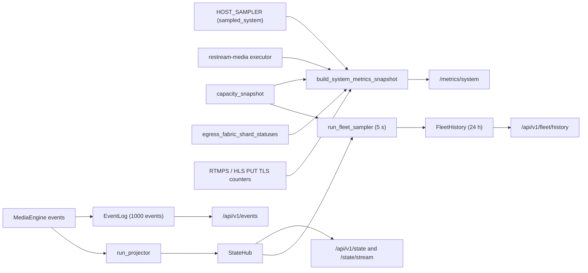
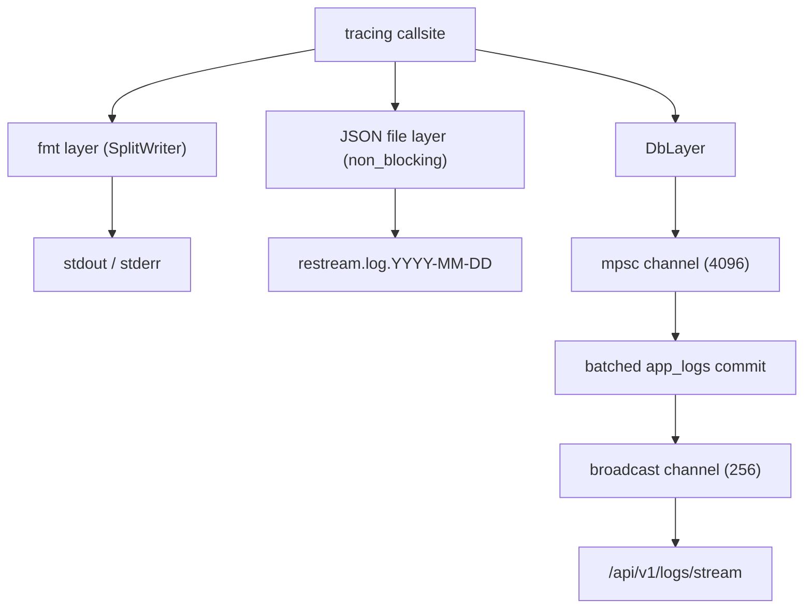

# Observability

Restream reports health, metrics, alerts and logs as authenticated JSON and SSE
built from in-process state. There is no Prometheus text endpoint, no bundled
Grafana and no metrics sidecar.

## Contents

- [Endpoints](#endpoints)
- [Where signals come from](#where-signals-come-from)
- [Engine health](#engine-health)
- [System metrics](#system-metrics)
- [Telemetry, state and history](#telemetry-state-and-history)
- [Diagnostic checks](#diagnostic-checks)
- [Alerts](#alerts)
- [Logging](#logging)
- [Known gaps](#known-gaps)

## Endpoints

Every route below except `/healthz` needs a dashboard session. The
[API reference](api-reference.md) owns request and response detail.

| Route | Purpose |
|---|---|
| `GET /healthz` | Liveness only: always `{ "status": "ok" }`, no session |
| `GET /api/v1/engine/health` | Pipeline input/output state, transport quality, recording, listeners, fabric shards; `?view=summary` for a smaller shape |
| `GET /api/v1/dashboard/runtime` | Health and system metrics in one response (`health_view`, `metrics_view`, `pipeline_id`) |
| `GET /metrics/system` | Host and process resources, capacity, media executor, egress shards, TLS counters (JSON); `?view=summary` |
| `GET /api/v1/engine/resource-map` | CPU/RSS/thread attribution per resource node; grouped top-N by default |
| `GET /api/v1/capacity/scenario` | Observe-only projection of added outputs or stages on the capacity priors |
| `GET /api/v1/engine` | Build, toolchain, native libraries, SBOM summary, OS/CPU/virtualization |
| `GET /api/v1/engine/sbom` | CycloneDX 1.5 runtime SBOM |
| `GET /api/v1/engine/telemetry` | All ingests, inputs, stages, egresses, transcoder buffers, memory accounting |
| `GET /api/v1/pipelines/:id/telemetry` | One pipeline's ingest, source ring, stages, egresses and delivery |
| `GET /api/v1/stages/:key/telemetry` | One stage's throughput and pipe metrics |
| `GET /api/v1/measure` | Fixed-shape counts, payload byte sums and delivery totals |
| `GET /api/v1/overview` | Pipeline counts, failed outputs, alert counts, SRT listener |
| `GET /api/v1/state`, `GET /api/v1/state/stream` | Runtime-state projection; the stream sends `snapshot` and `delta` SSE events |
| `GET /api/v1/fleet/history` | Fleet headroom, delivering share and degraded outputs by layer; `?since=`, `?until=` |
| `GET /api/v1/events` | Recent lifecycle events; `?pipeline_id=`, `?limit=` |
| `GET /api/v1/alerts` | Alerts across all pipelines with `firstSeen`/`lastSeen`; `?since=` adds resolved alerts |
| `GET /api/v1/pipelines/:id/alerts` | One pipeline's alerts |
| `GET /api/v1/pipelines/:id/summary` | Operator card view: source, outputs, alerts, graph counts |
| `GET /api/v1/pipelines/:id/inputs` | Every configured input with its runtime state |
| `GET /api/v1/pipelines/:id/probe` | Active input codec, dimensions, audio tracks, bitrate, GOP |
| `GET /api/v1/pipelines/:id/graph` | Runtime graph plus desired graphs |
| `GET /api/v1/pipelines/:id/diagnostics/context` | Health, graphs, alerts, recent events and logs for one pipeline |
| `POST /api/v1/pipelines/:id/diagnostics/run` | Protocol-aware diagnostic batch |
| `GET /api/v1/logs`, `GET /api/v1/logs/stream` | Process-log query and SSE live tail |

`/metrics/system` appears in `PUBLIC_ROUTE_PATHS` in `src/api/router.rs`, but
its handler still requires a session (`metrics_system_handler`).

## Where signals come from

Health and alerts are computed on request from the `MediaEngine` registries.
Producers only update counters and registries; no background task builds a
health document.



Metrics, runtime state, events and fleet history come from shared samplers,
the event log and two Tokio tasks started in
`src/infrastructure/bootstrap/mod.rs`.



## Engine health

`GET /api/v1/engine/health` is built on demand by
`api_runtime_views::health_snapshot_view` (`src/api_runtime_views/status.rs`)
from `MediaEngine` state and per-pipeline recording settings in SQLite. The
full view is serialized straight from its typed form; `?view=summary` returns
only `status`, `pipelines`, `runtimeLimits` and `hostSettings`.

### Top-level shape

| Field | Meaning |
|---|---|
| `generatedAt` | Snapshot time (RFC 3339) |
| `status` | Always `ready` when the handler returns |
| `pipelines` | One entry per pipeline: `input`, `outputs`, `recording`, `hlsPreview` |
| `stages` | Stage runtime snapshots keyed `pipelineId:stageKind` |
| `runtimeLimits.nofile` | Configured and actual open-file limits, `satisfied` |
| `hostSettings` | Sampled host tuning rows (cached 15 s) |
| `rtmpListener` | `acceptErrors`, `fdExhaustionErrors`, `restarts`, `ingressOwners` |
| `srtListener` | `bondingAvailable`, `restarts`, `ingressOwner` counters |
| `egressFabricShards` | Per-shard state, progress age, command depth, resyncs |
| `containedPanics` | Panics contained at a per-entity boundary since start |
| `tuning.outputMaxRetries` | Restart budget the alert rules compare against |

The health view applies the ingest disconnect grace
(`RESTREAM_INGEST_DISCONNECT_GRACE_MS`). Alerts, overview and pipeline-scoped
views use a grace of zero, so they show current state at once.

### Input status

`input.status` is `on` while `MediaEngine` has an active ingest for the
pipeline and `off` otherwise. It is never `warning` or `error`.

| Field | Source |
|---|---|
| `publishStartedAt` | Current UTC time minus the ingest's monotonic uptime |
| `bytesReceived` | Ingest `AtomicU64` counter |
| `bitrateKbps` | Average bytes received over the ingest's uptime |
| `video`, `audio`, `audioTracks` | RTMP FLV parser or native TS demuxer metadata |
| `publisher.protocol` | Ingest protocol: `rtmp`, `srt`, `hls` or `file` |
| `publisher.remoteAddr` | Accepted peer address when known |
| `publisher.quality` | Protocol-specific transport snapshot (below) |
| `bytesSent` | Sum of the pipeline's active egress byte counters |
| `readers`, `readerMetrics` | Live source-ring readers; per reader lag slots, overflow count, unread packet age, indexes, burst sizes |
| `unexpectedReaders.count` | Always `0`; a placeholder |

Disconnect and flap fields:

| Field | Meaning |
|---|---|
| `disconnectGraceActive` | The last disconnect is still inside the grace window |
| `disconnectGraceRemainingMs` | Time left in that window; `null` without grace |
| `recentDisconnectCount` | Disconnects inside the 30 s flap window (`INGEST_FLAP_WINDOW_MS`) |
| `flapping` | `true` at two or more disconnects inside that window |

Pipeline health shows the selected forwarding input only.
`GET /api/v1/pipelines/:id/inputs` reports every configured input with
`forwardingState` `standby`, `awaitingKeyframe` or `active`. A standby input's
bytes and preview can advance while output counters follow the selected input.
Standby GOP cache occupancy is not exposed.

### RTMP publisher quality

On Linux, `src/media/tcp_stats.rs` reads `TCP_INFO` and `SO_MEMINFO` from the
accepted socket about every two seconds. Fields cover RTT, receive RTT, bytes
received, last-receive age, receive space and window, out-of-order packets,
receive-buffer occupancy, the congestion-control algorithm, and a rate from
consecutive byte samples. The first rate sample is empty. When collection is
unsupported or fails, `tcpStatsUnavailableReason` says why.

### SRT publisher quality

The SRT ingress Owner thread samples `srt-rs` receiver statistics about once
per second. Samples reach Tokio over a bounded, lossy telemetry bridge; a full
bridge drops the sample and counts it in `ingressOwner.telemetryDropped`.

- Per-second rates come from two consecutive Owner observations. A duplicate
  observation is ignored; a counter that went backwards gives no rate.
- Cumulative loss, drop, retransmit and undecryptable counters stay for
  context. Alert on the per-second fields so a recovered link turns healthy.
- Receive-buffer occupancy is `srtRecvBufPackets` /
  `srtRecvBufCapacityPackets`, plus exact `srtRecvBufPayloadBytes`. Capacity is
  a packet limit, so there is no byte-capacity field.
- `mbpsReceiveRate` is the wire receive rate for a direct publisher and the
  logical payload rate (one copy per delivered payload) for a bond.

Bonded publishers add:

| Field | Meaning |
|---|---|
| `srtBonded` | `srt-rs` admitted the publisher as a bonded group |
| `srtGroupMemberCount` | Member tuples reported |
| `srtGroupConnectedMembers` | Members active, standby or unstable |
| `srtGroupActiveMembers` | Members on the active backup path |
| `srtGroupBrokenMembers` | Members reported broken |
| `srtGroupWireReceiverPacketsLost` | Missing sequence numbers summed over legs |
| `srtGroupWirePacketsUndecryptable` | Decryption rejections summed over legs |

For a bond the ordinary loss/drop/retransmit/undecrypt fields are not set:
one degraded leg does not mean the deduplicated stream lost data. RTT,
jitter, latency span and buffer occupancy use connected legs only (an unstable
leg counts; a broken leg does not). The `wire` counters sum every leg. A bond
with no connected leg reports no new sample.

### Output status

`pipelines[id].outputs` lists active egresses (matched on
`ActiveEgress.pipeline_id`) and the most recent outcome of outputs that have
ended, so a failure and its error stay visible after cleanup.

| Field | Source |
|---|---|
| `status` | `running`, `stalled` (no progress for 10 s, `EGRESS_PROGRESS_STALE_MS`), `stopped` (no ingest), `failed`, or `retrying` while reconciler backoff runs |
| `rawStatus`, `phase` | Stored egress status and sender phase (`starting`, `connecting`, `handshaking`, `publishing`, `sending`, `uploading`, `failed`, ...) |
| `protocol` | From the URL: `rtmp`, `srt`, `hls`, `moq`, `sink`, `pipeline` or `unknown` |
| `targetAddr` | Resolved peer address, no credentials |
| `totalSize`, `bytesOut` | The same bytes-sent counter |
| `bitrateKbps` | Byte delta over a sample window longer than 0.5 s; cached between samples |
| `startedAt`, `uptimeSecs` | Registration time and age |
| `lastProgressAt`, `lastProgressAgeMs` | Last successful send or HLS PUT |
| `lastError`, `lastErrorAt`, `failurePhase` | Last structured sender failure; kept after teardown |
| `recentFailureCount`, `flapping` | Failures inside the 30 s flap window (`EGRESS_FLAP_WINDOW_MS`); `flapping` at two or more, also after recovery |
| `retrying`, `retryAttempts`, `retryBackoffMs`, `nextRetryAt`, `retryRemainingMs` | Present while the reconciler delays the next start |
| `endedAt`, `endedAgeMs` | On recent (ended) outputs |
| `blockedBy` | Snapshot of the upstream stage the output waits on |
| `fabric`, `fabricFeed`, `shardId` | Egress fabric feed and owning shard |
| `resyncCount` | Times this leaf fell behind the retained feed window and resynced to the latest sync point |
| `feedLagUnits` | Feed units behind the head, updated by the shard's 1 s stall sweep |
| `backpressureReason` | `null`, `backpressured` (bytes queued within the no-progress deadline), `stalled` (deadline passed), or `shard_saturated` (SRT: deadline passed while at least four, and at least a quarter, of the shard's outputs are backpressured; the output stays connected) |
| `quality` | Sender transport quality (below) |
| `metrics` | The output's `StageMetrics` counters |

Sender quality:

- **RTMP/RTMPS**: `TCP_INFO`/`SO_MEMINFO` on the sending socket: RTT, bytes
  sent/acked/retransmitted, unacked/lost/retransmitted packets, congestion
  state and window, not-sent bytes, pacing and delivery rate, send-buffer
  limited time, RTO counters, socket memory, congestion-control algorithm.
- **SRT**: `srt-rs` caller statistics: RTT, sent loss/drop, send-buffer
  backlog. `mbpsSendRate` is the interval delta of the caller's own wire bytes
  (`total_srt_bytes_sent`, or summed `wire_srt_bytes_sent` for a bond), sampled
  in the ~1 Hz stall sweep. A first sample, a counter reset or a missing
  sender direction reads `null`, not zero. A bond has no aggregate drop counter.
- **HLS PUT**: upload progress for segment and playlist PUTs.

These are sender-side signals. They do not prove a platform accepted or played
the stream.

HLS PUT failure handling (`src/media/hls/upload.rs`, `upload_policy.rs`):

- Each request has a 5 s timeout.
- 5xx, 408, 425, 429, timeouts and connection failures raise
  `upload_segment` or `upload_playlist` errors and back off from 200 ms,
  doubling to 5 s.
- A segment still failing one segment duration (at least 1 s) after its first
  send is dropped (`upload_segment_dropped`); playlists retry without limit.
- At most five segments wait for upload. A slower destination drops the oldest
  ("upload backlog over 5 segments").
- After a failure the output avoids pooled connections for 90 s.
- Any other 4xx stops the uploader; the output then follows the normal
  output retry policy.

### Per-destination delivery

Each fabric output's `quality` carries `deliveredBps`, `offeredBps` and
`deliveryRatio`, computed by its shard over a 5 s window
(`DELIVERY_WINDOW`, `src/media/egress/delivery.rs`) in the 1 s stall sweep.

- **Offered**: bytes the output's feed published (the ring's
  `published_bytes` counter).
- **Delivered, RTMP/RTMPS**: the `tcpi_bytes_acked` delta. Chunk headers make
  a healthy ratio slightly above 1.0.
- **Delivered, SRT**: `srt-rs` `total_bytes_acked`. This is an upper bound: a
  receiver that drops late packets still ACKs past the gap. Bonded outputs
  report `null`.
- The window starts when media flows (RTMP: after publish acceptance).

`GET /api/v1/pipelines/:id/telemetry` folds these per feed into `delivery`:
`rated`, `delivered` (outputs at or above the 0.95 `DELIVERY_FLOOR`),
`ratioMin`, and Jain's fairness index `jain` over delivered rates.
`/api/v1/measure` sums them in `delivery` (`destinations`, `rated`,
`delivered`, `ratioMin`, `jainMin`).

### Recording state

`recording.enabled` is SQLite key `recording_enabled:<pipelineId>`.
`recording.active` is `true` while a recording cancellation token is live.

### SRT listener state

The SRT listener is one `srt-rs` Compio Owner on its own thread (see
[media pipeline](media-pipeline.md#srt-ingress-owner)). `srtListener` values
are listener-wide, not per pipeline.

`srtListener.ingressOwner` is published by the ingress Owner threads and has no
peer or StreamID labels. With several Owners (`RESTREAM_SRT_INGRESS_OWNERS`)
counters and gauges are sums and high-water marks are maxima; a stopped Owner
withdraws its gauges, so `owners` counts running Owners. The full set:

- service visits, actions, maintenance actions, budget exhaustion;
- TX capacity, in flight, high water, exhaustions, packets, completions,
  failures;
- RX packets, bytes, ring depth, ring drops, buffer exhaustion, truncation;
- peers, admission policy telemetry, command and event bridge depth high
  water, event-bridge-full visits, dropped telemetry samples, deferred read
  sends, stale commands, overload disconnects, send failures.

How to read the receive path:

- `rxRingDropped` counts real completion-ring discards; `rxTruncated` counts
  oversized datagrams dropped unparsed.
- `rxBufferExhaustions` counts transient provided-buffer pressure (`ENOBUFS` /
  `ResourceBusy`). It is not packet loss and does not fault the Owner.
- These are local receive-path counters, not wire loss or kernel drops.
- Use `txFailed`, `txExhaustions` and `faulted` for the transmit path and
  Owner health.

SRT ingest media runs on the Owner thread, so the Owner also reports it:

| Field | Meaning |
|---|---|
| `mediaPayloads` | Payloads demuxed and published |
| `mediaWorkUs`, `mediaPassMaxUs` | Total and longest receive-and-publish pass |
| `mediaSlowPasses5ms`, `mediaSlowPasses20ms` | Passes over 5 and 20 ms; each delays protocol service |
| `mediaUnattachedDropped` | Payloads dropped while Tokio admits a peer (bound 2.5 MB per peer, 32 MiB per Owner; a full Owner cap evicts from the largest queue) |
| `mediaProbeHoldOverflows` | Probe holds that hit 4 MiB per publisher, 64 MiB per Owner, or 2 s; held packets go to the current ring |
| `mediaProbeAckMaxUs` | Longest wait for Tokio to answer a stream probe |

The event bridge carries session lifecycle only (connect, probe,
disconnect), so `eventBridgeFullVisits` should stay at zero. The same Owner
fields appear per SRT egress Owner under `egressFabricShards`.

## System metrics

`GET /metrics/system` (`src/api/telemetry/system.rs`) is JSON, not
Prometheus. Host CPU and memory come from one shared `HOST_SAMPLER`
(`src/system_sampling.rs`) refreshed per request: host CPU usage is the delta
since the previous call, and only Restream and its child processes are
refreshed. Network rates come from two interface reads 250 ms apart.

| Field | Full view | Summary view |
|---|---|---|
| `cpu` | `usagePercent`, `cores`, `load1` | `usagePercent` |
| `memory` | total/used/free bytes, `usedPercent` | `usedPercent` |
| `disk`, `mediaDisk` | System root and media directory usage | `disk.usedPercent` |
| `network` | External interface rates, per-interface list, ignored interfaces | `downloadKbps`, `uploadKbps` |
| `engine` | Restream and child FFmpeg CPU and memory (`restreamCpuPercent`, `externalFfmpegCpuPercent`, `restreamMemoryBytes`, `externalFfmpegCount`, ...) | same |
| `capacity` | Observe-only capacity projection | same |
| `hostCapacity` | CPU count and sized thread classes | same |
| `mediaExecutor` | Class, worker and per-service rows | class and worker rows |
| `egressShards` | Fabric shard status, including `srtOwners[]` | same |
| `ioUring` | Cached io_uring capability probe | same |
| `rtmps`, `hlsPutTls` | TLS and kTLS counters | same |

`egressShards[].state` is `healthy`, `stalled`, `stopped` or `panicked`. This
route marks a shard stalled after 5 s without progress; the health view and
alerts use 10 s (`SHARD_STALL_AFTER`).

### Capacity (`capacity`)

`capacity` projects measured ingest bitrate and packet rate, active fanout,
stage count and egress shard count onto calibrated service centers. It does
not reject or defer work (`observeOnly: true`).

- `ingressPps`, `mediaBps`, `egressPps`, `activeLeaves`, `uniqueStages`:
  measured load.
- `hottestShardUtil`, `nicUtil`, `memoryUtil`, `ffmpegUtil`, `diskUtil`:
  per-center utilization ratios (`1.0` is fully used).
- `hottestCenter`, `projectedUtilization`: the largest projected center.
- `flow` (`flowMeasured`): the hottest observed shard's queue, backlog slope,
  deadline slack, delay, errors, retransmit amplification and `status`.

### Host capacity (`hostCapacity`)

`cpus` is the CPU count every sizing law uses (affinity mask and root cgroup
`cpu.max`, read once at boot). The thread counts are `controlWorkers` (Tokio),
`mediaWorkers`, `rtmpIngressOwners`, `srtIngressOwners`, `egressShards`, and
their sum `sizedThreads`. The blocking pool, resolver, recording and FFmpeg
pipe threads are not included. `sizedThreads` above `cpus` is not overload: an
idle thread uses no CPU.

### Media executor (`mediaExecutor`)

`mediaExecutor` describes the `restream-media` pool that runs shared SRT TS
muxing, HLS packaging, recording preparation, audio routing and file-ingest
demux. All counters are cumulative; take rates from two snapshots.

- `classes[]`: per service class, `active` services, `polls`, `busyUs` (wall
  time inside `poll` calls) and `maxPollUs`. Utilization is
  `Δ busyUs / (Δ wall µs × configuredWorkers)`; demand per wake is
  `Δ busyUs / Δ polls`.
- Thread CPU inside the same polls (`CLOCK_THREAD_CPUTIME_ID`): `cpuUs`,
  `maxCpuUs`, `cpuP99Us`, and `pollsOverCpu1Ms`, `pollsOverCpu4Ms`,
  `pollsOverCpu16Ms`. A long poll with small CPU time waited for a CPU.
  `cpuP99Us` is the lower bound of the power-of-two microsecond bucket that
  holds the 99th percentile of the captured histogram. Its final bucket
  starts at 8,388,608 µs with no upper bound. With fewer than 100 samples,
  one outlier can determine p99. Neither means nor percentiles bound the
  cost of an individual poll.
- `usage` (only with `RESTREAM_MEDIA_POLL_USAGE=1`; adds two
  `getrusage(RUSAGE_THREAD)` calls per poll): `all` sums `userUs`, `sysUs`,
  `minorFaults` and `majorFaults`; `overCpu1Ms` sums them over polls above
  1 ms of CPU. The user/system split is tick-sampled, so read it over many
  polls; fault counts are exact.
- `workers[]`: per worker `busyUs` and `parks`, plus `globalQueueDepth`. Empty
  until the first media service starts.
- `queueLatency*`: spawn-to-first-poll delay of new services.
- `services[]` (full view only): one row per running service with
  `serviceId`, `class`, `pipelineId`, `stage` and the same counters. Subtract
  only rows with the same `serviceId`: a restarted service gets a new id.

Virtualization and clock accounting can complicate timing interpretation.
The harness's optional `hls-push-duty --host-probe` samples wall and thread-CPU
clock gaps on an independent thread beside the rated window. Its raw
`hostProbe` report provides context, not causal attribution: a probe gap and
an application poll need not overlap or share a cause. Executor maxima and
percentiles cover service lifetime; the probe covers only the rated window.
Do not subtract independent maxima or declare a long poll harmless because
the probe observed a larger gap. Use correlated profiling on a qualified
host to distinguish application work, kernel work and scheduling delays.

### I/O and TLS capability

`ioUring` is a cached probe of kernel io_uring features (`pollAdd`, accept,
multishot receive, `sendZc`, `napi`, `deploymentTier`, ...).
`available: false` means the host lacks or denies io_uring.

`rtmps` (RTMPS outputs) and `hlsPutTls` (HTTPS HLS PUT outputs) have the same
process-lifetime counters: `connections`, `tls12`, `tls13`, `ktlsRequested`,
`ktlsAttempts`, `ktlsSuccess`, `ktlsUnsupported`, `ktlsError`,
`userspaceTlsConnections`, and `ktlsCapabilities` for TLS 1.2/1.3
AES-128/256-GCM.

- `ktlsRequested` is intent; `ktlsSuccess` is a completed kernel handoff.
- `ktlsUnsupported` is an unsupported negotiated suite; `ktlsError` is a
  handoff failure.
- There is no userspace-TLS fallback. `userspaceTlsConnections` counts
  connections dropped after the handshake but before kTLS handoff.

### SRT Owner datagram counters

`egressShards[].srtOwners[]` carries per-shard SRT Owner counters. `txClass`
splits `txPackets` by `DatagramClass`: `dataFirst`, `dataRetransmit`, `ack`,
`ackack`, `nak`, `keepalive`, `handshake`, `dropRequest`, `keyMaterial`,
`shutdown`, `otherControl`. Their total must equal `txPackets`.

`txBatchedSends`, `txCoalescedDatagrams` and `txGsoFallbacks` are UDP GSO
counters: sends carrying more than one datagram, datagrams joined to a staged
send, and times GSO was rejected and coalescing switched off. Only consecutive
datagrams to the same address coalesce.

## Telemetry, state and history

- **Engine and pipeline telemetry**: `/api/v1/engine/telemetry` returns
  `ingests`, `inputs`, `stages`, `egresses`, `activeTranscoderBuffers` and
  `memoryAccounting`. The pipeline route returns `ingest`, `sourceRing`,
  `stages`, `egresses` and `delivery`. The stage route returns one stage row
  or `404`.
- **Measure**: `/api/v1/measure` returns fixed-shape totals for capacity
  sampling: `pipelines`, `ingests`, `egresses`, `stages`,
  `activeTranscoderBuffers`, `ingestBytesReceived`, retained and per-ring
  payload bytes, and `delivery`.
- **Overview**: `/api/v1/overview` derives `totalPipelines`,
  `activePipelines`, `degradedPipelines` (pipelines with an alert),
  `failedOutputs` (non-`running` outputs of live pipelines),
  `alertCount.critical` / `.warning`, and `srtListener`.
- **Runtime state**: `StateHub` holds the projection under an
  `epoch.revision`. Lifecycle events, successful mutating requests and the
  reconciler's retries-exhausted write mark it changed. `run_projector`
  rebuilds on change, and once per reconcile interval while a stream client
  is connected. With no client, reads refresh on demand and reuse a
  projection younger than 500 ms (`ON_DEMAND_REUSE`). The stream sends
  `snapshot` or `delta` events with `id: <epoch>.<revision>`, keeps 256
  deltas for `?since=` / `Last-Event-ID` resumption, resyncs with a snapshot
  when the gap is too old or the client lags, and sends a heartbeat every
  20 s.
- **Events**: `EventLog` (`src/events.rs`) keeps the last 1000 lifecycle
  events in memory (`limit` defaults to 100). Types are `ingest.connected`,
  `ingest.disconnected`, `ingest.probed`, `stage.registered`,
  `stage.waitingForCapacity`, `stage.backendSpawned`, `stage.firstInput`,
  `stage.firstOutput`, `stage.failed`, `stage.stopped`, `egress.started`,
  `egress.stopped`, `egress.failed`. Each event is also persisted to the log
  history.
- **Fleet history**: `run_fleet_sampler` takes a sample every 5 s whether or
  not anyone watches and keeps 24 h (`FLEET_HISTORY_SPAN`). Each sample has
  `atMs`, `headroomPercent` (100 minus projected utilization, floored at 0),
  `deliveringPercent` (wanted outputs that are converged and flowing; `null`
  when none is wanted) and `degraded` counts by layer (`ingest`, `feed`,
  `shard`, `destination`). The response adds `completeFromMs`, `intervalMs`
  and `newestMs`. A restart forgets history.

## Diagnostic checks

`POST /api/v1/pipelines/:id/diagnostics/run` takes no body. It picks the check
set from the active ingest protocol and returns `404` without an active
ingest. One run per pipeline holds a permit (`429` while one is running); a
client disconnect does not stop the server batch, so blocking file analysis
cannot overlap a retry.

RTMP, SRT and HLS ingests:

| # | Check | Notes |
|---|---|---|
| 1 | Engine Status | Ingest/egress state, uptime, bytes, source ring, max reader lag, overflows, max unread packet age |
| 2 | Stream Info | Codec and track metadata |
| 3 | GOP Analysis | Keyframe interval; media PTS when available |
| 4 | Publisher Transport | RTMP `TCP_INFO`/`SO_MEMINFO` or SRT receiver statistics; bonded SRT reports bond identity and wire counters instead of logical loss counters |
| 5 | Ring Buffer Health | Per-reader lag slots, overflows, unread packet age |
| 6 | Active Outputs | Output state and bytes |
| 7 | System Resources | CPU, RAM, disk |
| 8 | Network Bandwidth | Host-wide interface rates |
| 9 | SRT Listener Owner | SRT only: bonding, Owner fault, receive mode, peers, RX/TX, ring drops, truncation, admission, dropped telemetry samples |

File ingests:

| # | Check | Notes |
|---|---|---|
| 1 | Engine Status | Same core summary |
| 2 | File Source | Path, existence, size, mtime, loop/start offset, live-optimized settings, codec/fps/duration, sparse-GOP warnings |
| 3 | Stream Info | Runtime demux metadata |
| 4 | GOP Analysis | Observed keyframe cadence |
| 5 | File Ingest Runtime | Uptime, bytes injected, ingest id, registry and subprocess state |
| 6 | Ring Buffer Health | Same reader view |
| 7 | Preview & Recording | HLS preview and recording state |
| 8 | Active Outputs | Output state and bytes |
| 9 | System Resources | CPU, RAM, disk |

The SRT Listener Owner check reports ring discards, truncation and Owner
faults as issues. Buffer exhaustion is informational.

## Alerts

`derive_alerts` (`src/alerts.rs`, `src/alerts/output.rs`) is a pure function
of a health snapshot. It returns alerts sorted critical first, then by
pipeline and id. `AlertTracker` (`src/alerts/tracker.rs`) adds `firstSeen`
and `lastSeen`.

| Route | Snapshot | Tracking |
|---|---|---|
| `GET /api/v1/alerts` | All pipelines, no grace | Opens and resolves alerts; `?since=<RFC 3339>` adds `resolved` and `resolvedCompleteFrom` |
| `GET /api/v1/pipelines/:id/alerts` | One pipeline, no grace | Resolves only that pipeline's alerts |
| `GET /api/v1/pipelines/:id/summary` | Summary view | Stamps already-open alerts only |
| `GET /api/v1/overview` | All pipelines, no grace | Counts only |

The tracker keeps 256 resolved conditions. A restart forgets them.

Each alert has `id` (stable per condition and entity), `severity`
(`critical` or `warning`), `scope` (`engine`, `pipeline`, `stage`, `output`),
optional `pipelineId` / `stageId` / `outputId`, `title`, `cause`, `evidence`
(each `{ signal, confidence }`, where confidence is `measured` or `derived`),
`recommendedAction`, `generatedAt`, and for output alerts `diagnosis`.

### Engine alerts

| Id | Severity | Fires when |
|---|---|---|
| `engine:runtime:nofile_limit_too_low` | warning | `runtimeLimits.nofile.satisfied` is `false` |
| `engine:rtmp_listener:fd_exhaustion` | critical | `rtmpListener.fdExhaustionErrors > 0` |
| `engine:egress_fabric:<proto>:<feed>:<shard>:panicked` | critical | Shard `state = panicked` |
| `…:stalled` | warning | Shard made no progress for 10 s |
| `…:stopped` | warning | Shard stopped while outputs are still assigned |
| `…:command_overload` | warning | `commandDepth / commandCapacity ≥ 80%` |
| `…:repeated_resync` | warning | Shard `resyncCount ≥ 5` |

### Pipeline and stage alerts

| Id | Severity | Fires when |
|---|---|---|
| `pipeline:<id>:no_publisher` | critical | `input.status = off` |
| `pipeline:<id>:input:srt_recv_buffer_saturated` | warning ≥ 80%, critical ≥ 95% | `srtRecvBufPackets / srtRecvBufCapacityPackets` |
| `pipeline:<id>:stage:<reader>:lag` | warning | Reader `lagSlots > 256` |
| `pipeline:<id>:stage:<reader>:overflow` | warning | Reader `overflowCount > 0` |
| `pipeline:<id>:stage:<kind>:failed` | warning | Stage phase `failed` |
| `pipeline:<id>:stage:<kind>:no_output` | warning | Phase `runningNoOutputYet`, input seen, no output yet |
| `pipeline:<id>:stage:<kind>:waiting_for_keyframe` | warning | `hls` or `preview:*` stage in `waitingForKeyframe` |
| `pipeline:<id>:stage:<kind>:capacity_exhausted` | warning | Phase `waitingForCapacity` or `capacityWaitMs ≥ 5000` |
| `pipeline:<id>:input:picture_black` | critical | Picture and sound checks on: picture black for 10 s |
| `pipeline:<id>:input:picture_frozen` | warning | Checks on: picture unchanged for 30 s (not while black) |
| `pipeline:<id>:input:audio_silent` | warning | Checks on: first audio track at or under -60 LUFS for 10 s |

The picture and sound checks are opt in per pipeline; see
[API reference](api-reference.md#picture-and-sound-checks).

### Output alerts

Each output is reduced to `OutputSignals` and diagnosed once
(`src/application/diagnosis.rs`). The cause picks at most one alert, with id
`pipeline:<id>:output:<output>:<code>`. All are warnings.

| Code | Cause |
|---|---|
| `blocked_by_stage` | The upstream stage is not producing |
| `egress_capacity_refused` | Admission refused: the feed's least-loaded shard is at its load ceiling |
| `retry_admission_saturation` | Retrying with `retryAttempts ≥ 80%` of `outputMaxRetries` (`RESTREAM_OUTPUT_MAX_RETRIES`) |
| `failed_phase` | The destination rejected the output and `phase = failed` |
| `not_running` | The destination rejected the output in another phase |
| `send_path_stalled` | `backpressureReason = stalled` |
| `stale_progress` | Bytes sent, then `lastProgressAgeMs ≥ 10000` |

### Destination anomalies

Each running output also learns its own usual
(`src/application/destination_baselines.rs`), fed by the flight recorder
every 2 s. The signals are the delivery ratio (bad when low), the round
trip (SRT's, else the TCP socket's) and SRT retransmits per second (both
bad when high).

- Each signal keeps an exponentially weighted mean and variance with about
  5 minutes of memory. Nothing is judged for its first 150 samples
  (5 min).
- A signal is off its usual after 5 samples in a row (10 s) more than 4
  deviations on its bad side. It clears after 5 samples back within 2.
  While off, the baseline does not learn.
- The deviation has a floor: 0.005 for the ratio, 10% of the usual (at
  least 5 ms) for the round trip, and half the usual (at least 1/s) for
  retransmits.
- An output that stops running drops its baseline and learns again.

| Id | Severity | Fires when |
|---|---|---|
| `output:<output>:anomaly:delivery` | warning | Delivery ratio below its usual |
| `output:<output>:anomaly:rtt` | warning | Round trip above its usual |
| `output:<output>:anomaly:retransmits` | warning | SRT retransmits above their usual |

These catch a slow decline before a fixed limit does. For example, a ratio
sliding 0.002 every 2 s from 1.0 is flagged before it crosses 0.95. They
sit beside the diagnosis above, not instead of it.

No output alert is raised when the cause is upstream or transient: no
publisher (the pipeline alert covers it), a panicked, stalled or stopped shard
(the shard alert counts `affectedOutputs`), an exhausted retry budget, or
backpressure within the deadline. Output alerts list the layers ruled out as
derived evidence.

## Logging

Restream uses `tracing` for process logs and lifecycle events. One callsite
emits one structured event. The subscriber writes it to the console, an
optional daily JSON file, and SQLite history. Committed history rows are then
broadcast to SSE clients.

[Configuration](configuration.md) owns the environment variables and the
[API reference](api-reference.md#process-logs) owns the log API contract.

### Data flow

The three subscriber layers in `src/logging.rs` and the SSE handoff:



SSE is not a fourth layer. The drain task broadcasts rows only after their
transaction commits, so every stream ID is a durable database ID.

### Level filtering

- `Cargo.toml` enables `tracing`'s `max_level_debug`, so `trace!` is compiled
  out.
- `RUST_LOG` (default `info`) filters the console and file layers.
- SQLite history keeps every compiled `error`, `warn` and `info` event,
  independent of `RUST_LOG`.

### Level policy

| Level | Use it for |
|---|---|
| `error` | A system fault stopped a task or delivery path and needs an operator: database failure, panic, unrecoverable setup failure, crashed media worker |
| `warn` | A recoverable or client-caused condition: rejected auth, malformed input, destination refusal followed by retry, transient network failure, enforced limit |
| `info` | An operator-visible lifecycle transition: server ready, ingest connect/disconnect, output start/stop/retry, recording transition, codec discovery |
| `debug` | Internal detail: reconciliation, registry changes, setup |

Two questions usually decide:

1. Did the system lose the ability to deliver this task or stream? Use
   `error`. If it can reject or recover, use `warn`.
2. Does an operator need the event to rebuild the lifecycle? Use `info`.
   Otherwise use `debug`.

A remote refusal the reconciler will retry is `warn`, not `error`. Use
`error` when the local delivery task cannot continue safely.

### Sinks

- **Console**: `error` and `warn` go to stderr; `info` and `debug` go to
  stdout. Text format with module targets; ANSI color follows `no_color`.
- **Daily file**: JSON through `tracing_appender::non_blocking`, rolled daily
  as `restream.log.<date>` under `RESTREAM_LOG_DIR` (default
  `.restream/logs`; empty disables it). `LoggingHandles` keeps the writer
  guard for the process lifetime so buffered events flush at shutdown.
  Restream does not delete rolled files; use host log rotation.
- **SQLite history**: `DbLayer` uses `try_send` into a 4096-entry channel and
  never waits; when full, the event is dropped. The drain task commits up to
  64 rows or every 100 ms to `app_logs`, then broadcasts them on a 256-row
  channel. The reconciler deletes rows older than
  `RESTREAM_LOG_RETENTION_DAYS` (default 7).

### Pipeline and output context

Long-lived work carries `pipeline_id` and, where it applies, `output_id`,
directly or from an enclosing span. Instrument spawned futures so the context
crosses the task boundary:

```rust
let span = tracing::info_span!(
    "egress",
    pipeline_id = %pipeline_id,
    output_id = %output_id,
);

tokio::spawn(run_output().instrument(span));
```

Lifecycle events also set `event_class` and `event_type`. The dashboard groups
history by those fields, not by message text.

### Query and live tail

- `GET /api/v1/logs` returns stored rows. Filters: `level`, `since`, `until`,
  `target`, `scope`, `pipeline_id`, `output_id`, `event_class`, `prefix`,
  `after_id`, `order`, `limit` (default 200).
- `GET /api/v1/logs/stream` sends `event: log` SSE frames with the row ID as
  `id`. It takes the scope filters, resumes from the `Last-Event-ID` header or
  `last_event_id` query, backfills from SQLite in ascending ID order, then
  switches to the live broadcast. Heartbeat every 20 s. A lagging receiver is
  closed so the browser reconnects from its last durable ID.

### Callsite rules

- Put identifiers in structured fields, not in message text.
- Keep messages stable and readable; use `event_type` for machine
  classification.
- Do not add `[module]` prefixes; the target names the module.
- Never log inside packet-level push, pull, read, mux, demux or send loops.
- Control operations (stage creation, reader registration, resize, teardown)
  may log at `debug` or `info`.
- Passing tests must not print expected warnings, panic text or media-tool
  output. Suppress expected noise in the test helper.

### Implementation map

| Concern | Source |
|---|---|
| Subscriber layers, span inheritance, batching, broadcast | `src/logging.rs` |
| Log DTOs and filters | `src/logging/types.rs` |
| SQLite schema | `src/db/schema.rs` |
| Storage and filter queries | `src/db/log_repo.rs` |
| HTTP query and SSE | `src/api/logs.rs` |
| Routes | `src/api/router.rs` |
| Defaults | `src/config.rs`, [configuration](configuration.md) |

### Invariants

- No `println!` or `eprintln!` in `src/`; crate lints enforce this.
- No logging in packet loops in `ring_buffer.rs` or `avio.rs`.
- Callsites never block on SQLite or SSE consumers.
- SSE publishes only committed rows with a stable ID.
- The file writer guard outlives every task that can log.
- Async work that needs context uses `.instrument(span)`; never hold a
  `span.enter()` guard across a task boundary.

## Known gaps

- Egress parity gaps: no post-egress media metadata, GOP cadence or timestamp
  validation, and no loopback/readback probe for RTMP/SRT outputs. Sender
  counters do not prove what a receiver got.
- `RingBuffer::fill_and_capacity()` reports occupancy from the slowest live
  reader, capped at capacity.
- `MemoryQueue` (`src/media/avio.rs`) tracks high-water bytes and blocked
  writes internally, but no API or graph snapshot exposes them.
- HLS and recording share the TS packet feeder. An active task or token does
  not prove those mux paths are healthy.
- There is no packet-residency or end-to-end latency timing. Any future
  instrumentation must avoid per-packet allocation, logging, serialization
  and global locks; keep residence time separate from PTS/DTS; stop lineage at
  transcoders; publish fixed-size aggregates at the existing snapshot cadence;
  and come with a before/after hot-path benchmark.
- A Prometheus adapter, if added, must read these same snapshots without
  labels, allocation or collection work on packet loops.
