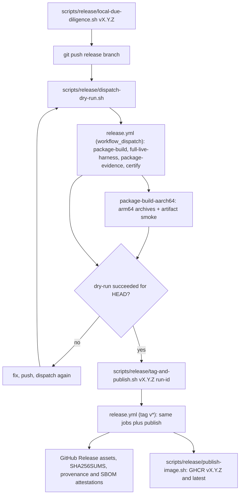

# Release runbook

A release is three scripts run in order: local due diligence, a GitHub
dry-run, then tag-and-publish. The scripts own the gates, artifact list,
shards, timeouts and packaging; this page gives the sequence.

## Contents

- [Release flow](#release-flow)
- [Preflight](#preflight)
- [Run local due diligence](#run-local-due-diligence)
- [Dispatch the GitHub dry-run](#dispatch-the-github-dry-run)
- [Publish the certified commit](#publish-the-certified-commit)
- [Verify publication](#verify-publication)
- [Handle a failed publish](#handle-a-failed-publish)

## Release flow

The diagram shows the scripts and the `.github/workflows/release.yml` jobs
from a clean branch to published artifacts.



## Preflight

- Use a clean checkout of the release branch and push its commit.
- Confirm `gh` authentication and Docker.
- Each script checks its own tools; run it with `--help` when setup fails.
- Branch dispatches never publish. Only a `v*` tag starts publishing.

## Run local due diligence

[scripts/release/local-due-diligence.sh](../scripts/release/local-due-diligence.sh)
runs, in order:

1. format, frontend, API contract, test hygiene and fixture discipline;
2. the full live harness suite, unless `--skip-harness` is given;
3. packaging of every supported Linux binary;
4. release evidence, packaged-frontend smoke and container runtime smoke.

The evidence step needs `cargo-audit`, `cargo-deny`, `grype`, `trivy` and
Docker.

```sh
scripts/release/local-due-diligence.sh <vX.Y.Z>
```

Use `--skip-harness` only when the same commit already has complete
live-harness evidence; record why. When a step fails, read the script output
for the failing owner instead of rerunning a copied subsequence.

## Dispatch the GitHub dry-run

[scripts/release/dispatch-dry-run.sh](../scripts/release/dispatch-dry-run.sh)
starts the non-publishing Release workflow for the current branch or a given
ref. It certifies the exact pushed SHA without creating a GitHub Release or
pushing images.

```sh
scripts/release/dispatch-dry-run.sh [ref]
```

Keep the run ID it reports. If the branch moves, dispatch again: a run for
an older SHA cannot authorize publication. The workflow and
`scripts/lib/release-shards.sh` own matrix, runtime image, retries and
timeouts.

## Publish the certified commit

[scripts/release/tag-and-publish.sh](../scripts/release/tag-and-publish.sh)
runs from the unchanged clean checkout:

```sh
scripts/release/tag-and-publish.sh <vX.Y.Z> <successful-dry-run-id>
```

It checks the run's workflow, event, jobs, status, conclusion and head SHA
against `HEAD`, and the tag state, before it pushes the tag. Do not bypass it
with a direct tag push. The tag starts the publishing workflow: GitHub
Release assets plus GHCR `<tag>` and `latest` images.

## Verify publication

```sh
gh release view <vX.Y.Z> --json tagName,targetCommitish,assets,url
docker manifest inspect ghcr.io/krsna1729/restream:<vX.Y.Z>
docker manifest inspect ghcr.io/krsna1729/restream:latest
```

Every archive, the seccomp profile and the runtime image carry a
Sigstore-signed build-provenance attestation, and each `restream` archive an
SBOM attestation; `SHA256SUMS` lists the files:

```sh
gh attestation verify restream-<vX.Y.Z>-linux-aarch64.tar.gz --repo krsna1729/restream
gh attestation verify restream-<vX.Y.Z>-linux-x86_64.tar.gz --repo krsna1729/restream \
  --predicate-type https://cyclonedx.org/bom
gh attestation verify oci://ghcr.io/krsna1729/restream:<vX.Y.Z> --repo krsna1729/restream
sha256sum -c SHA256SUMS
```

Check the assets against their owners:
[scripts/release/package-binaries.sh](../scripts/release/package-binaries.sh)
(names and contents) and
[scripts/check/release-evidence.sh](../scripts/check/release-evidence.sh)
(evidence). See [Release compliance](release-compliance.md) for the legal
and provenance properties.

## Handle a failed publish

- No public GitHub Release yet: inspect the failed run and decide whether to
  remove the unpublished tag.
- A public release exists: do not overwrite it. Fix forward with a new
  version.

Tag deletion is visible to everyone. Confirm the release state and
repository policy before you delete a local or remote tag.
