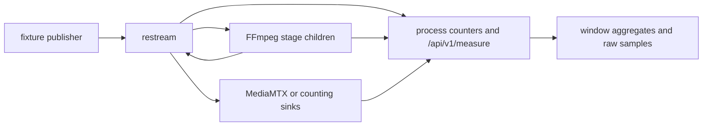

# Resource sweep

Use the resource-sweep harness to attribute CPU, memory and delivery cost
to one workload shape. Use the [capacity ramp](capacity-ramp.md) when the
question is maximum fan-out with repeated delivery gates.

## Contents

- [Run one scenario](#run-one-scenario)
- [Workloads and peers](#workloads-and-peers)
- [Controls](#controls)
- [Artifacts and counters](#artifacts-and-counters)
- [Per-rendition FFmpeg child cost](#per-rendition-ffmpeg-child-cost)
- [Profiling workflow](#profiling-workflow)
- [Matrix resource constraints](#matrix-resource-constraints)

## Run one scenario

Build before starting media. For committed performance evidence use real
release binaries, not debug or inner-loop bench binaries:

```sh
flock -x /tmp/restream-host.lock cargo xtask build-release

HARNESS_BIN="$PWD/target/qual-release/test_harness" \
RESTREAM_BIN="$PWD/target/qual-release/restream" \
BENCH_BUILD=never MSR_PEER=sink \
RESOURCE_SWEEP_SCENARIOS=egress-growth-source-same \
RESOURCE_SWEEP_EGRESS_COUNTS=10 \
RESOURCE_SWEEP_SAMPLE_SECS=20 RESOURCE_SWEEP_SETTLE_SECS=6 \
  flock -x /tmp/restream-host.lock \
  scripts/harness/run.sh resource-sweep -- --no-netns
```

Verify `target/qual-release/COMMIT` against the revision under test. Setting
both binary paths and `BENCH_BUILD=never` prevents the wrapper from building
a different profile immediately before the measurement.

Use the wrapper without overrides for an inner-loop run with canonical
`target/bench/` binaries. `--no-netns` is for hosts that cannot create the
harness's private network namespace. Do not run concurrent sweeps, builds
or unrelated media on the measurement host.

The harness keeps the server's cost separate from its external encoders:



## Workloads and peers

The source of truth for egress scenarios is
[`resource_egress_scenarios.json`](../src/bin/test_harness/resource_egress_scenarios.json).
Output kinds and their encoding/transport choices are defined in
[`catalog.rs`](../src/bin/test_harness/resource_sweep/catalog.rs).

| Workload family | Question |
|---|---|
| Empty baseline | Fixed process and runtime cost |
| Ingest only | Cost of one input shape without destination growth |
| Same or mixed ingest growth | Cost of adding pipelines and publishers |
| Source egress growth | Cost per destination without a rendition transcode |
| Transcode egress growth | Cost of one or more shared rendition stages plus their destinations |
| Source and transcode mixed | How passthrough and rendition costs combine |
| HEVC ingest with RTMP source | Enhanced RTMP passthrough, not an automatic HEVC-to-H.264 edge |
| HLS PUT or RTMPS source | Segment-upload or TLS egress cost |

`branch-matrix` exercises the passthrough-versus-transcode-family shape.
For the scale workload and its signal-calibration/probe controls, use the
[Mahashivratri scenario](mahashivratri-hero-scenario.md). Do not substitute
its topology for a single-feed fan-out test.

The default peer is MediaMTX. `MSR_PEER=sink` uses harness counting
receivers, including RTMPS when `RESOURCE_SWEEP_RTMPS_CERT` and
`RESOURCE_SWEEP_RTMPS_KEY` are set. `RESOURCE_SWEEP_HLS_TLS=1` enables the
HLS PUT HTTPS sink with the checked-in certificate. The harness supplies
its trust root to Restream.

For remote SRT receivers, set `RESOURCE_SWEEP_SRT_PEER_HOSTS` to a
comma-separated host list and run `srt-sink` on each host. The remote
state endpoints supply same-window drop counters. Configure
`SRT_SINK_PORTS` and `SRT_SINK_STATE_PORT` using
[`srt_sink.rs`](../src/bin/test_harness/srt_sink.rs), and check
[`peer_state_config`](../src/bin/test_harness/resource_sweep/config.rs)
for endpoint overrides. Remote counters must be reachable to grade the
workload's validity.

## Controls

Configuration is parsed by
[`resource_sweep/config.rs`](../src/bin/test_harness/resource_sweep/config.rs).

| Variable | Default or use |
|---|---|
| `RESTREAM_BIN`, `HARNESS_BIN` | Explicit binary paths for a release measurement |
| `WORK_DIR` | Artifact directory; default `.local/artifacts/resource-sweep` |
| `RESOURCE_SWEEP_SCENARIOS` | Comma-separated filter; restrict it to the workload under test |
| `RESOURCE_SWEEP_BITRATE` | Fixture bitrate label, default `1.5M` |
| `RESOURCE_SWEEP_SAMPLE_SECS` | Rated window, default 6 s |
| `RESOURCE_SWEEP_SAMPLE_INTERVAL_MS` | Sampling interval, default 1000 ms |
| `RESOURCE_SWEEP_SETTLE_SECS` | Settle before sampling, default 4 s |
| `RESOURCE_SWEEP_INGEST_COUNTS` | Pipeline-count ladder, default `1,3,5` |
| `RESOURCE_SWEEP_EGRESS_COUNTS` | Output-count ladder, default `1,5,10` |
| `RESOURCE_SWEEP_INGEST_GROWTH_CONFIG` | Input shape for same-ingest growth, default `h264-srt` |
| `RESOURCE_SWEEP_INGEST_OUTPUTS` | Outputs per same-ingest-growth feed, default 0 |
| `RESOURCE_SWEEP_INGEST_OUTPUT_KIND` | Catalog output kind for those feeds, default `srtSource` |
| `MSR_PEER` | `mediamtx` or `sink` |
| `PEER_COUNT` | Peer instances/ports, default 1 |
| `RESOURCE_SWEEP_SRT_PEER_HOSTS` | Remote SRT receiver hosts; unset means loopback |
| `RESOURCE_SWEEP_HLS_TLS` | `1` selects HTTPS on the counting HLS sink |
| `RESOURCE_SWEEP_RTMPS_CERT`, `RESOURCE_SWEEP_RTMPS_KEY` | Certificate/key pair for MediaMTX or the counting RTMPS listener |
| `RESOURCE_SWEEP_NO_CLEANUP` | `1` skips final stack cleanup; retaining a live workload also requires `cumulative` |

Lifecycle determines what each row includes:

| `RESOURCE_SWEEP_LIFECYCLE` | Process and topology lifetime |
|---|---|
| `isolated` | Restart the stack between scenarios for attribution |
| `continuous` | Keep processes, replace pipelines and publishers |
| `cumulative` | Keep processes and earlier workloads; later rows include prior growth |

To inspect a live workload after the harness exits, combine
`RESOURCE_SWEEP_NO_CLEANUP=1` with `cumulative` and an external peer such
as MediaMTX. `isolated` stops its per-scenario stack, and `continuous`
removes publishers and pipelines. In-process counting sinks do not survive
the harness process.

A changed lifecycle is a changed experiment. Do not compare an isolated
row directly with a cumulative row as if they measured the same work.

## Artifacts and counters

| Artifact | Purpose |
|---|---|
| `resource-sweep-results.json` / `.csv` | Per-window aggregates |
| `resource-sweep-samples.jsonl` | Raw samples, including child-process observations |
| `packet-contract.json` | Packet-rate summary, provenance, availability and validity |
| `packet-contract-samples.jsonl` | Per-sample packet-rate records |
| `media-executor-*-start.json` / `*-end.json` | Executor counters at window boundaries |
| Server, publisher and peer logs | Explain failures and confirm workload identity |

The sampler combines `/proc` process/thread counters with
`GET /api/v1/measure` and receiver observations. The measure endpoint has a
fixed shape so its cost does not scale with the number of output rows.

- `restream_cpu_*` is the server process; `ffmpeg_cpu_*` is its encoder
  children; `total_cpu_*` combines them. Receiver and publisher costs are
  not interchangeable with those totals.
- RSS, PSS and retained payload account for different things. Do not add
  overlapping memory categories or describe retained bytes as process RSS.
- `threadRunQueuePct` uses per-thread `schedstat` to show runnable time not
  scheduled. It does not identify cache misses or prove a codec bottleneck.
- Executor `busyUs`/`polls` are cumulative. Subtract window boundaries;
  `maxPollUs` is a lifetime maximum, not a window delta.
- Packet-contract validity distinguishes healthy samples from contaminated
  receiver/host drops and invalid or stalled workloads. Inspect it before
  drawing performance conclusions.

## Per-rendition FFmpeg child cost

One external child serves a live unique FFmpeg-backed stage key. Adding
destinations that share that key does not imply more children. Source
passthrough, the TS muxer and lightweight audio routes need not create an
FFmpeg child at all. See
[Native and child-process boundaries](high-performance-data-path.md#native-and-child-process-boundaries).

Measure this with both the child PID set (`ffmpegCount` in raw samples) and
child RSS/CPU. Stage count is not child count: it also includes TS muxers
and audio routers. A source output on HEVC ingest does not prove a codec
conversion; check the destination's resolved codec and RTMP mode.

Record the fixture, codec, output kinds, shared stage keys, child count,
child RSS, child CPU and delivered destinations for each rung. Keep the
numbers in the measured change's commit message, not a dated table here.

## Profiling workflow

Run one scenario with a long enough sample window to attach the profiler.
First obtain a comparable unprofiled run; profiling changes scheduling and
cost. Use the same release binary and fixture for both.

```sh
perf stat -e task-clock,context-switches,cpu-migrations,page-faults \
  -p <restream-pid> -- sleep 10
perf record -F 99 -e cpu-clock -g -p <restream-pid> -- sleep 10
perf report --stdio --no-children
```

Use a kernel-compatible `perf`. Record whether PMU events are available on
the host. Profile encoder children separately when they dominate total
CPU; optimizing the parent cannot remove child codec work.

End the harness normally. If inspection mode left processes running,
identify their PIDs and command lines before stopping only those owned by
the run. Do not use process-name-wide `pkill` on a shared host.

## Matrix resource constraints

A live matrix proves protocol or recovery behavior for its exercised
topology. It is not automatically production capacity certification.

| Resource | Owner |
|---|---|
| Cargo parallelism | `.cargo/config.toml`; host lock is an operator convention |
| Server executors and storage bounds | `src/config.rs` and `src/media/` implementations |
| RTMP/SRT admission and owner threads | Protocol listeners and runtime configuration |
| FFmpeg child admission and thread hints | `src/config.rs`, `src/media/external_transcoder.rs` |
| Fixtures, peer processes, artifacts and cleanup | `src/bin/test_harness/`, `test/harness/` |
| CPU affinity, NUMA, cgroups and host memory | Launch environment |

A semaphore that bounds a server resource does not cap the whole process
tree, and Cargo job limits impose no runtime cgroup. Apply whole-process
limits externally when the experiment requires them.

Choose the smallest harness mode that proves the changed boundary. Capture
its summary and the evidence needed to explain a failure. Broaden the
matrix only after the focused scenario works. Check variable names against
their source owner: an ignored environment variable is not a constraint.

Separate protocol correctness, recovery, directional resource evidence and
deployment recommendations. Only the first two are usually established by
one bounded run. Record repeatable measurements, limitations and host
identity in the commit that makes the change.
