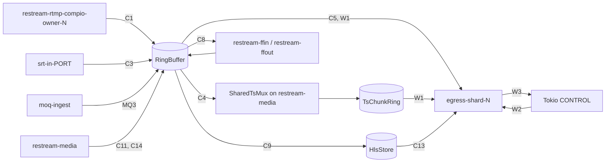

# Runtime crossings

This page lists every place media or protocol work crosses between execution
contexts: Tokio CONTROL, the Compio owners, the media executor, egress shards
and FFmpeg threads. Each row gives the mechanism, rate, bound and a verdict.
Row IDs are stable; source comments cite them.

Verdicts:

- **Justified**: the crossing buys ownership, isolation or backpressure that
  is worth its cost.
- **No media crossing**: media stays on one context; only lifecycle or
  telemetry crosses.
- **Open**: plausibly material at scale; the measurement reference that
  decides it is named.

## Contents

- [Execution contexts](#execution-contexts)
- [Media crossings](#media-crossings)
- [MoQ crossings](#moq-crossings)
- [Control and wake crossings](#control-and-wake-crossings)
- [Observability crossings](#observability-crossings)
- [Measurement references](#measurement-references)

## Execution contexts

| Context | Threads | Runs |
|---|---|---|
| Tokio CONTROL | `restream-tokio` workers | API, DB, reconciler, pipeline and session lifecycle, HTTP HLS serving and push requests, Reqwest HLS PUT fallback, diagnostic RTMP play reader |
| RTMP ingress | `restream-rtmp-compio-owner-N` (`RESTREAM_RTMP_INGRESS_OWNERS`, default 1) | RTMP parse and publish to completion; direct RTMP play sockets |
| SRT ingress | `srt-in-PORT[-N]` (`RESTREAM_SRT_INGRESS_OWNERS`, default 1) | SRT receive, TS demux and publish to completion; direct SRT play |
| MoQ ingest and origin | `moq-ingest` (one Compio runtime) | MoQ/QUIC and WebTransport sessions, CMAF demux, publish, local origin |
| Media executor | `restream-media` (fixed pool, `RESTREAM_MEDIA_WORKERS`) | Shared SRT TS muxing, audio routers, HLS segmenting, recording feed, file ingest demux, HLS push/pull assembly |
| Egress shards | `egress-shard-N` (one Compio runtime each) | RTMP/RTMPS, SRT, HLS PUT, MoQ, sink and pipeline leaves ([Egress architecture](egress-architecture.md)) |
| Egress DNS | RTMP resolver worker, `srt-dns-res`, `hls-put-resolve`; MoQ uses Compio `spawn_blocking` | Blocking `getaddrinfo` |
| FFmpeg | `restream-ffin`, `restream-ffout` per child | Child stdin writes and stdout demux |
| Disk | Guarded writer threads | Recording file writes |

The diagram shows where media enters a ring and how it leaves. Labels are row
IDs.

"Off Tokio" on this page means off CONTROL. The media executor is a separate
Tokio runtime with a fixed worker count (`src/media/executor.rs`).

## Media crossings

| # | Crossing | Mechanism | Rate | Bound | Verdict |
|---|---|---|---|---|---|
| C1 | RTMP publish: ingress owner → ring | The owner parses each message and runs `RtmpPublisherMedia` inline: sequence-header cache, timestamp mapping, input gate, GOP cache, ring publish. The CONTROL session receives lifecycle commands, the one-time `RtmpControlCommand::MediaProbe` and quality reports | lifecycle per session | no media on the control channel | **No media crossing.** |
| C2 | Direct RTMP play: CONTROL session ↔ ingress owner | `PlayNext` request; oneshot reply with ≤ 32 `Arc<MediaPacket>` (`MEDIA_PULL_BURST_PACKETS`) in a recycled `Vec` | one round trip per burst; a burst can be one packet at the live edge | one outstanding burst per player | **Justified.** Diagnostic path, not production fan-out. It must play with ffplay/ffmpeg and must not disturb the publish path. |
| C3 | SRT publish: ingress Owner → ring | Each payload is demuxed, gated, timestamp-mapped, GOP-cached and published on the Owner thread (`src/media/srt/ingress_media.rs`). Owner↔CONTROL bridges carry connect/auth, the one-time probe, disconnect, and a lossy quality feed | lifecycle per session | no media on the bridges | **No media crossing.** Per-packet allocations on this thread contend on the allocator, so packet paths avoid them. |
| C4 | Ring → SRT egress: shared TS muxer | `start_shared_ts_muxer` runs as `MediaServiceClass::SharedTsMux` on `restream-media`. It reads the ring in bounded bursts, writes `TsChunkRing` and yields. One muxer per `(pipeline, stage key)`; with `RESTREAM_SRT_EGRESS_MUXER_MAX_OUTPUTS_PER_SHARD` > 0 a feed's outputs split across up to `RESTREAM_SRT_EGRESS_MUXER_MAX_SHARDS` (64) muxers | per packet, once per muxer, not per output | TS ring capacity | **Justified.** Mux cost scales with feeds, not outputs. |
| C5 | Ring → RTMP/RTMPS egress | Shards read `RingFeed` by cursor. Raw→FLV conversion is memoized per shard (`SharedRtmpPayloadCache`, 64 entries); a lagging output may reconvert after eviction | no per-packet crossing; wakes only (W1) | ring capacity; per-leaf cursor | **Justified.** |
| C7 | Direct SRT play | The SRT ingress Owner refills each reader's `TsChunkReader` and sends through the peer; window pressure defers (≤ 32 per peer) or disconnects | per TS chunk per player | per-peer deferral bound | **No media crossing** on CONTROL. Diagnostic only; checked by the `direct-play` CI shard. |
| C8 | Ring ↔ FFmpeg stage | `restream-ffin` pulls the source ring through `StageInputPump::into_queue_refill` (`StageInputRefill::refill`) and writes the child's stdin. `restream-ffout` demuxes stdout with `TsDemuxer` into the output ring | per packet | pipe backpressure | **No media crossing** on CONTROL. The CONTROL stage task only waits for cancel or end. |
| C9 | Ring → HLS segmenter | TS and fMP4 segmenting run on `restream-media`. CONTROL registers the lifecycle and observes failure; dropping CONTROL cancels but lets media flush the last segment | per packet, once per pipeline or rendition | packet bursts; one open segment; store limits retained segments | **Justified.** HTTP serving stays on CONTROL. |
| C10 | Ring → recording | `feed_recording` (`MediaServiceClass::Recording`) pulls the ring into a bounded `MemoryQueue`, yielding per burst; a guarded OS thread writes the file | per packet, once per recording | `MemoryQueue` capacity | **Justified.** Benchmarked by `benches/avio_throughput.rs`. |
| C11 | External file ingest: child stdout → ring | The stdout pipe is detached from CONTROL and pumped as `MediaServiceClass::FileIngest`; `TsDemuxer`, timestamp continuity, gate and publish stay on `restream-media` | per read burst | 64 KiB read buffer; ring capacity | **No media crossing** on CONTROL. |
| C12 | Source ring → audio router → output ring | `start_audio_router` runs as `MediaServiceClass::AudioRouter` on `restream-media` (`src/media/stage_runtime.rs`) | per audio packet | ring capacity | **No media crossing** on CONTROL. |
| C13 | HLS store → HLS PUT egress | The segmenter publishes to `HlsStore`; a publication subscription wakes the HLS PUT shards directly (`engine_hls_egress_fabric.rs`). Fallback: the CONTROL Reqwest uploader (`src/media/hls/upload.rs`) when `RESTREAM_HLS_PUT_FABRIC` is off or HTTPS lacks kTLS | per segment and playlist | store retention; shard leaf capacity | **Justified.** |
| C14 | HTTP HLS push ingest → ring | CONTROL accepts each PUT/POST and queues the object on a two-slot channel (`OBJECT_QUEUE`) to the session's `MediaServiceClass::HlsIngest` assembler on `restream-media`, which demuxes and publishes. Playlist parsing runs on `spawn_blocking` | per object | 2 queued objects per session; per-key upload slots | **Justified.** |
| C15 | HLS pull ingest → ring | A CONTROL fetch task downloads playlists and segments; parsing runs on `spawn_blocking`; segments feed the same assembler path as C14 | per playlist and segment | as C14 | **Justified.** |
| C16 | Pipeline recirculation: source ring → target ring | A pipeline shard reads `RingFeed` and calls `RecirculationInputPublisher::publish` into the target pipeline's ring, sharing `Arc<MediaPacket>` | per packet, on the shard | ring capacity; shard budgets | **Justified.** No serialization. |

## MoQ crossings

MoQ phase 1 uses moq-lite (`moq-net`) with the hang catalog over Compio QUIC
(`src/media/moq/`). Ingest and the local origin share the `moq-ingest`
thread. Relay output (`moqt://`) runs on egress shards. No MoQ media runs on
CONTROL.

| # | Crossing | Mechanism | Rate | Bound | Verdict |
|---|---|---|---|---|---|
| MQ1 | Listener start and stop | `listener::start` spawns `moq-ingest` with its own Compio runtime and reports readiness on a oneshot. Shutdown cancels a `CancellationToken`; the listener drains sessions for up to 1 s | once per process | — | **Justified.** |
| MQ2 | Publisher admission and probe: `moq-ingest` → CONTROL → `moq-ingest` | `TokioLifecycle::admit` and `apply_probe` spawn CONTROL tasks and return `Admission` or a replacement ring on a oneshot; `finish` is fire-and-forget at disconnect | once per session; probe at most once | `RESTREAM_MOQ_MAX_CONNECTIONS` (64); probe hold 4 MiB / 2 s | **Justified.** |
| MQ3 | MoQ track → ring | Track pumps run as futures inside the session on `moq-ingest`. `IngestTrack::push` converts hang frames or demuxes CMAF fragments; `PublisherMedia` gates, maps timestamps and publishes | per frame | 16 MiB per frame; CMAF init ≤ 1 MiB; ≤ 1 video and ≤ 8 AAC tracks | **No media crossing.** |
| MQ4 | Origin attach: `moq-ingest` → CONTROL → `moq-ingest` | `Origin::attach` spawns a CONTROL lookup that returns the pipeline's ring and `MoqPublishStartup` | first viewer of a pipeline | `RESTREAM_MOQ_ORIGIN_MAX_VIEWERS` (64) | **Justified.** |
| MQ5 | Ring → local origin | The ring's publication subscriber calls `ChannelWake::wake` on the producer thread (`flume::bounded(1)`, `try_send`). One Compio pump per served pipeline reads the ring and writes shared-`Bytes` hang frames to every viewer session | per publication, coalesced | 1 queued wake per pipeline; 64 units / ~1 MiB per pump batch | **Justified.** |
| MQ6 | Output control: CONTROL → MoQ shard | `run_moq_fabric` installs a `MoqPublishStartup` in `SharedMoqStartupSource`, then dispatches `Add`; `Remove` at the end. Same command channel as W2 | per output attempt | W2 | **Justified.** |
| MQ7 | Ring → MoQ relay egress | Feed wakes as W1. `MoqShardBackend` visits leaves; `MoqEngine` reads `RingFeed` and writes the broadcast. Each output has one Compio connection task on the shard runtime, linked by `LeafLink` | per bounded visit | `RESTREAM_EGRESS_VISIT_MAX_UNITS` and `_BYTES` per visit (the publisher does not check the time budget); one connection task per output | **No media crossing.** |
| MQ8 | MoQ relay DNS | `compio::runtime::spawn_blocking` resolves a hostname; IP literals skip it | per connect | Compio blocking pool; no explicit timeout `[unverified bound]` | **Open.** No measurement yet. |

## Control and wake crossings

| # | Crossing | Mechanism | Rate | Verdict |
|---|---|---|---|---|
| W1 | Feed wake: producer → egress shards | The producer calls the ring's `PublishSubscribers` after each publish batch, seal and end of stream. `subscribe_fabric_wakes` registers one `FabricWakers` per feed, which calls `FeedWakeHandle::deliver` per shard: a `WakeGate` swap, then `try_send(FeedWake)` only on clear-to-set. A full channel leaves one fallback bit. The shard clears the gate before reading heads | per publication: two `ArcSwap` loads plus one gate swap per shard; ≤ 1 queued wake + 1 fallback bit per shard | **Justified.** No watcher task between producer and shard. |
| W2 | Egress commands: CONTROL → shard | Bounded flume channel per shard (`RESTREAM_EGRESS_COMMAND_CAPACITY`, default 1024); the manager checks free slots before sending | per add, update, remove | **Justified.** |
| W3 | Egress progress and quality: shard → CONTROL/API | `EgressProgressSink`: relaxed atomics per visit; `Mutex<PublisherQuality>` and backpressure reason written by the stall sweep at most once per second per leaf; `terminated_unexpectedly` polled by `EgressTask` every 250 ms | ≤ 1 Hz per leaf for quality | **Justified.** |
| W4 | SRT Owner events inside a shard | Owner event and failure queues drained per ready batch (`SrtOwners::drain_events`, ≤ 64 per pass). The Owner runs on the shard's own thread and runtime, so this is not a thread crossing; results reach CONTROL through W3 | connection and failure events | **No media crossing.** |
| W5 | Egress DNS | RTMP: one resolver worker per shard, request and completion queues of 1024. SRT: lazy `srt-dns-res` worker per shard with bounded queues. HLS PUT: `hls-put-resolve`. MoQ: MQ8 | per connect | **Justified.** Blocking `getaddrinfo` stays off shard threads. |

## Observability crossings

| # | Crossing | Current state | Verdict |
|---|---|---|---|
| O1 | API → host and process sampling (`/metrics/system`, status, resource map, agent context) | One long-lived sampler (`system_sampling::sampled_system`) refreshes host CPU (a real delta), memory, and only Restream and its children (`/proc/self/task/*/children`). If child lists cannot be read it refreshes all processes with minimal fields. Sampling runs on the requesting CONTROL worker | **Justified.** |
| O2 | API observation cost (health, telemetry) | `/api/v1/engine/health` serializes typed views with no `Value` tree; `sample_host_settings` is cached for 15 s. Telemetry endpoints and the summary view still build `serde_json::Value` trees (`egress_runtime_json`), so their cost grows with output count. The capacity harness reads one fixed-shape `GET /api/v1/measure` per sample instead. The API reads what shards publish and sends no shard commands | **Open.** Remaining cost is payload size per output; `benches/api_health.rs` measures it. |

## Measurement references

Each item gives the number a reader needs and where it came from. Full data
is in the commit that recorded it.

- **M1** RTMP ingress owner cost: about 0.66% of a core per 8 Mbit/s
  publisher (release, ingest only, 64 publishers). Permit and queue wait
  percentiles are not instrumented. Open.
- **M2** Direct play (C2, C7) is diagnostic. CI's `direct-play` shard checks
  structure with ffprobe and decodes SRT `read` and RTMP `play` to a null
  sink. No scaling study.
- **M3** SRT ingest at 8–32 publishers held ~7.9 Mbit/s each. The
  Owner→CONTROL event bridge (`INGRESS_EVENT_CAPACITY` 256, plus
  `PENDING_EVENTS_MAX` 1024 on the Owner) carries lifecycle only; media
  never waits on it (C3). The harness drives at most ~40 SRT publishers on
  the reference host.
- **M4** SRT ingress Owner ceiling: about 1.8% of a core per 8 Mbit/s
  publisher, so one Owner saturates near 55 publishers.
  `RESTREAM_SRT_INGRESS_OWNERS=2` lifted the per-Owner ceiling about 20%, not
  2×, on a 6-vCPU KVM guest; the default stays 1.
- **M5** RTMP ingress owners share only the allocator, the CONTROL session
  consumer, the engine registries and the kernel. At up to 4 owners on 6
  vCPUs there was no contention signature. Candidates if a larger host shows
  one: `MALLOC_ARENA_MAX`, per-owner pools, CPU-aligned reuseport steering.
- **M6** Single-shard SRT capacity (one 4 Mbit/s feed, sink receivers,
  delivery-checked): one shard delivered every output up to 64 at 19–51%
  busy, lost outputs at 96 (62% busy) and collapsed at 128 (89% busy). This
  sets the SRT cold prior (64 outputs per shard) and the 60% admission
  ceiling in `src/media/egress/sizing.rs`. Cross-host qualification is
  open.
- **M7** Pinning CONTROL, MEDIA and hot threads to separate CPUs saved about
  10% process CPU at SRT × 64 but doubled shard run-queue wait; at RTMP × 100
  the ranges overlapped. Decision: keep shared affinity
  (`scripts/harness/restream-segregated.sh` reproduces the split arm).
- **M8** Many-feed cost (SRT, 1.5 Mbit/s feeds, 2 outputs each): each extra
  feed adds about 5% shard CPU, 2.4 threads and 15 MB, against about 0.7%
  shard CPU per extra output on one feed. A host-level shared SRT pool cut
  that cost but let one structural Owner fault fail outputs of several
  feeds, so production keeps one shard group per feed.
