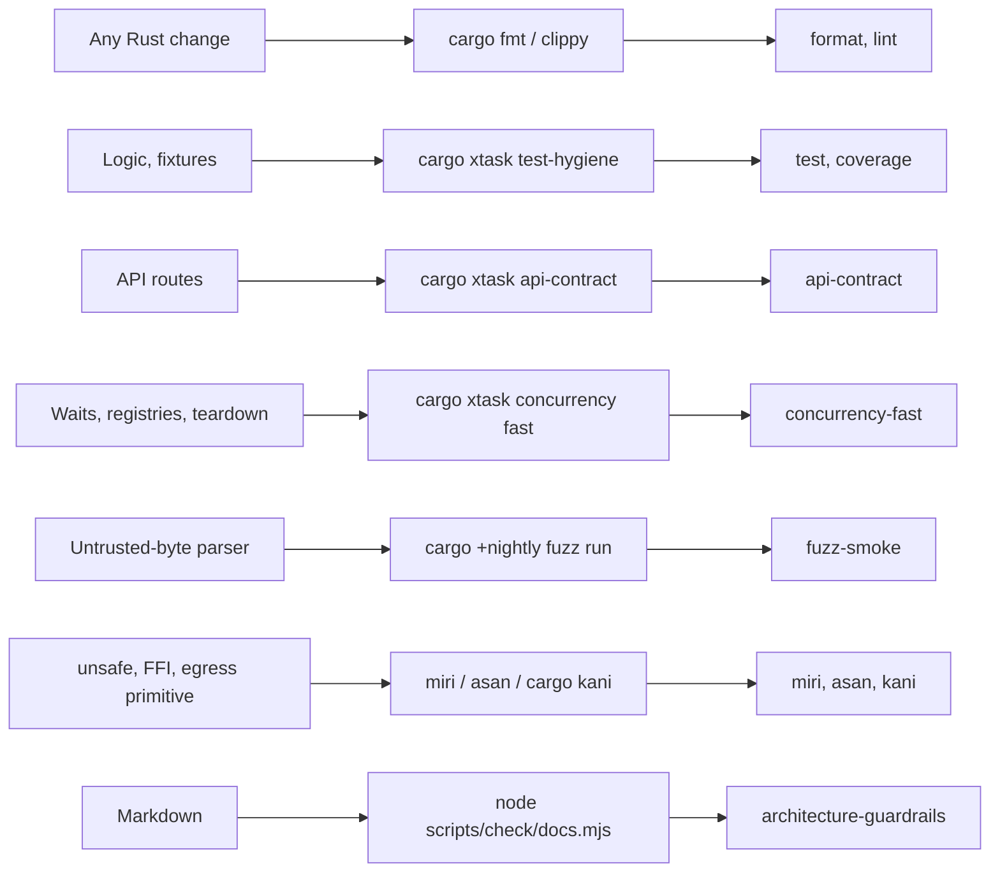
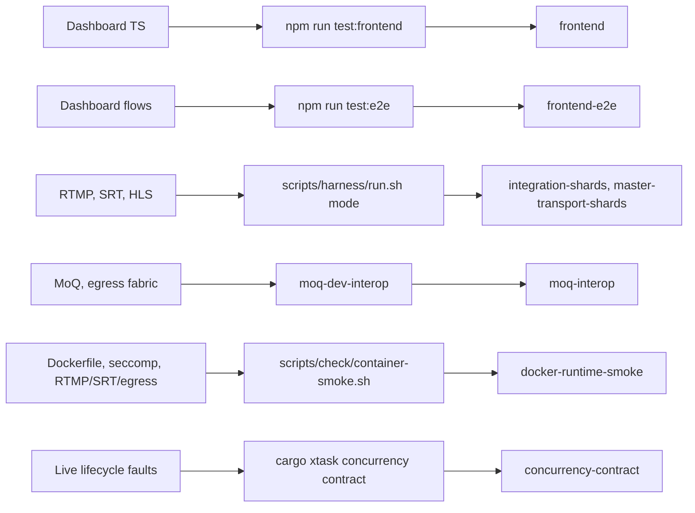

# Testing

Run the smallest gate that proves the changed behavior. Then widen it to the
boundary the change crosses. This page maps each change type to its local
check and to the CI job that enforces it (`.github/workflows/ci.yml`).

## Contents

- [Gates by change type](#gates-by-change-type)
- [Rust test suite](#rust-test-suite)
- [Frontend tests](#frontend-tests)
- [Parallelism policy](#parallelism-policy)
- [Scoped verification loop](#scoped-verification-loop)
- [Evidence and generated inventories](#evidence-and-generated-inventories)
- [Live integration tests](#live-integration-tests)
- [Capability gates](#capability-gates)
- [Container runtime smoke](#container-runtime-smoke)
- [SRT egress qualification](#srt-egress-qualification)
- [Why two test tiers](#why-two-test-tiers)
- [Stage boundary proof map](#stage-boundary-proof-map)
- [Frontend boundary proof map](#frontend-boundary-proof-map)
- [Regression artifacts](#regression-artifacts)

## Gates by change type

The first diagram shows the source-level gates: change type, local check,
then CI job.



The second diagram shows the gates that run the real binary or browser.



| CI job (name) | Runs | When |
|---|---|---|
| `format` (Source formatting and TS types) | `cargo fmt --all --check`, `npx tsc -p tsconfig.json --noEmit`, `scripts/check/agent-worktree-frontend-deps.sh` | every run |
| `lint` (Rust lint) | `cargo clippy` for the lib, all targets, and the MCP features; the MCP feature `cargo check` matrix; agent tests with and without the agent plane | every run |
| `architecture-guardrails` (Source architecture audit) | `cargo xtask source-audit`, `node scripts/check/docs.mjs` | every run |
| `test` (Rust unit hygiene and fixtures) | `cargo xtask test-hygiene` (runs `cargo test --workspace`, then scans for noise), `cargo xtask fixture-discipline` | every run |
| `coverage` (Workspace coverage report) | `cargo llvm-cov --workspace`; uploads to Codecov; never fails on a percentage | after `test` |
| `api-contract` (API contract smoke) | `cargo xtask api-contract` | every run |
| `frontend` (Frontend unit) | `npm run test:frontend:coverage` | every run |
| `frontend-e2e` (Frontend app E2E) | `npm run test:e2e` in Chromium | after `frontend` |
| `concurrency-fast` (Concurrency fast proof) | `cargo xtask concurrency fast`, `cargo test --test egress_scheduler_shape` | after `api-contract` |
| `concurrency-contract` (Concurrency live lifecycle proof) | `cargo xtask concurrency contract` with `--no-netns` | `master` only |
| `fuzz-smoke` (Parser fuzz smoke) | every target in `fuzz/` for 30 s | after `test` |
| `miri` (Miri) | `cargo +nightly miri test --lib` over `MIRI_FILTERS` | after `test` |
| `kani` (Kani) | `cargo kani --lib -Z stubbing`; expects `KANI_PROOFS` (7) proofs and every cover satisfied | after `test` |
| `asan` (AddressSanitizer) | `cargo +nightly test -Zbuild-std` over `ASAN_FILTERS` | after `test` |
| `integration-build` (Transport live-harness build) | `cargo xtask build-bench`; uploads `restream` and `test_harness` | after `test` |
| `integration-shards` | `mixed.live.srt.h264.a1.bf0`, `mixed.live.rtmp.h264.a1.bf0`, `direct-play` | not on `master` pushes |
| `master-transport-shards` | the H.264/H.265 SRT shapes, two RTMP shapes, `srt-crypto-matrix`, `fault.resilience`, `direct-play` | `master` pushes |
| `moq-interop` (MoQ interop) | `moq-dev-interop --browsers` | `master`, manual runs, and pull requests that touch `src/**moq**`, `src/media/egress/`, `scripts/dev/moq/`, `test/e2e/moq/` or `ci.yml` |
| `docker-runtime-smoke` | `scripts/check/container-smoke.sh` on a source-built image | when the diff touches the Dockerfile, release/build scripts, `distribution/`, `tests/seccomp_profile.rs`, RTMP, SRT or egress sources |

`nightly-full-certification.yml` adds `cargo test --workspace --all-features`,
a nightly container smoke and the broad harness shard matrix. The workflow
files are the source of truth for shard lists.

## Rust test suite

```sh
cargo xtask test-hygiene        # the CI gate: full suite plus noise scan
cargo xtask fixture-discipline  # fixture-first media discipline
cargo test                      # full suite without the noise scan
```

Passing runs stay quiet. Do not land compiler warnings, panic text, FFmpeg
probe chatter or other "expected noise". Fix or suppress it in the helper.

### Parser fuzz targets

`fuzz/` holds cargo-fuzz targets for the parsers that read untrusted bytes.
Each calls production code. Private parsers are reached through
`media::rtmp::fuzz_entry`, `media::egress::fuzz_entry` and
`media::moq_fuzz_entry`; these exist only under `--cfg fuzzing`. The
vendored moq-net's wire codecs are reached through its `fuzz` feature
(`moq_net::fuzz`).

| Target | Input | Production code |
|---|---|---|
| `flv_video_tag` | RTMP ingest video tag | `classify_flv_video_packet`, `flv_avcc_config_annexb_parameter_sets`, `parse_flv_video_meta` (SPS) |
| `flv_audio_tag` | RTMP ingest audio tag | `parse_flv_audio_meta` (AudioSpecificConfig) |
| `avcc_annexb` | H.264 from either ingest | `parse_avcc_config`, `avcc_to_annexb`, `annexb_to_avcc`, `build_avcc_sequence_header` (must read back) |
| `hevc_enhanced_rtmp` | HEVC Annex-B from SRT ingest | `build_hevc_enhanced_rtmp_sequence_header`, coded-frame packer |
| `rtmp_server_responses` | destination server bytes after the handshake | `RtmpSessionCore::handle_server_input` |
| `rtmp_client_requests` | publisher bytes after the handshake | ingest `ServerSession::handle_input` with the message-size limit |
| `ts_demux` | SRT ingest MPEG-TS, sync-forced or raw | `TsDemuxer` (PAT/PMT, PES, `mpegts_probe`) |
| `http_response` | HLS PUT destination response, split into reads | `http1::ResponseReader` (result must not depend on read splits) |
| `hls_playlist` | HLS push ingest m3u8 body; first byte picks the path depth | `hls_ingest::playlist::parse` |
| `fmp4_ingest` | HLS push ingest fMP4: 2-byte init length, init segment, then one media segment in 4 KiB chunks | `fmp4::boxes`, `Fmp4Demux::check_init`, `apply_init`, media segment demux |
| `moq_ingest` | MoQ ingest: 2-byte catalog length, hang/MSF catalog, then frames | upstream MSF consumer, `from_hang_catalog`, `TrackSet::new`, `IngestTrack::push` (LOC/legacy timestamps, NAL units, AAC, CMAF fragments) |
| `moq_wire` | MoQ session bytes: a draft and message-type selector, then the body | vendored moq-net IETF (drafts 14-22) and moq-lite control/object codecs, moq-lite announce-stream prefix compression (decoded value must re-encode to itself) |

```sh
cd fuzz
./seed-corpus.sh   # seeds ts_demux, http_response, hls_playlist, fmp4_ingest, moq_ingest, moq_wire
```

`moq_wire` seeds come from `moq_net::fuzz::seeds()`, written by the small
`fuzz/moq-seeds` crate so seeding does not build restream.

```sh
cargo +nightly fuzz run <target> -- -max_total_time=60
```

CI runs every target from `cargo +nightly fuzz list` for 30 s
(`-timeout=5`). A crash becomes a regression unit test next to the parser
before the fix lands.

### Miri and AddressSanitizer

Two narrow memory-safety jobs. Neither runs the whole suite: Miri cannot run
FFmpeg, io_uring or sockets, and the linked FFmpeg is not ASan-instrumented.

| CI job | Modules | Why |
|---|---|---|
| `miri` | `media::egress::tls::ktls::tests::ancillary`, `egress::leaf_arena`, `egress::scheduler`, `codec::bits` | the kTLS cmsg parser is project `unsafe`; the rest run fast under Miri and check std and dependency use |
| `asan` | `media::avio`, `egress::tls`, `egress::backends::compio_tcp`, `external_transcoder`, `timing`, `rtmp::listener`, `rtmp::tests`, `tcp_stats`, `runtime_info` | Rust-side use of FFmpeg, kTLS and socket memory; leak detection off (FFmpeg keeps process-lifetime allocations) |

Both jobs first run `scripts/ci/require-test-filters.sh`. It fails when a
filter selects no test, so a renamed module cannot drop out silently.

```sh
MIRIFLAGS=-Zmiri-disable-isolation PROPTEST_CASES=8 \
  cargo +nightly miri test --lib -- media::egress::tls::ktls::tests::ancillary media::egress::leaf_arena
RUSTFLAGS=-Zsanitizer=address ASAN_OPTIONS=detect_leaks=0 \
  cargo +nightly test -Zbuild-std --target x86_64-unknown-linux-gnu --lib -- media::avio
```

`ring_buffer` and `egress::journal` are not in Miri: they are too slow there
and have no project `unsafe`. When a module gains `unsafe` or an FFI call,
add it to the matching job.

### Kani proofs

Rung 4 of the [assurance roadmap](assurance-roadmap.md): bounded model checks
of production functions. The `kani` job runs them with Kani 0.68. Each proof
sits in a `#[cfg(kani)] mod kani_proofs` beside its code.

| Primitive | Proof | Property |
|---|---|---|
| `egress::leaf_arena` | `a_key_resolves_exactly_while_its_leaf_is_live` | over any 4 inserts, reserves, fills and removals: a key resolves exactly while its leaf is live; `len` equals the live count and stays within capacity |
| `egress::scheduler::ReadyQueue` | `pushes_and_pops_are_fifo_once_per_key_at_capacity_{one,two}` | any order of pushes and pops over fixed keys: FIFO, each key queued at most once, `AlreadyQueued` and `Full` exactly when due |
| `egress::scheduler::ReadyQueue` | `removing_the_{older,newer}_leaf_never_leaves_it_queued` | a removed leaf's key is never a member again; the other keeps its place |
| `egress::policy::WorkBudget` | `a_visit_never_takes_more_than_its_budget`, `debits_saturate` | a visit never exceeds its unit or byte limit; debits saturate (`Instant::now` is stubbed) |

Bounds are small because CBMC also models the std containers. Symbolic keys
that reach `VecDeque` copies and `retain` exhaust memory, so the
`ReadyQueue` proofs keep keys concrete and make the operation choice
symbolic. Unit tests cover `pop` skipping a stale entry. `kani::cover!`
statements show each proof reaches its interesting branches; the job fails
if one is unsatisfiable. Kani builds abort on panic, so the `panic = "abort"`
guard in `src/lib.rs` skips `cfg(kani)`. A new proof raises `KANI_PROOFS` in
the job.

```sh
cargo install --locked kani-verifier --version 0.68.0 && cargo kani setup
cargo kani --lib -Z stubbing --harness a_key_resolves_exactly_while_its_leaf_is_live
```

## Frontend tests

Three layers. Use the lowest one that can catch the bug.

| Layer | Proves | Command |
|---|---|---|
| TypeScript logic | parsing, helpers, API choke points, stream clients, workspace models | `npm run test:frontend` |
| App in a browser | login, navigation, playback, network wiring against an isolated app | `npm run test:e2e` |
| Backend media path | the preview segments the browser plays | `cargo test hls_fmp4`, `cargo bench --bench hls_fmp4_cost` |

- `npm run test:frontend` runs the Node suites from a sourcemapped build of
  `web/ts/**`, then a smaller smoke pass over the shipped `public/js/**`.
- `npm run test:frontend:coverage` is the same split with coverage mapped to
  the TypeScript modules. The `frontend` job runs it. Like the Rust
  `coverage` job, it reports and never fails on a percentage.
- `npm run test:frontend:js-smoke` checks only the compiled `public/js/**`.
- `npm run test:e2e` builds the debug app and frontend, seeds a checked-in
  multi-audio fixture into `.local/e2e/`, waits for `/healthz`, runs
  Playwright and stops only the app it started. Do not start a dashboard
  first.

### Property and interleaving tests

For pure state derivation and stale-callback guards, add a
[fast-check](https://github.com/dubzzz/fast-check) property instead of one
more hand-picked case.
`test/frontend/frontend-log-stream-interleaving.property.test.mjs` replays
random interleavings of `sync()` calls and `EventSource` events against
`core/log-stream.ts`. It asserts the guard `source !== openedSource` never
lets a stale event reach `onLog`.

Before you trust a new property, break its invariant on purpose. Confirm it
fails with a shrunk counterexample, then revert.

## Parallelism policy

- Rust tests: one `cargo test` at a time per worktree. Cargo owns compile
  parallelism (`.cargo/config.toml`, `jobs = -1`). On a small host, set
  `RUST_TEST_THREADS=N` and `CARGO_BUILD_JOBS=N`.
- Live correctness modes may run in parallel when each has its own network
  namespace and work directory.
- Measurement modes run serially from `target/bench/` only.
- Criterion: parallelize `cargo bench --no-run`, not timed runs.

## Scoped verification loop

```sh
cargo test --lib <filter>
cargo test --test api <filter>
cargo test --test transcoder <filter>
cargo bench --bench <bench> -- <criterion-filter>
cargo bench --bench high_performance_data_path -- data_path/egress_progress
cargo bench --bench srt_ingest_latency -- 'srt_(ingest|egress)'
```

`srt_ingest_latency` is a socket-pair microbenchmark, not a pipeline test. It
compares `srt_ingest/{plain,aes128,aes192,aes256}/recv_path` and
`srt_egress/.../send_path`, each moving 8 live-mode packets of 1316 bytes per
iteration; only the key length changes.

Widen to the full suite, full benches or live modes when a change crosses
modules, changes a shared contract, touches protocol behavior or a hot path
with unclear reach. Report unrelated failures separately.

### Composable verification stages

| Stage | Purpose | Typical command |
|---|---|---|
| 0 Preflight | environment and cheap invariants | `cargo fmt --all --check`, harness `--preflight` |
| 1 Changed behavior | the touched code path | `cargo test --lib <filter>` |
| 2 Contract slice | neighbouring API, graph, protocol or lifecycle contracts | filtered tests by module, endpoint or protocol |
| 3 Hot-path cost | the touched Criterion group | `cargo bench --bench <bench> -- <filter>` |
| 4 Live protocol slice | one live topology | `target/bench/test_harness mixed.live.srt.h264.a1.bf2` |
| 5 Scale slice | bounded ramp, restart, queue pressure or bonding | small `N_OUTPUTS` ramp, `bonding` |
| 6 Full gate | release pass assembled from the stages above | full `cargo test`, benches, live modes |

Split a growing suite along behavior, protocol, codec shape, topology, load
shape or evidence type. Add selectors and result artifacts, not a new
all-or-nothing command.

## Evidence and generated inventories

This page does not copy counts or snapshots. Use the owner:

- routes: `PUBLIC_ROUTE_PATHS` and `AUTHENTICATED_ROUTE_PATHS` in
  `src/api/router.rs`, checked by `tests/api.rs`;
- Rust tests: `cargo test -- --list`;
- coverage: `npm run test:frontend:coverage` and the `coverage` job;
- performance: the measured commit's message and CI artifacts.

## Live integration tests

The manifest catalog under `test/harness/` is the source of truth for modes.
Ask the binary for it, and run modes through the wrapper, which rebuilds
stale binaries:

```sh
scripts/harness/run.sh --prepare
target/bench/test_harness catalog help
scripts/harness/run.sh <mode>
scripts/harness/run.sh <mode> -- --no-netns
```

Modes use a private loopback namespace by default. Use `--no-netns` only when
the host cannot create one or the test needs a host service. Never build
while Restream, MediaMTX or FFmpeg live processes run.
`MIXED_OUTPUT_GROUPS` (comma-separated row ids such as
`rtmp.720p.a0,rtmp.720p.a1`) limits a mixed matrix to a few rows.

### Choosing a live proof

| Change | Mode |
|---|---|
| protocol or codec behavior | one matching mixed RTMP/SRT scenario |
| multi-input promotion | `fault.resilience` (10 s GOP; cached replay within 5 s) |
| teardown or recovery | the matching `fault.*` mode or `recovery` |
| HLS, recording, file ingest | a scenario whose plan has that sink |
| HLS push/pull ingest, executor isolation | `hls-push-duty` |
| MoQ egress, origin, ingest, or the egress fabric | `moq-dev-interop` |
| MoQ delivery under loss, startup and A/V skew | `moq-impairment` |
| broad regression | a catalog suite, after the scoped mode passes |
| performance or capacity | a measurement workflow, serial, bench profile |

### HLS push ingest isolation (`hls-push-duty`)

`hls-push-duty` checks that HLS ingest does not degrade RTMP/SRT ingest and
egress. One bench-profile Restream runs arms that differ only by the HLS
addition. Every pipeline sends to its own in-process RTMP sink, which checks
video, audio, a keyframe and monotonic DTS. An HLS push pipeline also fails
when its mean MEDIA poll CPU exceeds an empirical 250 µs regression
threshold. This threshold was calibrated on the TS workload and host class
in the change's commit evidence; it is not a portable per-poll work bound.
Pending polls dilute the mean, and hardware speed and host stalls affect it.
Missing, reset or empty executor measurements fail the check.

| Option | Default | Meaning |
|---|---|---|
| `--base-publishers N` | `2` | RTMP publishers, one sink output each (baseline arm) |
| `--hls-publishers N` | `0` | HLS push pipelines, one FFmpeg `-f hls` each |
| `--pull-sessions N` | `0` | `hlsPull` pipelines of a `pull-source` pipeline's preview |
| `--segment-type ts\|fmp4` | `ts` | container the HLS arm pushes |
| `--method put\|post` | `put` | upload method |
| `--duration-secs N` | `12` | rated window after every input publishes |
| `--segment-secs N` | `2` | `-hls_time` |
| `--poll-usage` | off | sets `RESTREAM_MEDIA_POLL_USAGE=1` |
| `--host-probe` | off | run the host-stall probe on 1 ms in 4 ms for the rated window |

```sh
scripts/harness/run.sh hls-push-duty
scripts/harness/run.sh hls-push-duty -- --hls-publishers 4 --segment-type fmp4
scripts/harness/run.sh hls-push-duty -- --pull-sessions 4 --duration-secs 60
```

`.local/artifacts/hls-push-duty/report.json` holds, per pipeline:
`publishedPackets`, `input`, `egress` (resyncs, `stalled`, overflows, drops),
`windowDelivery` (`mediaRatio` = media time over window time) and
`executor` (window polls and CPU). It also holds the raw `mediaExecutor`
snapshot (see
[observability](observability.md#media-executor-mediaexecutor)),
`egressShards`, `pollCpu` per executor class, `hostMemory` (vmstat, cgroup
`memoryEvents`, THP modes) and `environment.cpuCount`. With `--host-probe`,
`hostProbe` carries the probe thread's samples, gaps above 1 ms, maximum
wall and thread-CPU gaps, and longest wake delay. These are contextual raw
measurements, not evidence that any particular application poll was delayed
by the host. Executor maxima/percentiles cover service lifetime, whereas the
probe covers only the rated window. Its nominal 1 ms spin / 4 ms sleep cycle
costs about 20% of one core and misses gaps outside spinning windows.
Requested probe startup, clock or thread-join failures invalidate the run.

### MoQ interop

`moq-dev-interop` proves moq-lite-06 with hang by default, and explicit
MOQT draft-19 with MSF/LOC under `--ietf`, using `moq-net` 0.3.15 and the
tools from commit `e2c5b505`: `moq` (moq-cli 0.14.7), `moq-relay` 0.17.7.
`scripts/dev/moq/fetch-moq-dev.sh` downloads them, checks the SHA256 and
installs `.local/bin/moq-0.14.7` and `.local/bin/moq-relay-0.17.7`. The mode
refuses another `--version`. `MOQ_DEV_INTEROP_MOQ_BIN` and
`MOQ_DEV_INTEROP_RELAY_BIN` override the paths, not the versions.

```sh
scripts/dev/moq/fetch-moq-dev.sh
scripts/harness/run.sh moq-dev-interop -- --no-netns
scripts/harness/run.sh moq-dev-interop -- --no-netns --ietf
(cd test/e2e/moq && npm ci && npx playwright install chromium firefox)
scripts/harness/run.sh moq-dev-interop -- --no-netns --browsers
```

Headless Firefox plays audio only through an audio server. Start a
PulseAudio null sink first (CI does):

```sh
pulseaudio -D --exit-idle-time=-1
pactl load-module module-null-sink sink_name=moq_null && pactl set-default-sink moq_null
```

Each run makes a CA and an ECDSA P-256 leaf with `openssl`. Restream's MoQ
listener (`RESTREAM_MOQ_INGEST_LISTEN`, `RESTREAM_MOQ_TLS_CERT`,
`RESTREAM_MOQ_TLS_KEY`) serves ingest and the origin. Restream output URLs
pin `version=moq-lite-06` or `version=moqt-19`; CLI/log spelling for the latter
is `moq-transport-19`. Every CLI dial offers only the selected version over
QUIC; IETF exports select MSF without hang fallback. Both catalogs advertise
the same LOC media.

| Phase | Path | Key checks |
|---|---|---|
| Egress | RTMP publish → pipeline → `moqt://…/?broadcast=live/egress.hang&version=<alpn>` → moq-relay, plus an RTMP sibling | `egressRelayCatalog` (MSF/LOC under `--ietf`), `egressRelayVersion`, `egressReadBack` (`moq export ts`, ≥ 20 s, H.264 + AAC, monotone PTS) |
| Origin | `POST /api/v1/pipelines/<id>/moq-token`, then `moq export ts` from Restream's listener | `originReadBack`, `originRefusesNoToken`, `originRefusesBadToken` |
| Browsers (`--browsers`) | Playwright Chromium and Firefox play origin and relay with `@moq/watch` | `browser-<chromium\|firefox>-<origin\|relay>`, `browser-<…>-origin-no-token` |
| Isolation | moq-relay SIGKILLed, restarted 3 s later | `isolationMoqReconnected` (≤ 60 s), `isolationRelayVersion`, `isolationSiblingUninterrupted`, `isolationReadBackAfterReconnect` |
| Ingest | `ffmpeg … -f mpegts - \| moq … import ts` into Restream → RTMP output to an FFmpeg server | `ingestMoqSession`, `ingestReadBack` |
| IETF ingest (`--ietf`) | RTMP-fed source pipeline → draft-19 MSF/LOC output → dedicated moq-relay → draft-19-only `--cluster-connect` into Restream ingest → RTMP read-back | `ingestRelayMsfLocCatalog`, `ingestRelayVersion`, `ingestMoqSession`, `ingestReadBack` (≥ 8 s). No CLI export/re-import media bridge; port override `MOQ_DEV_INTEROP_INGEST_RELAY` |

The browser specs live in their own package, `test/e2e/moq/` (`@moq/watch`
0.6.3, `@playwright/test` 1.63.0, Vite 8.3.2, `*.moq.ts`), so the frontend
suite never collects them. A browser test needs protocol
`moq-lite-06/webtransport`, ≥ 150 decoded frames, a repainting canvas and
≥ 5 s of decoded audio. A Firefox too old for moq-lite-06 is reported as a
`fallback` row, never a pass or a failure. Safari is a manual check: serve
the spec page (`npx vite --config vite.config.ts --port 5180` in
`test/e2e/moq`), forward it to a Mac over SSH, and record the Safari version
and result in the pull request.

The actual control-room preview is a separate application E2E:
`test/frontend/control-room.spec.ts`, test `program preview over MoQ`.
Root Playwright projects `chromium` and `firefox-moq` run it (Firefox is
scoped to this test). It checks decoded canvas content and persisted
transport selection. After building frontend assets and `target/debug/restream`:

```sh
RESTREAM_E2E_SKIP_BUILD=1 scripts/harness/frontend-e2e.sh --grep 'program preview over MoQ'
```

`.local/artifacts/moq-dev-interop/` (or `moq-dev-interop-ietf/`) holds
`report.json`, relay sessions, logs, CLI captures with FFprobe JSON, and
`browser/` (Playwright report, traces, screenshots). CI's `moq-interop` job
runs lite/browser and IETF modes using the same pinned tools and uploads both.

### MoQ impairment (`moq-impairment`)

`moq-impairment` is the protocol-under-impairment evidence beside the browser
E2E, which it does not replace. It is **manual evidence, not a CI job**: no
workflow runs it, and the browser E2E remains the product proof. An RTMP
publisher feeds one Restream pipeline whose `moqt://` output publishes
`live/impairment.hang` to the pinned moq-relay 0.17.7. Once the relay serves
the catalog, the mode puts a `netem` qdisc on loopback (2 % loss and 200 ms
delay in each direction, about 400 ms RTT) with filters for the relay's UDP
port in both directions, then runs the headless `moq_subscriber` over the
production moq-net/hang path (native QUIC, hang catalog, the same
`transport::connect` and `Client::connect` as the egress leaf and origin).
The chosen path is the relay: it is the production `moqt://` egress and needs
no origin token. `moq-dev-interop` still covers the Restream-direct origin
path and the browser playback unchanged.

```sh
scripts/dev/moq/fetch-moq-dev.sh
scripts/harness/run.sh moq-impairment
```

The mode requires the default private network namespace with
`CAP_NET_ADMIN` for `tc`; `--no-netns` fails instead of silently skipping the
impairment. `MOQ_IMPAIRMENT_SUBSCRIBER_BIN` overrides the subscriber path (it
otherwise sits next to the harness binary). SIGINT/SIGTERM/SIGHUP route
through a bounded 30 s teardown that kills the relay, Restream, publisher and
subscriber, removes the `tc` tree and lets the private namespace go away;
SIGKILL of the harness cannot be handled and can still orphan children.

The subscriber prints one JSON object (also kept in the mode report):

| Field | Meaning |
|---|---|
| `startupDelayMs` | catalog-ready publishing to the first delivered frame (either track) |
| `videoFrames`, `keyframes`, `videoBytes` | delivered video groups/frames |
| `audioFrames`, `audioBytes` | delivered audio frames and their payload bytes |
| `p95AbsSkewUs`, `maxAbsSkewUs`, `skewSamples`, `skewMatchToleranceUs` | A/V arrival skew: the wall-clock gap between video and audio delivering the same media instant (matched within 25 ms), after a 2 s join warmup; the p95 is the gate, the max is evidence |
| `connected`, `connectionMs`, `catalogMs`, `alpn`, `error` | transport/protocol context |

It exits `0` after the watch window however few frames arrived, `2` for a
rejected invocation (arguments, URL, ALPN, CA path or CA PEM) before
connecting, and `3` for a runtime, connection or protocol failure, still
printing the partial counts. The mode asserts `videoFrames > 0`,
`keyframes > 0`, `audioFrames`/`audioBytes > 0`, `p95AbsSkewUs <= 500 000`
(500 ms) and `startupDelayMs <= 10 000` (10 s). The 500 ms p95 bound is
empirical for this impairment profile, not a sustained-delivery guarantee:
with 2 % loss and 200 ms delay each way a retransmission can delay one
track by most of a recovery interval, so the maximum skew is reported but
not gated. Arrival skew pairs frames by media time, so a stalled frame
produces no pair rather than an unbounded skew claim; the frame counts carry
the delivery verdict. The subscriber prints its JSON even on a runtime
failure, so partial counts survive. `.local/artifacts/moq-impairment/` holds
`report.json`, `restream.log`, `moq-relay.log`, `publisher.log`,
`subscriber.log` and the generated TLS material; the harness also writes
`.local/artifacts/moq-impairment.json`.

`moq-relay-interop` targets unmodified MediaMTX v1.21.2
(`scripts/dev/moq/fetch-mediamtx.sh`, `MOQ_INTEROP_MEDIAMTX_BIN`).
It is diagnostic-only, not run by CI or suites: the SETUP, namespace and
LOC/MSF dialect mismatches are source/spec-evidenced in
[Q-091](backlog.md#q-091-protocol-opus-align-mediamtx-moq-dialect-with-ietf-interop).
Use `moq-dev-interop --ietf` for the supported IETF gate; do not fork a
MediaMTX-specific profile.

### MoQ through moxygen (`moq-moxygen-interop`)

`moq-moxygen-interop` checks Restream's IETF egress against moxygen, an
independent C++ MOQT implementation. moxygen publishes no release binaries,
so `scripts/dev/moq/build-moxygen.sh` builds `moqrelayserver` from a pinned
commit with moxygen's own getdeps and installs
`.local/bin/moxygen-<commit>/moqrelayserver` with a `.commit` stamp; the
mode refuses another stamp. `MOQ_MOXYGEN_RELAY_BIN` overrides the path, not
the commit. The script documents its host workarounds (CMake 4 policy floor,
C17 for libunwind, a pinned liburing for folly); none of them touch moxygen.
It is **manual evidence, not a CI job**: the build takes 30-60 minutes.

For each draft moxygen supports (16 and 18), one relay offers only that
draft, and one RTMP-fed pipeline has one `moqt://` output per relay with the
matching `version=moqt-NN`. Each relay log must show the draft negotiated
and the broadcast's PUBLISH_NAMESPACE accepted (`dNNRestreamPublish`). The
pinned `moq` CLI then reads the broadcast back through moxygen on the same
draft (MSF catalog, LOC media), and FFprobe checks H.264/AAC, monotonic
timestamps and the frame rate over at least 10 s (`dNNReadBack`).

```sh
scripts/dev/moq/fetch-moq-dev.sh
scripts/dev/moq/build-moxygen.sh
scripts/harness/run.sh moq-moxygen-interop -- --no-netns
```

`.local/artifacts/moq-moxygen-interop/` holds `report.json`, the relay,
Restream and publisher logs, and the CLI captures with their FFprobe JSON.
Port overrides: `MOQ_MOXYGEN_INTEROP_D16`, `MOQ_MOXYGEN_INTEROP_D18`.

### Transport CI tiers

- Pull requests: `integration-shards` (one SRT smoke, one RTMP smoke whose
  matrix has an RTMPS row, `direct-play`) and `concurrency-fast`. Missing
  kTLS fails the capability preflight; it never falls back to userspace TLS.
- `master` pushes: `master-transport-shards` and `concurrency-contract`
  (`fault.resilience`, `fault.egress-retry`, `fault.output-stall`,
  `fault.srt-output-stall`, `recovery`). `fault.resilience` also proves
  RTMPS delivery, sink loss
  reaching `retrying`, and SIGTERM shutdown with `restream.shutdown.completed`
  within 5 s.
  `fault.egress-retry` reads effective retry/backoff and reconciliation
  tuning from the product startup log before testing the retry budget.
  Misspelled or ignored overrides fail instead of silently exercising
  production defaults.
- Nightly: file and live matrices, crypto, bitrate sweeps, ramps, resource
  sweeps and fault modes. Artifacts upload on every result.
- Artifact retention: pull-request shards 3 days and `master` shards 7 days,
  on failure or cancel.

A capability failure means the runner cannot qualify that transport. Do not
skip it or swap transports. RTMPS ingest is not in the product contract; the
RTMPS leg is RTMP ingest → Restream → RTMPS egress.

### Fixtures and artifacts

Resolve committed media through `src/test_fixtures.rs`; add new assets to that
contract. Runs write under `.local/artifacts/<run>/` (manifest, results,
logs, probes). These are evidence, not source: never commit them.

## Capability gates

Treat these as test results, not assumptions.

| Capability | Gate |
|---|---|
| RTMP H.264/AAC ingest and egress | `target/debug/test_harness timestamp.bframe` |
| SRT H.264 and H.265 ingest/egress | full correctness matrix |
| H.265 SRT passthrough, H.265 → RTMP | `mixed.live.srt.h265.a1.bf2` |
| SRT → RTMP | `mixed.live.srt.h264.a1.bf0` |
| Built-in presets (`h264`, `720p`, `1080p`) | `tests/transcoder.rs` |
| Other video presets | must be profiled and matrix-tested before they are advertised |
| Linked FFmpeg features | `scripts/build/app-static.sh` runs `restream-ffmpeg-capabilities` |
| HLS live segments | native TsMuxer validated in memory |
| HLS upload egress | unit tests plus the `mixed.live.srt.h264.a1.bf2` HLS PUT probe |
| Recording | readable file with correct streams and timestamps |
| Audio remap/downmix | channel filtering implemented; full audio-content matrix still required |
| Custom encoding | runtime output selection stays rejected until a backend applies custom args |
| Bonded SRT ingest | broadcast and backup bond tests |

## Container runtime smoke

`scripts/check/container-smoke.sh` tests the shipped image:

1. non-root user and the no-mount health contract;
2. real SRT egress under `distribution/docker/restream-seccomp.json`;
3. an H.264 RTMP publisher through the image to RTMPS egress, checked at the
   sink by the mixed live harness.

It also records what the engine's default seccomp profile does, as a
negative control (the expected `io_uring` denial never fails the run). It
needs `cargo xtask build-bench`. `--diagnostic-unconfined` adds a
troubleshooting control, never a deployment setting.
`tests/seccomp_profile.rs` pins the profile to the Moby baseline plus the
`io_uring` delta.

## SRT egress qualification

`scripts/harness/srt_final_qual.py` runs the SRT Owner qualification
(fanout points, connect bursts, `srt.slow-peer`, frozen destination) and
derives gates; `scripts/harness/test_srt_final_qual.py` tests it.

For a frozen-destination attribution campaign, build with
`cargo xtask build-release`, then run (under the host measurement lock):

```sh
flock -x /tmp/restream-host.lock python3 scripts/harness/srt_final_qual.py frozen \
  --variant candidate --tag frozen-attribution --out .local/artifacts/srt-attribution \
  --attribution
```

The frozen driver defaults to `target/qual-release/{restream,test_harness}`;
`--restream-bin` and `--harness-bin` permit explicit binaries (including an
exec-style allocation-profiler launcher that preserves the child PID).
`--variant` is a report label only, not a binary selector. Each tag must be
new. The campaign saves raw smaps/rollup, thread names, socket FD
inodes and UDP tables, existing retained-ring and SRT Owner telemetry, harness
stdout/stderr, and wall-clock phase markers through live progress, SIGSTOP,
retry, output stop, pipeline deletion and intentional capture completion.
Receiver-side MediaMTX byte growth is required before freezing. Missing/zero
gate RSS is unavailable and fails; the artifact includes both read errors and
nullable values, never a zero substitute. Exit zero alone is insufficient:
the named frozen subtest must pass with available/bounded RSS, matching
positive `rssBeforeStallKb`/`rssAfterStallKb` endpoints and the unchanged
64 MiB limit. Missing reports and legacy endpoint keys are rejected.
Missing attribution or process samples fail the driver as well. Ordered phase
markers and samples must cover live progress before SIGSTOP and the full
120-second retry observation, through `capture-complete` before intentional
process shutdown. Phase proximity and consecutive capture gaps may not exceed
two sampling intervals (2 seconds at the default 1 Hz). Late discovery,
truncated sampling, sampler failure and observed process disappearance before
capture completion fail; expected shutdown afterward does not. A timed-out
harness runs in its own process group, which is terminated and then killed
before sampler join and the final process census.
RSS/smaps and ring payload alone cannot separate live heap from allocator
retention; pair them with an allocation profiler before making that claim.
The 64 MiB growth limit remains unchanged pending historical attribution.

- `srt.slow-peer` pauses application delivery on one `RawSrtSink` receiver
  while protocol timers keep running. Healthy siblings must keep progressing.
  `SLOW_PEER_EXACT_OWNER=1` also requires one shared IPv4 Owner.
- `srt.admission` caps each pool at `ADMISSION_SHARDS` (default 1) and fans
  one 8 Mbit/s feed to `ADMISSION_OUTPUTS` (default 96 per shard). Refused
  outputs report `capacityRefused` and send nothing; admitted outputs
  progress; no `egress-shard-<n>` thread reaches 62% busy.

## Why two test tiers

Restream has two correctness tiers. Benchmarks are measurement, not a tier.

1. **Unit and component tests** (`cargo test`): pure logic, state machines,
   crafted bytes, bounded concurrency models. No running service.
2. **Live tests**: the real `restream` binary, driven through the HTTP API,
   with media over real RTMP, SRT, HTTP and file boundaries.

There is no in-process middle tier. It would bypass startup, API wiring,
persistence and reconciliation while still needing FFmpeg and sockets.
Malformed input belongs in unit tests near the parser; exact egress checks
belong at a harness sink that receives the binary's wire output.

| Concern | Unit tier | Live tier |
|---|---|---|
| Timestamp and DTS/PTS rules | primary proof | representative round-trip |
| Parser fault isolation | crafted bytes | process stays healthy |
| Ring math, wake/cancel order | unit, property or loom | visible lifecycle/recovery |
| API, database, reconciliation | focused handler tests | real binary over `/api/v1/*` |
| Protocol framing, interop | codec/container helpers | real traffic and readback |
| Resource shape | not a correctness claim | bench-profile measurement |

Rules:

- Prove an invariant without I/O when you can.
- Add or extend a live scenario when the invariant crosses a process,
  protocol, persistence or lifecycle boundary. Prefer enriching an existing
  run.
- Add MediaMTX or FFmpeg as a sink only when interop or decode is the
  property.
- Correctness never weakens to make a measurement pass; a passing
  correctness test is not capacity evidence.

## Stage boundary proof map

Each row is a stage boundary, its contract and the proof that enforces it.

| Boundary | Contract | Proof |
|---|---|---|
| Planner → stage runtime | planned `StageKey` and `select_backend` pick the registered runtime used by outputs, graph and status | planner and `select_backend` unit tests, HLS/recording planned-key tests, a property over generated output mixes |
| Runtime admission → registry | `ensure_stage` creates one live runtime, reuses live ones, replaces cancelled ones | stage runtime tests; `transcoder_stage_loom`, `ts_muxer_stage_loom` |
| Control runtime → media executor | media work progresses without control scheduling; dropping a control owner does not abort finalization; old HLS cleanup cannot hit a replacement | `media::executor::tests`, `while_control_thread_is_blocked`, `control_owner_abort_flushes_final_segment`, `detached_teardown_preserves_replacement`, `aborting_control_owner_closes_media_feeder_and_writer` |
| Source ring → stage input | starts at the right keyframe, emits selected media only, exits on EOS/cancel; a blocked child is reaped within the grace | `refill_pulls_the_ring_on_the_reading_thread_until_eos`, `refill_stops_on_cancel_while_waiting`, `cancelled_reap_releases_a_writer_blocked_on_a_stalled_child`, ring migration proptests and loom |
| Stage input → backend | FFmpeg gets the `FfmpegStagePlan` and startup policy; capacity waits are visible and cancellable | `build_ffmpeg_stage_plan` tests (`stage_runtime.rs`), `build_stage_ffmpeg_args` tests, `tests/transcoder.rs` |
| Backend → output normalizer | stage-local, non-negative, per-stream monotone timestamps; cached parameter sets; metrics match packets | normalizer unit tests and a proptest over interleaved packets |
| Audio router | selected tracks, prebuffer replay and EOS keep order and intent | audio-router unit tests and a reindexing property |
| HLS segmenter | planned key, no segment before init, visible keyframe/no-segment states | planned-key tests, fMP4 proptests, `hls_segment_boundaries_preserve_non_decreasing_dts_per_stream` |
| Recording writer | metadata persists before failures; stage-owned lifecycle | `recording_media_writer_failure_reports_failed_without_finalization`, mixed-harness recording identity |
| Snapshot → status/graph/alerts | non-producing `StagePhase`s surface `blockedBy` and details consistently | table-driven stage phase contract over status JSON, graph and alerts |
| Cancel/teardown → cleanup | cancel wakes waiters, stops stages, clears registries, keeps causal status | `avio_loom`, `ts_chunk_ring_loom`, `ring_migration_loom`, `cargo xtask concurrency fast` |

A new stage family, protocol boundary or runtime primitive adds a row here
first. Then pick the lowest proof layer that catches the bug
([concurrency proofing](concurrency-proofing.md)).

## Frontend boundary proof map

| Boundary | Contract | Proof |
|---|---|---|
| API client → routes | every call hits a canonical `/api/v1` route and method; multipart shape is stable | `test/frontend/frontend-api-contract.test.mjs`; `scripts/check/api-drift.mjs` in `cargo xtask api-contract` (a hard CI gate) |
| Runtime state stream | snapshot, then deltas in revision order; a gap reconnects; a silent stream is reported | `test/frontend/frontend-runtime-state-stream.test.mjs` |
| Log stream (SSE) | one connection per filter, resumed from the last id, replaced on filter change; stale events never reach the caller | `frontend-log-stream.test.mjs`, `frontend-log-stream-interleaving.property.test.mjs` |
| Workspace models | each workspace derives its view from the store and mutates through `core/api.ts` | `test/frontend/control-room-*.test.mjs` |
| App against a running engine | login, `?w=` workspaces, converging mutations, HLS previews, logs, diagnostics | `test/frontend/control-room.spec.ts` (`npm run test:e2e`) |

These must never regress silently. A change to the boundary they cover
brings an equal or stronger proof in the same change.

## Regression artifacts

| Failure class | Replay | Guardrail |
|---|---|---|
| External H.265 capacity or zero-output stall | `test/fixtures/transport/correctness-h265.ts`, `bench-h265-1_5m.ts`, `bench-h265-1_5m-2a.ts`; `mixed.live.srt.h265.a1.bf2`, `mixed.live.srt.h265.a2.bf2` | `waitingForCapacity` health/alert tests; `cargo xtask concurrency fast` |
| Low-CPU external-capacity collapse | `target/bench/test_harness resource-sweep` (output in `.local/artifacts/resource-sweep/`) | baselines in [resource sweep](resource-sweep.md) |
| Recording `.tmp.mp4` or wrong-case media selection | `cargo test media_recording_identity --bin test_harness` | API media-library tests key recordings by `pipelineId`/`recordingId` |

New failure evidence takes a durable form: a fixture registered in
`src/test_fixtures.rs`, a focused test, a harness mode writing
`manifest.json` and `results.jsonl`, or a baseline with its replay command.
